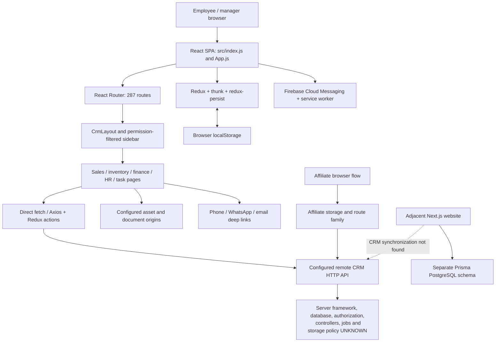
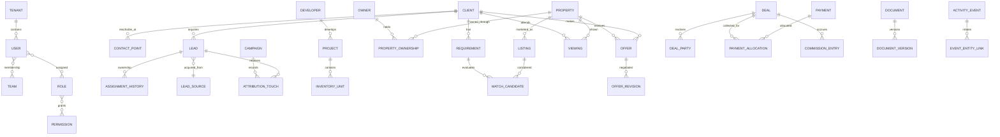

# REDBOX CRM — Phase 0 master audit, architecture map and modernization plan

**Audit date:** 30 September 2026, Asia/Karachi  
**Scope:** Existing `redboxcrm` working tree, including the recent uncommitted dashboard/navigation changes. Adjacent website inspected only to establish system boundaries.  
**Mode:** Audit, architecture and planning only. No application behavior, routes, dependencies, production URLs, schemas or records changed.  
**Decision:** Preserve and stabilize the existing CRM. Do not start a replacement application or implement the roadmap before the evidence and business decisions below are resolved.

## Reading guide

- Sections 1–3: business summary, audit coverage and current architecture.
- Sections 4–7: module overview, current journey, real-estate workflow and data model gaps.
- Sections 8–12: data quality, security, performance, technical debt, tests and warnings.
- Sections 13–17: UX, proposed navigation/design system, global search, timeline, automation and AI readiness.
- Sections 18–20: phased roadmap, explicit business decisions and first actions.
- Appendix A: detailed module inventory, including purpose, components, routes, API families, inferred entities, dependencies, status, issues, redundancies and classification.
- Appendix B: all 287 declared application routes and their source components, grouped by module.
- Appendix C: the 112 Redux action-file API inventory and API call sites outside routed module dependency trees.
- Appendix D: potentially unused source candidates, dependency observations and verification record.

## 1. Executive summary

REDBOX already has a substantial operational system: lead intake and distribution, agent assignment, customer activity, reminders, call reporting, project inventory, reservations, completed sales, customer/nominee documentation, payment schedules, receipts, financial registers, HR, task management and an affiliate channel. These are valuable business assets. Their existing identifiers, historical relationships, URLs and integrations must be preserved while the interface improves.

The main problem is uneven completeness and integration. Some screens perform real operations; others are static templates or unfinished copies. A menu entry is not proof of a working module. There are multiple interpretations of “lead,” “customer,” “deal,” “payment” and “requirement.” In particular, the purchase-requirement forms concern internal procurement, not a buyer's property requirements.

The new sidebar and home charts improve presentation and route continuity, but they do not establish server-side security, repair incomplete modules or prove compatibility with every role. The dashboard now opens the shared overview instead of the old automatic finance/HR landing behavior. That change, the suppression of legacy navigation, and all permission mappings need explicit regression acceptance before production rollout.

**The most urgent confirmed issue is a destructive action connected to the wrong business screen.** The Deal Form and Vehicle Pass list components read petty-cash records and send their Delete actions to `pettycash/{id}`. This is a code-confirmed wiring problem, not a claim that deletion has already happened. No destructive requests were made during this audit. Treat these paths as release blockers until their intended behavior is confirmed and tested.

**The largest evidence gap is the CRM server and database.** This repository is a React client. It does not contain the implementation behind its configured CRM API, database migrations, server authorization, queues or storage policies. The neighboring website has a Next.js/Prisma/PostgreSQL backend, but no inspected source bridge proves it is the backend used by this CRM. Do not label the CRM database PostgreSQL, MySQL or Laravel based on naming conventions or neighboring files.

The safest next implementation work is a small stabilization phase: characterize existing routes and permission behavior, address the confirmed wrong-resource actions, recover the backend/API/schema evidence, resolve lead-form data loss and session failure cases, and add workflow tests. Continue the design system only after those gates. Database evolution, automation and AI should be additive, reversible and tied to agreed business definitions.

## 2. Evidence, coverage and limits

### 2.1 What was inspected

| Evidence | Result / meaning |
|---|---|
| Source syntax inventory | All 534 JavaScript files parsed successfully with the installed Babel parser; 18 source CSS files also inventoried. This includes the dashboard test file. |
| Application routes | 287 unique path declarations in `src/App.js`, mapping to 222 distinct source components. Three test-only route declarations excluded. |
| API discovery | 569 active `fetch`, callable `axios`, and `axios.get/post/...` call sites across source files. These are call sites, not 569 unique server endpoints. Dynamically constructed URLs and server-only endpoints prevent a complete server API inventory. |
| Redux | 112 files under `src/redux/action`; 113 under `src/redux/reducers`, including the root reducer file. |
| Module review | All routed component groups mapped; detailed reads of authentication, permissions, lead create/edit/import/assignment, activities, reminders, inventory holds/sales, documents, financial forms, employee editing and recent dashboard changes. |
| Frontend tests, freshly run | `CI=true npm test -- --watchAll=false --runInBand`: **1 suite, 10 tests passed**. Test data is mocked; this is not backend or production acceptance coverage. |
| Fresh whole-source lint | `eslint src --ext .js --format json`: **1 error and 6,733 warnings** over 534 files. No auto-fix used. |
| Existing production build evidence | Previous-turn production build completed with warnings. Existing main JS artifact: 3,910,406 bytes raw, approximately 872,578 bytes gzip as measured locally. No fresh build was needed for this documentation-only audit; this is not a browser transfer measurement. |
| Browser evidence | During the preceding implementation, the current home charts and sidebar-to-Assigned-Leads navigation were observed in Chrome. This audit did not repeat live mutations, test every role, or extract production records. |
| Backend/database review | No CRM backend source, ORM schema, migrations or SQL dump found inside `redboxcrm`. Nearby website files were reviewed separately. |
| Preservation | Source, public assets and package/lockfiles were hashed at audit start and checked at completion. Only this report is intended to be added. Existing dirty files belong to the earlier work and were not reverted. |

### 2.2 Evidence labels

- **Confirmed:** directly visible in source or a named verification result.
- **Client-wired:** screen and request code exist; business correctness and server behavior remain unverified.
- **Partial/template:** visible UI or state exists without a complete persistence/workflow path in inspected code.
- **Inferred entity:** a business object suggested by payload fields, response relations or endpoint names. Not a verified database table, primary key, foreign key or cardinality.
- **Unknown:** requires server source, database metadata, production configuration or business confirmation.
- **Candidate:** possible redundancy/dead code; never a deletion instruction.

No load tests, penetration tests, database scans, live financial actions, record merges, uploads, message sends or production mutations were performed. No credentials or private customer records are reproduced. Secret scanning here is source-pattern review, not an exhaustive historical secret scan or a dependency CVE assessment.

## 3. Current architecture map

### 3.1 Frontend technology and structure

| Area | Observed implementation | Architectural implication |
|---|---|---|
| Runtime | React declared `^18.1.0`, locally resolved **18.2.0**; React DOM root API | JavaScript function components; no TypeScript contracts inside CRM. |
| Toolchain | Create React App / `react-scripts` **5.0.1** | Preserve the current toolchain while stabilizing; evaluate migration later with build parity. |
| Routing | `BrowserRouter`, `Routes`, direct imports in [App.js](../src/App.js); React Router **6.3.0** | Flat central route registry; no observed route-level lazy loading or shared protected-route boundary. Hosting must support SPA fallback for deep links. |
| State | Redux **4.2.0**, react-redux, thunk, redux-persist | Many endpoint-shaped reducers; UI state in components; errors sometimes stored as data. |
| Persistence | [store.js](../src/redux/store.js) persists the root reducer using localStorage with no observed allowlist/denylist | Customer, employee, permission and operational state may persist on shared devices. |
| Styling | Public legacy theme, Bootstrap, inline styles, 18 CSS files, new `CrmLayout.css`, styled-components login | Multiple overlapping styles and design languages; a controlled adapter approach is safer than global CSS replacement. |
| UI | Bootstrap **5.2.0** dependency, React Bootstrap **2.4.0**, jQuery **3.6.0**, vendor Bootstrap/Popper scripts from `public/index.html` | Legacy `data-toggle`, jQuery plugins and React-managed DOM coexist. Vendor script versions must be inventoried separately from npm versions. |
| Charts | ECharts **5.3.3**, echarts-for-react **3.0.2**, many custom chart components | Shared chart semantics, loading/error states, accessible summaries and stable data contracts needed. |
| Forms | Local state; HTML required fields; `FormData`; react-select; input masks; Moment/date-range picker; TinyMCE | No consistent validation schema, typed payload adapter or common submit lifecycle found. |
| Tables | HTML tables, react-data-table-component, ReactPaginate, CSV export | Server pagination exists in important lead/inventory paths; not every table is paginated or consistent. |
| Modals | React Bootstrap Modal, SweetAlert2, legacy jQuery/backdrop manipulation | Mixed ownership creates focus, cleanup and state risks. |
| Icons | New react-icons SVGs; Feather packages; legacy bitmap and icon-font assets | Converge gradually on a maintained icon wrapper; do not regenerate working vector icons as images. |
| Responsive UI | New sidebar breakpoint at 767px; metric/chart changes at 1199px; legacy Bootstrap grids and scroll containers | Desktop layout improved; mobile keyboard/focus, overlays, print and deep financial tables still need acceptance testing. |

### 3.2 Authentication and authorization

Employee login posts `email`, `password` and a Firebase messaging registration `Token` to `login`, writes returned employee data to `authdata`, team data to `empTeam`, and role-feature permissions into Redux. The `Token` in this flow is a push registration token; it is **not evidence of an API access token**. Affiliate login/OTP use `affiliateauthdata` and separate endpoints. Password reset posts the route's reset code and new password.

Many screens check localStorage presence and navigate away in `useEffect`. The new [CrmLayout.js](../src/Includes/CrmLayout.js) returns its children when no stored user exists; it is a layout wrapper, **not a route guard**. [crmNavigation.js](../src/Includes/crmNavigation.js) filters navigation by feature/action/role; that does not authorize API calls or prevent direct route access.

No common bearer-header interceptor, explicit cross-origin cookie credentials policy, session validation endpoint, shared 401 handler, or server logout/revocation flow was found in the inspected CRM client. This does not prove the remote API has no protection. Obtain its actual authentication contract before changing the architecture. UI permission IDs and action strings are duplicated across legacy pages and the new menu; reconcile them against server policies.

### 3.3 API and backend boundary

The client calls a remote API configured in [configuration.js](../src/configuration.js). Resource-like CRUD paths coexist with action-like endpoints such as `assignleadadd`, `employeeleaddistribution`, `myleadactivityReminder`, `inventoryhold`, `fileStatus`, and reporting endpoints. API methods, error envelopes, casing and tenant/user parameter names vary. `code`, `success`, `message`, `data`, `TotalCount` and relation-shaped objects appear in different contracts.

**Not available for the CRM:** server framework/version, controllers, services, models, authorization middleware, API routing definitions, scheduled jobs, queues, transaction boundaries, storage provider configuration, migrations, indexes and observability. Browser timers and FCM service-worker callbacks are not evidence of backend scheduled jobs.

The active API origin is HTTPS, while active `REACT_APP_MAIN` uses HTTP. Asset/download origins use HTTPS. This is a transport/configuration finding, not permission to change any URL. Confirm the HTTPS asset equivalent and deployment policy before remediation.

### 3.4 Integrations and storage

| Integration / facility | Confirmed client evidence | Unverified boundary |
|---|---|---|
| Firebase Cloud Messaging | `src/firebase.js`; `public/firebase-messaging-sw.js`; login registration; foreground/background handlers | Project IAM, API restrictions, service-worker deployment, delivery, retention and consent settings. |
| Calls / Zong | `ZongCallingData.js`, `ZongCallingDataAction.js`, `ZongDataUpdate`, call/KPI report fields | Provider credentials, ingestion jobs/webhooks, deduplication, call recording storage and reconciliation. |
| WhatsApp | `wa.me` links, impression tracking, manual screenshot/duration upload in `AddActivity.js` | No confirmed WhatsApp Business API message delivery, webhook or shared-inbox integration in this client. |
| Email / SMS | `mailto:` and communication-impression paths; separate email UI | A click is not proof of sending or delivery; no working inbox/sending backend found in `EmailComponent.js`. |
| Meta/social leads | Online lead labels, Facebook list, manual intake and source/campaign import fields | No Meta/Google/portal webhook implementation in this repository. |
| CSV/files | Lead import, attendance import, exports; multipart documents, CNIC images and attachments | Storage encryption, private access, malware scanning, MIME enforcement, lifecycle and upload limits. |
| Rich text | TinyMCE usage in email/pricing components | Server sanitization and editor-domain restrictions. |
| Printing | react-to-print and dedicated booking/allocation/receipt/voucher routes | Document authenticity, permission checks, numbering and audit requirements. |
| Adjacent website | Next.js routes, Prisma/PostgreSQL, website lead upsert, server-side AI-summary endpoint | No source bridge to the legacy CRM found; deployment and synchronization unknown. |

### 3.5 Adjacent website — explicitly separate

The neighboring `../prisma/schema.prisma` declares PostgreSQL and models including User, Lead, LeadNote, Project, Property, City, Area, PropertyCategory, PropertyImage, content, tax and AI logs. The website `../app/api/leads/route.ts` uses Zod validation and `prisma.lead.upsert` by unique mobile. Its update branch resets status to `New` and replaces some submitted fields; if this website is live, business review is needed before repeated inquiries overwrite qualification state. The neighboring AI endpoint is not a CRM AI feature.

These are **verified website schema/code facts, not CRM schema facts**. No inspected website source in `app`, `lib`, `components` or `prisma` referenced the legacy CRM identifiers/API paths searched. A middleware/deployment integration could still exist elsewhere. Decide whether the website is a lead source, a future platform, or unrelated work before designing synchronization.

## 4. Existing module inventory — interpretation

Appendix A provides the full module catalog and Appendix B expands every registered route. Classifications mean future maintenance direction, not deletion authorization:

| Classification | Meaning |
|---|---|
| KEEP | Preserve proven domain value and behavior; add regression evidence. |
| IMPROVE | Preserve workflow; improve validation, usability and operational clarity. |
| MERGE | Consolidate presentation or adapters only after semantic equivalence and data ownership are proved. |
| REFACTOR | Restructure incrementally behind unchanged contracts and tests. |
| REPLACE LATER | Template/incomplete implementation may need a real implementation once its domain is agreed. |
| DEPRECATED / POSSIBLY UNUSED | Candidate only; verify import reachability, live usage, routes and owner before any removal. |

Most valuable preservation targets: assigned-lead distribution/transfer, customer activity and reminders, source-aware imports, project inventory/hold/sale workflows, sale documentation, payment schedules/receipts, finance registers, employee/permission administration, task comments/checklists and the affiliate pathway.

Do not confuse UI overlap with duplicate database records. A lead assignment, customer profile, imported prospect and completed sale can legitimately represent different business objects, even when they share a name or phone.

## 5. Current user journey

1. **Intake:** Agents use `AddLeads` → `AddLeadForm`; managers use imports/data drive; affiliate users use affiliate lead entry. Source/campaign/ad-spend fields exist in import payloads. Website intake is a separate unproven feed.
2. **Assignment:** Import distribution and consultant assignment create/reroute work. Assigned lists are scoped through employee/company/team query parameters and support filters, pagination, transfer and bulk operations. Server enforcement is unknown.
3. **Initial contact / qualification:** An agent records a phone, WhatsApp, email or other impression, adds activity/outcome/interest, uses hot/not-interested states, and schedules a reminder. List views and “client database” overlap operationally, but no explicit universal lead-to-client conversion transaction was found.
4. **Customer follow-up:** `AddActivity` passes customer/agent/activity/outcome/status fields and can attach WhatsApp evidence or meeting information. `AddReminders` schedules follow-up; history endpoints provide fragments of the chronology.
5. **Property selection:** Projects and filtered inventory are browsed manually. Units may be held/unheld/cancelled for a customer. No persisted requirement-to-property matching workflow was identified.
6. **Sale:** `lead-activity/:invid/:custId/:proId` opens `SoldInventories`; customer/nominee identity documents, discounts, received amounts and installments feed `inventorysold`. These route IDs imply relationships, not verified database constraints.
7. **Documentation / collections:** Booking, allocation, confirmation and allotment print routes, security files, payment plans, receipt workflows and statements support administration. Multiple receipt/form families need finance-owner reconciliation.
8. **Management:** Dashboards, call/KPI/lead reports, HR, tasks and finance summaries provide oversight. Some legacy charts/screens are demonstrations rather than trustworthy metrics.

This journey is assembled from client code. A signed-off end-to-end process walkthrough with an agent, sales manager, inventory controller and accountant is still required.

## 6. Real-estate workflow gap map

| Ideal stage | Current evidence | Assessment | Required bridge |
|---|---|---|---|
| Lead | Manual/import/affiliate entry, assigned lists, source fields | Exists | Consistent identity, intake contract and source attribution. |
| Qualification | Interest, status, activity outcomes, hot/not-interested | Partial | Explicit qualification fields/rules and history. |
| Client | `customerid`, `custId`, `getleads`, `listmyleads`, client database screens | Exists but identity boundary unclear | Define person/contact/client versus inquiry and assignment; controlled conversion. |
| Requirement | Lead preference/budget/timeframe UI | Partial/disconnected | A persisted one-client/many-requirements model; procurement requests must remain separate. |
| Property matching | Inventory filters/manual selection | Missing dedicated capability | Requirement criteria, candidate scoring, shared shortlist and feedback. |
| Follow-up | Reminders, today/overdue UI, activity reminders | Exists | Unified ownership, due time/timezone, completion and escalation semantics. |
| Call / WhatsApp / email | Zong reports, deep links, impressions, manual evidence | Partial/disconnected | Separate intent, attempt, sent, delivered, read and actual conversation events. |
| Meeting | Meeting type/time/location fields | Partial | Calendar/attendees, cancellation/reschedule and property linkage. |
| Viewing | Activity vocabulary may represent visits | Partial; no dedicated lifecycle found | Viewing record linked to property, client, agent, outcome. |
| Offer | No dedicated persisted offer workflow found | Missing in inspected client | Versioned offers, expiry, acceptance/rejection and approval. |
| Negotiation | Status/activity notes; no negotiation object found | Partial/disconnected | Offer revision history and agreed terms. |
| Deal | `inventorysold`, deals lists and finance deal-form UI | Exists, with disconnected/incomplete alternatives | Canonical deal identity and lifecycle; fix wrong-resource list first. |
| Documentation | Security files, uploads, print forms | Exists | Entity-linked versions, restricted download, retention and audit. |
| Payment | Plan, receipt, voucher, bank/cheque/cash workflows | Exists | Finance-approved allocation/reconciliation; preserve historical ledgers. |
| Commission | Commission/rebate fields in unfinished `AddDealForm` | Partial, not a verified ledger | Rules, accruals, splits, approval, payable/payment/reversal records. |
| After-sales | Tasks/reminders may be reused | Disconnected | Handover/service lifecycle and accountable ownership. |
| Retargeting / referral | Referral fields/source labels | Partial | Consent-aware lifecycle campaigns and referral relationships/outcomes. |
| Secondary sales / rentals | Generic buyer/rent labels and property-entry UI | Partial/template | Owner listings, tenancy/listing lifecycle and separate transaction semantics. |

## 7. Database / entity map and model gap analysis

### 7.1 Current CRM data evidence — not a physical schema

| Requested entity | Client evidence and observed identifiers | Capability / relationship still unverified |
|---|---|---|
| Lead | `assignleadadd`, `listassignleads`, `leadid`, `getleads` | Physical lead vs import-row vs assignment table; unique keys, conversion. |
| Client | `customerid` / `customerId` / `custId`, `listmyleads` | Stable client identity independent of an agent/inquiry. |
| Contact | Phone/email/WhatsApp/name on several forms | Multiple contact points, normalized numbers, verification and consent. |
| Property | `AddProperty`, inventory/property fields | General resale/rental property creation is incomplete; canonical property model unknown. |
| Property owner | Ownership title/document fields | Owner entity and one-owner/many-properties relationship not established. |
| Requirement | Budget, timeframe, city/project/type/preference in lead form | Multiple requirements per client; several captured UI fields are omitted from submit payload. |
| Project | `project`, `ProjectId`, project inventory | Developer/location/FK constraints and stable property hierarchy. |
| Developer | Developer-branded marketing materials | Canonical developer entity not established. |
| Location | Country/city/location endpoints; blocks/plots and project fields | Geographic hierarchy, normalized addresses and uniqueness scope. |
| Activity | `myleadactivity`, `ActivityType`, `Outcome`, `customerid`, `agentid` | Immutable event identity, before/after history and consistent object links. |
| Call | Zong records, calling impressions, duration/connected fields | Provider-call ID, duplicate ingestion and reliable contact linkage. |
| Message | WhatsApp screenshot/duration, impression counts, email/chat UI | Message/thread/delivery model and provider IDs not found. |
| Task | `task`, `task_id_pk`, comments/assigned/checklist/status endpoints | Atomic audit, ownership changes and business-object links. |
| Follow-up | `assignreminder`, `getReminderLog`, lead/customer IDs | Completion, repeat rules, timezone and consistent due-date semantics. |
| Meeting | `Mettingtime`, `MettingLocation`, meeting activity types | First-class appointment and attendee model. |
| Viewing | Site-visit/activity concepts | Property-specific scheduled/completed viewing record. |
| Offer | No direct API/model evidence found | Offer versions, parties, expiry, acceptance. |
| Negotiation | Status/note concepts only | Terms/revisions and links to offers/deals. |
| Deal | `inventorysold`, sale/form IDs and `soldId` | Canonical deal across inventory, documents and receipts. |
| Document | `securityfiles`, `documentlist`, uploaded files, print forms | Object access, versioning, hashes, classification, ownership and retention. |
| Payment | `paymentplan`, `paymentreciept`, `payreciepts`, `paymentvoucher`, bank/cash registers | Decimal/currency semantics, allocations, idempotency, ledger balancing, reversal. |
| Commission | Agent/manager commission and rebate UI fields | No confirmed calculation/approval/settlement ledger. |
| Campaign | `campaignName`, `adSpend`, `cpl` import fields | Campaign identity, touchpoints, spend periods and allocation rules. |
| Lead source | `leadSourceId`, online-intake type fields | Source taxonomy, source event ID and acquisition consent. |
| User | Employee IDs, `authdata`, employee API | Password hash handling, active sessions and server principal model. |
| Team | `empTeam.teamObj`, reporting structure, manager status | Effective-dated membership and scope enforcement. |
| Role | `role_id`, role categories, employee roles | Server role assignment, inheritance and constraints. |
| Permission | `feature_id`, `sub_features`, module IDs, role permissions | Central policy, record/tenant-level enforcement and revocation. |

Inferred current links include employee → assignments → lead/customer; customer → activities/reminders; project → inventory; inventory + customer + agent → completed sale; sale/customer/property → plans/receipts; employee → task comments/assignments; role → module features. **None is a verified SQL foreign key.** `id` values in responses do not prove PK type, sequence policy or uniqueness.

### 7.2 Proposed logical model, subject to schema reconciliation

This is a proposal, not a migration specification. Confirm whether an inventory unit is itself a property subtype, whether a deal can contain several units, and whether joint owners/clients are common. Use explicit join entities for co-ownership and joint purchasers rather than forcing one owner/client per property/deal. Keep raw source identifiers and a `legacy_id_map`; do not reuse IDs from the adjacent website without a namespace.

### 7.3 Likely future changes — gated and additive

1. Canonical client/contact identity, normalized contact points and tenant scoping; do not immediately enforce unique phone on people.
2. Inquiry/lead separate from client, client requirements and effective-dated agent assignment history.
3. Owner/property/listing/project/developer/location relationships; unit identity and reservation concurrency/versioning.
4. Viewing, offer/version, negotiation and deal-party relationships.
5. Document metadata/version/access links; activity events and immutable audit records with actor, tenant, timestamps and correlation.
6. Payment allocations, currency/precision, idempotent receipt references, reversals and commission ledger — designed with finance, never retroactively guessed.
7. Source/campaign/touchpoint identity, consent, external provider IDs and duplicate-ingestion safeguards.
8. Indexes and constraints only after DDL review, orphan/duplicate profiling, measured query plans and backfill rehearsal.

Use expand → backfill → validate → switch readers/writers → observe → optional retire. Rehearse restore and rollback. New optional tables/columns and compatibility APIs precede any rename or removal. Unknown existing relationships may make some proposed additions unnecessary.

## 8. Duplicate handling and data quality

**Observed:** `ImportLeads.js` calls `getduplicateleads`; no implementation of its matching rules is available. Manual lead entry accepts plain text phone fields and defaults email state to a placeholder. Several views share lead/client concepts. `AddNewPaymentPlan.js` creates a display selection using a Map keyed by `clientName`, which can hide distinct same-name clients. This is frontend collapsing, not proof that records are merged in the database. The adjacent website uses a unique raw mobile field/upsert; it does not establish equivalent CRM rules.

| Object | Current confidence | Recommended future treatment |
|---|---|---|
| Phone | Some masks, text input and duplicate endpoint; normalization unknown | Preserve raw value; normalize with country context; support extensions/shared family/company numbers. Exact normalized match suggests a candidate, not automatic person equivalence. |
| Email | Free text/HTML input; no central normalizer found | Trim, validate and normalize domain safely; don't assume plus-tags/dots can be stripped for every provider. |
| Client / lead | Overlapping lists/IDs, name-based display dedupe | Distinguish repeat inquiry from duplicate identity. Scope candidates by tenant; combine phone/email/name/project/time context. |
| Property | Project/block/plot/type identifiers and free-form property UI | Candidate keys by project/block/unit/type plus jurisdiction/context; verify historic renumbering and multiple listings. |
| Provider records | External call/source IDs not centrally modeled in client | Persist provider + account + external event ID with idempotent ingestion; retain raw event provenance. |

Future flow: non-destructive profiling → candidate groups with reasons/confidence → human review → select canonical identity → transactional relation reassignment using an approved merge plan → preserve aliases/provenance and reversible merge journal. Never auto-merge payments, owned properties or same-name customers. Track conflicts, orphan links, invalid formats, missing required relationships, repeated imports and possible overcounting separately. No duplicate-rate percentage can be estimated without safe database profiling.

## 9. Security report

Severity describes impact and remediation priority; evidence confidence is stated separately. No confirmed remote exploit or active compromise was established.

| ID / priority | Evidence | Risk / limitation | Recommended next action |
|---|---|---|---|
| S01 **CRITICAL verification gate** | Client sends employee/company/team IDs in requests; no common API credential attachment found; layout/sidebar do not guard server access. `App.js`, `CrmLayout.js`, `AssignLeadsAction.js` | If server trusts client IDs or missing credentials, cross-user/tenant reads/writes would be critical. Actual API protection **unknown**. | Obtain middleware/policy source; use authorized non-production identities for anonymous, horizontal and vertical access tests. Server derives identity/tenant and authorizes every object/action. |
| S02 **HIGH; escalate to CRITICAL if credential disclosure confirmed** | `Hr/AddNewEmployee.js:135` and `Hr/NewAddEmployee.js:146` read employee response `.password` into form state; password field posted back | Server may return a password, hash, empty placeholder or sentinel. Client pattern is confirmed; content was not retrieved. | Verify serializer and reset/update contract. Password hashes/plaintext must not be returned as editable data. Do not change auth architecture without approval. |
| S03 **HIGH** | Root Redux persistence; `authdata`, employee/customer reducers; full response/request logging | Shared-browser retention and developer-tools/console PII exposure; session revocation not evidenced. | Classify persisted slices, minimize after compatibility review, redact logs; define logout/purge/revocation and session lifetime. |
| S04 **HIGH** | Destructive endpoint wiring in Deal Form / Vehicle Pass; bulk lead deletion code | Wrong-object integrity risk; UI permissions may not align with mutation permissions. | Block affected release paths through an approved narrow fix; tests must assert resource, selected IDs and authorized actor before mutation. |
| S05 **HIGH** | CNIC/nominee/employee attachments, document URLs and multipart uploads | Sensitive documents may be exposed if server static-file authorization is weak. Access controls and malware scanning **unknown**. | Verify private storage, MIME/size controls, scanning, object-level authorization, expiring delivery and audit. |
| S06 **HIGH** | Hardcoded `agentId=1` lookups and inconsistent/missing company parameters; e.g. `AddNewPaymentPlan.js`, old reminder dashboard fetch | Could fetch inappropriate scope if backend permits; client query alone is not a trust boundary. | Contract tests for tenant/user/role scoping; server enforcement first. |
| S07 **MEDIUM/HIGH by resource** | Active `REACT_APP_MAIN` is HTTP | Mixed-content failures or insecure asset/document transport depending on response/browser behavior. | Validate supported HTTPS endpoint and redirects with operations; change configuration only in approved implementation. |
| S08 **MEDIUM** | Client-provided query strings, labels, rich text and external link targets; no raw `dangerouslySetInnerHTML` found in source scan | React escapes ordinary text, but URL handling, stored HTML in other consumers and server sanitization still matter. No demonstrated XSS. | Boundary validation, safe URL schemes, server HTML sanitization and deployment CSP review. |
| S09 **UNKNOWN; high consequence** | No CRM backend available | Password hashing/rate limits/MFA/reset expiry, CSRF, SQL/NoSQL injection, mass assignment, CORS and audit enforcement cannot be proved. | Server review with explicit tests. CSRF assessment depends on actual cookie/session architecture; do not label every fetch CSRF-vulnerable. |
| S10 **MEDIUM** | Firebase web configuration/public VAPID and TinyMCE client keys in named files | Presence of a Firebase web key is not proof of a privileged secret leak. Project/key restrictions and other enabled APIs unknown. | Review project IAM/security rules/API restrictions and editor-domain restrictions; redact values in reports. |
| S11 **MEDIUM** | CSV exports, document prints and deep-linked customer records | Export authorization, formula injection handling, watermarking and retention not centrally controlled. | Validate export scope and escaping in staging; audit bulk export and document access. |
| S12 **LOW to MEDIUM** | Debug output, JavaScript URL anchors, inconsistent target-blank links | Privacy, accessibility and hardening debt; many warnings are not exploits. | Small, tested cleanup in touched modules. |

**Secret handling:** source patterns reviewed included `apiKey`, `vapidKey`, authorization/bearer strings, credential-like assignments and password response fields. Values were withheld. Named files: `src/firebase.js`, `public/firebase-messaging-sw.js`, `EmailDashboard/EmailComponent.js`, `WebsiteMaterial/AddNewPricing.js`. No privileged server secret was conclusively identified in the reviewed CRM source. No claim is made about git history, ignored files, server environment or deployed bundles.

Server authorization must be enforced per request and resource, not by hidden navigation. See [OWASP Authorization guidance](https://cheatsheetseries.owasp.org/cheatsheets/Authorization_Cheat_Sheet.html). Browser storage is accessible to script and should not be treated as a trusted authorization source; see [OWASP HTML5 storage guidance](https://cheatsheetseries.owasp.org/cheatsheets/HTML5_Security_Cheat_Sheet.html). Firebase distinguishes client API configuration from server authorization; see [Firebase API key guidance](https://firebase.google.com/docs/projects/api-keys). These references support recommendations, not a conclusion that this deployment is compromised.

## 10. Performance report

No production latency, query plan, payload histogram or memory profile was collected. Priorities below are based on code and artifact evidence; performance gains are not quantified.

| Priority | Evidence | Impact and proposed measurement / action |
|---|---|---|
| **CRITICAL** | No production performance outage proven | Do not invent critical query findings. Establish p50/p95 page/API timings, response sizes, device memory and backend query profiles first. |
| **HIGH** | App imports its route components eagerly; main JS ~3.91 MB raw / ~0.873 MB gzip | Evaluate route-level code splitting by stable module after routing/print/auth tests. Measure initial parse/execute and cache behavior. |
| **HIGH** | `AddLeadForm.js:115` effect requests country, city, project, type and nature together whenever any dependent choice changes | Redundant requests and stale cascade responses; split/cache dependent lookups and cancel stale work after characterization tests. |
| **HIGH** | jQuery document handlers attached in render paths, e.g. `AssignListing.js:192`, `ListMyLeads.js:132` | Repeated registration, duplicated callbacks and retained closures. Replace with React handlers or effect-scoped registration/cleanup. Raw scan has 15 candidate occurrences including comments/backup files, not 15 proven leaks. |
| **HIGH** | `App.js` calls `onMessageListener()` during render; helper subscribes without exposing cleanup; Login calls token request during render | Subscription/token work can repeat. Move lifecycle-managed subscriptions after targeted tests. React documents setup/cleanup expectations in [useEffect](https://react.dev/reference/react/useEffect). |
| **HIGH** | Entire Redux root persisted, large response-shaped slices | Storage serialization, quota, hydration and PII footprint. Measure persisted size; define a minimal persistence policy. |
| **HIGH** | Large components: AssignListing 1,497 lines, OtherNavigation 1,486, DashboardBox 1,456, ListSuperDatabaseReport 1,434 | Maintenance and render complexity. Extract tested request/interaction boundaries before memoization. Lines alone do not prove slow rendering. |
| **MEDIUM** | Axios CancelToken sources created but not cancelled; error objects returned into Redux | Stale responses, ambiguous loading/errors; adopt a common cancel/error adapter incrementally. |
| **MEDIUM** | Lead lists use server pagination, but other screens request broad employee/reference lists | Audit backend limits and cache reference data; avoid labelling all tables unpaginated. Virtualize only when measured. |
| **MEDIUM** | Dashboard/finance pages dispatch multiple aggregations and selectors | Define endpoint cost and refresh policy; use server aggregation/cache only with actual query evidence. |
| **MEDIUM** | Multiple chart/QR/date/icon variants; npm and vendored scripts coexist | Inventory actual usage; remove nothing until import and runtime evidence agree. Narrow ECharts imports only after measuring bundle composition. |
| **MEDIUM** | Whole-page reloads after some mutations; inconsistent refetch/error handling | Replace with scoped invalidation when server contracts and state ownership are known. |
| **LOW** | Empty timers, e.g. HR dashboard interval; raw interval scan includes commented code | Clean confirmed no-op intervals. `TaskDetails` has a real one-second countdown with cleanup; do not call every timer a leak. |

Slow database queries, N+1 ORM behavior, absent DB indexes, query-cache effectiveness and queue bottlenecks remain **unknown** until server evidence is supplied.

## 11. Technical debt and concrete correctness findings

| ID / severity | Confirmed evidence | Recommendation and acceptance condition |
|---|---|---|
| T01 **CRITICAL** | `Dealform/ListDealForm.js:28–51` and `VehcilePass/ListVehcilePass.js` select `PettyCashreducers`, dispatch `PettyCashAction`, and delete `pettycash/{id}` | Isolate these mislabeled destructive paths first. Determine whether they are intentionally aliases or incomplete copies. Test the intended record family before enabling writes. |
| T02 **HIGH** | `AddLeadForm.js` collects email, CNIC, WhatsApp, budget, timeframe and referral-related state, but its `FeildData` submit object omits several of these; edit loader sets only name/mobile | User-visible data may never be saved or correctly restored. Reconcile every rendered field with API schema and round-trip tests; do not add guessed payload keys. |
| T03 **HIGH** | `AddNewPaymentPlan.js` deduplicates customer choices by `clientName`; client-side float totals and zero placeholders in submitted schedule totals | Same-name identity collision and financial-contract ambiguity. Use stable IDs after backend confirmation; golden finance fixtures and server reconciliation required. |
| T04 **HIGH** | `Dealform/AddDealForm.js:341` uses `onSubmit=""`; save implementations are commented; commission fields do not establish a ledger | Mark incomplete workflow in product acceptance; do not migrate “commission balances” inferred from this UI. |
| T05 **HIGH** | `AddProperty`, `AddFileRequest`, `ViewDealDone`, dormant listing, chat/email and some operational dashboards have template/static behavior | Separate available, partial and planned capabilities; preserve assets until replacements are approved. |
| T06 **HIGH** | `Login.js` fetch lacks network catch/finally; no centralized response.ok/401 handling in action layer | A failed login can retain a loading spinner; server errors can become success-shaped empty data. Define typed result/error adapters and retry rules. |
| T07 **HIGH** | Recent sidebar/home changes remove previous role-specific automatic dashboard selection; context hides legacy nav and QuickNav | Regression-check every role, action shortcut, locked account, deep link and print route. Route existence alone does not prove workflow parity. |
| T08 **HIGH** | Numeric feature IDs/action strings repeated; `New lead` visibility tied to feature 100 in the new shell; client filters differ | Obtain canonical permission matrix and test exact create/list/view/report/delete semantics. Do not infer IDs from labels. |
| T09 **MEDIUM** | Inconsistent date formats, 12/24-hour formatting and fixed hold time `02:06:39` in `ListInventories.js:216` | Define timezone, business day and hold-expiry rules; test midnight/DST/late reminders. |
| T10 **MEDIUM** | Hardcoded datasets in `ConversionGraphs.js:70–106`; real and illustrative metrics coexist | Label/remove demo figures only through scoped changes; never aggregate them into executive KPIs. Current new dashboard uses API totals/empty states. |
| T11 **MEDIUM** | Multiple create-employee, receipt, database-report, import/data-drive and backup implementations | Compare semantics and live consumers before shared components/adapters; no immediate merge/deletion. |
| T12 **MEDIUM** | Both `yarn.lock` and `package-lock.json`; no CI configuration found in the CRM root | Choose one reproducible installation policy with the maintainer, record Node/package-manager versions, add CI gates later; no lockfile rewrite during audit. |
| T13 **MEDIUM** | Indirect `bootstrap-daterangepicker` CSS dependency; mixed global/vendor and npm UI stacks | Make dependency ownership explicit during a tested build phase, not a broad upgrade. |
| T14 **LOW** | Naming/typo inconsistencies (`reciept`, `metting`, `vehcile`, etc.), unused imports and template labels | Correct visible copy incrementally; legacy API/DB names remain untouched until compatibility adapters exist. |

The code contains valuable business behavior alongside these defects. Fix targeted contracts and high-risk paths, not entire folders based on size or coding style.

## 12. Testing audit and warning triage

### 12.1 Current coverage

Jest via react-scripts and React Testing Library are installed. The only discovered source test file is [Dashboard.test.js](../src/Components/SalesDashboard/Dashboard.test.js), added with the new dashboard. All ten tests pass in a fresh all-tests run. They cover number handling, chart selection, fallback snapshot, refresh rejection, sidebar filtering/navigation, locked accounts, standalone route exclusions, unauthenticated redirect and finance-role menu visibility. Redux requests and ECharts are mocked. No API integration, real chart rendering, server authorization, financial ledger, import, upload or end-to-end mutation tests were found. No meaningful system-wide coverage percentage can be inferred from ten passing tests.

### 12.2 Required regression matrix

| Area | Minimum tests before relevant changes |
|---|---|
| Authentication | Valid/invalid login, network failure, malformed/stale storage, expired session, logout and account switch, OTP/reset expiry/rate limits in server staging. |
| Permissions | Every role × module × action; hidden link versus direct URL; anonymous access; same/different tenant; locked user; revoked permissions. |
| Lead creation/editing | Every visible field round-trips; validation; phone/email normalization; duplicate suggestion; failed save retains values; edit does not clear omitted fields. |
| Assignment | Single/bulk assign, transfer history, team boundaries, concurrent reassignment, partial failure/idempotent retry. |
| Client conversion | Original inquiry/source retained, repeat inquiry behavior, multiple requirements and contact merge review. Not implementable as a current E2E flow until contract agreed. |
| Property/inventory | Create/edit validation, project/block/unit identity, simultaneous holds, expiry, unhold, cancel, sold unit protection. |
| Matching/viewings/offers | Planned capability tests: criteria, deterministic score/explanation, visibility, scheduling conflict, offer revision and acceptance authorization. |
| Activities/follow-ups | Correct lead/customer IDs, reminder timestamps/timezone, completion, reschedule, history, WhatsApp evidence upload failures. |
| Deals/documents | Correct inventory/customer/agent links, required approvals, immutable document versions, authorized print/download, cancel/reversal. |
| Payments/commissions | Decimal rounding, installment totals, allocations, duplicates, overpayment, void/reversal, permission separation and signed-off finance fixtures. |
| Data validation | Invalid IDs, null/empty/error envelopes, Unicode, query encoding, long inputs, large CSV, MIME mismatch, formula-leading CSV cells. |
| Navigation/layout | Route parity across all role groups, browser back/deep link, sidebar search, print exclusions, narrow viewport and keyboard operation. |

Use sanitized fixtures and a non-production environment with known reset/restore procedure. Never run destructive tests against production customers or financial records.

### 12.3 Fresh lint results and prioritization

| Rule / count | Interpretation | Priority |
|---|---|---|
| `no-undef`: **1 error** | `SalesDashboard/AssignLeads/VirginData.js:8` references `actionConfig` without importing it. File is not statically imported by another source file in this scan; full lint catches it while reachable production build can succeed. | Fix before reuse; characterize reachability first. |
| `eqeqeq`: 3,609 warnings | Loose coercion can be intentional for string IDs, or a real data-type bug. | High only where scope, money or status transitions depend on coercion; otherwise staged cleanup. |
| `no-unused-vars`: 1,977 | Mostly maintenance noise, but may indicate an unfinished submit/state path. | Low generally; inspect high-risk forms. |
| `react-hooks/exhaustive-deps`: 369 | Stale reads or repeated requests can be real defects; adding dependencies mechanically may loop. | High in auth, mutation/refetch, scoping and network effects. |
| `jsx-a11y/anchor-is-valid`: 324; `no-script-url`: 114 | Template links and JavaScript URLs degrade keyboard/navigation behavior; not proof of script injection. | Medium; replace with correct button/link semantics in touched screens. |
| `no-redeclare`: 147 | Reused variables and scope ambiguity; some benign `var` declarations. | Medium, high if data filters are overwritten. |
| `jsx-a11y/alt-text`: 72 | Missing image alternatives. | Medium accessibility debt. |
| `no-useless-concat`: 39; `no-array-constructor`: 39 | Mostly style/clarity. | Low. |
| `array-callback-return`: 18 | Some map-as-loop patterns; others can drop mapped values. | Inspect per site; do not replace automatically. |
| `no-mixed-operators`: 12 | Permission precedence expressions may grant too much or hide functions. | High where authorization presentation/scope is affected. |
| `react/jsx-no-target-blank`: 9 | External-window hardening policy missing in some links. | Medium/low; modern browser defaults do not replace consistent policy. |
| Other warnings | `default-case` 2, empty-anchor 1, self-assign 1 | Site-specific. |

Total is **6,733 warnings plus 1 error**, not 6,734 confirmed functional defects. Existing build logs also report outdated Browserslist data, a Node `fs.F_OK` deprecation and a large bundle. These are not evidence of a broken login or corrupt database. No dependency upgrades or mass lint rewrite were performed.

## 13. UI/UX audit and proposed navigation

### 13.1 Current redesigned experience

**Keep:** persistent desktop sidebar, consistent SVG icons, module search, active route highlighting, main-workspace rendering, restrained red accents, home KPI cards, real-data chart fallback, explicit missing-data states, a refresh action, account shortcuts and accessible labels added to the new controls. The main-workspace approach is a useful foundation; it should not be replaced again for cosmetic reasons.

**Improve before broad rollout:**

- Sidebar search currently finds **module names**, not clients, leads or property records. Label it accordingly until global search exists.
- There are 80 configured destinations but 287 declared route variants. List/create/edit/print variants need not all be sidebar tabs; verify that every authorized action remains reachable after legacy navigation is suppressed.
- Collapse by business task, keep frequent items visible, and offer role-specific defaults without losing a clear “All modules” path. Avoid a long flat menu containing both everyday sales work and accounting setup.
- Home labels must distinguish totals from activity and source freshness. Assigned records, client records and closed deals are not sequential funnel stages with comparable denominators. Do not present the totals bar chart as conversion rate.
- Dashboard recent-assignment/follow-up panels may be empty even when all-time totals are populated. Explain period/scope, stale data and retrieval errors consistently.
- A mobile off-canvas sidebar requires verified focus handling, Escape behavior, hidden-link tab order, overlay interaction and touch targets. Current desktop verification does not prove mobile acceptance.
- The new shell does not modernize the legacy page content: inconsistent buttons, dense tables, duplicate headings, jQuery modals, bitmap icons and mixed loading messages remain.
- Provide one PageHeader, filter summary, persisted table preference, clear row action menu and safe bulk-action confirmation pattern. Preserve current records, filters, export scope and pagination while restyling.
- “My Day” should become a task-oriented view of due follow-ups, meetings, viewings and assignments, not another duplicate report.
- Use original design decisions informed by enterprise CRM usability; no proprietary Salesforce/Zoho/HubSpot assets or copied layouts are required.

### 13.2 Recommended future sidebar (proposal only)

Legend: **E** = existing client-wired capability; **P** = partial/disconnected; **N** = no dedicated capability found in this CRM client. “N” does not prove no backend feature exists. The existing 80-entry permission registry remains unchanged during this audit.

| Area | Proposed items and existing mapping | Main gap / migration approach |
|---|---|---|
| **HOME** | Dashboard **E** `/dashboard`; My Day **P** reminders + tasks | Compose due work from existing contracts after scope/date rules are agreed. |
| **SALES** | Leads **E** assigned/my/hot/virgin/not-interested lists; Pipeline **P** status/activity fragments; Clients **P/E** client database; Requirements **P** lead preferences; Follow-ups **E** reminders; Activities **E**; Viewings **P**; Offers **N**; Deals **E/P** sold inventory + unfinished deal form | Consolidate list views without collapsing distinct entities. A pipeline requires agreed stage/transition definitions. |
| **PROPERTIES** | Properties **P** AddProperty; Inventory **E**; Property Owners **P/N** ownership fields; Matching **N**; Saved Searches **N**; Projects **E**; Developers **P** marketing pages; Locations **E/P** country/city/location/project data | Retain primary-project sales; extend general listings/owners/rentals only with a clear domain model. |
| **COMMUNICATION** | Inbox **P** email UI; Calls **E** Zong; WhatsApp **P** deep links/manual evidence; Email **P**; SMS **P** impression links; Chat **P**; History **P/E** lead/call histories | Build provider-backed threads/delivery as a later integration, not merely a renamed menu. |
| **MARKETING** | Campaigns **P** import fields; Lead Sources **P/E** selectors; Meta Leads **P/E** Facebook list; Google/Website/Portal Leads **N/P** website separate; Referral Leads **P** source/referrer fields; Marketing Analytics **P** report fragments | Unified provenance and consent before ROI claims. Separate source filters from unimplemented connectors. |
| **BUSINESS** | Tasks **E**; Calendar **P** due dates but no unified calendar; Reminders **E**; Documents **E**; Forms **E/P**; Reports **E** | Retain procurement requirements under Business/Procurement, not buyer Requirements. |
| **PEOPLE** | Team **E/P** reporting structure; Agents **E** employees; Partners/Dealers **E/P** affiliates; Referrers **P**; Vendors **P/N** payee data | One party directory may later expose different roles; preserve HR confidentiality and affiliate account boundaries. |
| **FINANCE** | Transactions **E/P** cash/bank/manual vouchers; Payments **E**; Receivables **P/E** plans/statements; Commissions **P**; Expenses **E** petty cash/bills; Revenue Reports **P/E** summaries | Keep account hierarchy, dimensions, banks, cheques, registers and historical printed forms as nested specialist tools. |
| **ANALYTICS** | Executive **E/P** home; Sales **P/E**; Lead **E**; Agent **E** KPI; Marketing ROI **P**; Calls **E**; Inventory **P/E**; Deal **P/E**; Forecasting **N** | Define denominators, periods, stage history and money semantics before forecast/ROI. |
| **ADMIN** | Users/Roles/Permissions **E**; Teams/Branches/Locations **E/P**; Sources **P**; Custom Fields **N**; Pipelines **N**; Statuses **P**; Integrations **P** configured in code; Automation **N**; Audit Logs **P** fragmented history; Settings **P** | Admin setup is not a substitute for server-side policy. Migrate capability registry incrementally. |
| **AI** | Assistant, scoring, matching, next action, drafts, summaries, duplicates, insights **N** within CRM | Hide or explicitly mark planned entries until a governed implementation exists. Adjacent website summary API is not CRM readiness. |

Preserve old URLs and use aliases/redirects only after route inventory and analytics confirm usage. Navigation migration should be a configuration change over existing working modules first. Do not ship empty pages to make the sidebar appear complete.

## 14. Reusable component design system

| Target component | Existing equivalent / starting point | Future boundary |
|---|---|---|
| PageHeader | `crm-page-heading`, repeated `hk-pg-header` | Title/icon, breadcrumb, primary action, scope and optional status. |
| Sidebar / TopBar | `CrmLayout`, `crmNavigation`, legacy navigation | Keep new shell; shared capability registry with tested route/action links. |
| Search | Sidebar module search; repeated list inputs | Distinguish module, table and global search; controlled debounce and encoded queries. |
| CommandPalette | None found | Authorized navigation/commands, keyboard discovery, no bypass of policies. |
| KPI Card | New dashboard `crm-metric`; old DashboardBox cards | Typed metric value, unit, period, scope, freshness and missing state. |
| DataTable / FilterBar | Data-table library, HTML tables, page-specific filters | Shared server-pagination adapter, stable row IDs, accessible sorting, saved views and scoped bulk actions. |
| StatusBadge / UserAvatar | `crm-status-label`, `crm-avatar`; Bootstrap badges/images | Stable domain status vocabulary and identity fallback; no color-only meaning. |
| LeadCard / ClientCard | Lead lists and popup summaries | Separate inquiry/client identity with safe communication actions. |
| PropertyCard | `Inventories`, marketing/property templates | Listing/unit distinction, price/unit/status, permissions and media fallback. |
| DealCard | Deals tables/sale forms | Lifecycle, parties, property and authorized financial summary. |
| ActivityTimeline | `LeadHistory`, `TotalLeadWorkHistory`, task logs | Read model of server events, actor/time/source and permission-aware details. |
| TaskPanel | `TaskDashboard`, `TaskDetails`, SalesTodos | Due/overdue states, ownership, status transitions and entity context. |
| QuickCreate | New lead button and legacy QuickNav | Configurable allowed create actions; defaults from current record, unsaved-change protection. |
| Drawer | No common drawer found | Contextual record preview/edit after form contracts are stable. |
| Modal / ConfirmationDialog | React Bootstrap Modal, SweetAlert2, window.confirm | One focus/accessibility policy; explicit object/count/action for high-impact mutations. |
| FormField / PhoneField | Repeated labels/inputs, InputMask | Validation + inline error + help + raw/normalized value separation. |
| DatePicker | Moment/date-range picker wrappers | Consistent display/storage timezone and single/range modes. |
| CurrencyField | React Number Format, number inputs and parseFloat | Explicit currency/precision; server-calculated financial truth. |
| Pagination | ReactPaginate; server table pagination | One page/limit/count contract with filter reset and empty-page recovery. |
| EmptyState / LoadingState / ErrorState | Dashboard helpers, LoadingSpinner, skeleton folders | Reuse real states; distinguish no access, no results, not configured, failed retrieval and zero. |

Start by extracting the new shell's stable visual primitives and adapting one low-risk listing. Avoid simultaneously changing CSS, endpoint names, permission rules and storage behavior in the same release. Create tokens for spacing, typography, semantic color, border, elevation, density and focus; confirm contrast on red accents. Test keyboard navigation and accessible chart summaries alongside desktop screenshots.

## 15. Global search proposal

Current module search and individual `q` filters do not constitute cross-entity search. The client cannot safely index all customers and documents in browser storage.

Propose a server-authorized search endpoint returning typed, minimal results for client/contact/lead/property/plot/project/owner/agent/deal. The request carries query, optional types and cursor; the server derives identity and tenant, applies record permissions and redacts restricted fields before returning results. Normalize phone variants in a server search adapter; index names, normalized phone, email, legacy IDs, plot/unit and project identifiers. Exact ID/phone hits should be easy to distinguish from fuzzy name suggestions.

Begin with indexed search over the actual existing database once schema/query plans are known. Add a dedicated search engine only if measured scale, language, typo-tolerance or latency needs justify it. Avoid overfetching all records to approximate global search. Use debouncing, cancellation, minimum query policy for PII, result limits, safe highlighting and audit/rate limits. Access-revocation and deletion must invalidate any search read model. Acceptance tests include cross-tenant negatives, same-name people, shared numbers, multilingual names, deleted records and inaccessible documents.

## 16. Universal timeline and automation architecture

### 16.1 Timeline

Keep existing lead histories, reminder logs, task comments/checklists and call records; introduce a versioned event adapter rather than replacing historical tables.

Proposed event envelope: `event_id`, `tenant_id`, `occurred_at`, `recorded_at`, `actor_id`/service identity, `event_type`, `schema_version`, `source`, `source_event_id`, `correlation_id`, `causation_id`, redacted payload and explicit links to business entities. A link table relates one event to client, lead, property, deal, task or payment. Store business-visible timeline events separately from restricted security audit detail. Never put credentials, raw document contents or unnecessary HR/identity data into a universal payload.

Example event families: LeadCreated, AssignmentChanged, CallCompleted, MessageSent/Delivered, NoteAdded, StatusChanged, MeetingScheduled/Rescheduled, PropertyShared, ViewingCompleted, OfferReceived/Revised, DealClosed, PaymentReceived/Reversed. Communication-link clicks should remain Attempted/Opened events until provider evidence confirms delivery/completion.

Prefer events committed with the business transaction through a transactional outbox when the backend can support it. Consumers build a permission-filtered timeline read model with cursor pagination and stable ordering. Deduplicate external ingestion by source identity. Corrections append compensating events; do not silently edit history. Backfill legacy rows with provenance and known timestamp precision, not fabricated actors/times. Define retention/legal holds with the business owner.

### 16.2 Automation rules engine — conceptual only

A versioned rule consists of **trigger + conditions + actions**, with tenant ownership, permission constraints, active schedule, timezone, creator/approver, limits and audit history. Evaluate against trusted events and current authorized records. Use allowlisted conditions/actions, not executable customer-supplied JavaScript.

- Example intake: accepted Meta lead event → configured project/team match → assign agent according to capacity → create follow-up → notify through approved channel.
- Example inactivity: no qualifying activity for 48 hours → notify owner; 72 hours → manager; seven days → propose/re-engagement state only when the agreed consent and status rules permit.

Required mechanics: dry-run preview, version pinning, idempotency keys per event/rule/action, transactional assignment, bounded retries/backoff, dead-letter queue, pause/kill switch, loop prevention, duplicate-event protection, timezone-aware timers, reassignment re-check, quiet hours and consent. Separate “no activity” from “no recorded activity” and exempt closed/opted-out/on-hold records. Log decisions and action outcomes for support. Automation should not autonomously post financial entries, merge customers or revoke access.

No rule engine, queues, cron tasks or migrations were implemented by this audit.

## 17. AI readiness — provider-independent and permission-aware

The CRM first needs trustworthy identity, clean field semantics, permission-aware retrieval, activity history and evaluation data. A model cannot repair missing customer relationships or prove a call was delivered.

Proposed boundary: CRM domain services → **AI capability interface** → provider adapters. Define stable request/response schemas for summary, draft, ranking and extraction; keep prompts, provider/model selection, budgets, timeouts and evaluation separate from core lead/deal code. Server-side keys only. Use queues for long tasks, versioned inputs/outputs, source references, confidence and a non-AI fallback. The adjacent website's direct provider call is a separate integration candidate, not an existing CRM abstraction.

| Capability | Prerequisites / control |
|---|---|
| Lead summaries / conversation summaries | Authorized event/thread retrieval, provenance, consent, retention; human verification. |
| Follow-up drafting | Approved channel policies, opt-out/quiet hours, no sending without user approval. |
| Lead scoring / next action | Defined outcomes, historical labels, drift/bias evaluation; recommendations must not silently reassign or exclude leads. |
| Property matching | Structured requirements/property availability, explainable constraints and deterministic baseline. |
| Call summaries / coaching | Authorized recordings/transcripts, provider ingestion, consent and explicit retention. |
| Duplicate suggestions | Deterministic normalization first; human merge review and reversible decisions. |
| Management insights | Governed metric definitions; distinguish facts, estimates and missing data. |
| Natural-language search | Permission-filtered typed query tools; never unrestricted SQL, arbitrary URLs or broad data exports. |

Treat lead notes, uploaded files and messages as untrusted content, including prompt-injection instructions. Restrict tool permissions and data egress, redact unnecessary PII, log access without retaining secrets, require human approval for writes, and maintain a fixed evaluation set before provider/model changes. No AI features or provider migration are authorized by this plan.

## 18. Modernization roadmap

Complexity is relative scope, **not a delivery-date promise**: Small = narrow tested change; Medium = several coordinated workflows; Large = cross-domain/backend/data evolution. Estimates must be revisited after backend discovery. Every phase preserves old contracts until compatibility is proved and has a staged rollout/rollback plan. Security is a gate throughout; Phase 14 is further hardening, not permission to postpone critical issues.

### Phase 0 — Audit and stabilization

- **Objective:** establish the system boundary, verified contracts and a safe baseline; contain T01/S01/S02 risks through separately approved implementation work.
- **Existing components affected later:** Dealform/VehiclePass lists, lead form, login, request actions, permission/navigation paths; this audit itself changes none.
- **New components needed:** non-production contract fixtures, route/role matrix, narrow regression harness, defect register.
- **Backend changes:** first inspect API controllers, policies, credential serializers, mutation targets and deployment; remediation only after review.
- **Database changes:** none now; obtain DDL/migrations, anonymized profiles, backup/restore evidence and query plans.
- **Risk:** High if working financial flows are changed without contract evidence.
- **Dependencies:** backend owner/access, business workflow walkthrough, staging and restore procedure.
- **Testing:** wrong-resource negative tests; anonymous/cross-tenant access; login failure; lead round-trip; key role journeys.
- **Complexity:** Medium for scoped containment; backend audit extent unknown.
- **Exit:** signed-off findings/owners, release blockers resolved or operationally isolated, reproducible baseline. Client audit delivered; backend verification remains open.

### Phase 1 — Design system, navigation and global UX

- **Objective:** consistent shell and low-risk page primitives over working modules.
- **Existing components affected:** CrmLayout/context, crmNavigation, old navigation, Login, Dashboard, one reference listing.
- **New components needed:** PageHeader, Button/Icon, field/error/empty/loading patterns, table/filter adapters and capability map.
- **Backend changes:** no required business-contract change; optional current-user/capability endpoint only through auth approval.
- **Database changes:** none required.
- **Risk:** Medium; hidden shortcuts, changed landing pages, CSS/print regressions.
- **Dependencies:** Phase 0 route/role/permission acceptance and representative users.
- **Testing:** every role and direct route, sidebar parity, keyboard/mobile focus, visual/print regression, unchanged endpoint payloads.
- **Complexity:** Medium. **Exit:** one accepted end-to-end slice before rollout to other modules.

### Phase 2 — Lead management

- **Objective:** reliable intake, edit, import, dedupe review and assignment.
- **Existing components affected:** AddLeadForm, AssignListing, ImportLeads, Datadrive, lead lists/actions.
- **New components needed:** lead API adapter, canonical form mapping, assignment/bulk-result UI, non-destructive duplicate review.
- **Backend changes:** validated create/update/assign contracts, tenant authorization, idempotent import/assignment and normalized lookup.
- **Database changes:** additive normalization/source/external-ID and assignment-history structures only if absent; no broad unique-phone constraint yet.
- **Risk:** High; lost fields, mistaken merge, reassignment or duplicate import.
- **Dependencies:** server schema, source taxonomy and identity rules.
- **Testing:** full field round-trip, import retries, concurrent assignment, partial bulk failure, duplicate suggestions, multi-tenant negatives.
- **Complexity:** Large. **Exit:** agreed lead lifecycle preserved with auditable assignment.

### Phase 3 — Client and requirements management

- **Objective:** separate people/organizations, inquiries and multiple property requirements.
- **Existing components affected:** client database/MyLeads, AddLeadForm preferences, histories.
- **New components needed:** ClientCard/profile, ContactPoint editor, Requirement form/list and conversion adapter.
- **Backend changes:** stable client identity, inquiry/client linking and scoped requirement APIs.
- **Database changes:** additive client/contact/requirement links or adapters over existing equivalents; legacy-ID mapping and reviewed backfill.
- **Risk:** High; same-name/shared-phone customers and historical ownership.
- **Dependencies:** Phase 2 identity agreement and source data profiling.
- **Testing:** repeat inquiries, one client/many requirements, conversion/backfill reconciliation and rollback.
- **Complexity:** Large.

### Phase 4 — Property and inventory management

- **Objective:** preserve project inventory while establishing general listings, owners and resale/rental semantics.
- **Existing components affected:** Inventories, AddProjects/AddInventories/ListInventories, SoldInventories, incomplete AddProperty.
- **New components needed:** property/listing/owner cards/forms, unit adapter, availability and reservation service interface.
- **Backend changes:** atomic reservation/status transitions, ownership/listing endpoints, project/location contracts.
- **Database changes:** owner/property/listing/project/location relations and reservation versions where absent; retain historic unit IDs.
- **Risk:** High; double booking, lost ownership history, mismatched units.
- **Dependencies:** inventory-controller approval, existing constraints and transaction review.
- **Testing:** concurrent holds/sales, expiry, joint owners, plot identity, status transitions and legacy deep links.
- **Complexity:** Large.

### Phase 5 — Property matching

- **Objective:** explainable requirement-to-available-property shortlists.
- **Existing components affected:** inventory filters and client preferences.
- **New components needed:** matching service, SavedSearch, MatchCandidate/shortlist UI, feedback tracking.
- **Backend changes:** permission-aware query/scoring, availability recheck and sharing records.
- **Database changes:** saved criteria and requirement/listing links; measured search indexes if needed.
- **Risk:** Medium; stale availability and inappropriate disclosure.
- **Dependencies:** Phases 3–4 structured criteria and canonical units.
- **Testing:** deterministic ranking fixtures, hard exclusions, missing fields, access and stale availability.
- **Complexity:** Medium; defer AI ranking until a baseline exists.

### Phase 6 — Pipeline, activities and follow-ups

- **Objective:** consistent stages, ownership, due work, appointments/viewings and timeline.
- **Existing components affected:** lead status lists, AddActivity, AddReminders, history, TaskDetails.
- **New components needed:** Pipeline/Stage definitions, My Day, timeline adapter, appointment/viewing UI.
- **Backend changes:** validated transitions, event/outbox support, reminder completion/reschedule and scheduling API.
- **Database changes:** stage history, event links, appointment/viewing records and timestamp policy as needed.
- **Risk:** High; overwritten history, double reminders, incorrect stage conversion.
- **Dependencies:** business stage vocabulary, Phases 2–4 identity and ownership.
- **Testing:** allowed/forbidden transitions, due/overdue timezone boundaries, cancellation, concurrent edits and event replay.
- **Complexity:** Large.

### Phase 7 — Communication

- **Objective:** reliable channel threads and provider-delivery evidence.
- **Existing components affected:** Zong calls, impression actions, WhatsApp screenshots/deep links, EmailComponent/Chat templates.
- **New components needed:** provider adapters, Inbox/Thread/Message UI, consent and delivery-state controls.
- **Backend changes:** authenticated webhooks, ingestion, retry/rate-limit handling and scoped send operations.
- **Database changes:** thread/message/participant/provider event IDs, call-to-contact links, consent and retention metadata.
- **Risk:** High; messages sent to wrong recipients, PII leakage and duplicate sends.
- **Dependencies:** provider agreements/access, approved consent practices and Phase 6 event model.
- **Testing:** signature verification, replay/idempotency, opt-out, delivery ordering, access, failed sends and user confirmation.
- **Complexity:** Large.

### Phase 8 — Deals and documentation

- **Objective:** canonical deal lifecycle from accepted offer through sale and document handover.
- **Existing components affected:** SoldInventories, ListViewDeals, SalesForm, Dealform, booking/allocation/confirmation prints, security files.
- **New components needed:** offer/revision/negotiation UI, DealCard, document versions and approval checklist.
- **Backend changes:** deal state machine, transactional unit commitment, document authorization and metadata endpoints.
- **Database changes:** deal-party/offer/document links and version metadata while retaining old sale IDs/forms.
- **Risk:** High; legal/business-document and inventory consistency.
- **Dependencies:** finance/inventory/legal-process owner approval; do not infer contractual rules.
- **Testing:** accepted/rejected offers, joint parties, cancel/reversal, unit lock, authorized downloads/prints and legacy document parity.
- **Complexity:** Large.

### Phase 9 — Finance and commissions

- **Objective:** reconciled payments, receivables, expenses and auditable commission settlement.
- **Existing components affected:** both receipt families, payment plans/statements/vouchers, bank/cheque/cash, account/dimension/mapping, unfinished commissions.
- **New components needed:** finance-approved adapters, allocation/reconciliation UI, commission ledger and reversal workflow.
- **Backend changes:** atomic posting, decimal calculations, idempotency, approvals and segregation of duties.
- **Database changes:** payment allocations, currency/precision, ledger/reversal links and commission accrual/split/payment structures if absent.
- **Risk:** Very high; preserve historical accounting and printed references.
- **Dependencies:** accountant's canonical ledger/revenue rules, balances reconciliation and restore rehearsal; Phase 8 deal identity.
- **Testing:** signed-off financial fixtures, rounding, duplicates, overpayments, installments, reversals and balanced migration totals.
- **Complexity:** Large. No automatic merging of similarly named receipt endpoints.

### Phase 10 — Marketing and attribution

- **Objective:** source provenance and accountable campaign outcomes.
- **Existing components affected:** import campaign/source/spend fields, online/Facebook lists, website lead intake separately.
- **New components needed:** campaign/source administration, touchpoint and connector status UI.
- **Backend changes:** source adapters/webhooks, consent-aware ingestion and attribution policy.
- **Database changes:** campaign/touchpoint/source event links; spend currency/period metadata.
- **Risk:** Medium/high; duplicate leads and misleading ROI.
- **Dependencies:** source taxonomy, client identity and signed-off first/last/multi-touch definitions.
- **Testing:** replay, dedupe, multi-inquiry identity, referral/UTM preservation and cost allocation.
- **Complexity:** Medium to Large, depending on actual providers.

### Phase 11 — Analytics and management dashboards

- **Objective:** trustworthy role-scoped metrics, conversion and forecasts.
- **Existing components affected:** Dashboard, Analytics, call/KPI/status/daily/database reports, finance charts.
- **New components needed:** metric catalog, shared chart/summary components, drilldowns and data freshness indicators.
- **Backend changes:** measured aggregates/read models, consistent period/scope/currency semantics and cache policy.
- **Database changes:** indexes/materialized read models only with measured query need; source business tables remain authoritative.
- **Risk:** High for decision quality if denominators or stages change.
- **Dependencies:** stable domain events, stage history, finance and marketing definitions.
- **Testing:** reconciliation to source records, zero/missing/error, role scope, timezone and historical period restatement.
- **Complexity:** Large.

### Phase 12 — Automation

- **Objective:** auditable, reversible workflow assistance from events.
- **Existing components affected:** assignment, reminder, task and notification operations.
- **New components needed:** versioned rule UI, dry run, execution log, pause/kill switch and queue workers.
- **Backend changes:** rules evaluator, outbox consumer, scheduler, retries and dead-letter handling.
- **Database changes:** rules/versions/execution/idempotency/scheduled-action state; no raw executable rules.
- **Risk:** High; runaway assignment/notifications and invalid transitions.
- **Dependencies:** Phase 6 events, Phase 7 consent/channel controls and operation permissions.
- **Testing:** replay, loops, escalation clocks, reassignment, quiet hours, cancellation and failure recovery.
- **Complexity:** Large.

### Phase 13 — AI capabilities

- **Objective:** assist staff with grounded summaries, drafts and ranked suggestions.
- **Existing components affected:** authorized client/property/activity data; adjacent website AI code is separate.
- **New components needed:** provider-neutral gateway, prompt/output schemas, review UI, audit and evaluation suite.
- **Backend changes:** permission-filtered retrieval/tools, provider adapters, queues, budget/rate limits and redaction.
- **Database changes:** optional versioned AI artifact/evaluation/provenance metadata; embeddings only if justified and revocable.
- **Risk:** High; hallucination, privacy, injection and unapproved actions.
- **Dependencies:** clean data and event/search controls; consent and business acceptance criteria.
- **Testing:** grounding, access boundaries, injection, PII handling, provider outage, cost and quality regressions.
- **Complexity:** Large; begin with a read-only summary pilot.

### Phase 14 — Further performance and security hardening

- **Objective:** measured scale, reliability and defense in depth beyond earlier release-blocker fixes.
- **Existing components affected:** all high-traffic frontend/API/storage boundaries and deployment pipeline.
- **New components needed:** monitoring, error budgets, security regression suite, bundle/load budgets and operational runbooks.
- **Backend changes:** query tuning, rate limits, caching, resilience, access/audit improvements backed by evidence.
- **Database changes:** tested indexes, partition/archive strategies or read models only after profiling.
- **Risk:** Medium/high; tuning and caching can alter correctness or access.
- **Dependencies:** production-like measurements, deployment/backup ownership and stable contracts.
- **Testing:** load/soak, failover, cache isolation, restore drills and authorized security assessments.
- **Complexity:** Medium to Large. Critical security and data-integrity work does not wait until this phase.

### Phase 15 — Mobile optimization / future app readiness

- **Objective:** mobile-friendly field work without compromising authorization or records.
- **Existing components affected:** new shell breakpoints, lists, follow-ups, viewings and forms.
- **New components needed:** responsive record views, mobile navigation, touch/focus patterns and optional app-oriented API adapters.
- **Backend changes:** pagination/sync contracts; offline mutation support only if explicitly required.
- **Database changes:** none initially; sync/version/conflict state only with approved offline scope.
- **Risk:** Medium; shared-device privacy, lost drafts and stale offline actions.
- **Dependencies:** stable domain APIs and field-agent workflow testing.
- **Testing:** real devices, low bandwidth, keyboard/screen reader, uploads, session expiry and any offline conflict handling.
- **Complexity:** Medium; native app/offline capability would be a separate Large estimate.

## 19. Business-owner and server-owner decisions required

1. Which repository/team runs the configured CRM API? Provide server source, framework versions, API contract, authorization middleware and non-production credentials through secure channels, not this report.
2. What is the CRM database engine and authoritative migration/DDL source? Who owns backup, restore, retention and production deployment?
3. Is the adjacent Next.js website deployed, and should it feed this CRM? Which system owns client/property identities and source attribution?
4. What do “lead,” “assigned lead,” “my lead,” “client/customer,” “self lead,” and “deal” mean operationally? Is conversion a separate event?
5. Which roles should land on sales, finance or HR home? Is the new shared overview approved? Are Inbox/Chat templates meant to remain exposed?
6. Are Deal Form and Vehicle Pass intentionally petty-cash aliases? If not, identify their intended data source and suspend use operationally until fixed.
7. Which receipt/payment/voucher families are legally/accountingly distinct? Who signs off chart of accounts, balances, reversal policy, commission triggers, agent/manager splits and rounding?
8. Can clients share phone numbers or own multiple requirements? Are joint buyers/owners, multiple agents and repeat inquiries common? Who approves merges?
9. Is the business primarily project sales, secondary resale, rentals or all three? Define unit/property/listing, owners, developers and location hierarchy.
10. Define qualification/pipeline stages, mandatory transitions, lost reasons, viewing/offer approvals and the moment a unit becomes held/sold.
11. Define team visibility, tenant/company separation, manager scope, assignment/transfer rules and view/create/edit/delete/export permissions.
12. Which telephony/WhatsApp/email/SMS providers are contracted? What counts as a completed call or sent message? What consent, opt-out, quiet-hour and recording policies apply?
13. Which sources/campaign identifiers and spend measures are authoritative? Does website upsert resetting an existing inquiry to `New` reflect desired behavior?
14. Which printed forms and documents must remain byte/layout-compatible? What CNIC/HR retention, private access and audit requirements apply?
15. What scale, concurrent users, largest imports and performance targets matter? Provide metrics rather than guesses.
16. Which placeholder modules are intended products, historic experiments, or genuinely used workarounds? Usage evidence and owners are needed before consolidation.
17. What audit history must be immutable, who may see it, and what retention/erasure rules must coexist?
18. What is the release process and acceptable maintenance window? Who will run agent/manager/inventory/finance acceptance tests and approve rollback?

These questions do not block producing this report. They do block confident schema changes, new backend architecture and broad rollout of redesigned workflows.

## 20. Direct answers and recommended first work package

**A. What should be fixed first?** Contain and characterize the Deal Form/Vehicle Pass wrong-resource deletion paths. In parallel, verify server authentication/tenant/object authorization and employee-password serialization. Then fix confirmed lead-form round-trip loss and login/request failure handling with narrow tests. Prioritize user-data safety before visual polish or lint totals.

**B. What should NOT be touched yet?** Historical financial balances, sale/inventory identifiers, authentication architecture, production origins, schema names, existing integrations, duplicate records, old documents and package baselines. No mass merges, migration rewrites, dependency upgrades, removal of backups/modules or AI/automation rollout.

**C. Which existing modules are most valuable?** Lead distribution/assignment/transfer; customer activities/reminders/history; project inventory/holds/sales; sale documentation; payment plans/receipts and finance registers; employee/permission administration; task/checklist/comments; affiliate intake. Preserve their contracts and operational knowledge.

**D. Which modules are redundant?** ImportLeads/Datadrive, several database/report/list variants, old/new employee forms, repeated lead-action popups, receipt/form UI families, legacy/new navigation and backup/demo chart files are consolidation candidates. Financial receipt families may be semantically distinct. Deal Form/Vehicle Pass borrowing petty-cash behavior is a defect candidate, not valid grounds to merge their records. Appendix D lists unreferenced candidates, not deletions.

**E. Safest first implementation phase?** A **Phase 0 stabilization slice**, followed by Phase 1 design-system/navigation parity on one already-working read-only list. Required gates: approved API/permission matrix, regression tests for dangerous actions, staging/restore capability and documented rollback. Each change should preserve legacy routes/payloads unless explicitly approved.

**F. Which database changes will eventually be required?** Likely additive client/contact/requirement relationships; assignment and stage history; owner/property/listing and reservation links; offers/viewings/deal parties; document versions and event/audit links; payment allocations/commission ledger; source/touchpoint/consent/provider IDs. These are candidate requirements, not proof that existing tables are absent. No migration is approved until actual schema reconciliation and finance/data-owner sign-off.

**G. Which questions require answers before development continues?** The server/database ownership and contracts; canonical client/lead/property/deal definitions; role/tenant visibility; the wrong-resource financial screens; payment/commission meaning; website integration; provider consent; document/retention obligations; and desired default dashboard per role. Section 19 provides the full decision checklist.

**First work package acceptance checklist:** reproduce defects using fixtures/staging; no production deletions; correct endpoint and permission asserted in tests; all visible lead fields either round-trip or are explicitly read-only; failed login/save restores usable UI; role navigation and old deep links remain usable; no unauthorized schema/auth change; finance/inventory owner validates impacted behavior; deploy with a rollback artifact. This package is recommended, not implemented.

## Appendix A. Detailed existing module inventory

The catalog groups all **287 routes / 222 routed components into 56 functional modules**. Each route and exact component path appears in Appendix B. API families below are derived from imports reachable from those components, including child forms and Redux actions, excluding shared navigation/reducer trees to avoid attributing the entire application to every module. They are client references, not verified server contracts. Dynamic URL variables remain unresolved. Database entities are inferred business concepts throughout this appendix; no CRM table/schema was available.

Shared dependencies across routed modules include React, React Router, global styles and the application Redux/persistence provider. Module-specific imported packages are listed below; presence does not establish that every import is used. Status describes inspected client wiring, never production acceptance. Classifications propose later work and authorize no removal.

### M01. Employee authentication and profile

| Field | Evidence / recommendation |
|---|---|
| Purpose | Employee sign-in, profile and recovery screens. |
| Routes | See [Appendix B: M01](#routes-m01); 5 declared path(s). |
| Main components | [Login.js](../src/Components/SalesDashboard/Login.js); [ForgotPassword.js](../src/Components/UserProfile/ForgotPassword.js); [Profile.js](../src/Components/UserProfile/Profile.js); [ResetPassword.js](../src/Components/UserProfile/ResetPassword.js); [SignUp.js](../src/Components/UserProfile/SignUp.js) |
| API used | `employee/${agentId}`; `forgotpassword`; `listrolepermission`; `login`; `resetpassword` |
| Database entities used (inferred) | Employee/user, session, recovery token (schema unknown). |
| Dependencies | Packages: `firebase/app`, `firebase/messaging`, `react-icons/fi`, `styled-components`, `sweetalert2`. Redux actions: [EmployeeRolesAction.js](../src/redux/action/EmployeeRolesAction.js), [PermissionDataAction.js](../src/redux/action/PermissionDataAction.js), [SingleEmpAction.js](../src/redux/action/SingleEmpAction.js). |
| Current status | Mixed: login/recovery client wiring; SignUp is a template. |
| Known issues | Login request rejection can leave loading active; client storage and route visibility do not establish API authorization. |
| Redundancies | Separate affiliate sign-in; registration template must not be mistaken for employee provisioning. |
| Classification | REFACTOR |
| Recommended future action | Verify session/recovery contract and failure tests before changing auth. |

### M02. Home and management dashboards

| Field | Evidence / recommendation |
|---|---|
| Purpose | Operational summaries and role-oriented landing views. |
| Routes | See [Appendix B: M02](#routes-m02); 4 declared path(s). |
| Main components | [FinanceDashboard.js](../src/Components/FinanceDashboard/FinanceDashboard.js); [HrDashboard.js](../src/Components/Hr/HrDashboard.js); [Dashboard.js](../src/Components/SalesDashboard/Dashboard.js); [Dashoard.js](../src/Components/SuperAdmin/Dashoard.js) |
| API used | `assetcompanyflow`; `assetdepartmentflow`; `assetlocationflow`; `assettypesflow`; `bankdepositsflows`; `bankpaymentflowlist`; `billduesummaryflow`; `billsummaryflow`; `cashinflowlist`; `employee/${agentId}`; `findashboardlist`; `listdashboardaction`; `listdashboardcount${cond}`; `noticeboard`; `pettycashflowlist` |
| Database entities used (inferred) | Lead, employee, financial and activity aggregates. |
| Dependencies | Packages: `axios`, `echarts-for-react`, `jquery`, `react-icons/fi`. Redux actions: [AssetcompanyflowAction.js](../src/redux/action/AssetcompanyflowAction.js), [AssetdepartmentflowAction.js](../src/redux/action/AssetdepartmentflowAction.js), [AssetlocationflowAction.js](../src/redux/action/AssetlocationflowAction.js), [AssettypeflowAction.js](../src/redux/action/AssettypeflowAction.js), [BankFlowAction.js](../src/redux/action/BankFlowAction.js), [Bankdepositflowaction.js](../src/redux/action/Bankdepositflowaction.js), [BillSummaryaction.js](../src/redux/action/BillSummaryaction.js), [BilldueSummaryAction.js](../src/redux/action/BilldueSummaryAction.js), [CashInFlowAction.js](../src/redux/action/CashInFlowAction.js), [DashboardCountAction.js](../src/redux/action/DashboardCountAction.js), [FinanceDashboardAction.js](../src/redux/action/FinanceDashboardAction.js), [PettycashflowAction.js](../src/redux/action/PettycashflowAction.js), [SingleEmpAction.js](../src/redux/action/SingleEmpAction.js), [SingleNoticeBoard.js](../src/redux/action/SingleNoticeBoard.js), [getDashboardListACtion.js](../src/redux/action/getDashboardListACtion.js). |
| Current status | Client-wired summaries; current shared home newly redesigned. |
| Known issues | Default landing behavior changed; chart correctness depends on API meanings. Some older graph children contain demo data. |
| Redundancies | Role-specific overview components and older dashboard versions overlap. |
| Classification | IMPROVE |
| Recommended future action | Validate role landing, metric definitions and navigation/action parity; preserve working summaries. |

### M03. Assigned leads and working lead lists

| Field | Evidence / recommendation |
|---|---|
| Purpose | Filter assigned/personal leads, transfer ownership and manage disposition. |
| Routes | See [Appendix B: M03](#routes-m03); 7 declared path(s). |
| Main components | [AssignListing.js](../src/Components/SalesDashboard/AssignListing.js); [ListHotLeads.js](../src/Components/SalesDashboard/ListHotLeads.js); [ListMyLeads.js](../src/Components/SalesDashboard/ListMyLeads.js); [ListNotintersted.js](../src/Components/SalesDashboard/ListNotintersted.js); [ListTransfer.js](../src/Components/SalesDashboard/ListTransfer.js); [ListVirginLeads.js](../src/Components/SalesDashboard/ListVirginLeads.js); [Selfleads.js](../src/Components/SalesDashboard/Selfleads.js) |
| API used | `assignleadtransfer`; `assignnotinterested`; `callingimpression`; `leadimpression`; `leadsDeleteData`; `leadsTransferData`; `listassignleads${cond}orderby=created_at&ordertype=desc&page=${page}&perpage=${limit}&q=${search}&nature=${nature}&salesId=${salesId}&transferStatus=${transferStatus}&ProjectN=${ProjectN}`; `listemployee`; `listhotleads${cond}orderby=id&ordertype=desc&page=${page}&perpage=${limit}`; `listmyleads${cond}orderby=id&ordertype=desc&page=${page}&perpage=${limit}&q=${search}`; `listnotinterestedleads${cond}orderBy=created_at&orderType=desc&page=${page}&perPage=${limit}`; `listnotinterestedreason`; `listransferleads`; `listransferleads${cond}orderby=id&ordertype=desc&page=${page}&perpage=${limit}`; `listsuperdatabasereportings`; `listvirginleads`; `myleadshareleads`; `myleadsnotinterested`; `myleadstatushot` |
| Database entities used (inferred) | Lead/customer, employee assignment, lead status, transfer. |
| Dependencies | Packages: `axios`, `jquery`, `react-bootstrap-daterangepicker`, `react-bootstrap/Button`, `react-bootstrap/Modal`, `react-csv`, `react-device-detect`, `react-icons/fa`, `react-paginate`, `sweetalert2`. Redux actions: [AssignLeadsAction.js](../src/redux/action/AssignLeadsAction.js), [CallingActions.js](../src/redux/action/CallingActions.js), [HotLeadsAction.js](../src/redux/action/HotLeadsAction.js), [MyLeadsAction.js](../src/redux/action/MyLeadsAction.js), [NotInterestedAction.js](../src/redux/action/NotInterestedAction.js), [NotinterestedReasonAction.js](../src/redux/action/NotinterestedReasonAction.js), [SuperDatabaseReportAction.js](../src/redux/action/SuperDatabaseReportAction.js), [TransferLeadsAction.js](../src/redux/action/TransferLeadsAction.js), [VirginLeadsAction.js](../src/redux/action/VirginLeadsAction.js). |
| Current status | Client-wired lists and actions. |
| Known issues | Permission and cross-company scope must be enforced by server; repeated action handlers and query strings need contract tests. |
| Redundancies | Several list variants repeat table/action/filter logic. |
| Classification | REFACTOR |
| Recommended future action | Keep URLs and behavior; converge shared table/action primitives after assignment regression tests. |

### M04. Lead create and edit

| Field | Evidence / recommendation |
|---|---|
| Purpose | Capture and edit lead information through AddLeadForm. |
| Routes | See [Appendix B: M04](#routes-m04); 2 declared path(s). |
| Main components | [AddLeads.js](../src/Components/SalesDashboard/AddLeads.js) |
| API used | `assigncity`; `assigncountry`; `assignleadadd`; `assignnature`; `assignprojects`; `assignprotype`; `listassignleads`; `listformdata` |
| Database entities used (inferred) | Lead/customer, source, project, location, employee. |
| Dependencies | Packages: `axios`, `sweetalert2`. Redux actions: [ListformAction.js](../src/redux/action/ListformAction.js). |
| Current status | Partial persistence: core fields submitted. |
| Known issues | Visible email/CNIC/WhatsApp/budget/timeframe/referral state does not all round-trip in the inspected payload; lookup calls repeat on selections. |
| Redundancies | Form and list quick actions overlap related lead entry paths. |
| Classification | IMPROVE |
| Recommended future action | Agree writable fields, then repair payload/load symmetry without changing server field names. |

### M05. Dormant lead queue

| Field | Evidence / recommendation |
|---|---|
| Purpose | Intended re-engagement queue. |
| Routes | See [Appendix B: M05](#routes-m05); 1 declared path(s). |
| Main components | [DormentLeads.js](../src/Components/SalesDashboard/DormentLeads.js) |
| API used | No API call discovered in the inspected module import closure. |
| Database entities used (inferred) | Lead, inactivity status (intended only). |
| Dependencies | No module-specific Redux action import discovered. |
| Current status | Template: empty static table. |
| Known issues | No complete dormant-lead workflow found. |
| Redundancies | Overlaps status-filtered lead lists in purpose. |
| Classification | REPLACE LATER |
| Recommended future action | Define inactivity criteria and reuse lead queries only after server support; preserve route. |

### M06. Lead import, distribution and source intake

| Field | Evidence / recommendation |
|---|---|
| Purpose | Bulk lead intake, campaign/source metadata and distribution. |
| Routes | See [Appendix B: M06](#routes-m06); 6 declared path(s). |
| Main components | [Datadrive.js](../src/Components/SalesDashboard/Datadrive.js); [FacebookLeadData.js](../src/Components/SalesDashboard/FacebookLeadData.js); [ImportLeads.js](../src/Components/SalesDashboard/ImportLeads.js); [LeadImportList.js](../src/Components/SalesDashboard/LeadImportList.js); [Listimportleads.js](../src/Components/SalesDashboard/Listimportleads.js); [TestImportLeads.js](../src/Components/SalesDashboard/TestImportLeads.js) |
| API used | `assignconsultantleads`; `callingimpression`; `employee`; `employeeleaddistribution`; `employeemanagerslist`; `getduplicateleads`; `importleads`; `leadimportreports`; `listassignleads${cond}orderby=created_at&ordertype=desc&page=${page}&perpage=${limit}&q=${search}&nature=${nature}&salesId=${salesId}&transferStatus=${transferStatus}&ProjectN=${ProjectN}`; `listnotinterestedreason`; `{external-origin}/zongapi/facebookLeads/checkingfb.php` |
| Database entities used (inferred) | Lead batch, lead source, campaign, employee, duplicate candidate. |
| Dependencies | Packages: `axios`, `echarts-for-react`, `jquery`, `moment`, `react-bootstrap-daterangepicker`, `react-data-table-component`, `react-paginate`, `react-papaparse`, `react-select`, `sweetalert2`. Redux actions: [AssignLeadsAction.js](../src/redux/action/AssignLeadsAction.js), [CallingActions.js](../src/redux/action/CallingActions.js), [EmployeemanagerAction.js](../src/redux/action/EmployeemanagerAction.js), [ImportEmployeeAction.js](../src/redux/action/ImportEmployeeAction.js), [ImportLeadAction.js](../src/redux/action/ImportLeadAction.js), [LeadImportDataAction.js](../src/redux/action/LeadImportDataAction.js), [NotinterestedReasonAction.js](../src/redux/action/NotinterestedReasonAction.js). |
| Current status | Client-wired imports/lists; individual variants require owner acceptance. |
| Known issues | Import validation, duplicate policy, atomicity, retry and Meta provenance cannot be established from UI alone. |
| Redundancies | ImportLeads/Datadrive and import list variants are consolidation candidates. |
| Classification | MERGE |
| Recommended future action | Retain batch/source IDs; test dry runs, duplicate review and repeat imports before unifying screens. |

### M07. Activities, follow-ups and reminders

| Field | Evidence / recommendation |
|---|---|
| Purpose | Record activity outcomes, planned follow-ups and reminders. |
| Routes | See [Appendix B: M07](#routes-m07); 6 declared path(s). |
| Main components | [AddActivity.js](../src/Components/SalesDashboard/AddActivity.js); [AddReminders.js](../src/Components/SalesDashboard/AddReminders.js); [ListActivities.js](../src/Components/SalesDashboard/ListActivities.js); [ListReminders.js](../src/Components/SalesDashboard/ListReminders.js); [ListWhatsappActivity.js](../src/Components/SalesDashboard/ListWhatsappActivity.js) |
| API used | `assignleadtransfer`; `assignnotinterested`; `assignreminder`; `callingimpression`; `getReminderLog`; `leadimpression`; `leadsDeleteData`; `listactivity`; `listactivity${cond}orderby=id&ordertype=desc&page=${page}&perpage=${limit}`; `listassignleads${cond}orderby=created_at&ordertype=desc&page=${page}&perpage=${limit}&q=${search}&nature=${nature}&salesId=${salesId}&transferStatus=${transferStatus}&ProjectN=${ProjectN}`; `listdashboardaction`; `listdashboardcount${cond}`; `listemployee`; `listnotinterestedreason`; `listreminders${cond}orderby=id&ordertype=desc&page=${page}&perpage=${limit}`; `listwhatsappactivity${cond}orderby=publishAgentDate&ordertype=desc&page=${page}&perpage=${limit}&q=${search}&nature=${nature}&salesId=${salesId}&transferStatus=${transferStatus}`; `myleadactivity`; `myleadactivityReminder`; `myleadactivityoutcome`; `myleadactivityparenttype`; `myleadactivitytype`; `myleadshareleads`; `myleadsnotinterested`; `myleadstatushot`; `singlemyleads/${cid}` |
| Database entities used (inferred) | Customer, activity type/outcome, reminder, employee, attachments. |
| Dependencies | Packages: `axios`, `jquery`, `moment/moment`, `react-bootstrap-daterangepicker`, `react-bootstrap/Button`, `react-bootstrap/Modal`, `react-csv`, `react-device-detect`, `react-moment`, `react-paginate`, `react-select`, `sweetalert2`. Redux actions: [ActivitiesAction.js](../src/redux/action/ActivitiesAction.js), [AssignLeadsAction.js](../src/redux/action/AssignLeadsAction.js), [CallingActions.js](../src/redux/action/CallingActions.js), [DashboardCountAction.js](../src/redux/action/DashboardCountAction.js), [NotinterestedReasonAction.js](../src/redux/action/NotinterestedReasonAction.js), [ReminderLeadsAction.js](../src/redux/action/ReminderLeadsAction.js), [WhatsappActivityAction.js](../src/redux/action/WhatsappActivityAction.js), [getDashboardListACtion.js](../src/redux/action/getDashboardListACtion.js). |
| Current status | Client-wired; meeting details embedded in activities. |
| Known issues | Deep-link clicks/impressions are not delivery evidence; reminder dashboard call lacks a company argument in one path. |
| Redundancies | Activity/reminder histories overlap future universal timeline, but retain originals. |
| Classification | IMPROVE |
| Recommended future action | Stabilize scoping and timestamps, then adapt existing records to a timeline. |

### M08. Lead and call history

| Field | Evidence / recommendation |
|---|---|
| Purpose | Historical lead work, calling and talk-time records. |
| Routes | See [Appendix B: M08](#routes-m08); 4 declared path(s). |
| Main components | [LeadHistory.js](../src/Components/SalesDashboard/LeadHistory.js); [Talktimehistory.js](../src/Components/SalesDashboard/Talktimehistory.js); [TotalLeadWorkHistory.js](../src/Components/SalesDashboard/TotalLeadWorkHistory.js); [ZongCallingData.js](../src/Components/SalesDashboard/ZongCallingData.js) |
| API used | `${newCond}orderBy=id&orderType=desc&page=${page}&perPage=${limit}&q=${search}&Type=${Type}&Source=${Source}&CommentStatus=${CommentStatus}&Consultant=${Consultant}&Project=${Project}&SearchDate=${SearchDate}&empTeam=${empTeam}&StartDates=${StartDates}&EndDate=${EndDate}&Status=${Status}&company_id=${company_id}`; `ZongDataUpdate`; `callingimpression`; `leadhistoryaction`; `listassignleads${cond}orderby=created_at&ordertype=desc&page=${page}&perpage=${limit}&q=${search}&nature=${nature}&salesId=${salesId}&transferStatus=${transferStatus}&ProjectN=${ProjectN}`; `listemployee`; `listnotinterestedreason`; `listreminders${cond}orderby=id&ordertype=desc&page=${page}&perpage=${limit}`; `talktimehistory`; `tlwhistory` |
| Database entities used (inferred) | Lead, employee, activity, call import/history. |
| Dependencies | Packages: `axios`, `jquery`, `react-bootstrap-daterangepicker`, `react-paginate`, `sweetalert2`. Redux actions: [AssignLeadsAction.js](../src/redux/action/AssignLeadsAction.js), [CallingActions.js](../src/redux/action/CallingActions.js), [LeadHistoryAction.js](../src/redux/action/LeadHistoryAction.js), [NotinterestedReasonAction.js](../src/redux/action/NotinterestedReasonAction.js), [ReminderLeadsAction.js](../src/redux/action/ReminderLeadsAction.js), [TalktimeAction.js](../src/redux/action/TalktimeAction.js), [TlwLeadsAction.js](../src/redux/action/TlwLeadsAction.js), [ZongCallingDataAction.js](../src/redux/action/ZongCallingDataAction.js). |
| Current status | Client-wired history and Zong update paths. |
| Known issues | Provider ingestion, identity resolution and dedupe are server unknowns. |
| Redundancies | Several reports expose overlapping work/call histories. |
| Classification | IMPROVE |
| Recommended future action | Keep provider identifiers and provenance; reconcile timeline events without fabricating call outcomes. |

### M09. Sales analytics and reporting

| Field | Evidence / recommendation |
|---|---|
| Purpose | Sales, lead status, team KPI and database reports. |
| Routes | See [Appendix B: M09](#routes-m09); 9 declared path(s). |
| Main components | [Analytics.js](../src/Components/SalesDashboard/Analytics.js); [Callinganalytics.js](../src/Components/SalesDashboard/Callinganalytics.js); [DailyLeadsReporting.js](../src/Components/SalesDashboard/DailyLeadsReporting.js); [KpiGraphs.js](../src/Components/SalesDashboard/KpiGraphs.js); [KpiReports.js](../src/Components/SalesDashboard/KpiReports.js); [LeadStatusReport.js](../src/Components/SalesDashboard/LeadStatusReport.js); [ListStatusReport.js](../src/Components/SalesDashboard/ListStatusReport.js); [ListSuperDatabaseReport.js](../src/Components/SalesDashboard/ListSuperDatabaseReport.js); [Listsuperdatabasereports.js](../src/Components/SalesDashboard/Listsuperdatabasereports.js) |
| API used | `callinggraphs`; `callingimpression`; `employee/${agentId}`; `kpireport`; `leadimpression`; `leadstatusreports`; `listanalytics${cond}orderBy=publishAgentDate&orderType=desc&page=${page}&perPage=${limit}`; `listdailyleadsreporting`; `listdashboardaction`; `listdashboardcount${cond}`; `listemployee`; `listformdata`; `listnotinterestedreason`; `liststatusreports`; `listsuperdatabasereportings`; `listsuperdatabasesreportings`; `myleadshareleads`; `myleadsnotinterested` |
| Database entities used (inferred) | Lead, employee, source, activity/call aggregates. |
| Dependencies | Packages: `axios`, `echarts-for-react`, `jquery`, `moment`, `moment/moment`, `react-bootstrap-daterangepicker`, `react-bootstrap/Button`, `react-bootstrap/Modal`, `react-data-table-component`, `react-device-detect`, `react-loading-skeleton`, `react-paginate`, `sweetalert2`. Redux actions: [AnalyticsActions.js](../src/redux/action/AnalyticsActions.js), [DailyLeadsReportingAction.js](../src/redux/action/DailyLeadsReportingAction.js), [DashboardCountAction.js](../src/redux/action/DashboardCountAction.js), [KPIReportAction.js](../src/redux/action/KPIReportAction.js), [LeadStatusReportAction.js](../src/redux/action/LeadStatusReportAction.js), [ListStatusReportAction.js](../src/redux/action/ListStatusReportAction.js), [ListformAction.js](../src/redux/action/ListformAction.js), [SingleEmpAction.js](../src/redux/action/SingleEmpAction.js), [SuperDatabaseReportAction.js](../src/redux/action/SuperDatabaseReportAction.js), [SuperDatabaseReportActions.js](../src/redux/action/SuperDatabaseReportActions.js), [getDashboardListACtion.js](../src/redux/action/getDashboardListACtion.js). |
| Current status | Client-wired reports with mixed chart completeness. |
| Known issues | Some chart widgets use static sample values; consistent denominators, date windows and role scope need validation. |
| Redundancies | Similar database/status/KPI reports repeat filters and tables. |
| Classification | REFACTOR |
| Recommended future action | Define a metric catalog and reconcile report totals; retain exports and routes. |

### M10. Projects, inventory and reservations

| Field | Evidence / recommendation |
|---|---|
| Purpose | Maintain project units, list availability, hold/unhold/cancel inventory. |
| Routes | See [Appendix B: M10](#routes-m10); 6 declared path(s). |
| Main components | [Inventories.js](../src/Components/SalesDashboard/Inventories.js); [AddInventories.js](../src/Components/SalesDashboard/Inventories/AddInventories.js); [AddProjects.js](../src/Components/SalesDashboard/Inventories/AddProjects.js); [ListInventories.js](../src/Components/SalesDashboard/Inventories/ListInventories.js) |
| API used | `assigncity`; `assigncountry`; `inventoriesfilters`; `inventoryCancelled`; `inventoryUnhold`; `inventoryhold`; `listdashboardcount${cond}`; `listformdata`; `listinventoriesfilters`; `listinventoryfilterdata`; `location`; `project`; `project/${ProjectId}`; `project/${id}`; `projectinventory` |
| Database entities used (inferred) | Project, inventory unit, customer, employee, reservation. |
| Dependencies | Packages: `axios`, `react-bootstrap-daterangepicker`, `react-bootstrap/Button`, `react-bootstrap/Modal`, `react-icons/bs`, `react-icons/fa`, `react-paginate`, `react-papaparse`, `react-select`, `sweetalert2`. Redux actions: [DashboardCountAction.js](../src/redux/action/DashboardCountAction.js), [InventoriesAction.js](../src/redux/action/InventoriesAction.js), [InventoryFilterdataAction.js](../src/redux/action/InventoryFilterdataAction.js), [ListInventoriesFilterAction.js](../src/redux/action/ListInventoriesFilterAction.js), [ListInventoriesdata.js](../src/redux/action/ListInventoriesdata.js), [ListformAction.js](../src/redux/action/ListformAction.js), [SingleInventories.js](../src/redux/action/SingleInventories.js). |
| Current status | Client-wired inventory workflows. |
| Known issues | Displayed hold time includes a hardcoded value; concurrency, expiry and status transitions require server verification. |
| Redundancies | Affiliate inventory is a separate audience over related business records. |
| Classification | IMPROVE |
| Recommended future action | Keep identifiers; verify authoritative reservation state and concurrent hold behavior. |

### M11. Inventory sales and customer documentation

| Field | Evidence / recommendation |
|---|---|
| Purpose | Record sold-unit/customer details and sale documents. |
| Routes | See [Appendix B: M11](#routes-m11); 2 declared path(s). |
| Main components | [SoldInventories.js](../src/Components/SalesDashboard/Inventories/SoldInventories.js) |
| API used | `inventorysold`; `listmyleads`; `occupations`; `project/${id}`; `projectinventory/${invId}` |
| Database entities used (inferred) | Inventory, customer, nominee, sale, installment, document. |
| Dependencies | Packages: `react-bootstrap/Button`, `react-bootstrap/Modal`, `react-icons/fa`, `react-input-mask`, `sweetalert2`. Redux actions: [SingleInventories.js](../src/redux/action/SingleInventories.js), [SingleProjectInventoriesdata.js](../src/redux/action/SingleProjectInventoriesdata.js), [SinglemyleadAction.js](../src/redux/action/SinglemyleadAction.js). |
| Current status | Client-wired forms and status actions. |
| Known issues | PII uploads/document authorization, edit history and finance linkage need backend evidence. |
| Redundancies | Overlaps sale forms/deal concepts; backups are candidates only. |
| Classification | IMPROVE |
| Recommended future action | Preserve customer/unit/sale links and document layouts; clarify canonical deal identity. |

### M12. Property requirement entry

| Field | Evidence / recommendation |
|---|---|
| Purpose | Capture prospective buyer/property preferences. |
| Routes | See [Appendix B: M12](#routes-m12); 1 declared path(s). |
| Main components | [AddProperty.js](../src/Components/Properties/AddProperty.js) |
| API used | No API call discovered in the inspected module import closure. |
| Database entities used (inferred) | Requirement, property/location preference (intended). |
| Dependencies | Packages: `axios`, `jquery`, `sweetalert2`. No module-specific Redux action import discovered. |
| Current status | Partial UI: no completed submit/persistence workflow found. |
| Known issues | Not a working property listing, owner registry or persisted requirement model; duplicate unit field. |
| Redundancies | Overlaps some lead preference fields but procurement requirements are unrelated. |
| Classification | REPLACE LATER |
| Recommended future action | Define client-to-many requirements and later implement behind a compatible route. |

### M13. Deal views and file requests

| Field | Evidence / recommendation |
|---|---|
| Purpose | Deal-oriented list/detail and requested sale paperwork. |
| Routes | See [Appendix B: M13](#routes-m13); 4 declared path(s). |
| Main components | [AddFileRequest.js](../src/Components/SalesDashboard/AddFileRequest.js); [ListViewDeals.js](../src/Components/SalesDashboard/ListViewDeals.js); [ViewDealDone.js](../src/Components/SalesDashboard/ViewDealDone.js) |
| API used | `fileStatus`; `inventorysold` |
| Database entities used (inferred) | Deal/sale, customer, file request (inferred/intended). |
| Dependencies | Packages: `react-bootstrap-daterangepicker`, `react-icons/fa`, `react-moment`, `react-number-format`, `react-paginate`, `sweetalert2`. Redux actions: [ListViewDealsAction.js](../src/redux/action/ListViewDealsAction.js). |
| Current status | Mixed: list wiring; ViewDealDone static invoice and AddFileRequest unfinished. |
| Known issues | Static historical invoice is not evidence of a functioning deal ledger. |
| Redundancies | Overlaps inventory sales and Finance Deal Form with incompatible completeness. |
| Classification | REFACTOR |
| Recommended future action | Agree deal lifecycle/ID; preserve existing sale records before completing screens. |

### M14. Task management

| Field | Evidence / recommendation |
|---|---|
| Purpose | Tasks, assignments, comments, checklists and detail history. |
| Routes | See [Appendix B: M14](#routes-m14); 3 declared path(s). |
| Main components | [AddTask.js](../src/Components/TaskManagement/AddTask.js); [TaskDashboard.js](../src/Components/TaskManagement/TaskDashboard.js); [TaskDetails.js](../src/Components/TaskManagement/TaskDetails.js) |
| API used | `department`; `departmentwise/${DepartmentsId}`; `employee`; `employee/${agentId}`; `listdashboardaction`; `listemployee`; `listformdata`; `selftasklist`; `task`; `task/${id}`; `taskassigned`; `taskchangeLog`; `taskchecklistlog`; `taskcomment` |
| Database entities used (inferred) | Task, employee, checklist, comment, change log. |
| Dependencies | Packages: `axios`, `moment`, `react-bootstrap-daterangepicker`, `react-icons/bs`, `react-icons/md`, `react-select`, `sweetalert2`. Redux actions: [ListformAction.js](../src/redux/action/ListformAction.js), [SingleEmpAction.js](../src/redux/action/SingleEmpAction.js), [TaskManegementAction.js](../src/redux/action/TaskManegementAction.js), [TaskSelfAction.js](../src/redux/action/TaskSelfAction.js), [getDashboardListACtion.js](../src/redux/action/getDashboardListACtion.js). |
| Current status | Client-wired task workflows. |
| Known issues | Record scoping, concurrent edits and event consistency need tests; timer lifecycle has cleanup in inspected code. |
| Redundancies | Standalone countdown helper appears unreferenced. |
| Classification | KEEP |
| Recommended future action | Keep; connect task records to clients/deals through additive links after schema review. |

### M15. Roles, modules and permissions

| Field | Evidence / recommendation |
|---|---|
| Purpose | Administer role/module/feature visibility. |
| Routes | See [Appendix B: M15](#routes-m15); 7 declared path(s). |
| Main components | [CrmModules.js](../src/Components/RolesPermission/CrmModules.js); [CustomizePermission.js](../src/Components/RolesPermission/CustomizePermission.js); [ModuleSetup.js](../src/Components/RolesPermission/ModuleSetup.js); [RoleCategory.js](../src/Components/RolesPermission/RoleCategory.js); [RolePermission.js](../src/Components/RolesPermission/RolePermission.js) |
| API used | `crmmodule`; `crmmodule/${ModuleId}`; `crmmodule/${id}`; `employee`; `employee/${agentId}`; `employeerole`; `employeerole/${agentId}`; `listdashboardaction`; `listdashboardcount${cond}`; `modulefeature`; `rolecategory`; `rolecategory/${RoleId}`; `rolecategory/${id}`; `rolepermission` |
| Database entities used (inferred) | Role, module, feature, employee permission. |
| Dependencies | Packages: `axios`, `react-bootstrap/Button`, `react-bootstrap/Modal`, `react-paginate`, `react-select`, `sweetalert2`. Redux actions: [DashboardCountAction.js](../src/redux/action/DashboardCountAction.js), [RoleCategoryAction.js](../src/redux/action/RoleCategoryAction.js), [RoleModuleAction.js](../src/redux/action/RoleModuleAction.js), [RolePermissionModuleAction.js](../src/redux/action/RolePermissionModuleAction.js), [SingleEmpAction.js](../src/redux/action/SingleEmpAction.js), [SingleRolePermissiondataAction.js](../src/redux/action/SingleRolePermissiondataAction.js), [getDashboardListACtion.js](../src/redux/action/getDashboardListACtion.js). |
| Current status | Client-wired configuration. |
| Known issues | Sidebar filtering is not authorization; new-lead feature mapping and direct URLs need canonical policy verification. |
| Redundancies | Permission checks are spread between navigation and pages. |
| Classification | REFACTOR |
| Recommended future action | Document server policy and test deny-by-default access; centralize UI interpretation later. |

### M16. Email and chat

| Field | Evidence / recommendation |
|---|---|
| Purpose | Intended employee email and chat workspace. |
| Routes | See [Appendix B: M16](#routes-m16); 2 declared path(s). |
| Main components | [Chat.js](../src/Components/ChatDashboard/Chat.js); [EmailComponent.js](../src/Components/EmailDashboard/EmailComponent.js) |
| API used | No API call discovered in the inspected module import closure. |
| Database entities used (inferred) | Message, conversation, participant (intended). |
| Dependencies | Packages: `@tinymce/tinymce-react`, `feather-icons-react`, `jquery`, `react-bootstrap/Button`, `react-bootstrap/Modal`, `react-select/creatable`. No module-specific Redux action import discovered. |
| Current status | Templates: no operational send/receive API wiring found in these screens. |
| Known issues | Do not present static inbox/chat content as connected communication. |
| Redundancies | Future unified inbox may absorb these UIs after provider integration. |
| Classification | REPLACE LATER |
| Recommended future action | Preserve routes, label capability accurately, define provider/webhook/consent contracts. |

### M17. Operations dashboard

| Field | Evidence / recommendation |
|---|---|
| Purpose | Intended operational overview. |
| Routes | See [Appendix B: M17](#routes-m17); 1 declared path(s). |
| Main components | [OperationDashboard.js](../src/Components/OperationDashboard/OperationDashboard.js) |
| API used | No API call discovered in the inspected module import closure. |
| Database entities used (inferred) | Operational aggregates (intended). |
| Dependencies | No module-specific Redux action import discovered. |
| Current status | Template; no direct API calls in main view. |
| Known issues | Displayed presentation is not evidence of operational metrics. |
| Redundancies | Overlap with future executive/operations analytics. |
| Classification | REPLACE LATER |
| Recommended future action | Confirm ownership/use before replacing template with verified aggregates. |

### M18. Content production dashboards

| Field | Evidence / recommendation |
|---|---|
| Purpose | Production, graphics, content and channel overview screens. |
| Routes | See [Appendix B: M18](#routes-m18); 4 declared path(s). |
| Main components | [ContentwriterDashboard.js](../src/Components/YoutubeDashboard/ContentWriters/ContentwriterDashboard.js); [GraphicDashboard.js](../src/Components/YoutubeDashboard/GraphicDesigner/GraphicDashboard.js); [ProductionDashboard.js](../src/Components/YoutubeDashboard/Production/ProductionDashboard.js); [YoutubeDasboard.js](../src/Components/YoutubeDashboard/YoutubeDasboard.js) |
| API used | No API call discovered in the inspected module import closure. |
| Database entities used (inferred) | Content work and channel aggregates (intended). |
| Dependencies | Packages: `echarts-for-react`. No module-specific Redux action import discovered. |
| Current status | Mixed/static dashboard scaffolding. |
| Known issues | Static cards/graphs cannot establish a YouTube analytics integration. |
| Redundancies | Multiple specialist dashboard variants. |
| Classification | REPLACE LATER |
| Recommended future action | Keep entry points pending owner review; integrate real metrics only with established contracts. |

### M19. Video requests

| Field | Evidence / recommendation |
|---|---|
| Purpose | Create, view and update content requests. |
| Routes | See [Appendix B: M19](#routes-m19); 3 declared path(s). |
| Main components | [SingleVideoReq.js](../src/Components/YoutubeDashboard/VideoRequestForm/SingleVideoReq.js); [VideoRequest.js](../src/Components/YoutubeDashboard/VideoRequestForm/VideoRequest.js); [ViewVideoRequest.js](../src/Components/YoutubeDashboard/VideoRequestForm/ViewVideoRequest.js) |
| API used | `education`; `project`; `videocategory`; `videoformstatusupdate`; `videorequest`; `videorequest${cond}orderby=id&ordertype=desc&page=${page}&perpage=${limit}`; `videorequest/${id}` |
| Database entities used (inferred) | Video request, status, requester, assignee. |
| Dependencies | Packages: `axios`, `react-moment`, `react-select`, `sweetalert2`. Redux actions: [EducationAction.js](../src/redux/action/EducationAction.js), [InventoriesAction.js](../src/redux/action/InventoriesAction.js), [SingleVideoReqAction.js](../src/redux/action/SingleVideoReqAction.js), [VideoCatAction.js](../src/redux/action/VideoCatAction.js), [VideoRequestAction.js](../src/redux/action/VideoRequestAction.js). |
| Current status | Client-wired request workflow. |
| Known issues | Attachment access, role transitions and notifications require acceptance tests. |
| Redundancies | Potential shared task primitives, but request semantics should remain distinct. |
| Classification | KEEP |
| Recommended future action | Preserve request IDs/statuses and reuse task UI only after workflow mapping. |

### M20. Affiliate identity and onboarding

| Field | Evidence / recommendation |
|---|---|
| Purpose | Partner sign-in, registration and OTP verification. |
| Routes | See [Appendix B: M20](#routes-m20); 3 declared path(s). |
| Main components | [AffiliateOtp.js](../src/Components/BrokerAffiliate/AffiliateOtp.js); [AffiliateRegister.js](../src/Components/BrokerAffiliate/AffiliateRegister.js); [BrokerLogin.js](../src/Components/BrokerAffiliate/BrokerLogin.js) |
| API used | `affiliatelogin`; `affiliateprogram`; `employee`; `listdashboardcount${cond}`; `optverification` |
| Database entities used (inferred) | Affiliate, registration, OTP/session. |
| Dependencies | Packages: `axios`, `sweetalert2`. Redux actions: [DashboardCountAction.js](../src/redux/action/DashboardCountAction.js). |
| Current status | Client-wired separate affiliate flow. |
| Known issues | Separate browser identity storage; OTP expiry/rate limits/session enforcement unknown. |
| Redundancies | Parallel employee identity system may intentionally have different access. |
| Classification | IMPROVE |
| Recommended future action | Verify partner isolation and OTP controls without merging identity stores by assumption. |

### M21. Affiliate sales and activity

| Field | Evidence / recommendation |
|---|---|
| Purpose | Partner lead intake, overview and activity. |
| Routes | See [Appendix B: M21](#routes-m21); 4 declared path(s). |
| Main components | [AffiliateActivity.js](../src/Components/BrokerAffiliate/AffiliateActivity.js); [AffiliateDashboard.js](../src/Components/BrokerAffiliate/AffiliateDashboard.js); [AffliateLeadsAdd.js](../src/Components/BrokerAffiliate/AffliateLeadsAdd.js); [ViewAffiliateLeads.js](../src/Components/BrokerAffiliate/ViewAffiliateLeads.js) |
| API used | `affiliateactivity`; `affiliateactivity/${id}`; `affiliateleads`; `affiliateleads/${id}`; `assigncity`; `assigncountry`; `assignnature`; `assignprojects`; `assignprotype`; `listassignleads`; `listformdata`; `myleadactivityoutcome`; `myleadactivitytype` |
| Database entities used (inferred) | Affiliate, lead/customer, activity, project. |
| Dependencies | Packages: `axios`, `jquery`, `sweetalert2`. Redux actions: [AffiliateLeadsAction.js](../src/redux/action/AffiliateLeadsAction.js), [ListformAction.js](../src/redux/action/ListformAction.js), [SingleAffiliateAction.js](../src/redux/action/SingleAffiliateAction.js), [SingleAffiliateActivityAction.js](../src/redux/action/SingleAffiliateActivityAction.js). |
| Current status | Client-wired partner sales screens. |
| Known issues | Ownership scope and duplicate/client linkage require server tests. |
| Redundancies | Lead/activity behavior parallels internal sales with distinct ownership rules. |
| Classification | IMPROVE |
| Recommended future action | Keep partner scope explicit; share UI primitives only after API mapping. |

### M22. Affiliate inventory

| Field | Evidence / recommendation |
|---|---|
| Purpose | Partner project and inventory views. |
| Routes | See [Appendix B: M22](#routes-m22); 3 declared path(s). |
| Main components | [InventoriesAffiliates.js](../src/Components/BrokerAffiliate/AffiliateInventories/InventoriesAffiliates.js); [ListInventoriesaffiliates.js](../src/Components/BrokerAffiliate/AffiliateInventories/ListInventoriesaffiliates.js) |
| API used | `inventoryCancelled`; `inventoryUnhold`; `inventoryhold`; `listformdata`; `listinventoryfilterdata`; `project`; `project/${id}`; `projectinventory` |
| Database entities used (inferred) | Project, inventory, affiliate, customer. |
| Dependencies | Packages: `axios`, `react-bootstrap-daterangepicker`, `react-bootstrap/Button`, `react-bootstrap/Modal`, `react-icons/fa`, `react-paginate`, `react-select`, `sweetalert2`. Redux actions: [InventoriesAction.js](../src/redux/action/InventoriesAction.js), [InventoryFilterdataAction.js](../src/redux/action/InventoryFilterdataAction.js), [ListInventoriesdata.js](../src/redux/action/ListInventoriesdata.js), [ListformAction.js](../src/redux/action/ListformAction.js). |
| Current status | Client-wired inventory browsing; separate sold candidate exists outside route tree. |
| Known issues | Inventory visibility/reservation rules must match partner policy. |
| Redundancies | Internal inventory UI and unreferenced sold affiliate screen. |
| Classification | IMPROVE |
| Recommended future action | Keep partner routes; verify permitted transitions and link to canonical stock. |

### M23. Affiliate documents and training

| Field | Evidence / recommendation |
|---|---|
| Purpose | Project collateral, affiliate documents and training resources. |
| Routes | See [Appendix B: M23](#routes-m23); 18 declared path(s). |
| Main components | [AffiliateDocument.js](../src/Components/BrokerAffiliate/AffiliateDocument.js); [AffiliateTraining.js](../src/Components/BrokerAffiliate/AffiliateTraining.js); [AlbarshaCitydoc.js](../src/Components/BrokerAffiliate/DocumentData/AlbarshaCitydoc.js); [AlbarshaFarmhousedoc.js](../src/Components/BrokerAffiliate/DocumentData/AlbarshaFarmhousedoc.js); [Alitown.js](../src/Components/BrokerAffiliate/DocumentData/Alitown.js); [City108doc.js](../src/Components/BrokerAffiliate/DocumentData/City108doc.js); [GreenLandfarmhouse.js](../src/Components/BrokerAffiliate/DocumentData/GreenLandfarmhouse.js); [Jauharat.js](../src/Components/BrokerAffiliate/DocumentData/Jauharat.js); [Lakhaniblessing.js](../src/Components/BrokerAffiliate/DocumentData/Lakhaniblessing.js); [Lakhanivista.js](../src/Components/BrokerAffiliate/DocumentData/Lakhanivista.js); [Ninthavenue.js](../src/Components/BrokerAffiliate/DocumentData/Ninthavenue.js); [Ocean99.js](../src/Components/BrokerAffiliate/DocumentData/Ocean99.js); [Paragontower.js](../src/Components/BrokerAffiliate/DocumentData/Paragontower.js); [RedsimHillsdoc.js](../src/Components/BrokerAffiliate/DocumentData/RedsimHillsdoc.js); [Signature27.js](../src/Components/BrokerAffiliate/DocumentData/Signature27.js); [Sq10.js](../src/Components/BrokerAffiliate/DocumentData/Sq10.js); [YsiMallResdoc.js](../src/Components/BrokerAffiliate/DocumentData/YsiMallResdoc.js); [MarketingDocuments.js](../src/Components/BrokerAffiliate/MarketingDocuments.js) |
| API used | No API call discovered in the inspected module import closure. |
| Database entities used (inferred) | Project document, marketing asset, training content. |
| Dependencies | No module-specific Redux action import discovered. |
| Current status | Mixed resource pages/static project collateral. |
| Known issues | Hardcoded project-specific pages and document access need ownership/version review. |
| Redundancies | Many per-project document components repeat presentation. |
| Classification | REFACTOR |
| Recommended future action | Move toward a metadata-backed resource catalog after preserving published links. |

### M24. Marketing collateral and pricing

| Field | Evidence / recommendation |
|---|---|
| Purpose | Company/project materials, payment schedules and real-estate pricing maintenance. |
| Routes | See [Appendix B: M24](#routes-m24); 9 declared path(s). |
| Main components | [AlbarshaDeveloperMaterial.js](../src/Components/MarketingMaterial/AlbarshaDeveloperMaterial.js); [PaymentScheduleMaterial.js](../src/Components/MarketingMaterial/PaymentScheduleMaterial.js); [RedboxMaterial.js](../src/Components/MarketingMaterial/RedboxMaterial.js); [AddNewPricing.js](../src/Components/WebsiteMaterial/AddNewPricing.js); [RealEstatePricing.js](../src/Components/WebsiteMaterial/RealEstatePricing.js) |
| API used | `pricinglist`; `pricinglist/${PricingId}`; `pricinglist/${id}` |
| Database entities used (inferred) | Marketing asset, project schedule, pricing record. |
| Dependencies | Packages: `@tinymce/tinymce-react`, `sweetalert2`. Redux actions: [PricingAction.js](../src/redux/action/PricingAction.js). |
| Current status | Static materials plus client-wired pricing forms. |
| Known issues | Document publication/version policy and website integration are unverified. |
| Redundancies | Affiliate document screens repeat collateral concerns. |
| Classification | REFACTOR |
| Recommended future action | Unify asset metadata and access rules; keep pricing persistence and public URLs stable. |

### M25. Fixed assets and gate passes

| Field | Evidence / recommendation |
|---|---|
| Purpose | Maintain fixed assets and gate passes and associated list/form/report or print views. |
| Routes | See [Appendix B: M25](#routes-m25); 5 declared path(s). |
| Main components | [AddNewAsset.js](../src/Components/FinanceDashboard/AssetRegister/AddNewAsset.js); [FixedAssetRegister.js](../src/Components/FinanceDashboard/AssetRegister/FixedAssetRegister.js); [GenerateGatePass.js](../src/Components/FinanceDashboard/AssetRegister/GenerateGatePass.js); [PrintGatePass.js](../src/Components/FinanceDashboard/AssetRegister/PrintGatePass.js) |
| API used | `assetlocation`; `assetregister`; `assetregister/${AssetId}`; `assetregister/${id}`; `banklist`; `company`; `department`; `generategatepass`; `inventorysold/${id}`; `listdashboardcount${cond}`; `listemployee` |
| Database entities used (inferred) | Asset, custodian, gate pass |
| Dependencies | Packages: `axios`, `moment`, `moment/moment`, `react-bootstrap-daterangepicker`, `react-moment`, `react-paginate`, `react-qr-code`, `react-to-print`, `sweetalert2`. Redux actions: [AssetListAction.js](../src/redux/action/AssetListAction.js), [BankListAction.js](../src/redux/action/BankListAction.js), [DashboardCountAction.js](../src/redux/action/DashboardCountAction.js), [SingleInventorySoldAction.js](../src/redux/action/SingleInventorySoldAction.js). |
| Current status | Client-wired forms/reports; print views consume related records. |
| Known issues | Verify custody, approvals and print consistency. Server accounting/storage semantics remain unknown. |
| Redundancies | FixedAssetReport is a companion report. |
| Classification | KEEP |
| Recommended future action | KEEP business contracts; improve validation, permissions and error states with module-specific fixtures. |

### M26. Cheque books

| Field | Evidence / recommendation |
|---|---|
| Purpose | Maintain cheque books and associated list/form/report or print views. |
| Routes | See [Appendix B: M26](#routes-m26); 3 declared path(s). |
| Main components | [AddNewChequeBook.js](../src/Components/FinanceDashboard/ChequeBook/AddNewChequeBook.js); [ChequeBookList.js](../src/Components/FinanceDashboard/ChequeBook/ChequeBookList.js) |
| API used | `assetregister`; `banklist`; `banklist/${AccountNo}`; `chequeregister`; `chequeregister/${id}`; `listdashboardcount${cond}` |
| Database entities used (inferred) | Bank account, cheque book, cheque leaf |
| Dependencies | Packages: `axios`, `moment`, `moment/moment`, `react-bootstrap-daterangepicker`, `react-moment`, `react-paginate`, `react-to-print`, `sweetalert2`. Redux actions: [AssetListAction.js](../src/redux/action/AssetListAction.js), [BankListAction.js](../src/redux/action/BankListAction.js), [ChequeBookListAction.js](../src/redux/action/ChequeBookListAction.js), [DashboardCountAction.js](../src/redux/action/DashboardCountAction.js). |
| Current status | Client-wired forms/reports; print views consume related records. |
| Known issues | Verify numbering, uniqueness and cancellation permissions. Server accounting/storage semantics remain unknown. |
| Redundancies | Related to outward/PDC registers, not automatically duplicates. |
| Classification | KEEP |
| Recommended future action | KEEP business contracts; improve validation, permissions and error states with module-specific fixtures. |

### M27. Utility bills

| Field | Evidence / recommendation |
|---|---|
| Purpose | Maintain utility bills and associated list/form/report or print views. |
| Routes | See [Appendix B: M27](#routes-m27); 4 declared path(s). |
| Main components | [AddNewUtilsBills.js](../src/Components/FinanceDashboard/UtilsBills/AddNewUtilsBills.js); [ReportUtilsbills.js](../src/Components/FinanceDashboard/UtilsBills/ReportUtilsbills.js); [UtilsbillsList.js](../src/Components/FinanceDashboard/UtilsBills/UtilsbillsList.js) |
| API used | `assetregister`; `banklist`; `billstype`; `chequeregister`; `company`; `finbills`; `finbills/${id}`; `listdashboardcount${cond}`; `payablebillsfilters` |
| Database entities used (inferred) | Bill, payee, expense |
| Dependencies | Packages: `axios`, `moment`, `moment/moment`, `react-bootstrap-daterangepicker`, `react-moment`, `react-paginate`, `react-to-print`, `sweetalert2`. Redux actions: [AssetListAction.js](../src/redux/action/AssetListAction.js), [BankListAction.js](../src/redux/action/BankListAction.js), [ChequeBookListAction.js](../src/redux/action/ChequeBookListAction.js), [DashboardCountAction.js](../src/redux/action/DashboardCountAction.js), [FinbillsAction.js](../src/redux/action/FinbillsAction.js), [PayablebillsFilterAction.js](../src/redux/action/PayablebillsFilterAction.js). |
| Current status | Client-wired forms/reports; print views consume related records. |
| Known issues | Verify amounts, attachment access and payment status. Server accounting/storage semantics remain unknown. |
| Redundancies | May feed vouchers; no proof of automatic posting. |
| Classification | KEEP |
| Recommended future action | KEEP business contracts; improve validation, permissions and error states with module-specific fixtures. |

### M28. Outward cheques

| Field | Evidence / recommendation |
|---|---|
| Purpose | Maintain outward cheques and associated list/form/report or print views. |
| Routes | See [Appendix B: M28](#routes-m28); 5 declared path(s). |
| Main components | [AddChequeOutwardRegister.js](../src/Components/FinanceDashboard/ChequeOutwardRegister/AddChequeOutwardRegister.js); [ChequeOutWardList.js](../src/Components/FinanceDashboard/ChequeOutwardRegister/ChequeOutWardList.js); [OutwardVoucherPrint.js](../src/Components/FinanceDashboard/ChequeOutwardRegister/OutwardVoucherPrint.js); [ReportChequeOutward.js](../src/Components/FinanceDashboard/ChequeOutwardRegister/ReportChequeOutward.js) |
| API used | `banklist`; `banklist/${AccountNo}`; `chequelistno/${AccountNo}`; `chequeoutwardfilters`; `chequeoutwardregister`; `chequeoutwardregister/${id}`; `chequeregister`; `company`; `getbanklistdata`; `inventorysold/${id}`; `listdashboardcount${cond}`; `securityfilters` |
| Database entities used (inferred) | Cheque, payee, bank account, voucher |
| Dependencies | Packages: `axios`, `moment`, `moment/moment`, `react-bootstrap-daterangepicker`, `react-moment`, `react-paginate`, `react-to-print`, `sweetalert2`. Redux actions: [BankListAction.js](../src/redux/action/BankListAction.js), [ChequeBookListAction.js](../src/redux/action/ChequeBookListAction.js), [ChequeOutwardAction.js](../src/redux/action/ChequeOutwardAction.js), [ChequeOutwardFilterAction.js](../src/redux/action/ChequeOutwardFilterAction.js), [DashboardCountAction.js](../src/redux/action/DashboardCountAction.js), [SecurityFiltersAction.js](../src/redux/action/SecurityFiltersAction.js), [SingleInventorySoldAction.js](../src/redux/action/SingleInventorySoldAction.js). |
| Current status | Client-wired forms/reports; print views consume related records. |
| Known issues | Verify issue/clear/cancel lifecycle and audit trail. Server accounting/storage semantics remain unknown. |
| Redundancies | Related to cheque books and PDCs with potentially different roles. |
| Classification | KEEP |
| Recommended future action | KEEP business contracts; improve validation, permissions and error states with module-specific fixtures. |

### M29. Chart of accounts

| Field | Evidence / recommendation |
|---|---|
| Purpose | Maintain chart of accounts and associated list/form/report or print views. |
| Routes | See [Appendix B: M29](#routes-m29); 9 declared path(s). |
| Main components | [AddNewLevel1.js](../src/Components/FinanceDashboard/ChartofAccount/Level1/AddNewLevel1.js); [ListLevel1.js](../src/Components/FinanceDashboard/ChartofAccount/Level1/ListLevel1.js); [AddNewLevel2.js](../src/Components/FinanceDashboard/ChartofAccount/Level2/AddNewLevel2.js); [ListLevel2.js](../src/Components/FinanceDashboard/ChartofAccount/Level2/ListLevel2.js); [AddNewLevel3.js](../src/Components/FinanceDashboard/ChartofAccount/Level3/AddNewLevel3.js); [ListLevel3.js](../src/Components/FinanceDashboard/ChartofAccount/Level3/ListLevel3.js) |
| API used | `assetregister`; `banklist`; `chartofaccountlevel1`; `chartofaccountlevel1/${id}`; `chartofaccountlevel2`; `chartofaccountlevel2/${id}`; `chartofaccountlevel3`; `chartofaccountlevel3/${id}`; `chequeregister`; `level1Items`; `level1Items/${Level1Id}` |
| Database entities used (inferred) | Account hierarchy levels 1–3 |
| Dependencies | Packages: `axios`, `moment`, `moment/moment`, `react-bootstrap-daterangepicker`, `react-moment`, `react-paginate`, `react-to-print`, `sweetalert2`. Redux actions: [AssetListAction.js](../src/redux/action/AssetListAction.js), [BankListAction.js](../src/redux/action/BankListAction.js), [ChartLevel1Action.js](../src/redux/action/ChartLevel1Action.js), [ChartLevel2Action.js](../src/redux/action/ChartLevel2Action.js), [ChartLevel3Action.js](../src/redux/action/ChartLevel3Action.js), [ChequeBookListAction.js](../src/redux/action/ChequeBookListAction.js). |
| Current status | Client-wired forms/reports; print views consume related records. |
| Known issues | Verify posting restrictions and stable historical account references. Server accounting/storage semantics remain unknown. |
| Redundancies | Dimension hierarchy is a separate accounting axis. |
| Classification | KEEP |
| Recommended future action | KEEP business contracts; improve validation, permissions and error states with module-specific fixtures. |

### M30. Financial dimensions

| Field | Evidence / recommendation |
|---|---|
| Purpose | Maintain financial dimensions and associated list/form/report or print views. |
| Routes | See [Appendix B: M30](#routes-m30); 9 declared path(s). |
| Main components | [AddNewDimensionLevel1.js](../src/Components/FinanceDashboard/Dimension/Level1/AddNewDimensionLevel1.js); [ListDimensionLevel1.js](../src/Components/FinanceDashboard/Dimension/Level1/ListDimensionLevel1.js); [AddNewDimensionLevel2.js](../src/Components/FinanceDashboard/Dimension/Level2/AddNewDimensionLevel2.js); [ListDimensionLevel2.js](../src/Components/FinanceDashboard/Dimension/Level2/ListDimensionLevel2.js); [AddNewDimensionLevel3.js](../src/Components/FinanceDashboard/Dimension/Level3/AddNewDimensionLevel3.js); [ListDimensionLevel3.js](../src/Components/FinanceDashboard/Dimension/Level3/ListDimensionLevel3.js) |
| API used | `assetregister`; `banklist`; `chartofaccountlevel3/${id}`; `chequeregister`; `dimensionlevel1`; `dimensionlevel1/${id}`; `dimensionlevel2`; `dimensionlevel2/${id}`; `dimensionlevel3`; `dimensionlevel3/${id}`; `dimensionlevelitems`; `dimensionlevelitems/${Level1Id}`; `dimesionlevel2/${id}` |
| Database entities used (inferred) | Dimension hierarchy levels 1–3 |
| Dependencies | Packages: `axios`, `moment`, `moment/moment`, `react-bootstrap-daterangepicker`, `react-moment`, `react-paginate`, `react-papaparse`, `react-to-print`, `sweetalert2`. Redux actions: [AssetListAction.js](../src/redux/action/AssetListAction.js), [BankListAction.js](../src/redux/action/BankListAction.js), [ChequeBookListAction.js](../src/redux/action/ChequeBookListAction.js), [DimensionLevel1Action.js](../src/redux/action/DimensionLevel1Action.js), [DimensionLevel2Action.js](../src/redux/action/DimensionLevel2Action.js), [DimensionLevel3Action.js](../src/redux/action/DimensionLevel3Action.js). |
| Current status | Client-wired forms/reports; print views consume related records. |
| Known issues | Verify allowed combinations and mapping semantics. Server accounting/storage semantics remain unknown. |
| Redundancies | Do not merge into chart of accounts without finance approval. |
| Classification | KEEP |
| Recommended future action | KEEP business contracts; improve validation, permissions and error states with module-specific fixtures. |

### M31. Voucher types

| Field | Evidence / recommendation |
|---|---|
| Purpose | Maintain voucher types and associated list/form/report or print views. |
| Routes | See [Appendix B: M31](#routes-m31); 3 declared path(s). |
| Main components | [AddNewVoucherType.js](../src/Components/FinanceDashboard/VoucherType/AddNewVoucherType.js); [VoucherTypeList.js](../src/Components/FinanceDashboard/VoucherType/VoucherTypeList.js) |
| API used | `assetregister`; `banklist`; `chequeregister`; `listdashboardcount${cond}`; `vouchertypes`; `vouchertypes/${id}` |
| Database entities used (inferred) | Voucher type |
| Dependencies | Packages: `axios`, `moment`, `moment/moment`, `react-bootstrap-daterangepicker`, `react-moment`, `react-paginate`, `react-to-print`, `sweetalert2`. Redux actions: [AssetListAction.js](../src/redux/action/AssetListAction.js), [BankListAction.js](../src/redux/action/BankListAction.js), [ChequeBookListAction.js](../src/redux/action/ChequeBookListAction.js), [DashboardCountAction.js](../src/redux/action/DashboardCountAction.js), [VoucherTypeAction.js](../src/redux/action/VoucherTypeAction.js). |
| Current status | Client-wired forms/reports; print views consume related records. |
| Known issues | Verify codes and historical references. Server accounting/storage semantics remain unknown. |
| Redundancies | Shared by manual/payment vouchers; not a duplicate ledger. |
| Classification | KEEP |
| Recommended future action | KEEP business contracts; improve validation, permissions and error states with module-specific fixtures. |

### M32. Manual vouchers

| Field | Evidence / recommendation |
|---|---|
| Purpose | Maintain manual vouchers and associated list/form/report or print views. |
| Routes | See [Appendix B: M32](#routes-m32); 3 declared path(s). |
| Main components | [AddManualvoucher.js](../src/Components/FinanceDashboard/ManualVoucher/AddManualvoucher.js); [ListManualvoucher.js](../src/Components/FinanceDashboard/ManualVoucher/ListManualvoucher.js) |
| API used | `banklist`; `department`; `dimensionlevel1`; `dimensionlevel1/${id}`; `listitemlevel3`; `manualvouchers`; `manualvouchers/${id}`; `vouchertypesflow` |
| Database entities used (inferred) | Voucher, line, account, dimension |
| Dependencies | Packages: `axios`, `moment`, `moment/moment`, `react-bootstrap-daterangepicker`, `react-moment`, `react-paginate`, `react-select`, `sweetalert2`. Redux actions: [BankListAction.js](../src/redux/action/BankListAction.js), [DimensionLevel1Action.js](../src/redux/action/DimensionLevel1Action.js). |
| Current status | Client-wired forms/reports; print views consume related records. |
| Known issues | Verify balanced posting, approval and reversal contracts. Server accounting/storage semantics remain unknown. |
| Redundancies | Overlaps payment voucher presentation, not necessarily semantics. |
| Classification | KEEP |
| Recommended future action | KEEP business contracts; improve validation, permissions and error states with module-specific fixtures. |

### M33. General-ledger mappings

| Field | Evidence / recommendation |
|---|---|
| Purpose | Maintain general-ledger mappings and associated list/form/report or print views. |
| Routes | See [Appendix B: M33](#routes-m33); 3 declared path(s). |
| Main components | [AddNewMapping.js](../src/Components/FinanceDashboard/GlMapping/AddNewMapping.js); [Generatemapping.js](../src/Components/FinanceDashboard/GlMapping/Generatemapping.js) |
| API used | `assetregister`; `banklist`; `chequeregister`; `dimensionlevel1`; `dimensionlevelitems`; `dimensionlevelitems/${Level1Id}`; `generatemapping`; `generatemapping/${id}`; `listdimensionitemlevel2`; `listitemlevel3` |
| Database entities used (inferred) | Posting mapping, account, dimension |
| Dependencies | Packages: `axios`, `moment`, `moment/moment`, `react-bootstrap-daterangepicker`, `react-moment`, `react-paginate`, `react-select`, `react-to-print`, `sweetalert2`. Redux actions: [AssetListAction.js](../src/redux/action/AssetListAction.js), [BankListAction.js](../src/redux/action/BankListAction.js), [ChequeBookListAction.js](../src/redux/action/ChequeBookListAction.js), [DimensionLevel1Action.js](../src/redux/action/DimensionLevel1Action.js), [GemerateMappingAction.js](../src/redux/action/GemerateMappingAction.js). |
| Current status | Client-wired forms/reports; print views consume related records. |
| Known issues | Confirm mappings and effective-date behavior with finance owner. Server accounting/storage semantics remain unknown. |
| Redundancies | Depends on chart/dimension setup. |
| Classification | KEEP |
| Recommended future action | KEEP business contracts; improve validation, permissions and error states with module-specific fixtures. |

### M34. Postdated cheques

| Field | Evidence / recommendation |
|---|---|
| Purpose | Maintain postdated cheques and associated list/form/report or print views. |
| Routes | See [Appendix B: M34](#routes-m34); 4 declared path(s). |
| Main components | [AddPostDatedCheque.js](../src/Components/FinanceDashboard/PostDatedCheque/AddPostDatedCheque.js); [ListPostDatedCheque.js](../src/Components/FinanceDashboard/PostDatedCheque/ListPostDatedCheque.js); [ReportPostDatedCheque.js](../src/Components/FinanceDashboard/PostDatedCheque/ReportPostDatedCheque.js) |
| API used | `assetregister`; `banklist`; `chequeregister`; `listbanks`; `listdashboardcount${cond}`; `postdatedcheque`; `postdatedcheque/${id}`; `postdatedchequefilters` |
| Database entities used (inferred) | PDC, customer, bank, payment |
| Dependencies | Packages: `axios`, `moment`, `moment/moment`, `react-bootstrap-daterangepicker`, `react-moment`, `react-paginate`, `react-to-print`, `sweetalert2`. Redux actions: [AssetListAction.js](../src/redux/action/AssetListAction.js), [BankListAction.js](../src/redux/action/BankListAction.js), [ChequeBookListAction.js](../src/redux/action/ChequeBookListAction.js), [DashboardCountAction.js](../src/redux/action/DashboardCountAction.js), [PostDatedChequeAction.js](../src/redux/action/PostDatedChequeAction.js), [PostDatedFilterAction.js](../src/redux/action/PostDatedFilterAction.js). |
| Current status | Client-wired forms/reports; print views consume related records. |
| Known issues | Verify due dates, settlement and duplicate cheque handling. Server accounting/storage semantics remain unknown. |
| Redundancies | Outward cheque register may serve a different cash direction. |
| Classification | KEEP |
| Recommended future action | KEEP business contracts; improve validation, permissions and error states with module-specific fixtures. |

### M35. Payment vouchers

| Field | Evidence / recommendation |
|---|---|
| Purpose | Maintain payment vouchers and associated list/form/report or print views. |
| Routes | See [Appendix B: M35](#routes-m35); 4 declared path(s). |
| Main components | [AddNewPaymentVoucher.js](../src/Components/FinanceDashboard/PaymentVoucher/AddNewPaymentVoucher.js); [ListPaymentVoucher.js](../src/Components/FinanceDashboard/PaymentVoucher/ListPaymentVoucher.js); [PaymentVoucherReport.js](../src/Components/FinanceDashboard/PaymentVoucher/PaymentVoucherReport.js) |
| API used | `assetregister`; `banklist`; `chequelistno/${AccountNo}`; `chequeoutwardfilters`; `chequeregister`; `company`; `department`; `dimension`; `dimension/${dimensionId}`; `glcode`; `glcode/${glId}`; `listdashboardcount${cond}`; `paymentrecieptfilters`; `paymentvoucher`; `paymentvoucher/${id}`; `paymentvoucherfilters`; `securityfilters` |
| Database entities used (inferred) | Payment voucher, payee, account |
| Dependencies | Packages: `axios`, `moment`, `moment/moment`, `react-bootstrap-daterangepicker`, `react-moment`, `react-paginate`, `react-to-print`, `sweetalert2`. Redux actions: [AssetListAction.js](../src/redux/action/AssetListAction.js), [BankListAction.js](../src/redux/action/BankListAction.js), [ChequeBookListAction.js](../src/redux/action/ChequeBookListAction.js), [ChequeOutwardFilterAction.js](../src/redux/action/ChequeOutwardFilterAction.js), [DashboardCountAction.js](../src/redux/action/DashboardCountAction.js), [PaymentRecieptFilterAction.js](../src/redux/action/PaymentRecieptFilterAction.js), [PaymentVoucherAction.js](../src/redux/action/PaymentVoucherAction.js), [PaymentVoucherReportAction.js](../src/redux/action/PaymentVoucherReportAction.js), [SecurityFiltersAction.js](../src/redux/action/SecurityFiltersAction.js). |
| Current status | Client-wired forms/reports; print views consume related records. |
| Known issues | Verify approval, totals and reversal behavior. Server accounting/storage semantics remain unknown. |
| Redundancies | Manual vouchers and receipts are not equivalent transactions. |
| Classification | KEEP |
| Recommended future action | KEEP business contracts; improve validation, permissions and error states with module-specific fixtures. |

### M36. Sales forms

| Field | Evidence / recommendation |
|---|---|
| Purpose | Maintain sales forms and associated list/form/report or print views. |
| Routes | See [Appendix B: M36](#routes-m36); 4 declared path(s). |
| Main components | [AddSalesForm.js](../src/Components/FinanceDashboard/SalesForm/AddSalesForm.js); [ListSalesForm.js](../src/Components/FinanceDashboard/SalesForm/ListSalesForm.js); [PrintSaleForm.js](../src/Components/FinanceDashboard/SalesForm/PrintSaleForm.js) |
| API used | `banklist`; `company`; `department`; `inventorysold/${id}`; `listbanks`; `listdashboardcount${cond}`; `project`; `saleformdata`; `saleformdata/${id}` |
| Database entities used (inferred) | Sale, inventory, customer, sale document |
| Dependencies | Packages: `axios`, `moment`, `moment/moment`, `react-bootstrap-daterangepicker`, `react-input-mask`, `react-moment`, `react-paginate`, `react-qr-code`, `react-to-print`, `sweetalert2`. Redux actions: [BankListAction.js](../src/redux/action/BankListAction.js), [DashboardCountAction.js](../src/redux/action/DashboardCountAction.js), [InventoriesAction.js](../src/redux/action/InventoriesAction.js), [SalesFormAction.js](../src/redux/action/SalesFormAction.js), [SingleInventorySoldAction.js](../src/redux/action/SingleInventorySoldAction.js). |
| Current status | Client-wired forms/reports; print views consume related records. |
| Known issues | Confirm canonical sale/deal identity and preserve print formats. Server accounting/storage semantics remain unknown. |
| Redundancies | Inventory sales and deal forms overlap business context. |
| Classification | KEEP |
| Recommended future action | KEEP business contracts; improve validation, permissions and error states with module-specific fixtures. |

### M37. Petty cash

| Field | Evidence / recommendation |
|---|---|
| Purpose | Maintain petty cash and associated list/form/report or print views. |
| Routes | See [Appendix B: M37](#routes-m37); 5 declared path(s). |
| Main components | [AddPettyCash.js](../src/Components/FinanceDashboard/PettyCash/AddPettyCash.js); [ListPettyCash.js](../src/Components/FinanceDashboard/PettyCash/ListPettyCash.js); [PettyVoucherPrint.js](../src/Components/FinanceDashboard/PettyCash/PettyVoucherPrint.js); [PrintPettyCash.js](../src/Components/FinanceDashboard/PettyCash/PrintPettyCash.js) |
| API used | `banklist`; `company`; `destroy2/${ex.payEntryId}`; `inventorysold/${id}`; `listbanks`; `listdashboardcount${cond}`; `pettycash`; `pettycash/${id}`; `project`; `saleformdata`; `singlepettyvoucher/${id}` |
| Database entities used (inferred) | Petty-cash voucher, employee, expense |
| Dependencies | Packages: `axios`, `moment`, `moment/moment`, `react-bootstrap-daterangepicker`, `react-input-mask`, `react-moment`, `react-paginate`, `react-qr-code`, `react-to-print`, `sweetalert2`. Redux actions: [BankListAction.js](../src/redux/action/BankListAction.js), [DashboardCountAction.js](../src/redux/action/DashboardCountAction.js), [InventoriesAction.js](../src/redux/action/InventoriesAction.js), [PettyCashAction.js](../src/redux/action/PettyCashAction.js), [SalesFormAction.js](../src/redux/action/SalesFormAction.js), [SingleInventorySoldAction.js](../src/redux/action/SingleInventorySoldAction.js). |
| Current status | Client-wired forms/reports; print views consume related records. |
| Known issues | Protect deletion, approval and audit history; characterize current CRUD. Server accounting/storage semantics remain unknown. |
| Redundancies | Deal Form and Vehicle Pass incorrectly borrow its list/delete wiring. |
| Classification | KEEP |
| Recommended future action | KEEP business contracts; improve validation, permissions and error states with module-specific fixtures. |

### M38. Purchase requisitions

| Field | Evidence / recommendation |
|---|---|
| Purpose | Maintain purchase requisitions and associated list/form/report or print views. |
| Routes | See [Appendix B: M38](#routes-m38); 4 declared path(s). |
| Main components | [AddPurchaseRequest.js](../src/Components/FinanceDashboard/PurchaseRequestForm/AddPurchaseRequest.js); [ListPurchaseRequest.js](../src/Components/FinanceDashboard/PurchaseRequestForm/ListPurchaseRequest.js); [PurchasePrintVoucher.js](../src/Components/FinanceDashboard/PurchaseRequestForm/PurchasePrintVoucher.js) |
| API used | `banklist`; `department`; `inventorysold/${id}`; `itemdetails`; `itemtype`; `listbanks`; `listdashboardcount${cond}`; `pettycash`; `project`; `purchasereqform`; `purchasereqform/${id}`; `saleformdata` |
| Database entities used (inferred) | Procurement request, item, approver |
| Dependencies | Packages: `axios`, `moment`, `moment/moment`, `react-bootstrap-daterangepicker`, `react-input-mask`, `react-moment`, `react-paginate`, `react-qr-code`, `react-to-print`, `sweetalert2`. Redux actions: [BankListAction.js](../src/redux/action/BankListAction.js), [DashboardCountAction.js](../src/redux/action/DashboardCountAction.js), [InventoriesAction.js](../src/redux/action/InventoriesAction.js), [PettyCashAction.js](../src/redux/action/PettyCashAction.js), [PurchasereqFormAction.js](../src/redux/action/PurchasereqFormAction.js), [SalesFormAction.js](../src/redux/action/SalesFormAction.js), [SingleInventorySoldAction.js](../src/redux/action/SingleInventorySoldAction.js). |
| Current status | Client-wired forms/reports; print views consume related records. |
| Known issues | Confirm approval and stock/purchase linkage. Server accounting/storage semantics remain unknown. |
| Redundancies | This is procurement, not buyer property requirements. |
| Classification | KEEP |
| Recommended future action | KEEP business contracts; improve validation, permissions and error states with module-specific fixtures. |

### M39. Bank deposits

| Field | Evidence / recommendation |
|---|---|
| Purpose | Maintain bank deposits and associated list/form/report or print views. |
| Routes | See [Appendix B: M39](#routes-m39); 4 declared path(s). |
| Main components | [AddBankDeposit.js](../src/Components/FinanceDashboard/BankDeposit/AddBankDeposit.js); [DepositVoucherPrint.js](../src/Components/FinanceDashboard/BankDeposit/DepositVoucherPrint.js); [ListBankDeposit.js](../src/Components/FinanceDashboard/BankDeposit/ListBankDeposit.js) |
| API used | `bankdeposits`; `bankdeposits/${id}`; `banklist`; `banklist/${AccountNo}`; `chequelistno/${AccountNo}`; `company`; `inventorysold/${id}`; `listbanks`; `listdashboardcount${cond}`; `pettycash`; `saleformdata` |
| Database entities used (inferred) | Deposit, bank account, receipt/allocation |
| Dependencies | Packages: `axios`, `moment`, `moment/moment`, `react-bootstrap-daterangepicker`, `react-moment`, `react-paginate`, `react-to-print`, `sweetalert2`. Redux actions: [BankDepositListAction.js](../src/redux/action/BankDepositListAction.js), [BankListAction.js](../src/redux/action/BankListAction.js), [DashboardCountAction.js](../src/redux/action/DashboardCountAction.js), [PettyCashAction.js](../src/redux/action/PettyCashAction.js), [SalesFormAction.js](../src/redux/action/SalesFormAction.js), [SingleInventorySoldAction.js](../src/redux/action/SingleInventorySoldAction.js). |
| Current status | Client-wired forms/reports; print views consume related records. |
| Known issues | Verify reconciliation and allocation identity. Server accounting/storage semantics remain unknown. |
| Redundancies | Related receipts should link, not be merged based on names. |
| Classification | KEEP |
| Recommended future action | KEEP business contracts; improve validation, permissions and error states with module-specific fixtures. |

### M40. Payment receipts: plural API family

| Field | Evidence / recommendation |
|---|---|
| Purpose | Maintain payment receipts: plural api family and associated list/form/report or print views. |
| Routes | See [Appendix B: M40](#routes-m40); 5 declared path(s). |
| Main components | [AddNewPaymentReciepts.js](../src/Components/FinanceDashboard/PaymentReciepts/AddNewPaymentReciepts.js); [ListPaymentReciepts.js](../src/Components/FinanceDashboard/PaymentReciepts/ListPaymentReciepts.js); [PrintPaymentReciepts.js](../src/Components/FinanceDashboard/PaymentReciepts/PrintPaymentReciepts.js); [ReportPaymentReciept.js](../src/Components/FinanceDashboard/PaymentReciepts/ReportPaymentReciept.js) |
| API used | `banklist`; `chequelistno/${AccountNo}`; `chequeoutwardfilters`; `company`; `department`; `inventorysold/${id}`; `listbanks`; `listdashboardcount${cond}`; `paymentrecieptfilters`; `payreciepts`; `payreciepts/${id}`; `project`; `propertytype`; `securityfilters` |
| Database entities used (inferred) | Receipt, payer/customer, payment allocation |
| Dependencies | Packages: `axios`, `moment`, `moment/moment`, `react-bootstrap-daterangepicker`, `react-input-mask`, `react-moment`, `react-paginate`, `react-qr-code`, `react-to-print`, `sweetalert2`. Redux actions: [BankListAction.js](../src/redux/action/BankListAction.js), [ChequeOutwardFilterAction.js](../src/redux/action/ChequeOutwardFilterAction.js), [DashboardCountAction.js](../src/redux/action/DashboardCountAction.js), [InventoriesAction.js](../src/redux/action/InventoriesAction.js), [PaymentRecieptFilterAction.js](../src/redux/action/PaymentRecieptFilterAction.js), [PayrecieptsAction.js](../src/redux/action/PayrecieptsAction.js), [SecurityFiltersAction.js](../src/redux/action/SecurityFiltersAction.js), [SingleInventorySoldAction.js](../src/redux/action/SingleInventorySoldAction.js). |
| Current status | Client-wired forms/reports; print views consume related records. |
| Known issues | Reconcile with older receipt forms and backend posting before UI consolidation. Server accounting/storage semantics remain unknown. |
| Redundancies | Legacy PaymentReciept uses another API family. |
| Classification | KEEP |
| Recommended future action | KEEP business contracts; improve validation, permissions and error states with module-specific fixtures. |

### M41. Sale and payment document printing

| Field | Evidence / recommendation |
|---|---|
| Purpose | Maintain sale and payment document printing and associated list/form/report or print views. |
| Routes | See [Appendix B: M41](#routes-m41); 9 declared path(s). |
| Main components | [Allocation.js](../src/Components/FinanceDashboard/Print/Allocation.js); [BookingForm.js](../src/Components/FinanceDashboard/Print/BookingForm.js); [Confirmation.js](../src/Components/FinanceDashboard/Print/Confirmation.js); [PaymentVoucher.js](../src/Components/FinanceDashboard/Print/PaymentVoucher.js); [ProvisionalAllotment.js](../src/Components/FinanceDashboard/Print/ProvisionalAllotment.js) |
| API used | `inventorysold/${id}`; `paymentvoucher/${id}` |
| Database entities used (inferred) | Booking, allocation, confirmation, allotment, voucher |
| Dependencies | Packages: `react-to-print`. Redux actions: [SingleInventorySoldAction.js](../src/redux/action/SingleInventorySoldAction.js). |
| Current status | Client-wired forms/reports; print views consume related records. |
| Known issues | Validate every document with finance/operations owner before layout changes. Server accounting/storage semantics remain unknown. |
| Redundancies | Printed views repeat sale/customer details by design. |
| Classification | KEEP |
| Recommended future action | KEEP business contracts; improve validation, permissions and error states with module-specific fixtures. |

### M42. Finance deal forms

| Field | Evidence / recommendation |
|---|---|
| Purpose | Intended finance deal forms entry and listing. |
| Routes | See [Appendix B: M42](#routes-m42); 3 declared path(s). |
| Main components | [AddDealForm.js](../src/Components/FinanceDashboard/Dealform/AddDealForm.js); [ListDealForm.js](../src/Components/FinanceDashboard/Dealform/ListDealForm.js) |
| API used | `banklist`; `company`; `department`; `getPropertyDetails`; `getPropertyNo`; `listbanks`; `listdashboardcount${cond}`; `listinventoryfilterdata`; `pettycash`; `pettycash/${id}`; `project`; `saleformdata` |
| Database entities used (inferred) | Intended deal/vehicle record; list actually wired to petty cash. |
| Dependencies | Packages: `axios`, `moment`, `moment/moment`, `react-bootstrap-daterangepicker`, `react-input-mask`, `react-moment`, `react-paginate`, `react-to-print`, `sweetalert2`. Redux actions: [BankListAction.js](../src/redux/action/BankListAction.js), [DashboardCountAction.js](../src/redux/action/DashboardCountAction.js), [InventoriesAction.js](../src/redux/action/InventoriesAction.js), [InventoryFilterdataAction.js](../src/redux/action/InventoryFilterdataAction.js), [PettyCashAction.js](../src/redux/action/PettyCashAction.js), [SalesFormAction.js](../src/redux/action/SalesFormAction.js). |
| Current status | Partial/incorrectly copied workflow. |
| Known issues | Confirmed list reads petty-cash data and Delete targets pettycash/{id}; Deal Form submission is unfinished. |
| Redundancies | Incorrect reuse of petty-cash list/actions is a defect, not valid module consolidation. |
| Classification | REFACTOR |
| Recommended future action | Contain wrong-resource actions first; agree intended endpoint, payload and test cases before completing UI. |

### M43. Vehicle passes

| Field | Evidence / recommendation |
|---|---|
| Purpose | Intended vehicle passes entry and listing. |
| Routes | See [Appendix B: M43](#routes-m43); 2 declared path(s). |
| Main components | [AddVehcilePass.js](../src/Components/FinanceDashboard/VehcilePass/AddVehcilePass.js); [ListVehcilePass.js](../src/Components/FinanceDashboard/VehcilePass/ListVehcilePass.js) |
| API used | `bankdeposits/${id}`; `banklist`; `department`; `listdashboardcount${cond}`; `pettycash`; `pettycash/${id}`; `saleformdata`; `vehiclepass` |
| Database entities used (inferred) | Intended deal/vehicle record; list actually wired to petty cash. |
| Dependencies | Packages: `axios`, `moment`, `moment/moment`, `react-bootstrap-daterangepicker`, `react-moment`, `react-paginate`, `react-to-print`, `sweetalert2`. Redux actions: [BankListAction.js](../src/redux/action/BankListAction.js), [DashboardCountAction.js](../src/redux/action/DashboardCountAction.js), [PettyCashAction.js](../src/redux/action/PettyCashAction.js), [SalesFormAction.js](../src/redux/action/SalesFormAction.js). |
| Current status | Partial/incorrectly copied workflow. |
| Known issues | Confirmed list reads petty-cash data and Delete targets pettycash/{id}; Deal Form submission is unfinished. |
| Redundancies | Incorrect reuse of petty-cash list/actions is a defect, not valid module consolidation. |
| Classification | REFACTOR |
| Recommended future action | Contain wrong-resource actions first; agree intended endpoint, payload and test cases before completing UI. |

### M44. Payment plans, legacy receipts and statements

| Field | Evidence / recommendation |
|---|---|
| Purpose | Customer payment scheduling, legacy receipts and statements. |
| Routes | See [Appendix B: M44](#routes-m44); 10 declared path(s). |
| Main components | [AddNewPaymentPlan.js](../src/Components/FinanceDashboard/AddNewPaymentPlan.js); [NewPaymentReciept.js](../src/Components/FinanceDashboard/NewPaymentReciept.js); [PaymentPlan.js](../src/Components/FinanceDashboard/PaymentPlan.js); [PaymentPlanGenerate.js](../src/Components/FinanceDashboard/PaymentPlanGenerate.js); [PaymentReciept.js](../src/Components/FinanceDashboard/PaymentReciept.js); [PaymentStatement.js](../src/Components/FinanceDashboard/PaymentStatement.js); [ViewPaymentRecieptPrint.js](../src/Components/FinanceDashboard/ViewPaymentRecieptPrint.js) |
| API used | `blockwiseplot`; `company`; `customersolddata`; `customersoldetails`; `inventorysold/${id}`; `listdashboardcount${cond}`; `paymentplan`; `paymentplan/${id}`; `paymentplandata/${id}`; `paymentreciept`; `paymentreciept/${id}`; `plotwisesize`; `project`; `projectwiseblock`; `securityfiles` |
| Database entities used (inferred) | Customer, sold unit, payment plan, installment, receipt. |
| Dependencies | Packages: `axios`, `moment`, `moment-range`, `react-bootstrap-daterangepicker`, `react-moment`, `react-paginate`, `react-to-print`, `sweetalert2`. Redux actions: [AllBlockWisePlotAction.js](../src/redux/action/AllBlockWisePlotAction.js), [AllListInventoriesAction.js](../src/redux/action/AllListInventoriesAction.js), [AllPaymentRecieptAction.js](../src/redux/action/AllPaymentRecieptAction.js), [AllPlotWiseSizeAction.js](../src/redux/action/AllPlotWiseSizeAction.js), [DashboardCountAction.js](../src/redux/action/DashboardCountAction.js), [InventoriesAction.js](../src/redux/action/InventoriesAction.js), [PaymentPlanAction.js](../src/redux/action/PaymentPlanAction.js), [SecurityFilesAction.js](../src/redux/action/SecurityFilesAction.js), [SingleInventorySoldAction.js](../src/redux/action/SingleInventorySoldAction.js). |
| Current status | Client-wired with finance correctness questions. |
| Known issues | Payment-plan client selection dedupes by name; some total fields are submitted as zero; parseFloat calculations need contractual rounding checks. |
| Redundancies | Plural receipt family and legacy forms may represent different accounting paths. |
| Classification | REFACTOR |
| Recommended future action | Reconcile IDs/totals with backend and finance owner; do not merge ledgers or change historical values. |

### M45. Security files and document register

| Field | Evidence / recommendation |
|---|---|
| Purpose | Track security files and associated document records. |
| Routes | See [Appendix B: M45](#routes-m45); 7 declared path(s). |
| Main components | [AddSecurityFiles.js](../src/Components/FinanceDashboard/AddSecurityFiles.js); [Addlistdocuments.js](../src/Components/FinanceDashboard/Addlistdocuments.js); [Listdocuments.js](../src/Components/FinanceDashboard/Listdocuments.js); [SecurityFiles.js](../src/Components/FinanceDashboard/SecurityFiles.js); [SecurityFilesReport.js](../src/Components/FinanceDashboard/SecurityFilesReport.js) |
| API used | `company`; `documentlist`; `documentlist/${DocId}`; `documentlist/${id}`; `listdashboardcount${cond}`; `securityfiles`; `securityfiles/${DocId}`; `securityfiles/${id}`; `securityfilters` |
| Database entities used (inferred) | Security file, document, customer/employee. |
| Dependencies | Packages: `axios`, `moment`, `react-bootstrap-daterangepicker`, `react-moment`, `react-paginate`, `react-to-print`, `sweetalert2`. Redux actions: [DashboardCountAction.js](../src/redux/action/DashboardCountAction.js), [DocumentlistAction.js](../src/redux/action/DocumentlistAction.js), [SecurityFilesAction.js](../src/redux/action/SecurityFilesAction.js), [SecurityFiltersAction.js](../src/redux/action/SecurityFiltersAction.js). |
| Current status | Client-wired records/reports. |
| Known issues | Authorization to document binaries, retention and upload constraints unverified. |
| Redundancies | Affiliate documents are marketing resources, not necessarily the same security domain. |
| Classification | IMPROVE |
| Recommended future action | Preserve identifiers and access paths; require server-private document access and version history. |

### M46. Bank accounts

| Field | Evidence / recommendation |
|---|---|
| Purpose | Maintain banking reference records. |
| Routes | See [Appendix B: M46](#routes-m46); 3 declared path(s). |
| Main components | [AddBankAccount.js](../src/Components/FinanceDashboard/AddBankAccount.js); [BankAccounts.js](../src/Components/FinanceDashboard/BankAccounts.js) |
| API used | `assigncity`; `banklist`; `banklist/${BankId}`; `banklist/${id}`; `listdashboardcount${cond}` |
| Database entities used (inferred) | Bank/account. |
| Dependencies | Packages: `axios`, `react-bootstrap-daterangepicker`, `react-moment`, `react-paginate`, `sweetalert2`. Redux actions: [BankListAction.js](../src/redux/action/BankListAction.js), [DashboardCountAction.js](../src/redux/action/DashboardCountAction.js). |
| Current status | Client-wired CRUD. |
| Known issues | Sensitive reference edits and downstream transaction links need authorization tests. |
| Redundancies | Used by several payment/cheque/deposit screens. |
| Classification | KEEP |
| Recommended future action | Keep; verify references and prevent unsafe historical account changes. |

### M47. Stock registers and asset reporting

| Field | Evidence / recommendation |
|---|---|
| Purpose | Stock movement/cancellation and fixed-asset reports. |
| Routes | See [Appendix B: M47](#routes-m47); 7 declared path(s). |
| Main components | [FixedAssetReport.js](../src/Components/FinanceDashboard/FixedAssetReport.js); [StockCancelRegister.js](../src/Components/FinanceDashboard/StockCancelRegister.js); [StockInWordReg.js](../src/Components/FinanceDashboard/StockInWordReg.js); [StockOutWord.js](../src/Components/FinanceDashboard/StockOutWord.js); [StockRegister.js](../src/Components/FinanceDashboard/StockRegister.js); [StockReports.js](../src/Components/FinanceDashboard/StockReports.js) |
| API used | `assetregisterfilters`; `company`; `department`; `listdashboardcount${cond}`; `project`; `securityfilters`; `stockfilters`; `stockoutregister`; `stockregister`; `stockregister/${StockId}`; `stockregister/${id}` |
| Database entities used (inferred) | Stock item, inbound/outbound movement, cancellation, fixed asset. |
| Dependencies | Packages: `axios`, `moment`, `react-bootstrap-daterangepicker`, `react-moment`, `react-paginate`, `react-to-print`, `sweetalert2`. Redux actions: [DashboardCountAction.js](../src/redux/action/DashboardCountAction.js), [FixedAssetFiltersAction.js](../src/redux/action/FixedAssetFiltersAction.js), [SecurityFiltersAction.js](../src/redux/action/SecurityFiltersAction.js), [StockFiltersAction.js](../src/redux/action/StockFiltersAction.js), [StockRegAction.js](../src/redux/action/StockRegAction.js). |
| Current status | Client-wired register/report screens. |
| Known issues | Transaction consistency, cancellation semantics and balances need backend reconciliation. |
| Redundancies | Operational stock is not real-estate unit inventory. |
| Classification | KEEP |
| Recommended future action | Preserve movement history; distinguish stock from property inventory in navigation. |

### M48. Employee records and reporting lines

| Field | Evidence / recommendation |
|---|---|
| Purpose | Administer employee records and reporting lines. |
| Routes | See [Appendix B: M48](#routes-m48); 8 declared path(s). |
| Main components | [AddNewEmployee.js](../src/Components/Hr/AddNewEmployee.js); [AddNewReportTo.js](../src/Components/Hr/AddNewReportTo.js); [Employees.js](../src/Components/Hr/Employees.js); [NewAddEmployee.js](../src/Components/Hr/NewAddEmployee.js); [ReportTo.js](../src/Components/Hr/ReportTo.js) |
| API used | `assigncity`; `assigncountry`; `branch`; `company`; `department`; `designation`; `designation/${id}`; `employee`; `employee/${EmployeeId}`; `employee/${id}`; `employeeStatus`; `employeeshift`; `listdashboardcount${cond}`; `listemployementtype`; `listholydays`; `reportto`; `reportto/${ReportId}`; `reportto/${id}` |
| Database entities used (inferred) | Employee, manager/reporting relation |
| Dependencies | Packages: `axios`, `react-paginate`, `sweetalert2`. Redux actions: [DashboardCountAction.js](../src/redux/action/DashboardCountAction.js), [HrEmployeesAction.js](../src/redux/action/HrEmployeesAction.js). |
| Current status | Client-wired HR screens; server rules unverified. |
| Known issues | Returned password property is read into edit state; verify serialization urgently. Old/new employee forms overlap. |
| Redundancies | Related employee/reference forms share UI patterns; no automatic data merge recommended. |
| Classification | REFACTOR |
| Recommended future action | Preserve HR IDs and history; validate access and workflows before shared form refactoring. |

### M49. Organization setup

| Field | Evidence / recommendation |
|---|---|
| Purpose | Administer organization setup. |
| Routes | See [Appendix B: M49](#routes-m49); 13 declared path(s). |
| Main components | [AddBranch.js](../src/Components/Hr/AddBranch.js); [AddCompanies.js](../src/Components/Hr/AddCompanies.js); [AddDepartments.js](../src/Components/Hr/AddDepartments.js); [AddDesignation.js](../src/Components/Hr/AddDesignation.js); [Branch.js](../src/Components/Hr/Branch.js); [Companies.js](../src/Components/Hr/Companies.js); [Departments.js](../src/Components/Hr/Departments.js); [Designations.js](../src/Components/Hr/Designations.js); [Setups.js](../src/Components/Hr/Setups.js) |
| API used | `assigncity`; `assigncountry`; `branch`; `branch/${BranchId}`; `branch/${id}`; `company`; `company/${CompanyId}`; `company/${id}`; `department`; `department/${DepartmentId}`; `department/${id}`; `designation`; `designation/${DesignationId}`; `designation/${id}` |
| Database entities used (inferred) | Company, branch, department, designation |
| Dependencies | Packages: `sweetalert2`. No module-specific Redux action import discovered. |
| Current status | Client-wired HR screens; server rules unverified. |
| Known issues | Tenant scoping and reference edits require server checks. Shared setup screens should retain IDs. |
| Redundancies | Related employee/reference forms share UI patterns; no automatic data merge recommended. |
| Classification | KEEP |
| Recommended future action | Preserve HR IDs and history; validate access and workflows before shared form refactoring. |

### M50. Leave administration

| Field | Evidence / recommendation |
|---|---|
| Purpose | Administer leave administration. |
| Routes | See [Appendix B: M50](#routes-m50); 5 declared path(s). |
| Main components | [AddLeave.js](../src/Components/Hr/AddLeave.js); [Leave.js](../src/Components/Hr/Leave.js); [LeaveType.js](../src/Components/Hr/LeaveType.js) |
| API used | `employee`; `leaveapplication`; `leavebalance`; `leavetype`; `leavetype/${TypeId}`; `leavetype/${id}` |
| Database entities used (inferred) | Leave application, leave type, leave balance |
| Dependencies | Packages: `jquery`, `moment`, `react-bootstrap/Button`, `react-bootstrap/Modal`, `react-moment`, `sweetalert2`. No module-specific Redux action import discovered. |
| Current status | Client-wired HR screens; server rules unverified. |
| Known issues | Balance/approval rules and concurrent requests are backend unknowns. |
| Redundancies | Related employee/reference forms share UI patterns; no automatic data merge recommended. |
| Classification | KEEP |
| Recommended future action | Preserve HR IDs and history; validate access and workflows before shared form refactoring. |

### M51. Training

| Field | Evidence / recommendation |
|---|---|
| Purpose | Administer training. |
| Routes | See [Appendix B: M51](#routes-m51); 5 declared path(s). |
| Main components | [AddNewTraining.js](../src/Components/Hr/AddNewTraining.js); [AddTrainingType.js](../src/Components/Hr/AddTrainingType.js); [Tranining.js](../src/Components/Hr/Tranining.js) |
| API used | `department`; `training`; `training/${TrainingId}`; `training/${id}`; `trainingtype`; `trainingtype/${TrainingId}`; `trainingtype/${id}` |
| Database entities used (inferred) | Training, type, employee |
| Dependencies | Packages: `react-bootstrap-daterangepicker`, `sweetalert2`. No module-specific Redux action import discovered. |
| Current status | Client-wired HR screens; server rules unverified. |
| Known issues | Completion/attendance linkage and attachment permissions need owner acceptance. |
| Redundancies | Related employee/reference forms share UI patterns; no automatic data merge recommended. |
| Classification | KEEP |
| Recommended future action | Preserve HR IDs and history; validate access and workflows before shared form refactoring. |

### M52. Notices and employee warnings

| Field | Evidence / recommendation |
|---|---|
| Purpose | Administer notices and employee warnings. |
| Routes | See [Appendix B: M52](#routes-m52); 6 declared path(s). |
| Main components | [AddNotice.js](../src/Components/Hr/AddNotice.js); [AddWarning.js](../src/Components/Hr/AddWarning.js); [Notice.js](../src/Components/Hr/Notice.js); [Warning.js](../src/Components/Hr/Warning.js) |
| API used | `branch`; `employee`; `noticeboard`; `noticeboard/${id}`; `warning`; `warning/${WarningId}`; `warning/${id}`; `{external-origin}/entries` |
| Database entities used (inferred) | Notice, warning, employee |
| Dependencies | Packages: `sweetalert2`. Redux actions: [NoticeBoardAction.js](../src/redux/action/NoticeBoardAction.js). |
| Current status | Client-wired HR screens; server rules unverified. |
| Known issues | Audience permissions and sensitive employee details require scoped access. |
| Redundancies | Related employee/reference forms share UI patterns; no automatic data merge recommended. |
| Classification | KEEP |
| Recommended future action | Preserve HR IDs and history; validate access and workflows before shared form refactoring. |

### M53. Attendance, shifts and holidays

| Field | Evidence / recommendation |
|---|---|
| Purpose | Administer attendance, shifts and holidays. |
| Routes | See [Appendix B: M53](#routes-m53); 8 declared path(s). |
| Main components | [AddAttendance.js](../src/Components/Hr/AddAttendance.js); [AddEmployeeShift.js](../src/Components/Hr/AddEmployeeShift.js); [Attendance.js](../src/Components/Hr/Attendance.js); [EmployeeShift.js](../src/Components/Hr/EmployeeShift.js); [Holiday.js](../src/Components/Hr/Holiday.js) |
| API used | `attendance`; `attendance${cond}orderBy=attendance_date&orderType=desc&page=${page}&perPage=${limit}`; `attendance/${attendanceId}`; `employee/${EmpName}`; `employeeshift`; `employeeshift/${ShiftId}`; `employeeshift/${id}`; `holydays`; `holydays/${HolydaysId}`; `holydays/${id}`; `importattendance` |
| Database entities used (inferred) | Attendance, import batch, shift, holiday |
| Dependencies | Packages: `axios`, `jquery`, `react-bootstrap-daterangepicker`, `react-bootstrap/Button`, `react-bootstrap/Modal`, `react-paginate`, `react-papaparse`, `sweetalert2`. Redux actions: [AttendanceACtion.js](../src/redux/action/AttendanceACtion.js), [SingleAttendanceAction.js](../src/redux/action/SingleAttendanceAction.js). |
| Current status | Client-wired HR screens; server rules unverified. |
| Known issues | Import identity, timezone, correction and duplicate policies need backend tests. |
| Redundancies | Related employee/reference forms share UI patterns; no automatic data merge recommended. |
| Classification | KEEP |
| Recommended future action | Preserve HR IDs and history; validate access and workflows before shared form refactoring. |

### M54. Payroll

| Field | Evidence / recommendation |
|---|---|
| Purpose | Administer payroll. |
| Routes | See [Appendix B: M54](#routes-m54); 1 declared path(s). |
| Main components | [Payrolls.js](../src/Components/Hr/Payrolls.js) |
| API used | `payroll` |
| Database entities used (inferred) | Employee, payroll |
| Dependencies | Packages: `axios`, `react-bootstrap-daterangepicker`, `react-paginate`, `sweetalert2`. Redux actions: [PayrollAction.js](../src/redux/action/PayrollAction.js). |
| Current status | Client-wired HR screens; server rules unverified. |
| Known issues | No inspected server evidence establishes payroll calculations, approvals or posting. |
| Redundancies | Related employee/reference forms share UI patterns; no automatic data merge recommended. |
| Classification | IMPROVE |
| Recommended future action | Preserve HR IDs and history; validate access and workflows before shared form refactoring. |

### M55. Recruitment and termination

| Field | Evidence / recommendation |
|---|---|
| Purpose | Administer recruitment and termination. |
| Routes | See [Appendix B: M55](#routes-m55); 6 declared path(s). |
| Main components | [AddJobPost.js](../src/Components/Hr/AddJobPost.js); [AddTermination.js](../src/Components/Hr/AddTermination.js); [JobPost.js](../src/Components/Hr/JobPost.js); [Termination.js](../src/Components/Hr/Termination.js) |
| API used | `employee`; `jobpost`; `jobpost/${PostId}`; `jobpost/${id}`; `termination`; `termination/${TerminationId}`; `termination/${id}` |
| Database entities used (inferred) | Termination, employee, job post |
| Dependencies | Packages: `react-bootstrap-daterangepicker`, `sweetalert2`. No module-specific Redux action import discovered. |
| Current status | Client-wired HR screens; server rules unverified. |
| Known issues | Offboarding/session revocation and retention must be verified. |
| Redundancies | Related employee/reference forms share UI patterns; no automatic data merge recommended. |
| Classification | KEEP |
| Recommended future action | Preserve HR IDs and history; validate access and workflows before shared form refactoring. |

### M56. Circular policies and complaints

| Field | Evidence / recommendation |
|---|---|
| Purpose | Administer circular policies and complaints. |
| Routes | See [Appendix B: M56](#routes-m56); 6 declared path(s). |
| Main components | [AddCircularPolicy.js](../src/Components/Hr/CircularPolicy/AddCircularPolicy.js); [Circularpolicylist.js](../src/Components/Hr/CircularPolicy/Circularpolicylist.js); [AddComplainManagement.js](../src/Components/Hr/ComplainManagement/AddComplainManagement.js); [Complainmanagementlist.js](../src/Components/Hr/ComplainManagement/Complainmanagementlist.js) |
| API used | `circularpolicy`; `circularpolicy/${id}`; `circularpolicycategory`; `complainmanagement`; `complainmanagement/${id}` |
| Database entities used (inferred) | Circular policy, complaint, employee |
| Dependencies | Packages: `axios`, `moment/moment`, `sweetalert2`. Redux actions: [CircularPolicyACtion.js](../src/redux/action/CircularPolicyACtion.js), [ComplainmanageAction.js](../src/redux/action/ComplainmanageAction.js). |
| Current status | Client-wired HR screens; server rules unverified. |
| Known issues | Confidential complaint access, acknowledgment and audit rules need owner definitions. |
| Redundancies | Related employee/reference forms share UI patterns; no automatic data merge recommended. |
| Classification | KEEP |
| Recommended future action | Preserve HR IDs and history; validate access and workflows before shared form refactoring. |

## Appendix B. Complete application route map

These are the exact route patterns declared in `src/App.js`. Route parameters are placeholders, not record values. Direct URL declaration does not prove permission or working persistence. Several components intentionally serve multiple paths. Component source links and the module catalog make the mapping reviewable without renaming routes.

### M01. Employee authentication and profile routes

| Route | Component source | App declaration line |
|---|---|---|
| `/` | [Login](../src/Components/SalesDashboard/Login.js) | 305 |
| `/sign-up` | [SignUp](../src/Components/UserProfile/SignUp.js) | 306 |
| `profile` | [Profile](../src/Components/UserProfile/Profile.js) | 509 |
| `reset/:id` | [ResetPassword](../src/Components/UserProfile/ResetPassword.js) | 744 |
| `forgot-password` | [ForgotPassword](../src/Components/UserProfile/ForgotPassword.js) | 745 |

### M02. Home and management dashboards routes

| Route | Component source | App declaration line |
|---|---|---|
| `/dashboard` | [Dashboard](../src/Components/SalesDashboard/Dashboard.js) | 307 |
| `hr` | [HrDashboard](../src/Components/Hr/HrDashboard.js) | 336 |
| `finance` | [FinanceDashboard](../src/Components/FinanceDashboard/FinanceDashboard.js) | 337 |
| `/admin/dashboard` | [DashoardSuperAdmin](../src/Components/SuperAdmin/Dashoard.js) | 747 |

### M03. Assigned leads and working lead lists routes

| Route | Component source | App declaration line |
|---|---|---|
| `list-assign-leads` | [AssignListing](../src/Components/SalesDashboard/AssignListing.js) | 308 |
| `list-notinterested-leads` | [ListNotintersted](../src/Components/SalesDashboard/ListNotintersted.js) | 313 |
| `list-my-leads` | [ListMyLeads](../src/Components/SalesDashboard/ListMyLeads.js) | 317 |
| `list-hot-leads` | [ListHotLeads](../src/Components/SalesDashboard/ListHotLeads.js) | 318 |
| `list-virgin-leads` | [ListVirginLeads](../src/Components/SalesDashboard/ListVirginLeads.js) | 319 |
| `list-transfer-leads` | [ListTransfer](../src/Components/SalesDashboard/ListTransfer.js) | 323 |
| `list-self-leads` | [Selfleads](../src/Components/SalesDashboard/Selfleads.js) | 881 |

### M04. Lead create and edit routes

| Route | Component source | App declaration line |
|---|---|---|
| `add-lead/:id` | [AddLeads](../src/Components/SalesDashboard/AddLeads.js) | 324 |
| `add-lead` | [AddLeads](../src/Components/SalesDashboard/AddLeads.js) | 325 |

### M05. Dormant lead queue routes

| Route | Component source | App declaration line |
|---|---|---|
| `list-dorment-leads` | [DormentLeads](../src/Components/SalesDashboard/DormentLeads.js) | 320 |

### M06. Lead import, distribution and source intake routes

| Route | Component source | App declaration line |
|---|---|---|
| `import-leads` | [ImportLeads](../src/Components/SalesDashboard/ImportLeads.js) | 542 |
| `list-import-leads` | [Listimportleads](../src/Components/SalesDashboard/Listimportleads.js) | 543 |
| `data-drive` | [Datadrive](../src/Components/SalesDashboard/Datadrive.js) | 544 |
| `list-view-facebook` | [FacebookLeadData](../src/Components/SalesDashboard/FacebookLeadData.js) | 850 |
| `list-import-database-leads-report` | [LeadImportList](../src/Components/SalesDashboard/LeadImportList.js) | 883 |
| `test-import-leads` | [TestImportLeads](../src/Components/SalesDashboard/TestImportLeads.js) | 1240 |

### M07. Activities, follow-ups and reminders routes

| Route | Component source | App declaration line |
|---|---|---|
| `list-whatsapp-activity` | [ListWhatsappActivity](../src/Components/SalesDashboard/ListWhatsappActivity.js) | 309 |
| `list-reminders` | [ListReminders](../src/Components/SalesDashboard/ListReminders.js) | 321 |
| `list-activities` | [ListActivities](../src/Components/SalesDashboard/ListActivities.js) | 322 |
| `add-reminder/:id` | [AddReminders](../src/Components/SalesDashboard/AddReminders.js) | 329 |
| `add-reminder/:id/:cid` | [AddReminders](../src/Components/SalesDashboard/AddReminders.js) | 330 |
| `activities/:id/:cid` | [AddActivity](../src/Components/SalesDashboard/AddActivity.js) | 335 |

### M08. Lead and call history routes

| Route | Component source | App declaration line |
|---|---|---|
| `list-view-calling` | [ZongCallingData](../src/Components/SalesDashboard/ZongCallingData.js) | 849 |
| `lead-history/:id` | [LeadHistory](../src/Components/SalesDashboard/LeadHistory.js) | 1242 |
| `tlw-history/:id` | [TotalLeadWorkHistory](../src/Components/SalesDashboard/TotalLeadWorkHistory.js) | 1254 |
| `talktime-history` | [Talktimehistory](../src/Components/SalesDashboard/Talktimehistory.js) | 1259 |

### M09. Sales analytics and reporting routes

| Route | Component source | App declaration line |
|---|---|---|
| `analytics` | [Analytics](../src/Components/SalesDashboard/Analytics.js) | 501 |
| `calling-analytics` | [Callinganalytics](../src/Components/SalesDashboard/Callinganalytics.js) | 502 |
| `list-status-report` | [ListStatusReport](../src/Components/SalesDashboard/ListStatusReport.js) | 855 |
| `leads-status-report` | [LeadStatusReport](../src/Components/SalesDashboard/LeadStatusReport.js) | 860 |
| `list-daily-leads-report` | [DailyLeadsReporting](../src/Components/SalesDashboard/DailyLeadsReporting.js) | 866 |
| `list-super-database-report` | [ListSuperDatabaseReport](../src/Components/SalesDashboard/ListSuperDatabaseReport.js) | 871 |
| `list-super-database-reports` | [Listsuperdatabasereports](../src/Components/SalesDashboard/Listsuperdatabasereports.js) | 876 |
| `list-kpis-report` | [KpiReports](../src/Components/SalesDashboard/KpiReports.js) | 888 |
| `kpis-graphs` | [KpiGraphs](../src/Components/SalesDashboard/KpiGraphs.js) | 889 |

### M10. Projects, inventory and reservations routes

| Route | Component source | App declaration line |
|---|---|---|
| `inventories` | [Inventories](../src/Components/SalesDashboard/Inventories.js) | 512 |
| `add-inventories` | [AddInventories](../src/Components/SalesDashboard/Inventories/AddInventories.js) | 519 |
| `add-projects` | [AddProjects](../src/Components/SalesDashboard/Inventories/AddProjects.js) | 521 |
| `add-projects/:id` | [AddProjects](../src/Components/SalesDashboard/Inventories/AddProjects.js) | 522 |
| `list-inventories` | [ListInventories](../src/Components/SalesDashboard/Inventories/ListInventories.js) | 524 |
| `list-inventories/:id` | [ListInventories](../src/Components/SalesDashboard/Inventories/ListInventories.js) | 525 |

### M11. Inventory sales and customer documentation routes

| Route | Component source | App declaration line |
|---|---|---|
| `lead-activity/:invid/:custId/:proId` | [SoldInventories](../src/Components/SalesDashboard/Inventories/SoldInventories.js) | 704 |
| `affiliates/lead-activity/:invid/:custId/:proId/:affiliatestatus` | [SoldInventories](../src/Components/SalesDashboard/Inventories/SoldInventories.js) | 709 |

### M12. Property requirement entry routes

| Route | Component source | App declaration line |
|---|---|---|
| `add-property` | [AddProperty](../src/Components/Properties/AddProperty.js) | 327 |

### M13. Deal views and file requests routes

| Route | Component source | App declaration line |
|---|---|---|
| `list-view-deals` | [ListViewDeals](../src/Components/SalesDashboard/ListViewDeals.js) | 727 |
| `affiliates/list-view-deals` | [ListViewDeals](../src/Components/SalesDashboard/ListViewDeals.js) | 728 |
| `sales-view-form/:id` | [ViewDealDone](../src/Components/SalesDashboard/ViewDealDone.js) | 733 |
| `add-file-request/:id` | [AddFileRequest](../src/Components/SalesDashboard/AddFileRequest.js) | 734 |

### M14. Task management routes

| Route | Component source | App declaration line |
|---|---|---|
| `task-management` | [TaskDashboard](../src/Components/TaskManagement/TaskDashboard.js) | 740 |
| `add-task` | [AddTask](../src/Components/TaskManagement/AddTask.js) | 741 |
| `task/:id` | [TaskDetails](../src/Components/TaskManagement/TaskDetails.js) | 742 |

### M15. Roles, modules and permissions routes

| Route | Component source | App declaration line |
|---|---|---|
| `role-category` | [RoleCategory](../src/Components/RolesPermission/RoleCategory.js) | 714 |
| `role-category/:id` | [RoleCategory](../src/Components/RolesPermission/RoleCategory.js) | 715 |
| `crm-modules` | [CrmModules](../src/Components/RolesPermission/CrmModules.js) | 717 |
| `crm-modules/:id` | [CrmModules](../src/Components/RolesPermission/CrmModules.js) | 718 |
| `role-permission` | [RolePermission](../src/Components/RolesPermission/RolePermission.js) | 719 |
| `customize-permission` | [CustomizePermission](../src/Components/RolesPermission/CustomizePermission.js) | 720 |
| `module-setup` | [ModuleSetup](../src/Components/RolesPermission/ModuleSetup.js) | 725 |

### M16. Email and chat routes

| Route | Component source | App declaration line |
|---|---|---|
| `inbox` | [EmailComponent](../src/Components/EmailDashboard/EmailComponent.js) | 508 |
| `chat` | [Chat](../src/Components/ChatDashboard/Chat.js) | 510 |

### M17. Operations dashboard routes

| Route | Component source | App declaration line |
|---|---|---|
| `operation` | [OperationDashboard](../src/Components/OperationDashboard/OperationDashboard.js) | 499 |

### M18. Content production dashboards routes

| Route | Component source | App declaration line |
|---|---|---|
| `youtube` | [YoutubeDasboard](../src/Components/YoutubeDashboard/YoutubeDasboard.js) | 500 |
| `production` | [ProductionDashboard](../src/Components/YoutubeDashboard/Production/ProductionDashboard.js) | 546 |
| `graphic-designer` | [GraphicDashboard](../src/Components/YoutubeDashboard/GraphicDesigner/GraphicDashboard.js) | 547 |
| `content-writer` | [ContentwriterDashboard](../src/Components/YoutubeDashboard/ContentWriters/ContentwriterDashboard.js) | 548 |

### M19. Video requests routes

| Route | Component source | App declaration line |
|---|---|---|
| `video-request-form` | [VideoRequest](../src/Components/YoutubeDashboard/VideoRequestForm/VideoRequest.js) | 553 |
| `view-video-request` | [ViewVideoRequest](../src/Components/YoutubeDashboard/VideoRequestForm/ViewVideoRequest.js) | 554 |
| `view-video-request/:id` | [SingleVideoReq](../src/Components/YoutubeDashboard/VideoRequestForm/SingleVideoReq.js) | 559 |

### M20. Affiliate identity and onboarding routes

| Route | Component source | App declaration line |
|---|---|---|
| `affiliate-program` | [BrokerLogin](../src/Components/BrokerAffiliate/BrokerLogin.js) | 753 |
| `affiliate-register` | [AffiliateRegister](../src/Components/BrokerAffiliate/AffiliateRegister.js) | 754 |
| `affiliate-otp` | [AffiliateOtp](../src/Components/BrokerAffiliate/AffiliateOtp.js) | 759 |

### M21. Affiliate sales and activity routes

| Route | Component source | App declaration line |
|---|---|---|
| `affiliate-dashboard` | [AffiliateDashboard](../src/Components/BrokerAffiliate/AffiliateDashboard.js) | 760 |
| `affiliate-leads` | [AffliateLeadsAdd](../src/Components/BrokerAffiliate/AffliateLeadsAdd.js) | 765 |
| `view-affiliate-leads/:id` | [ViewAffiliateLeads](../src/Components/BrokerAffiliate/ViewAffiliateLeads.js) | 766 |
| `affiliate-activity/:id` | [AffiliateActivity](../src/Components/BrokerAffiliate/AffiliateActivity.js) | 771 |

### M22. Affiliate inventory routes

| Route | Component source | App declaration line |
|---|---|---|
| `affiliates/inventories` | [InventoriesAffiliates](../src/Components/BrokerAffiliate/AffiliateInventories/InventoriesAffiliates.js) | 513 |
| `affiliates/list-inventories` | [ListInventoriesaffiliates](../src/Components/BrokerAffiliate/AffiliateInventories/ListInventoriesaffiliates.js) | 531 |
| `affiliates/list-inventories/:id` | [ListInventoriesaffiliates](../src/Components/BrokerAffiliate/AffiliateInventories/ListInventoriesaffiliates.js) | 536 |

### M23. Affiliate documents and training routes

| Route | Component source | App declaration line |
|---|---|---|
| `affiliate-document` | [AffiliateDocument](../src/Components/BrokerAffiliate/AffiliateDocument.js) | 776 |
| `marketing-document` | [MarketingDocuments](../src/Components/BrokerAffiliate/MarketingDocuments.js) | 781 |
| `document/city-108/:id` | [City108doc](../src/Components/BrokerAffiliate/DocumentData/City108doc.js) | 786 |
| `document/green-land-farmhouse/:id` | [GreenLandfarmhouse](../src/Components/BrokerAffiliate/DocumentData/GreenLandfarmhouse.js) | 787 |
| `document/jauharat/:id` | [Jauharat](../src/Components/BrokerAffiliate/DocumentData/Jauharat.js) | 792 |
| `document/sq10/:id` | [Sq10](../src/Components/BrokerAffiliate/DocumentData/Sq10.js) | 793 |
| `document/paragontower/:id` | [Paragontower](../src/Components/BrokerAffiliate/DocumentData/Paragontower.js) | 794 |
| `document/alitown/:id` | [Alitown](../src/Components/BrokerAffiliate/DocumentData/Alitown.js) | 799 |
| `document/ninthavenue/:id` | [Ninthavenue](../src/Components/BrokerAffiliate/DocumentData/Ninthavenue.js) | 800 |
| `document/signature27/:id` | [Signature27](../src/Components/BrokerAffiliate/DocumentData/Signature27.js) | 805 |
| `document/lakhaniblessing/:id` | [Lakhaniblessing](../src/Components/BrokerAffiliate/DocumentData/Lakhaniblessing.js) | 810 |
| `document/lakhanivista/:id` | [Lakhanivista](../src/Components/BrokerAffiliate/DocumentData/Lakhanivista.js) | 815 |
| `document/ocean99/:id` | [Ocean99](../src/Components/BrokerAffiliate/DocumentData/Ocean99.js) | 820 |
| `document/albarsha-city/:id` | [AlbarshaCitydoc](../src/Components/BrokerAffiliate/DocumentData/AlbarshaCitydoc.js) | 822 |
| `document/ysi-mall-residency/:id` | [YsiMallResdoc](../src/Components/BrokerAffiliate/DocumentData/YsiMallResdoc.js) | 827 |
| `document/albarsha-farmhouse/:id` | [AlbarshaFarmhousedoc](../src/Components/BrokerAffiliate/DocumentData/AlbarshaFarmhousedoc.js) | 832 |
| `document/redsim-hills/:id` | [RedsimHillsdoc](../src/Components/BrokerAffiliate/DocumentData/RedsimHillsdoc.js) | 837 |
| `affiliate-training` | [AffiliateTraining](../src/Components/BrokerAffiliate/AffiliateTraining.js) | 843 |

### M24. Marketing collateral and pricing routes

| Route | Component source | App declaration line |
|---|---|---|
| `real-estate-pricing` | [RealEstatePricing](../src/Components/WebsiteMaterial/RealEstatePricing.js) | 891 |
| `add-new-pricing` | [AddNewPricing](../src/Components/WebsiteMaterial/AddNewPricing.js) | 896 |
| `add-new-pricing/:id` | [AddNewPricing](../src/Components/WebsiteMaterial/AddNewPricing.js) | 897 |
| `company/redbox-estate` | [RedboxMaterial](../src/Components/MarketingMaterial/RedboxMaterial.js) | 1181 |
| `company/al-barsha-developers` | [AlbarshaDeveloperMaterial](../src/Components/MarketingMaterial/AlbarshaDeveloperMaterial.js) | 1186 |
| `company/redbox-estate/:id` | [RedboxMaterial](../src/Components/MarketingMaterial/RedboxMaterial.js) | 1192 |
| `company/al-barsha-developers/:id` | [AlbarshaDeveloperMaterial](../src/Components/MarketingMaterial/AlbarshaDeveloperMaterial.js) | 1197 |
| `projects/al-barsha-city` | [PaymentScheduleMaterial](../src/Components/MarketingMaterial/PaymentScheduleMaterial.js) | 1203 |
| `projects/al-barsha-city/:id` | [PaymentScheduleMaterial](../src/Components/MarketingMaterial/PaymentScheduleMaterial.js) | 1208 |

### M25. Fixed assets and gate passes routes

| Route | Component source | App declaration line |
|---|---|---|
| `fixed-asset-register` | [FixedAssetRegister](../src/Components/FinanceDashboard/AssetRegister/FixedAssetRegister.js) | 368 |
| `add-new-asset` | [AddNewAsset](../src/Components/FinanceDashboard/AssetRegister/AddNewAsset.js) | 373 |
| `add-new-asset/:id` | [AddNewAsset](../src/Components/FinanceDashboard/AssetRegister/AddNewAsset.js) | 374 |
| `generate-gate-pass/:id` | [GenerateGatePass](../src/Components/FinanceDashboard/AssetRegister/GenerateGatePass.js) | 376 |
| `generate-gate-pass-print/:id` | [PrintGatePass](../src/Components/FinanceDashboard/AssetRegister/PrintGatePass.js) | 381 |

### M26. Cheque books routes

| Route | Component source | App declaration line |
|---|---|---|
| `list-cheque-book` | [ChequeBookList](../src/Components/FinanceDashboard/ChequeBook/ChequeBookList.js) | 394 |
| `add-new-cheque-book` | [AddNewChequeBook](../src/Components/FinanceDashboard/ChequeBook/AddNewChequeBook.js) | 395 |
| `add-new-cheque-book/:id` | [AddNewChequeBook](../src/Components/FinanceDashboard/ChequeBook/AddNewChequeBook.js) | 400 |

### M27. Utility bills routes

| Route | Component source | App declaration line |
|---|---|---|
| `bills-list` | [UtilsbillsList](../src/Components/FinanceDashboard/UtilsBills/UtilsbillsList.js) | 406 |
| `add-new-bills` | [AddNewUtilsBills](../src/Components/FinanceDashboard/UtilsBills/AddNewUtilsBills.js) | 407 |
| `add-new-bills/:id` | [AddNewUtilsBills](../src/Components/FinanceDashboard/UtilsBills/AddNewUtilsBills.js) | 408 |
| `bills-reports` | [ReportUtilsbills](../src/Components/FinanceDashboard/UtilsBills/ReportUtilsbills.js) | 413 |

### M28. Outward cheques routes

| Route | Component source | App declaration line |
|---|---|---|
| `list-cheque-outward-register` | [ChequeOutWardList](../src/Components/FinanceDashboard/ChequeOutwardRegister/ChequeOutWardList.js) | 415 |
| `report-cheque-outward-register` | [ReportChequeOutward](../src/Components/FinanceDashboard/ChequeOutwardRegister/ReportChequeOutward.js) | 420 |
| `add-cheque-outward-register` | [AddChequeOutwardRegister](../src/Components/FinanceDashboard/ChequeOutwardRegister/AddChequeOutwardRegister.js) | 425 |
| `add-cheque-outward-register/:id` | [AddChequeOutwardRegister](../src/Components/FinanceDashboard/ChequeOutwardRegister/AddChequeOutwardRegister.js) | 430 |
| `cheque-outward-voucher/:id` | [OutwardVoucherPrint](../src/Components/FinanceDashboard/ChequeOutwardRegister/OutwardVoucherPrint.js) | 435 |

### M29. Chart of accounts routes

| Route | Component source | App declaration line |
|---|---|---|
| `chart-of-account-level-1` | [ListLevel1](../src/Components/FinanceDashboard/ChartofAccount/Level1/ListLevel1.js) | 943 |
| `add-chart-of-account-level-1` | [AddNewLevel1](../src/Components/FinanceDashboard/ChartofAccount/Level1/AddNewLevel1.js) | 948 |
| `add-chart-of-account-level-1/:id` | [AddNewLevel1](../src/Components/FinanceDashboard/ChartofAccount/Level1/AddNewLevel1.js) | 953 |
| `chart-of-account-level-2` | [ListLevel2](../src/Components/FinanceDashboard/ChartofAccount/Level2/ListLevel2.js) | 959 |
| `add-chart-of-account-level-2` | [AddNewLevel2](../src/Components/FinanceDashboard/ChartofAccount/Level2/AddNewLevel2.js) | 964 |
| `add-chart-of-account-level-2/:id` | [AddNewLevel2](../src/Components/FinanceDashboard/ChartofAccount/Level2/AddNewLevel2.js) | 969 |
| `chart-of-account-level-3` | [ListLevel3](../src/Components/FinanceDashboard/ChartofAccount/Level3/ListLevel3.js) | 975 |
| `add-chart-of-account-level-3` | [AddNewLevel3](../src/Components/FinanceDashboard/ChartofAccount/Level3/AddNewLevel3.js) | 980 |
| `add-chart-of-account-level-3/:id` | [AddNewLevel3](../src/Components/FinanceDashboard/ChartofAccount/Level3/AddNewLevel3.js) | 985 |

### M30. Financial dimensions routes

| Route | Component source | App declaration line |
|---|---|---|
| `dimension-code-level-1` | [ListDimensionLevel1](../src/Components/FinanceDashboard/Dimension/Level1/ListDimensionLevel1.js) | 991 |
| `add-dimension-level-1` | [AddNewDimensionLevel1](../src/Components/FinanceDashboard/Dimension/Level1/AddNewDimensionLevel1.js) | 996 |
| `add-dimension-level-1/:id` | [AddNewDimensionLevel1](../src/Components/FinanceDashboard/Dimension/Level1/AddNewDimensionLevel1.js) | 1001 |
| `dimension-code-level-2` | [ListDimensionLevel2](../src/Components/FinanceDashboard/Dimension/Level2/ListDimensionLevel2.js) | 1007 |
| `add-dimension-level-2` | [AddNewDimensionLevel2](../src/Components/FinanceDashboard/Dimension/Level2/AddNewDimensionLevel2.js) | 1012 |
| `add-dimension-level-2/:id` | [AddNewDimensionLevel2](../src/Components/FinanceDashboard/Dimension/Level2/AddNewDimensionLevel2.js) | 1017 |
| `dimension-code-level-3` | [ListDimensionLevel3](../src/Components/FinanceDashboard/Dimension/Level3/ListDimensionLevel3.js) | 1023 |
| `add-dimension-level-3` | [AddNewDimensionLevel3](../src/Components/FinanceDashboard/Dimension/Level3/AddNewDimensionLevel3.js) | 1028 |
| `add-dimension-level-3/:id` | [AddNewDimensionLevel3](../src/Components/FinanceDashboard/Dimension/Level3/AddNewDimensionLevel3.js) | 1033 |

### M31. Voucher types routes

| Route | Component source | App declaration line |
|---|---|---|
| `voucher-type` | [VoucherTypeList](../src/Components/FinanceDashboard/VoucherType/VoucherTypeList.js) | 1039 |
| `add-new-voucher-type` | [AddNewVoucherType](../src/Components/FinanceDashboard/VoucherType/AddNewVoucherType.js) | 1040 |
| `add-new-voucher-type/:id` | [AddNewVoucherType](../src/Components/FinanceDashboard/VoucherType/AddNewVoucherType.js) | 1045 |

### M32. Manual vouchers routes

| Route | Component source | App declaration line |
|---|---|---|
| `manual-voucher-list` | [ListManualvoucher](../src/Components/FinanceDashboard/ManualVoucher/ListManualvoucher.js) | 1051 |
| `add-manual-voucher` | [AddManualvoucher](../src/Components/FinanceDashboard/ManualVoucher/AddManualvoucher.js) | 1056 |
| `add-manual-voucher/:id` | [AddManualvoucher](../src/Components/FinanceDashboard/ManualVoucher/AddManualvoucher.js) | 1061 |

### M33. General-ledger mappings routes

| Route | Component source | App declaration line |
|---|---|---|
| `generate-mapping` | [Generatemapping](../src/Components/FinanceDashboard/GlMapping/Generatemapping.js) | 1067 |
| `add-generate-mapping` | [AddNewMapping](../src/Components/FinanceDashboard/GlMapping/AddNewMapping.js) | 1068 |
| `add-generate-mapping/:id` | [AddNewMapping](../src/Components/FinanceDashboard/GlMapping/AddNewMapping.js) | 1073 |

### M34. Postdated cheques routes

| Route | Component source | App declaration line |
|---|---|---|
| `list-post-dated-cheque` | [ListPostDatedCheque](../src/Components/FinanceDashboard/PostDatedCheque/ListPostDatedCheque.js) | 1079 |
| `add-post-dated-cheque` | [AddPostDatedCheque](../src/Components/FinanceDashboard/PostDatedCheque/AddPostDatedCheque.js) | 1084 |
| `add-post-dated-cheque/:id` | [AddPostDatedCheque](../src/Components/FinanceDashboard/PostDatedCheque/AddPostDatedCheque.js) | 1089 |
| `report-post-dated-cheque` | [ReportPostDatedCheque](../src/Components/FinanceDashboard/PostDatedCheque/ReportPostDatedCheque.js) | 1094 |

### M35. Payment vouchers routes

| Route | Component source | App declaration line |
|---|---|---|
| `payment-voucher-list` | [ListPaymentVoucher](../src/Components/FinanceDashboard/PaymentVoucher/ListPaymentVoucher.js) | 1100 |
| `add-new-payment-voucher` | [AddNewPaymentVoucher](../src/Components/FinanceDashboard/PaymentVoucher/AddNewPaymentVoucher.js) | 1105 |
| `add-new-payment-voucher/:id` | [AddNewPaymentVoucher](../src/Components/FinanceDashboard/PaymentVoucher/AddNewPaymentVoucher.js) | 1110 |
| `report-payment-voucher` | [PaymentVoucherReport](../src/Components/FinanceDashboard/PaymentVoucher/PaymentVoucherReport.js) | 1120 |

### M36. Sales forms routes

| Route | Component source | App declaration line |
|---|---|---|
| `sales-form-list` | [ListSalesForm](../src/Components/FinanceDashboard/SalesForm/ListSalesForm.js) | 1126 |
| `add-new-sales-form` | [AddSalesForm](../src/Components/FinanceDashboard/SalesForm/AddSalesForm.js) | 1127 |
| `add-new-sales-form/:id` | [AddSalesForm](../src/Components/FinanceDashboard/SalesForm/AddSalesForm.js) | 1128 |
| `print-sales-form/:id` | [PrintSaleForm](../src/Components/FinanceDashboard/SalesForm/PrintSaleForm.js) | 1133 |

### M37. Petty cash routes

| Route | Component source | App declaration line |
|---|---|---|
| `petty-cash-list` | [ListPettyCash](../src/Components/FinanceDashboard/PettyCash/ListPettyCash.js) | 1139 |
| `add-new-petty-cash` | [AddPettyCash](../src/Components/FinanceDashboard/PettyCash/AddPettyCash.js) | 1140 |
| `add-new-petty-cash/:id` | [AddPettyCash](../src/Components/FinanceDashboard/PettyCash/AddPettyCash.js) | 1141 |
| `print-petty-cash/:id` | [PrintPettyCash](../src/Components/FinanceDashboard/PettyCash/PrintPettyCash.js) | 1243 |
| `petty-cash-voucher/:id` | [PettyVoucherPrint](../src/Components/FinanceDashboard/PettyCash/PettyVoucherPrint.js) | 1248 |

### M38. Purchase requisitions routes

| Route | Component source | App declaration line |
|---|---|---|
| `purchase-request-form-list` | [ListPurchaseRequest](../src/Components/FinanceDashboard/PurchaseRequestForm/ListPurchaseRequest.js) | 1151 |
| `add-new-purchase-request-form` | [AddPurchaseRequest](../src/Components/FinanceDashboard/PurchaseRequestForm/AddPurchaseRequest.js) | 1156 |
| `add-new-purchase-request-form/:id` | [AddPurchaseRequest](../src/Components/FinanceDashboard/PurchaseRequestForm/AddPurchaseRequest.js) | 1161 |
| `print-purchase-form/:id` | [PurchasePrintVoucher](../src/Components/FinanceDashboard/PurchaseRequestForm/PurchasePrintVoucher.js) | 1166 |

### M39. Bank deposits routes

| Route | Component source | App declaration line |
|---|---|---|
| `bank-deposit-list` | [ListBankDeposit](../src/Components/FinanceDashboard/BankDeposit/ListBankDeposit.js) | 1172 |
| `add-deposit` | [AddBankDeposit](../src/Components/FinanceDashboard/BankDeposit/AddBankDeposit.js) | 1173 |
| `add-deposit/:id` | [AddBankDeposit](../src/Components/FinanceDashboard/BankDeposit/AddBankDeposit.js) | 1174 |
| `list-bank-deposit-voucher/:id` | [DepositVoucherPrint](../src/Components/FinanceDashboard/BankDeposit/DepositVoucherPrint.js) | 1175 |

### M40. Payment receipts: plural API family routes

| Route | Component source | App declaration line |
|---|---|---|
| `payment-reciepts` | [ListPaymentReciepts](../src/Components/FinanceDashboard/PaymentReciepts/ListPaymentReciepts.js) | 1214 |
| `add-new-payment-reciepts` | [AddNewPaymentReciepts](../src/Components/FinanceDashboard/PaymentReciepts/AddNewPaymentReciepts.js) | 1219 |
| `add-new-payment-reciepts/:id` | [AddNewPaymentReciepts](../src/Components/FinanceDashboard/PaymentReciepts/AddNewPaymentReciepts.js) | 1224 |
| `print-payment-reciepts/:id` | [PrintPaymentReciepts](../src/Components/FinanceDashboard/PaymentReciepts/PrintPaymentReciepts.js) | 1229 |
| `report-payment-reciepts` | [ReportPaymentReciept](../src/Components/FinanceDashboard/PaymentReciepts/ReportPaymentReciept.js) | 1234 |

### M41. Sale and payment document printing routes

| Route | Component source | App declaration line |
|---|---|---|
| `booking-form/:id` | [BookingForm](../src/Components/FinanceDashboard/Print/BookingForm.js) | 441 |
| `allocation/:id` | [Allocation](../src/Components/FinanceDashboard/Print/Allocation.js) | 442 |
| `confirmation/:id` | [Confirmation](../src/Components/FinanceDashboard/Print/Confirmation.js) | 443 |
| `provisional-allotment/:id` | [ProvisionalAllotment](../src/Components/FinanceDashboard/Print/ProvisionalAllotment.js) | 444 |
| `booking-form/customer/:id/:vid` | [BookingForm](../src/Components/FinanceDashboard/Print/BookingForm.js) | 450 |
| `allocation/customer/:id/:vid` | [Allocation](../src/Components/FinanceDashboard/Print/Allocation.js) | 455 |
| `confirmation/customer/:id/:vid` | [Confirmation](../src/Components/FinanceDashboard/Print/Confirmation.js) | 460 |
| `provisional-allotment/customer/:id/:vid` | [ProvisionalAllotment](../src/Components/FinanceDashboard/Print/ProvisionalAllotment.js) | 465 |
| `list-payment-voucher/:id` | [PaymentVoucher](../src/Components/FinanceDashboard/Print/PaymentVoucher.js) | 1115 |

### M42. Finance deal forms routes

| Route | Component source | App declaration line |
|---|---|---|
| `deal-form-list` | [ListDealForm](../src/Components/FinanceDashboard/Dealform/ListDealForm.js) | 1147 |
| `add-deal-form` | [AddDealForm](../src/Components/FinanceDashboard/Dealform/AddDealForm.js) | 1148 |
| `add-deal-form/:id` | [AddDealForm](../src/Components/FinanceDashboard/Dealform/AddDealForm.js) | 1149 |

### M43. Vehicle passes routes

| Route | Component source | App declaration line |
|---|---|---|
| `vehcile-pass` | [ListVehcilePass](../src/Components/FinanceDashboard/VehcilePass/ListVehcilePass.js) | 387 |
| `add-new-vehcile-pass` | [AddVehcilePass](../src/Components/FinanceDashboard/VehcilePass/AddVehcilePass.js) | 388 |

### M44. Payment plans, legacy receipts and statements routes

| Route | Component source | App declaration line |
|---|---|---|
| `payment-reciept` | [PaymentReciept](../src/Components/FinanceDashboard/PaymentReciept.js) | 899 |
| `add-new-payment-reciept` | [NewPaymentReciept](../src/Components/FinanceDashboard/NewPaymentReciept.js) | 900 |
| `add-new-payment-reciept/:id` | [NewPaymentReciept](../src/Components/FinanceDashboard/NewPaymentReciept.js) | 905 |
| `add-new-payment-reciept/:id/:sid` | [NewPaymentReciept](../src/Components/FinanceDashboard/NewPaymentReciept.js) | 910 |
| `payment-reciept/plan/:id` | [PaymentPlanGenerate](../src/Components/FinanceDashboard/PaymentPlanGenerate.js) | 915 |
| `add-new-payment-plan` | [AddNewPaymentPlan](../src/Components/FinanceDashboard/AddNewPaymentPlan.js) | 921 |
| `payment-statement` | [PaymentStatement](../src/Components/FinanceDashboard/PaymentStatement.js) | 926 |
| `payment-statement/:id` | [PaymentStatement](../src/Components/FinanceDashboard/PaymentStatement.js) | 931 |
| `payment-plan` | [PaymentPlan](../src/Components/FinanceDashboard/PaymentPlan.js) | 936 |
| `view-payment-reciept/:id/:sid` | [ViewPaymentRecieptPrint](../src/Components/FinanceDashboard/ViewPaymentRecieptPrint.js) | 937 |

### M45. Security files and document register routes

| Route | Component source | App declaration line |
|---|---|---|
| `security-files` | [SecurityFiles](../src/Components/FinanceDashboard/SecurityFiles.js) | 339 |
| `add-security-files` | [AddSecurityFiles](../src/Components/FinanceDashboard/AddSecurityFiles.js) | 340 |
| `add-security-files/:id` | [AddSecurityFiles](../src/Components/FinanceDashboard/AddSecurityFiles.js) | 345 |
| `security-files-report` | [SecurityFilesReport](../src/Components/FinanceDashboard/SecurityFilesReport.js) | 350 |
| `list-view-documents` | [Listdocuments](../src/Components/FinanceDashboard/Listdocuments.js) | 356 |
| `add-documents-files` | [Addlistdocuments](../src/Components/FinanceDashboard/Addlistdocuments.js) | 357 |
| `add-documents-files/:id` | [Addlistdocuments](../src/Components/FinanceDashboard/Addlistdocuments.js) | 362 |

### M46. Bank accounts routes

| Route | Component source | App declaration line |
|---|---|---|
| `bank-list` | [BankAccounts](../src/Components/FinanceDashboard/BankAccounts.js) | 471 |
| `add-bank-list` | [AddBankAccount](../src/Components/FinanceDashboard/AddBankAccount.js) | 472 |
| `add-bank-list/:id` | [AddBankAccount](../src/Components/FinanceDashboard/AddBankAccount.js) | 473 |

### M47. Stock registers and asset reporting routes

| Route | Component source | App declaration line |
|---|---|---|
| `asset-report` | [FixedAssetReport](../src/Components/FinanceDashboard/FixedAssetReport.js) | 375 |
| `stock-list` | [StockRegister](../src/Components/FinanceDashboard/StockRegister.js) | 475 |
| `stock-inword-register` | [StockInWordReg](../src/Components/FinanceDashboard/StockInWordReg.js) | 476 |
| `stock-inword-register/:id` | [StockInWordReg](../src/Components/FinanceDashboard/StockInWordReg.js) | 481 |
| `stock-outword-register` | [StockOutWord](../src/Components/FinanceDashboard/StockOutWord.js) | 487 |
| `stock-cancel-register` | [StockCancelRegister](../src/Components/FinanceDashboard/StockCancelRegister.js) | 492 |
| `stock-reports` | [StockReports](../src/Components/FinanceDashboard/StockReports.js) | 497 |

### M48. Employee records and reporting lines routes

| Route | Component source | App declaration line |
|---|---|---|
| `employee` | [Employees](../src/Components/Hr/Employees.js) | 571 |
| `add-new-employee` | [AddNewEmployee](../src/Components/Hr/AddNewEmployee.js) | 572 |
| `add-new-employee/:id` | [AddNewEmployee](../src/Components/Hr/AddNewEmployee.js) | 573 |
| `report-to` | [ReportTo](../src/Components/Hr/ReportTo.js) | 579 |
| `add-new-report-to` | [AddNewReportTo](../src/Components/Hr/AddNewReportTo.js) | 580 |
| `add-new-report-to/:id` | [AddNewReportTo](../src/Components/Hr/AddNewReportTo.js) | 581 |
| `add-new-employees` | [NewAddEmployee](../src/Components/Hr/NewAddEmployee.js) | 587 |
| `add-new-employees/:id` | [NewAddEmployee](../src/Components/Hr/NewAddEmployee.js) | 588 |

### M49. Organization setup routes

| Route | Component source | App declaration line |
|---|---|---|
| `company` | [Companies](../src/Components/Hr/Companies.js) | 567 |
| `add-companies` | [AddCompanies](../src/Components/Hr/AddCompanies.js) | 568 |
| `add-companies/:id` | [AddCompanies](../src/Components/Hr/AddCompanies.js) | 569 |
| `branch` | [Branch](../src/Components/Hr/Branch.js) | 627 |
| `add-branch` | [AddBranch](../src/Components/Hr/AddBranch.js) | 628 |
| `add-branch/:id` | [AddBranch](../src/Components/Hr/AddBranch.js) | 629 |
| `department` | [Departments](../src/Components/Hr/Departments.js) | 631 |
| `add-department` | [AddDepartments](../src/Components/Hr/AddDepartments.js) | 632 |
| `add-department/:id` | [AddDepartments](../src/Components/Hr/AddDepartments.js) | 633 |
| `designation` | [Designations](../src/Components/Hr/Designations.js) | 682 |
| `add-designation` | [AddDesignation](../src/Components/Hr/AddDesignation.js) | 683 |
| `add-designation/:id` | [AddDesignation](../src/Components/Hr/AddDesignation.js) | 684 |
| `setups` | [Setups](../src/Components/Hr/Setups.js) | 691 |

### M50. Leave administration routes

| Route | Component source | App declaration line |
|---|---|---|
| `leave` | [Leave](../src/Components/Hr/Leave.js) | 594 |
| `add-leave-request` | [AddLeave](../src/Components/Hr/AddLeave.js) | 595 |
| `add-leave-request/:id` | [AddLeave](../src/Components/Hr/AddLeave.js) | 596 |
| `leave-type` | [LeaveType](../src/Components/Hr/LeaveType.js) | 597 |
| `leave-type/:id` | [LeaveType](../src/Components/Hr/LeaveType.js) | 598 |

### M51. Training routes

| Route | Component source | App declaration line |
|---|---|---|
| `training` | [Tranining](../src/Components/Hr/Tranining.js) | 600 |
| `add-new-training` | [AddNewTraining](../src/Components/Hr/AddNewTraining.js) | 601 |
| `add-new-training/:id` | [AddNewTraining](../src/Components/Hr/AddNewTraining.js) | 602 |
| `add-training-type` | [AddTrainingType](../src/Components/Hr/AddTrainingType.js) | 608 |
| `add-training-type/:id` | [AddTrainingType](../src/Components/Hr/AddTrainingType.js) | 609 |

### M52. Notices and employee warnings routes

| Route | Component source | App declaration line |
|---|---|---|
| `notice` | [Notice](../src/Components/Hr/Notice.js) | 615 |
| `add-new-notice` | [AddNotice](../src/Components/Hr/AddNotice.js) | 616 |
| `add-new-notice/:id` | [AddNotice](../src/Components/Hr/AddNotice.js) | 617 |
| `warning` | [Warning](../src/Components/Hr/Warning.js) | 619 |
| `add-new-warning` | [AddWarning](../src/Components/Hr/AddWarning.js) | 620 |
| `add-new-warning/:id` | [AddWarning](../src/Components/Hr/AddWarning.js) | 621 |

### M53. Attendance, shifts and holidays routes

| Route | Component source | App declaration line |
|---|---|---|
| `attendance` | [Attendance](../src/Components/Hr/Attendance.js) | 623 |
| `add-attendance` | [AddAttendance](../src/Components/Hr/AddAttendance.js) | 624 |
| `add-attendance/:id` | [AddAttendance](../src/Components/Hr/AddAttendance.js) | 625 |
| `employee-shift` | [EmployeeShift](../src/Components/Hr/EmployeeShift.js) | 635 |
| `add-employee-shift` | [AddEmployeeShift](../src/Components/Hr/AddEmployeeShift.js) | 636 |
| `add-employee-shift/:id` | [AddEmployeeShift](../src/Components/Hr/AddEmployeeShift.js) | 641 |
| `holiday` | [Holiday](../src/Components/Hr/Holiday.js) | 679 |
| `holiday/:id` | [Holiday](../src/Components/Hr/Holiday.js) | 680 |

### M54. Payroll routes

| Route | Component source | App declaration line |
|---|---|---|
| `payroll` | [Payrolls](../src/Components/Hr/Payrolls.js) | 690 |

### M55. Recruitment and termination routes

| Route | Component source | App declaration line |
|---|---|---|
| `termination` | [Termination](../src/Components/Hr/Termination.js) | 693 |
| `add-termination` | [AddTermination](../src/Components/Hr/AddTermination.js) | 694 |
| `add-termination/:id` | [AddTermination](../src/Components/Hr/AddTermination.js) | 695 |
| `job-post` | [JobPost](../src/Components/Hr/JobPost.js) | 701 |
| `add-job-post` | [AddJobPost](../src/Components/Hr/AddJobPost.js) | 702 |
| `add-job-post/:id` | [AddJobPost](../src/Components/Hr/AddJobPost.js) | 703 |

### M56. Circular policies and complaints routes

| Route | Component source | App declaration line |
|---|---|---|
| `circular-policy` | [Circularpolicylist](../src/Components/Hr/CircularPolicy/Circularpolicylist.js) | 647 |
| `add-circular-policy` | [AddCircularPolicy](../src/Components/Hr/CircularPolicy/AddCircularPolicy.js) | 652 |
| `add-circular-policy/:id` | [AddCircularPolicy](../src/Components/Hr/CircularPolicy/AddCircularPolicy.js) | 657 |
| `complain-management` | [Complainmanagementlist](../src/Components/Hr/ComplainManagement/Complainmanagementlist.js) | 663 |
| `add-new-complain` | [AddComplainManagement](../src/Components/Hr/ComplainManagement/AddComplainManagement.js) | 668 |
| `add-new-complain/:id` | [AddComplainManagement](../src/Components/Hr/ComplainManagement/AddComplainManagement.js) | 673 |

## Appendix C. Redux action and remaining API references

The following inventory covers every file in `src/redux/action`. Methods are recorded only when statically resolvable. `GET/default or options variable` means the scanner could not resolve an options object at that call site; it is not a verified HTTP-method claim. These patterns retain parameter names but no runtime values. URL origin configuration is deliberately symbolic. Call-site line numbers are evidence locations, not a server API specification.

| Action file | Method, client URL pattern and source line |
|---|---|
| [ActivitiesAction.js](../src/redux/action/ActivitiesAction.js) | `GET/default or options variable` → `${actionConfig.REACT_APP_URL}listactivity${cond}orderby=id&ordertype=desc&page=${page}&perpage=${limit}` (line 8) |
| [AffiliateLeadsAction.js](../src/redux/action/AffiliateLeadsAction.js) | `GET/default or options variable` → `${actionConfig.REACT_APP_URL}affiliateleads?affiliateId=${affiliateId}` (line 6) |
| [AllBlockWisePlotAction.js](../src/redux/action/AllBlockWisePlotAction.js) | `GET/default or options variable` → `${actionConfig.REACT_APP_URL}blockwiseplot?blockName=${blockName}&proid=${ProjectId}` (line 11) |
| [AllListInventoriesAction.js](../src/redux/action/AllListInventoriesAction.js) | `GET/default or options variable` → `${actionConfig.REACT_APP_URL}projectwiseblock?agentId=${agentId}&proid=${id}` (line 11) |
| [AllPaymentRecieptAction.js](../src/redux/action/AllPaymentRecieptAction.js) | `GET/default or options variable` → `${actionConfig.REACT_APP_URL}paymentreciept?orderby=id&ordertype=desc&page=${page}&perpage=${limit}` (line 11) |
| [AllPlotWiseSizeAction.js](../src/redux/action/AllPlotWiseSizeAction.js) | `GET/default or options variable` → `${actionConfig.REACT_APP_URL}plotwisesize?BlockId=${BlockId}&plotNo=${PropId}&proid=${ProjectId}` (line 11) |
| [AnalyticsActions.js](../src/redux/action/AnalyticsActions.js) | `GET/default or options variable` → `${actionConfig.REACT_APP_URL}listanalytics${cond}orderBy=publishAgentDate&orderType=desc&page=${page}&perPage=${limit}` (line 12) |
| [AssetListAction.js](../src/redux/action/AssetListAction.js) | `GET/default or options variable` → `${actionConfig.REACT_APP_URL}assetregister?agentId=${agentId}&orderBy=id&orderType=desc&page=${page}&perPage=${limit}&AssetType=${AssetType}&CompanyId=${CompanyId}&DepartementId=${DepartementId}&PurchaseDate=${PurchaseDate}&AssetBookValue=${AssetBookValue}&Status=${Status}&AssetLocationId=${AssetLocationId}&SalesConsul=${SalesConsul}&company_id=${company_id}` (line 11) |
| [AssetcompanyflowAction.js](../src/redux/action/AssetcompanyflowAction.js) | `GET/default or options variable` → `${actionConfig.REACT_APP_URL}assetcompanyflow?company_id=${company_id}` (line 6) |
| [AssetdepartmentflowAction.js](../src/redux/action/AssetdepartmentflowAction.js) | `GET/default or options variable` → `${actionConfig.REACT_APP_URL}assetdepartmentflow?company_id=${company_id}` (line 6) |
| [AssetlocationflowAction.js](../src/redux/action/AssetlocationflowAction.js) | `GET/default or options variable` → `${actionConfig.REACT_APP_URL}assetlocationflow?company_id=${company_id}` (line 6) |
| [AssettypeflowAction.js](../src/redux/action/AssettypeflowAction.js) | `GET/default or options variable` → `${actionConfig.REACT_APP_URL}assettypesflow?company_id=${company_id}` (line 6) |
| [AssignLeadsAction.js](../src/redux/action/AssignLeadsAction.js) | `GET/default or options variable` → `${actionConfig.REACT_APP_URL}listassignleads${cond}orderby=created_at&ordertype=desc&page=${page}&perpage=${limit}&q=${search}&nature=${nature}&salesId=${salesId}&transferStatus=${transferStatus}&ProjectN=${ProjectN}` (line 12) |
| [AttendanceACtion.js](../src/redux/action/AttendanceACtion.js) | `GET/default or options variable` → `${actionConfig.REACT_APP_URL}attendance${cond}orderBy=attendance_date&orderType=desc&page=${page}&perPage=${limit}` (line 12) |
| [BankDepositListAction.js](../src/redux/action/BankDepositListAction.js) | `GET/default or options variable` → `${actionConfig.REACT_APP_URL}bankdeposits?agentId=${agentId}&company_id=${company_id}&orderby=id&ordertype=desc&page=${page}&perpage=${limit}` (line 11) |
| [BankFlowAction.js](../src/redux/action/BankFlowAction.js) | `GET/default or options variable` → `${actionConfig.REACT_APP_URL}bankpaymentflowlist?company_id=${company_id}` (line 6) |
| [BankListAction.js](../src/redux/action/BankListAction.js) | `GET/default or options variable` → `${actionConfig.REACT_APP_URL}banklist?company_id=${company_id}&orderby=id&ordertype=desc&page=${page}&perpage=${limit}` (line 11) |
| [Bankdepositflowaction.js](../src/redux/action/Bankdepositflowaction.js) | `GET/default or options variable` → `${actionConfig.REACT_APP_URL}bankdepositsflows?company_id=${company_id}` (line 6) |
| [BillSummaryaction.js](../src/redux/action/BillSummaryaction.js) | `GET/default or options variable` → `${actionConfig.REACT_APP_URL}billsummaryflow?company_id=${company_id}` (line 6) |
| [BilldueSummaryAction.js](../src/redux/action/BilldueSummaryAction.js) | `GET/default or options variable` → `${actionConfig.REACT_APP_URL}billduesummaryflow?company_id=${company_id}` (line 6) |
| [CallingActions.js](../src/redux/action/CallingActions.js) | `GET/default or options variable` → `${actionConfig.REACT_APP_URL}callingimpression?agentid=${agentId}&leadid=${LeadId}&companyId=${companyId}` (line 11) |
| [CallingListStatusAction.js](../src/redux/action/CallingListStatusAction.js) | `GET/default or options variable` → `${actionConfig.REACT_APP_URL}callstatusreports?agentid=${agentId}&StartDates=${StartDates}&EndDate=${EndDate}` (line 12) |
| [CashInFlowAction.js](../src/redux/action/CashInFlowAction.js) | `GET/default or options variable` → `${actionConfig.REACT_APP_URL}cashinflowlist?company_id=${company_id}` (line 6) |
| [ChartLevel1Action.js](../src/redux/action/ChartLevel1Action.js) | `GET/default or options variable` → `${actionConfig.REACT_APP_URL}chartofaccountlevel1?orderby=id&ordertype=asc&page=${page}&perpage=${limit}` (line 11) |
| [ChartLevel2Action.js](../src/redux/action/ChartLevel2Action.js) | `GET/default or options variable` → `${actionConfig.REACT_APP_URL}chartofaccountlevel2?Level1Code=${Level1Code}&orderby=id&ordertype=asc&page=${page}&perpage=${limit}` (line 11) |
| [ChartLevel3Action.js](../src/redux/action/ChartLevel3Action.js) | `GET/default or options variable` → `${actionConfig.REACT_APP_URL}chartofaccountlevel3?Level1Id=${Level1Id}&Level2Id=${Level2Id}&orderby=id&ordertype=asc&page=${page}&perpage=${limit}` (line 11) |
| [ChequeBookListAction.js](../src/redux/action/ChequeBookListAction.js) | `GET/default or options variable` → `${actionConfig.REACT_APP_URL}chequeregister?company_id=${company_id}&orderBy=id&orderType=desc&page=${page}&perPage=${limit}` (line 11) |
| [ChequeOutwardAction.js](../src/redux/action/ChequeOutwardAction.js) | `GET/default or options variable` → `${actionConfig.REACT_APP_URL}chequeoutwardregister?orderBy=id&orderType=desc&page=${page}&perPage=${limit}&IssueDate=${IssueDate}&ChequeDate=${ChequeDate}&ChequeNo=${ChequeNo}&ChequeStatus=${ChequeStatus}&AccountNo=${AccountNo}&ChequeAmount=${ChequeAmount}&Title=${Title}&company_id=${company_id}` (line 11) |
| [ChequeOutwardFilterAction.js](../src/redux/action/ChequeOutwardFilterAction.js) | `GET/default or options variable` → `${actionConfig.REACT_APP_URL}chequeoutwardfilters?IssueDateFrom=${IssueDateFrom}&IssueDateTo=${IssueDateTo}&ChequeDateFrom=${ChequeDateFrom}&ChequeeDateTo=${ChequeeDateTo}&AccountNoFrom=${AccountNoFrom}&AccountNoTo=${AccountNoTo}&ChequeNoFrom=${ChequeNoFrom}&ChequeNoTo=${ChequeNoTo}&StatusFrom=${StatusFrom}&StatusTo=${StatusTo}` (line 11) |
| [CircularPolicyACtion.js](../src/redux/action/CircularPolicyACtion.js) | `GET/default or options variable` → `${actionConfig.REACT_APP_URL}circularpolicy?agentId=${agentId}&CircularCategory=${CircularCategory}&subjectName=${subjectName}&policyDate=${policyDate}&orderby=id&ordertype=desc&page=${page}&perpage=${limit}` (line 11) |
| [ComplainmanageAction.js](../src/redux/action/ComplainmanageAction.js) | `GET/default or options variable` → `${actionConfig.REACT_APP_URL}complainmanagement?agentId=${agentId}&deptId=${deptId}&orderby=id&ordertype=desc&page=${page}&perpage=${limit}` (line 11) |
| [DailyLeadsReportingAction.js](../src/redux/action/DailyLeadsReportingAction.js) | `GET/default or options variable` → `${actionConfig.REACT_APP_URL}listdailyleadsreporting` (line 11) |
| [DashboardCountAction.js](../src/redux/action/DashboardCountAction.js) | `GET/default or options variable` → `${actionConfig.REACT_APP_URL}listdashboardcount${cond}` (line 12) |
| [DimensionLevel1Action.js](../src/redux/action/DimensionLevel1Action.js) | `GET/default or options variable` → `${actionConfig.REACT_APP_URL}dimensionlevel1?orderby=id&ordertype=asc&page=${page}&perpage=${limit}` (line 11) |
| [DimensionLevel2Action.js](../src/redux/action/DimensionLevel2Action.js) | `GET/default or options variable` → `${actionConfig.REACT_APP_URL}dimensionlevel2?Level1Code=${Level1Code}&orderby=id&ordertype=asc&page=${page}&perpage=${limit}` (line 11) |
| [DimensionLevel3Action.js](../src/redux/action/DimensionLevel3Action.js) | `GET/default or options variable` → `${actionConfig.REACT_APP_URL}dimensionlevel3?Level1Id=${Level1Id}&Level2Id=${Level2Id}&orderby=id&ordertype=asc&page=${page}&perpage=${limit}` (line 11) |
| [DocumentlistAction.js](../src/redux/action/DocumentlistAction.js) | `GET/default or options variable` → `${actionConfig.REACT_APP_URL}documentlist?orderBy=id&orderType=desc&page=${page}&perPage=${limit}` (line 10) |
| [EducationAction.js](../src/redux/action/EducationAction.js) | `GET/default or options variable` → `${actionConfig.REACT_APP_URL}education` (line 6) |
| [EmployeeRolesAction.js](../src/redux/action/EmployeeRolesAction.js) | `GET/default or options variable` → `${actionConfig.REACT_APP_URL}listrolepermission?agentId=${id}` (line 6) |
| [EmployeemanagerAction.js](../src/redux/action/EmployeemanagerAction.js) | `GET/default or options variable` → `${actionConfig.REACT_APP_URL}employeemanagerslist?orderBy=id&orderType=desc&page=${page}&perPage=${limit}` (line 6) |
| [FinanceDashboardAction.js](../src/redux/action/FinanceDashboardAction.js) | `GET/default or options variable` → `${actionConfig.REACT_APP_URL}findashboardlist?company_id=${company_id}` (line 6) |
| [FinbillsAction.js](../src/redux/action/FinbillsAction.js) | `GET/default or options variable` → `${actionConfig.REACT_APP_URL}finbills?agentId=${agentId}&BillAmount=${BillAmount}&PaidAmount=${PaidAmount}&DueDate=${DueDate}&BillType=${BillType}&Beneficiary=${Beneficiary}&BillMonth=${BillMonth}&Lastpaymentdate=${Lastpaymentdate}&company_id=${company_id}&orderBy=id&orderType=desc&page=${page}&perPage=${limit}` (line 12) |
| [FixedAssetFiltersAction.js](../src/redux/action/FixedAssetFiltersAction.js) | `GET/default or options variable` → `${actionConfig.REACT_APP_URL}assetregisterfilters?AssetTypeFrom=${AssetTypeFrom}&AssetTypeTo=${AssetTypeTo}&PurchasedDateFrom=${PurchasedDateFrom}&PurchasedDateTo=${PurchasedDateTo}&DepartmentIdFrom=${DepartmentIdFrom}&DepartmentIdTo=${DepartmentIdTo}&CompanyIdFrom=${CompanyIdFrom}&CompanyIdTo=${CompanyIdTo}&AssetBookValueFrom=${AssetBookValueFrom}&AssetBookValueTo=${AssetBookValueTo}` (line 11) |
| [GemerateMappingAction.js](../src/redux/action/GemerateMappingAction.js) | `GET/default or options variable` → `${actionConfig.REACT_APP_URL}generatemapping?orderby=id&ordertype=asc&page=${page}&perpage=${limit}` (line 11) |
| [HotLeadsAction.js](../src/redux/action/HotLeadsAction.js) | `GET/default or options variable` → `${actionConfig.REACT_APP_URL}listhotleads${cond}orderby=id&ordertype=desc&page=${page}&perpage=${limit}` (line 9) |
| [HrEmployeesAction.js](../src/redux/action/HrEmployeesAction.js) | `GET/default or options variable` → `${actionConfig.REACT_APP_URL}employee?agentId=${agentId}&q=${search}&company_id=${company_id}&orderBy=id&orderType=desc&page=${page}&perPage=${limit}` (line 12) |
| [ImportEmployeeAction.js](../src/redux/action/ImportEmployeeAction.js) | `GET/default or options variable` → `${actionConfig.REACT_APP_URL}employee?teamObj=${teamObj}&company_id=${company_id}&orderBy=id&orderType=desc&page=${page}&perPage=${limit}&q=${search}` (line 6) |
| [ImportLeadAction.js](../src/redux/action/ImportLeadAction.js) | `GET/default or options variable` → `${actionConfig.REACT_APP_URL}importleads?leadstatus=${leadStatus}&ProjectFilter=${ProjectFilter}&agentId=${agentId}&company_id=${company_id}&StatusFilter=${StatusFilter}&orderBy=id&orderType=desc&page=${page}&perPage=${limit}` (line 14) |
| [InventoriesAction.js](../src/redux/action/InventoriesAction.js) | `GET/default or options variable` → `${actionConfig.REACT_APP_URL}project?company_id=${company_id}` (line 12) |
| [InventoryFilterdataAction.js](../src/redux/action/InventoryFilterdataAction.js) | `GET/default or options variable` → `${actionConfig.REACT_APP_URL}listinventoryfilterdata?proid=${id}` (line 7) |
| [KPIReportAction.js](../src/redux/action/KPIReportAction.js) | `GET/default or options variable` → `${actionConfig.REACT_APP_URL}kpireport?agentId=${agentId}&ReportType=${ReportType}&SalesConsul=${SalesConsul}&EmpData=${EmpData}&StartDates=${StartDates}&EndDate=${EndDate}&NoOfDays=${NoOfDays}&companyId=${companyId}` (line 12) |
| [LeadHistoryAction.js](../src/redux/action/LeadHistoryAction.js) | `GET/default or options variable` → `${actionConfig.REACT_APP_URL}leadhistoryaction?leadid=${LeadID}` (line 12) |
| [LeadImportDataAction.js](../src/redux/action/LeadImportDataAction.js) | `GET/default or options variable` → `${actionConfig.REACT_APP_URL}leadimportreports?q=${search}&ProjectN=${ProjectN}&StartDates=${StartDates}&EndDate=${EndDate}&orderBy=created_at&orderType=desc&page=${page}&perPage=${limit}` (line 12) |
| [LeadStatusReportAction.js](../src/redux/action/LeadStatusReportAction.js) | `GET/default or options variable` → `${actionConfig.REACT_APP_URL}leadstatusreports?agentid=${agentId}&StartDates=${StartDates}&EndDate=${EndDate}` (line 12) |
| [ListInventoriesFilterAction.js](../src/redux/action/ListInventoriesFilterAction.js) | `GET/default or options variable` → `${actionConfig.REACT_APP_URL}listinventoriesfilters` (line 11) |
| [ListInventoriesdata.js](../src/redux/action/ListInventoriesdata.js) | `GET/default or options variable` → `${actionConfig.REACT_APP_URL}projectinventory?proid=${id}&q=${query}&InventoriesStatus=${InventoriesStatus}&blockName=${blockName}&categoryName=${categoryName}&orderBy=id&orderType=desc&page=${page}&perPage=${limit}` (line 11) |
| [ListStatusReportAction.js](../src/redux/action/ListStatusReportAction.js) | `GET/default or options variable` → `${actionConfig.REACT_APP_URL}liststatusreports?agentId=${agentId}&teamObj=${teamObj}&StartDates=${StartDates}&EndDate=${EndDate}` (line 12) |
| [ListViewDealsAction.js](../src/redux/action/ListViewDealsAction.js) | `GET/default or options variable` → `${actionConfig.REACT_APP_URL}inventorysold?agentId=${agentId}&PlotNo=${PlotNo}&BlockName=${BlockName}&Size=${Size}&Project=${Project}&Category=${Category}&InvStatus=${InvStatus}&cusid=&company_id=${company_id}&orderBy=id&orderType=desc&page=${page}&perPage=${limit}` (line 6) |
| [ListformAction.js](../src/redux/action/ListformAction.js) | `GET/default or options variable` → `${actionConfig.REACT_APP_URL}listformdata?agentid=${agentId}` (line 12) |
| [MyLeadsAction.js](../src/redux/action/MyLeadsAction.js) | `GET/default or options variable` → `${actionConfig.REACT_APP_URL}listmyleads${cond}orderby=id&ordertype=desc&page=${page}&perpage=${limit}&q=${search}` (line 14) |
| [NotInterestedAction.js](../src/redux/action/NotInterestedAction.js) | `GET/default or options variable` → `${actionConfig.REACT_APP_URL}listnotinterestedleads${cond}orderBy=created_at&orderType=desc&page=${page}&perPage=${limit}` (line 12) |
| [NoticeBoardAction.js](../src/redux/action/NoticeBoardAction.js) | `GET/default or options variable` → `{external-origin}/entries` (line 6) |
| [NotinterestedReasonAction.js](../src/redux/action/NotinterestedReasonAction.js) | `GET/default or options variable` → `${actionConfig.REACT_APP_URL}listnotinterestedreason` (line 7) |
| [PayablebillsFilterAction.js](../src/redux/action/PayablebillsFilterAction.js) | `GET/default or options variable` → `${actionConfig.REACT_APP_URL}payablebillsfilters?Duedatefrom=${Duedatefrom}&Duedateto=${Duedateto}&Billingmonthfrom=${Billingmonthfrom}&Billingmonthto=${Billingmonthto}&Ballanceamountfrom=${Ballanceamountfrom}&Ballanceamountto=${Ballanceamountto}&Billnofrom=${Billnofrom}&Billnoto=${Billnoto}` (line 11) |
| [PaymentPlanAction.js](../src/redux/action/PaymentPlanAction.js) | `GET/default or options variable` → `${actionConfig.REACT_APP_URL}paymentplan?orderBy=id&orderType=asc&page=${page}&perPage=${limit}` (line 12) |
| [PaymentRecieptFilterAction.js](../src/redux/action/PaymentRecieptFilterAction.js) | `GET/default or options variable` → `${actionConfig.REACT_APP_URL}paymentrecieptfilters?DateOfRecieptFrom=${DateOfRecieptFrom}&DateOfRecieptTo=${DateOfRecieptTo}&PropertyNoFrom=${PropertyNoFrom}&PropertyNoTo=${PropertyNoTo}&ProjectFrom=${ProjectFrom}&ProjectTo=${ProjectTo}&CompanyFrom=${CompanyFrom}&CompanyTo=${CompanyTo}&PropertyTypeFrom=${PropertyTypeFrom}&PropertyTypeTo=${PropertyTypeTo}` (line 11) |
| [PaymentVoucherAction.js](../src/redux/action/PaymentVoucherAction.js) | `GET/default or options variable` → `${actionConfig.REACT_APP_URL}paymentvoucher?orderBy=id&orderType=desc&page=${page}&perPage=${limit}&Amount=${Amount}&TransactionDate=${TransactionDate}&CompanyId=${CompanyId}&Status=${Status}&PayTo=${PayTo}&PaymentType=${PaymentType}&company_id=${company_id}` (line 12) |
| [PaymentVoucherReportAction.js](../src/redux/action/PaymentVoucherReportAction.js) | `GET/default or options variable` → `${actionConfig.REACT_APP_URL}paymentvoucherfilters?DateOfTransactionFrom=${DateOfTransactionFrom}&DateOfTransactionTo=${DateOfTransactionTo}&VoucherDateFrom=${VoucherDateFrom}&VoucherDateTo=${VoucherDateTo}&AmountFrom=${AmountFrom}&AmountTo=${AmountTo}&PaymentTypeFrom=${PaymentTypeFrom}&PaymentTypeTo=${PaymentTypeTo}&CompanyFrom=${CompanyFrom}&CompanyTo=${CompanyTo}&PayToFrom=${PayToFrom}&PayToTo=${PayToTo}` (line 11) |
| [PayrecieptsAction.js](../src/redux/action/PayrecieptsAction.js) | `GET/default or options variable` → `${actionConfig.REACT_APP_URL}payreciepts?ProjectId=${ProjectId}&CompanyId=${CompanyId}&PropertyNo=${PropertyNo}&Reference=${Reference}&PropertyType=${PropertyType}&company_id=${company_id}&orderBy=id&orderType=desc&page=${page}&perPage=${limit}` (line 12) |
| [PayrollAction.js](../src/redux/action/PayrollAction.js) | `GET/default or options variable` → `${actionConfig.REACT_APP_URL}payroll?orderBy=id&orderType=asc&page=${page}&perPage=${limit}&StartDates=${StartDates}&EndDate=${EndDate}` (line 12) |
| [PermissionDataAction.js](../src/redux/action/PermissionDataAction.js) | No direct fetch/axios call detected; inspect local state/dispatch behavior. |
| [PettyCashAction.js](../src/redux/action/PettyCashAction.js) | `GET/default or options variable` → `${actionConfig.REACT_APP_URL}pettycash?agentId=${agentId}&company_id=${company_id}&orderBy=id&orderType=desc&page=${page}&perPage=${limit}` (line 12) |
| [PettycashflowAction.js](../src/redux/action/PettycashflowAction.js) | `GET/default or options variable` → `${actionConfig.REACT_APP_URL}pettycashflowlist?company_id=${company_id}` (line 6) |
| [PostDatedChequeAction.js](../src/redux/action/PostDatedChequeAction.js) | `GET/default or options variable` → `${actionConfig.REACT_APP_URL}postdatedcheque?orderBy=id&orderType=desc&page=${page}&perPage=${limit}` (line 11) |
| [PostDatedFilterAction.js](../src/redux/action/PostDatedFilterAction.js) | `GET/default or options variable` → `${actionConfig.REACT_APP_URL}postdatedchequefilters?RecievedDateFrom=${RecievedDateFrom}&RecievedDateTo=${RecievedDateTo}&ChequeDateFrom=${ChequeDateFrom}&ChequeeDateTo=${ChequeeDateTo}&BankNameFrom=${BankNameFrom}&BankNameTo=${BankNameTo}&PayeeTypeFrom=${PayeeTypeFrom}&PayeeTypeTo=${PayeeTypeTo}&StatusFrom=${StatusFrom}&StatusTo=${StatusTo}` (line 11) |
| [PricingAction.js](../src/redux/action/PricingAction.js) | `GET/default or options variable` → `${actionConfig.REACT_APP_URL}pricinglist?orderby=id&ordertype=desc&page=${page}&perpage=${limit}` (line 6) |
| [PurchasereqFormAction.js](../src/redux/action/PurchasereqFormAction.js) | `GET/default or options variable` → `${actionConfig.REACT_APP_URL}purchasereqform?agentId=${agentId}&deptId=${deptId}&TypeId=${TypeId}&DepartmentId=${DepartmentId}&Status=${Status}&User=${User}&TotalCost=${TotalCost}&DisbursedAmt=${DisbursedAmt}&company_id=${company_id}&orderBy=id&orderType=desc&page=${page}&perPage=${limit}` (line 12) |
| [ReminderLeadsAction.js](../src/redux/action/ReminderLeadsAction.js) | `GET/default or options variable` → `${actionConfig.REACT_APP_URL}listreminders${cond}orderby=id&ordertype=desc&page=${page}&perpage=${limit}` (line 8) |
| [RoleCategoryAction.js](../src/redux/action/RoleCategoryAction.js) | `GET/default or options variable` → `${actionConfig.REACT_APP_URL}rolecategory?agentId=${agentId}&orderby=id&ordertype=desc&page=${page}&perpage=${limit}` (line 6) |
| [RoleModuleAction.js](../src/redux/action/RoleModuleAction.js) | `GET/default or options variable` → `${actionConfig.REACT_APP_URL}crmmodule?agentId=${agentId}&orderby=id&ordertype=desc&page=${page}&perpage=${limit}` (line 6) |
| [RolePermissionModuleAction.js](../src/redux/action/RolePermissionModuleAction.js) | `GET/default or options variable` → `${actionConfig.REACT_APP_URL}rolepermission` (line 6) |
| [SalesFormAction.js](../src/redux/action/SalesFormAction.js) | `GET/default or options variable` → `${actionConfig.REACT_APP_URL}saleformdata?agentId=${agentId}&company_id=${company_id}&orderBy=id&orderType=asc&page=${page}&perPage=${limit}` (line 12) |
| [SecurityFilesAction.js](../src/redux/action/SecurityFilesAction.js) | `GET/default or options variable` → `${actionConfig.REACT_APP_URL}securityfiles?agentId=${agentId}&orderBy=id&orderType=desc&page=${page}&perPage=${limit}&dtype=${dtype}&ptype=${ptype}&dref=${dref}&dstatus=${dstatus}&Title=${Title}&Description=${Description}&IssuingAuthority=${IssuingAuthority}&companyId=${companyId}` (line 11) |
| [SecurityFiltersAction.js](../src/redux/action/SecurityFiltersAction.js) | `GET/default or options variable` → `${actionConfig.REACT_APP_URL}securityfilters?SerialNoStart=${SerialNoStart}&SerialNoEnd=${SerialNoEnd}&EntryDateFrom=${EntryDateFrom}&EntryDateTo=${EntryDateTo}&ReleaseDateFrom=${ReleaseDateFrom}&ReleaseDateTo=${ReleaseDateTo}&DocTypeFrom=${DocTypeFrom}&DocTypeTo=${DocTypeTo}&DocNatureFrom=${DocNatureFrom}&DocNatureTo=${DocNatureTo}&PropTypeFrom=${PropTypeFrom}&PropTypeTo=${PropTypeTo}&CompaniesStartId=${CompaniesStartId}&CompaniesEndId=${CompaniesEndId}` (line 11) |
| [SingleAffiliateAction.js](../src/redux/action/SingleAffiliateAction.js) | `GET/default or options variable` → `${actionConfig.REACT_APP_URL}affiliateleads/${id}` (line 6) |
| [SingleAffiliateActivityAction.js](../src/redux/action/SingleAffiliateActivityAction.js) | `GET/default or options variable` → `${actionConfig.REACT_APP_URL}affiliateactivity/${id}` (line 6) |
| [SingleAssignLeadsaction.js](../src/redux/action/SingleAssignLeadsaction.js) | `GET/default or options variable` → `${actionConfig.REACT_APP_URL}listassignleads?leadid=${leadid}` (line 11) |
| [SingleAttendanceAction.js](../src/redux/action/SingleAttendanceAction.js) | `GET/default or options variable` → `${actionConfig.REACT_APP_URL}attendance/${attendanceId}` (line 6) |
| [SingleEmpAction.js](../src/redux/action/SingleEmpAction.js) | `GET/default or options variable` → `${actionConfig.REACT_APP_URL}employee/${agentId}` (line 6) |
| [SingleInventories.js](../src/redux/action/SingleInventories.js) | `GET/default or options variable` → `${actionConfig.REACT_APP_URL}project/${id}` (line 6) |
| [SingleInventorySoldAction.js](../src/redux/action/SingleInventorySoldAction.js) | `GET/default or options variable` → `${actionConfig.REACT_APP_URL}inventorysold/${id}` (line 6) |
| [SingleNoticeBoard.js](../src/redux/action/SingleNoticeBoard.js) | `GET/default or options variable` → `${actionConfig.REACT_APP_URL}noticeboard?agentId=${id}` (line 6) |
| [SingleProjectInventoriesdata.js](../src/redux/action/SingleProjectInventoriesdata.js) | `GET/default or options variable` → `${actionConfig.REACT_APP_URL}projectinventory/${invId}` (line 5) |
| [SingleRolePermissiondataAction.js](../src/redux/action/SingleRolePermissiondataAction.js) | `GET/default or options variable` → `${actionConfig.REACT_APP_URL}employeerole/${agentId}` (line 5) |
| [SingleVideoReqAction.js](../src/redux/action/SingleVideoReqAction.js) | `GET/default or options variable` → `${actionConfig.REACT_APP_URL}videorequest/${id}` (line 6) |
| [SinglemyleadAction.js](../src/redux/action/SinglemyleadAction.js) | `GET/default or options variable` → `${actionConfig.REACT_APP_URL}listmyleads?cusid=${id}` (line 6) |
| [StockFiltersAction.js](../src/redux/action/StockFiltersAction.js) | `GET/default or options variable` → `${actionConfig.REACT_APP_URL}stockfilters?StockInDateStart=${StockInDateStart}&StockInDateEnd=${StockInDateEnd}&ProjectsFrom=${ProjectsFrom}&ProjectsTo=${ProjectsTo}&StockNatureFrom=${StockNatureFrom}&StockNatureTo=${StockNatureTo}&RecivedByFrom=${RecivedByFrom}&RecievedByTo=${RecievedByTo}` (line 11) |
| [StockRegAction.js](../src/redux/action/StockRegAction.js) | `GET/default or options variable` → `${actionConfig.REACT_APP_URL}stockregister?agentId=${agentId}&orderBy=id&orderType=desc&page=${page}&perPage=${limit}&StockNatureId=${StockNatureId}&ProjectId=${ProjectId}&StockTypeId=${StockTypeId}` (line 11) |
| [SuperDatabaseReportAction.js](../src/redux/action/SuperDatabaseReportAction.js) | `GET/default or options variable` → `${actionConfig.REACT_APP_URL}listsuperdatabasereportings?agentId=${agentId}&search=${search}&ProjectN=${ProjectN}&LeadStatys=${LeadStatys}&Status=${Status}&ReminderStatus=${ReminderStatus}&StartDates=${StartDates}&EndDate=${EndDate}&SalesConsul=${SalesConsul}&ReminderPriority=${ReminderPriority}&company_id=${company_id}&orderBy=id&orderType=desc&page=${page}&perPage=${limit}` (line 10) |
| [SuperDatabaseReportActions.js](../src/redux/action/SuperDatabaseReportActions.js) | `GET/default or options variable` → `${actionConfig.REACT_APP_URL}listsuperdatabasesreportings?orderBy=id&orderType=desc&page=${page}&perPage=${limit}&q=${search}&fdate=${fdate}&tdate=${tdate}` (line 10) |
| [TalktimeAction.js](../src/redux/action/TalktimeAction.js) | `GET/default or options variable` → `${actionConfig.REACT_APP_URL}talktimehistory?agentId=${agentId}&datefrom=${datefrom}&dateto=${dateto}&orderBy=datetime&orderType=desc&page=${page}&perPage=${limit}` (line 12) |
| [TaskManegementAction.js](../src/redux/action/TaskManegementAction.js) | `GET/default or options variable` → `${actionConfig.REACT_APP_URL}task?agentId=${id}` (line 6) |
| [TaskSelfAction.js](../src/redux/action/TaskSelfAction.js) | `GET/default or options variable` → `${actionConfig.REACT_APP_URL}selftasklist?agentId=${id}` (line 6) |
| [TlwLeadsAction.js](../src/redux/action/TlwLeadsAction.js) | `GET/default or options variable` → `${actionConfig.REACT_APP_URL}tlwhistory?agentId=${agentId}&orderBy=id&orderType=asc&page=${page}&perPage=${limit}` (line 12) |
| [TransferLeadsAction.js](../src/redux/action/TransferLeadsAction.js) | `GET/default or options variable` → `${actionConfig.REACT_APP_URL}listransferleads${cond}orderby=id&ordertype=desc&page=${page}&perpage=${limit}` (line 9) |
| [VideoCatAction.js](../src/redux/action/VideoCatAction.js) | `GET/default or options variable` → `${actionConfig.REACT_APP_URL}videocategory` (line 6) |
| [VideoRequestAction.js](../src/redux/action/VideoRequestAction.js) | `GET/default or options variable` → `${actionConfig.REACT_APP_URL}videorequest${cond}orderby=id&ordertype=desc&page=${page}&perpage=${limit}` (line 8) |
| [VirginLeadsAction.js](../src/redux/action/VirginLeadsAction.js) | `GET/default or options variable` → `${actionConfig.REACT_APP_URL}listvirginleads?agentid=${agentId}&teamObj=${teamObj}&orderby=id&ordertype=desc&page=${page}&perpage=${limit}&agentS=${agentS}&proid=${proid}` (line 6) |
| [VoucherTypeAction.js](../src/redux/action/VoucherTypeAction.js) | `GET/default or options variable` → `${actionConfig.REACT_APP_URL}vouchertypes?orderBy=id&orderType=desc&page=${page}&perPage=${limit}` (line 12) |
| [WhatsappActivityAction.js](../src/redux/action/WhatsappActivityAction.js) | `GET/default or options variable` → `${actionConfig.REACT_APP_URL}listwhatsappactivity${cond}orderby=publishAgentDate&ordertype=desc&page=${page}&perpage=${limit}&q=${search}&nature=${nature}&salesId=${salesId}&transferStatus=${transferStatus}` (line 12) |
| [ZongCallingDataAction.js](../src/redux/action/ZongCallingDataAction.js) | `GET/default or options variable` → `${actionConfig.REACT_APP_URL}${newCond}orderBy=id&orderType=desc&page=${page}&perPage=${limit}&q=${search}&Type=${Type}&Source=${Source}&CommentStatus=${CommentStatus}&Consultant=${Consultant}&Project=${Project}&SearchDate=${SearchDate}&empTeam=${empTeam}&StartDates=${StartDates}&EndDate=${EndDate}&Status=${Status}&company_id=${company_id}` (line 13) |
| [getDashboardListACtion.js](../src/redux/action/getDashboardListACtion.js) | `GET/default or options variable` → `${actionConfig.REACT_APP_URL}listdashboardaction?agentId=${agentId}&teamObj=${teamObj}&company_id=${company_id}` (line 8) |

### API call sites outside routed component dependency trees

These include unreferenced/backup files and application-level modules. Reachability is static import traversal, not proof of runtime execution. They are included to prevent route-based review from silently excluding source.

| Source | Line | Method | URL pattern |
|---|---|---|---|
| [SoldInventoriesaffiliates.js](../src/Components/BrokerAffiliate/AffiliateInventories/SoldInventoriesaffiliates.js) | 213 | `GET/default or options variable` | `${actionConfig.REACT_APP_URL}inventorysold` |
| [PrintDeposit.js](../src/Components/FinanceDashboard/BankDeposit/PrintDeposit.js) | 32 | `GET/default or options variable` | `${actionConfig.REACT_APP_URL}pettycash/${id}` |
| [PettyVoucherPrint.js](../src/Components/FinanceDashboard/Dealform/PettyVoucherPrint.js) | 27 | `GET/default or options variable` | `${actionConfig.REACT_APP_URL}singlepettyvoucher/${id}` |
| [PrintPettyCash.js](../src/Components/FinanceDashboard/Dealform/PrintPettyCash.js) | 32 | `GET/default or options variable` | `${actionConfig.REACT_APP_URL}pettycash/${id}` |
| [VirginData.js](../src/Components/SalesDashboard/AssignLeads/VirginData.js) | 8 | `GET/default or options variable` | `${actionConfig.REACT_APP_URL}listvirginleads?agentid=${prop.agentid}&leadid=${prop.dataid}` |
| [DashboardBox.js](../src/Components/SalesDashboard/DashboardBox.js) | 265 | `GET/default or options variable` | `${actionConfig.REACT_APP_URL}facebookchat` |
| [SoldInventoriesBackup.js](../src/Components/SalesDashboard/Inventories/SoldInventoriesBackup.js) | 116 | `GET/default or options variable` | `${actionConfig.REACT_APP_URL}occupations` |
| [SoldInventoriesBackup.js](../src/Components/SalesDashboard/Inventories/SoldInventoriesBackup.js) | 198 | `GET/default or options variable` | `${actionConfig.REACT_APP_URL}inventorysold?cusid=${custId}` |
| [SoldInventoriesBackup.js](../src/Components/SalesDashboard/Inventories/SoldInventoriesBackup.js) | 290 | `GET/default or options variable` | `${actionConfig.REACT_APP_URL}inventorysold` |

### Endpoint-contract limits

The 569 total call sites also include component-local mutation requests represented by module API families in Appendix A. Repeated calls to one family are not unique endpoints. URL expressions stored in variables, wrapper functions outside the recognized patterns, server-only routes and runtime request options may require additional contract capture. Before changing any API, obtain the server route catalog/OpenAPI equivalent, request/response examples with redacted data, auth middleware, permission checks, validation rules, tenant filters, pagination/error envelopes and idempotency semantics. No endpoint was invoked to test a destructive operation.

## Appendix D. Candidates, dependencies and verification record

### D.1 Potentially unused source files

These 20 files have no incoming static import in the source inventory (entry point and tests excluded). Runtime discovery, external entry points, old deep links, branch history and business usage were not established. Classification: **DEPRECATED / POSSIBLY UNUSED**, pending owner and reachability review. Do not delete any candidate.

| Candidate | Review concern |
|---|---|
| [src/Components/BrokerAffiliate/AffiliateInventories/SoldInventoriesaffiliates.js](../src/Components/BrokerAffiliate/AffiliateInventories/SoldInventoriesaffiliates.js) | Confirm usage and responsibility before consolidation. |
| [src/Components/FinanceDashboard/Dealform/PettyVoucherPrint.js](../src/Components/FinanceDashboard/Dealform/PettyVoucherPrint.js) | Petty-cash print copy under deal forms; do not infer it is a real deal document. |
| [src/Components/FinanceDashboard/Dealform/PrintPettyCash.js](../src/Components/FinanceDashboard/Dealform/PrintPettyCash.js) | Petty-cash print copy under deal forms; do not infer it is a real deal document. |
| [src/Components/OperationDashboard/OperationGraph/OperationPieGraph.js](../src/Components/OperationDashboard/OperationGraph/OperationPieGraph.js) | Chart helper/demo candidate; verify metrics and live usage. |
| [src/Components/SalesDashboard/AssignLeads/VirginData.js](../src/Components/SalesDashboard/AssignLeads/VirginData.js) | Contains whole-source lint error: undefined actionConfig; no imported execution path found. |
| [src/Components/SalesDashboard/Catalogues.js](../src/Components/SalesDashboard/Catalogues.js) | Confirm usage and responsibility before consolidation. |
| [src/Components/SalesDashboard/DashboardBackup.js](../src/Components/SalesDashboard/DashboardBackup.js) | Backup/legacy variant; compare business rules and history before archiving. |
| [src/Components/SalesDashboard/DashboardGraphs/MyleadHotGraphs.js](../src/Components/SalesDashboard/DashboardGraphs/MyleadHotGraphs.js) | Chart helper/demo candidate; verify metrics and live usage. |
| [src/Components/SalesDashboard/DashboardGraphs/TestPie3.js](../src/Components/SalesDashboard/DashboardGraphs/TestPie3.js) | Chart helper/demo candidate; verify metrics and live usage. |
| [src/Components/SalesDashboard/DashboardGraphs/TestPie4.js](../src/Components/SalesDashboard/DashboardGraphs/TestPie4.js) | Chart helper/demo candidate; verify metrics and live usage. |
| [src/Components/SalesDashboard/HomeTable.js](../src/Components/SalesDashboard/HomeTable.js) | Confirm usage and responsibility before consolidation. |
| [src/Components/SalesDashboard/Inventories/SoldInventoriesBackup.js](../src/Components/SalesDashboard/Inventories/SoldInventoriesBackup.js) | Backup/legacy variant; compare business rules and history before archiving. |
| [src/Components/Skeleton/AssignLeadSkeleton.js](../src/Components/Skeleton/AssignLeadSkeleton.js) | Confirm usage and responsibility before consolidation. |
| [src/Components/Skeleton/InventoriesSkeleton.js](../src/Components/Skeleton/InventoriesSkeleton.js) | Confirm usage and responsibility before consolidation. |
| [src/Components/TaskManagement/useCountdown.js](../src/Components/TaskManagement/useCountdown.js) | Confirm usage and responsibility before consolidation. |
| [src/Includes/OtherNavBack.js](../src/Includes/OtherNavBack.js) | Backup/legacy variant; compare business rules and history before archiving. |
| [src/Includes/QuickNavBackup.js](../src/Includes/QuickNavBackup.js) | Backup/legacy variant; compare business rules and history before archiving. |
| [src/Includes/RolePermission.js](../src/Includes/RolePermission.js) | Confirm usage and responsibility before consolidation. |
| [src/redux/action/CallingListStatusAction.js](../src/redux/action/CallingListStatusAction.js) | Confirm usage and responsibility before consolidation. |
| [src/redux/action/SingleAssignLeadsaction.js](../src/redux/action/SingleAssignLeadsaction.js) | Confirm usage and responsibility before consolidation. |

### D.2 Dependency observations

Both `package-lock.json` and `yarn.lock` are present in the existing working tree. The project scripts use Create React App. Establish the supported package manager and reproducible build baseline before any dependency work. No package was installed, removed or upgraded during this audit. No vulnerability-free claim is made; a registry advisory/SBOM review is still required.

Installed versions observed locally (declared ranges can differ):

| Package | Installed version |
|---|---|
| `react` | `18.2.0` |
| `react-dom` | `18.1.0` |
| `react-router-dom` | `6.3.0` |
| `redux` | `4.2.0` |
| `react-redux` | `8.0.2` |
| `redux-persist` | `6.0.0` |
| `redux-thunk` | `2.4.1` |
| `react-scripts` | `5.0.1` |
| `axios` | `0.27.2` |
| `bootstrap` | `5.2.0` |
| `react-bootstrap` | `2.4.0` |
| `jquery` | `3.6.0` |
| `echarts` | `5.3.3` |
| `echarts-for-react` | `3.0.2` |
| `firebase` | `9.13.0` |
| `react-icons` | `4.9.0` |
| `feather-icons-react` | `0.5.0` |
| `react-data-table-component` | `7.5.2` |
| `react-paginate` | `8.1.3` |
| `styled-components` | `5.3.5` |

No static JavaScript import was found for these declared feature packages: `html5-qrcode`, `qrcode.react`, `react-barcode`, `react-countdown`, `react-countdown-moment`, `react-google-qrcode`, `react-multistep`, `react-qrcode-logo`, `react-whatsapp`, `web-vitals`. These are candidates for usage/bundle analysis, not removal instructions. Dynamic usage, public scripts and prior planned workflows must be checked.

The same simplistic import check also flags legitimate tooling/transitive/style cases: `react-scripts` is the command runner, `echarts` is the chart wrapper dependency, `bootstrap` can enter through CSS/public assets and component integration, `feather-icons` through icon wrappers, and `@testing-library/user-event` is test tooling. Absence of a direct import alone is insufficient. Multiple QR, icon, date and timer libraries warrant a measured review after tests, not broad replacement.

### D.3 Verification completed

| Check | Result |
|---|---|
| Parse every source JavaScript file | 534 parsed; no parse errors. |
| Declared application routes | 287 unique paths; 222 source components; all assigned to 56 module groups. |
| Relative import resolution/casing | No unresolved relative import or case mismatch identified by the static inventory. |
| Fresh tests: `CI=true npm test -- --watchAll=false --runInBand` | 1 suite / 10 tests passed; dashboard/navigation focused, mocked requests/charts. |
| Fresh lint: `./node_modules/.bin/eslint src --ext .js --format json` | 1 error, 6,733 warnings; findings retained, no auto-fix. |
| Production build | Prior implementation build succeeded with existing warnings; not rerun for this documentation-only task. |
| Backend/database checks | Not executable: CRM server/schema unavailable; neighboring website is separately identified. |
| Destructive/live integration testing | Not performed; no production records, uploads, messages, deletes or schema changes. |
| Source preservation | 1,850 baseline files under source/public and package/lockfiles compared by SHA-256; no changes during this audit. |
| Report consistency | Local linked paths, route/module counts and required phase fields checked; no literal credential values included. |

### D.4 Evidence needed to finish server/database assurance

1. Read-only CRM backend checkout and deployment manifest: establish real framework/runtime, route registry, middleware, controllers/services, jobs, integrations and supported versions.
2. Redacted schema/metadata: tables, types, keys, foreign keys, indexes, uniqueness, soft deletion, tenant scope, monetary precision and migration history. Obtain aggregate data-quality statistics, not a raw customer dump.
3. Non-production API fixtures and actors: test anonymous access, role and cross-tenant object access, session lifetime/revocation, password serialization, validation, pagination, errors, uploads and private document downloads.
4. Finance/inventory fixtures: reconcile balances and plans, test wrong-resource actions, duplicate submissions, reservation races, cancellation/reversal, audit history and restore procedures.
5. Operational evidence: sanitized slow-query traces, request timing/payload distributions, job retries, provider webhook validation and deployment/rollback/backup verification.
6. Business acceptance: owners for every module, role/permission matrix, lead/client/deal definitions, required document formats, duplicates policy and customer communication consent.

The frontend inventory is complete for the inspected source patterns. Security, database correctness, integration delivery and operational readiness remain conditional on this evidence. The next task should be an explicitly scoped stabilization implementation, not an automatic execution of the entire roadmap.

