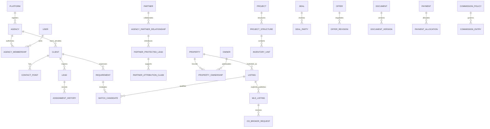

# Sellmore Target Domain Model

**PROPOSED TARGET MODEL — NOT VERIFIED CURRENT SCHEMA.** This document models target business concepts, not current tables, columns, primary keys or migration DDL. **BACKEND VERIFICATION REQUIRED** applies to the physical persistence and transaction design of every entity. The CRM backend/database are unavailable; the neighboring website is separate.

Read with the [master architecture](SELLMORE_MASTER_ARCHITECTURE.md), [module migration matrix](SELLMORE_MODULE_MIGRATION_MATRIX.md), [backend discovery gate](SELLMORE_BACKEND_DISCOVERY_CHECKLIST.md) and [frontend evidence](REDBOX_CRM_MASTER_AUDIT.md).

## Evidence and ownership interpretation

**EXISTING-INFERRED** means the frontend suggests a business equivalent, not a verified physical schema. **NEW** means a proposed target concept with no sufficiently complete equivalent established in inspected frontend evidence; it does not assert the backend lacks it. **REQUIRES BACKEND VERIFICATION** means partial/ambiguous mappings particularly need discovery before choosing reuse or addition. No classification authorizes replacement.

Ownership categories are authorization domains, not exclusive database partitions. SYSTEM GENERATED describes provenance and always retains agency/platform/shared ownership. USER PRIVATE still belongs to the enclosing agency data boundary. SHARED THROUGH MLS means an explicit limited publication/grant, never an unrestricted foreign-tenant join. PARTNER OWNED / AGENCY-CONTROLLED means partner-originated input managed under an agency relationship; it does not create broad rights to other agency data. These categories are product access classifications, not legal ownership advice.

Every agency-private relationship must validate compatible tenant ownership. Shared references use explicit participants/grants rather than a null tenant meaning public. Stable target references and legacy aliases preserve historic IDs; identifier types and indexes are chosen only after schema review.

## Entity catalog

### Platform and organization

| Entity | Purpose and illustrative attributes | Tenant ownership | Key relationships | Privacy level | Audit requirement | Legacy equivalent evidenced | Status |
|---|---|---|---|---|---|---|---|
| Platform | Sellmore control plane, policy versions and lifecycle authority | PLATFORM OWNED | Owns plans/features and Agency registry; distinct platform principals | Restricted platform administration | Policy and privileged access changes | No verified SaaS control plane; M02 admin dashboard alone is insufficient | NEW |
| SubscriptionPlan | Versioned plan limits, feature bundle and configurable pricing reference | PLATFORM OWNED | Plan versions granted through AgencySubscription and Feature | Published plan summary; restricted commercial configuration | Version, pricing/limit change and approver | No client-wired subscription module found | NEW |
| Feature | Stable capability key, supported actions and availability status | PLATFORM OWNED | Plan entitlement catalog; mapped to existing permissions | Catalog metadata; restricted administration | Feature activation and compatibility mapping | M15 module/feature configuration suggests related concepts, not SaaS entitlements | EXISTING-INFERRED |
| Agency | SaaS tenant identity, lifecycle status and primary administrative contact | PLATFORM OWNED | Owns private business domains, subscriptions and memberships | Agency profile only as published; operational details restricted | Creation, approval, status and support access | M49 company references require semantic reconciliation; not presumed tenant | REQUIRES BACKEND VERIFICATION |
| AgencySubscription | Effective plan version, add-ons, quotas and billing state | PLATFORM OWNED | Agency, SubscriptionPlan, entitlement overrides and usage | Platform billing and authorized agency administrators | Plan/limit changes and usage adjustments | No verified subscription equivalent | NEW |
| AgencyBranding | Versioned logo, colors, business contact and document branding | AGENCY OWNED | Agency; document template/version snapshots | Approved public brand assets; admin write only | Asset/theme/template changes | REDBOX hardcoding and M24/M41 branded material/prints | EXISTING-INFERRED |
| Branch | Agency branch identifier and address | AGENCY OWNED | Agency, Department or membership scope as verified | Organization scope; not private employee details | Create/change/close and scope impact | M49 branch | EXISTING-INFERRED |
| Department | Organizational function and authorized reporting scope | AGENCY OWNED | Agency, teams, employee memberships | Organization scope; restricted sensitive functions | Structure/scope changes | M49 department | EXISTING-INFERRED |
| Team | Team identity, purpose and active period | AGENCY OWNED | Department/branch, TeamMembership, assignments | Scoped organization metadata | Structure and membership events | empTeam/reporting data in M03/M48/M49; physical model unknown | EXISTING-INFERRED |
| User | Verified authentication subject; no returned editable password/hash | PLATFORM OWNED | AgencyMembership, UserRole and EmployeeProfile; platform grants separate | Highly restricted identity/session metadata | Login, credential, suspension/revocation events without secrets | M01 employee auth and M20 affiliate auth; unified subject not yet verified | REQUIRES BACKEND VERIFICATION |
| EmployeeProfile | Agency-specific employment/agent data and lifecycle | AGENCY OWNED | User/membership, organization, payroll and training links | Restricted HR; field-level separation from sales profile | Sensitive edits, access, status/offboarding | M48 employee forms; returned password pattern requires review | EXISTING-INFERRED |
| Role | Versioned action set in an explicit platform or agency realm | AGENCY OWNED; PLATFORM OWNED for platform realm | Permission, UserRole; never title-only authorization | Restricted access administration | Role changes and policy version | M15 rolecategory/rolepermission | EXISTING-INFERRED |
| Permission | Semantic resource/action and allowed scope definition | PLATFORM OWNED | Role grants, compatibility map and resource policies | Security configuration; effective UX projection only | Definition and legacy mapping changes | M15 numeric feature/action strings | EXISTING-INFERRED |
| UserRole | Effective-dated role grant with scope and assigning actor | AGENCY OWNED; PLATFORM OWNED for platform grants | User or AgencyMembership, Role, scope boundary | Restricted security administration | Grant/revoke, actor, reason and dates | M15 employeerole; membership/realm details unverified | EXISTING-INFERRED |
| TeamMembership | Effective user/team link and responsibility | AGENCY OWNED | AgencyMembership, Team and dates | Scoped team metadata | Join/leave/transfer history | empTeam/report-to concepts, exact persistence unknown | REQUIRES BACKEND VERIFICATION |
| AgencyMembership | User access to an agency, active period and status | AGENCY OWNED | Agency, User, scoped roles and profile | Restricted access administration | Invite/accept/revoke/suspend | No verified tenant membership contract | NEW |

### Client and sales identity

| Entity | Purpose and illustrative attributes | Tenant ownership | Key relationships | Privacy level | Audit requirement | Legacy equivalent evidenced | Status |
|---|---|---|---|---|---|---|---|
| Client | Canonical person/organization identity within one agency | AGENCY OWNED | ContactPoint, inquiries, requirements, parties and referrals | Private; field/object policies | Identity edits, merge journal and sensitive access | M03 customer/listmyleads/getleads references | EXISTING-INFERRED |
| ContactPoint | Raw and normalized complete phone/email/contact, verification and consent linkage | AGENCY OWNED | Client; authorized calls/messages; separate from partial partner contact | Sensitive PII; no cross-agent disclosure merely for duplicate match | Changes and disclosure; redacted history where appropriate | Phone/email on legacy lead/client forms; no verified multi-contact model | REQUIRES BACKEND VERIFICATION |
| Lead | Source inquiry with receipt, qualification and assignment state | AGENCY OWNED | Client optionally linked, Requirement, LeadSource and AssignmentHistory | Private sales scope | Intake, edits, stage and assignment history | M03/M04/M06 assignleadadd/listassignleads/importleads | EXISTING-INFERRED |
| LeadSource | Versioned extensible source taxonomy and provider mapping | AGENCY OWNED | Lead, campaign/touch and ingestion identity | Agency metadata; sensitive credentials never here | Taxonomy/mapping changes | M04/M06 activityMedium/leadSourceId | EXISTING-INFERRED |
| Campaign | Campaign identity, source, period, spend/currency and owner | AGENCY OWNED | LeadSource, AttributionTouch, leads and partner policy scope | Restricted marketing/commercial data | Spend/source/policy changes | M06 campaignName/adSpend/cpl fields; canonical campaign model unverified | EXISTING-INFERRED |
| AttributionTouch | Dated source interaction with UTM/external event provenance | AGENCY OWNED; SYSTEM GENERATED | Lead/Client, Campaign, provider and ingestion ID | Private acquisition/consent data | Append/correction with source dedupe | Source/import fields only; no full touchpoint model evidenced | NEW |
| Requirement | Client intent, purpose, locations/projects, budget/size ranges and lifecycle | AGENCY OWNED | Client one-to-many; inquiries, MatchCandidate, viewing/offer | Private sales/preferences | Criteria/status/ownership changes | M04 preferences and M12 incomplete UI; no persisted requirement confirmed | REQUIRES BACKEND VERIFICATION |
| AssignmentHistory | Effective assignment interval, previous/new owner, method/reason and policy version | AGENCY OWNED; SYSTEM GENERATED | Lead, assigned membership/team, actor and source | Scoped sales history | Append-only transfers/corrections, never overwrite ownership | M03/M06 assignment/transfer and M08 history; server storage unverified | EXISTING-INFERRED |

### Partners and attribution

| Entity | Purpose and illustrative attributes | Tenant ownership | Key relationships | Privacy level | Audit requirement | Legacy equivalent evidenced | Status |
|---|---|---|---|---|---|---|---|
| Partner | External broker/agent/referrer identity, independent of SaaS tenancy | PARTNER OWNED / AGENCY-CONTROLLED | Separate AgencyPartnerRelationship per collaborating agency | Partner's submitted identity; agency-specific private projections | Onboarding/profile/relationship decisions | M20 affiliates as starting identity | EXISTING-INFERRED |
| AgencyPartnerRelationship | Agency-approved collaborator scope, status and permitted projects | PARTNER OWNED / AGENCY-CONTROLLED | Agency, Partner, agreements, portal grants and claims | Only agency reviewers and that partner relationship | Approval, scope, suspension and exit | Affiliate scoping exists in client; explicit relationship contract unverified | REQUIRES BACKEND VERIFICATION |
| PartnerAgreement | Versioned protection, commercial and dispute terms | PARTNER OWNED / AGENCY-CONTROLLED | Relationship, project/opportunity, policy versions and claims | Restricted parties/authorized reviewers | Acceptance, amendment and expiry | No verified signed/versioned equivalent | NEW |
| PartnerProtectedLead | Protected introduction with raw partial contact, context and server protection window | PARTNER OWNED / AGENCY-CONTROLLED | Partner relationship, project/requirement; optional reviewed client link | Partner sees submitted/masked data; full identities remain separate | Submission, policy snapshot and authorized amendments | M21 affiliateleads is migration source; protection model not verified | REQUIRES BACKEND VERIFICATION |
| PartnerAttributionClaim | Independent claimant/evidence/protection/match/dispute and deal linkage | PARTNER OWNED / AGENCY-CONTROLLED | ProtectedLead, Agreement, reviewer, deal and commission policy | Restricted adjudication; minimal partner status view | Every adjudication, attribution override, expiry and dispute | M21 lead/activity starting evidence; no verified claim engine | NEW |

### Property projects and matching

| Entity | Purpose and illustrative attributes | Tenant ownership | Key relationships | Privacy level | Audit requirement | Legacy equivalent evidenced | Status |
|---|---|---|---|---|---|---|---|
| Developer | Developer identity and relevant project relationships | AGENCY OWNED | Projects, policies, approved public information | Public only by explicit publication; private contacts/contracts restricted | Profile/project mandate changes | Developer material in M24; canonical model unverified | REQUIRES BACKEND VERIFICATION |
| Project | Project profile, developer/location, dates, approvals/media and status | AGENCY OWNED | Developer, ProjectStructure, InventoryUnit, plans and training | Agency private; selected partner/network projection | Profile/status/pricing/availability changes | M10 project and M24 collateral | EXISTING-INFERRED |
| ProjectStructure | Typed hierarchy such as phase/tower/floor or sector/street | AGENCY OWNED | Project, parent structure, InventoryUnit and location reference | Project visibility scope | Hierarchy/identifier changes with aliases | M10 blocks/plots/type filters; hierarchy schema unknown | EXISTING-INFERRED |
| InventoryUnit | Stable marketable unit and authoritative inventory status/version | AGENCY OWNED | ProjectStructure, property link, reservations, sold/deal mapping | Agency/private; approved partner projection | All hold/unhold/cancel/sold transitions | M10/M22 projectinventory and M11 inventorysold links | EXISTING-INFERRED |
| Owner | Person/entity acting as asset owner or authorized representative | AGENCY OWNED | PropertyOwnership; limited mandate/contact references | Highly restricted contact/identity/ownership evidence | Verification, edits and sensitive access | Ownership fields/documents only; owner registry unverified | REQUIRES BACKEND VERIFICATION |
| Property | Physical asset identity, type/location/size and provenance | AGENCY OWNED | PropertyOwnership, Listing, project/unit link where valid | Private record; approved safe MLS projection only | Identity/canonicalization/change history | M10 unit data and incomplete M12 entry; general model unknown | REQUIRES BACKEND VERIFICATION |
| PropertyOwnership | Effective ownership share/role, evidence and verification status | AGENCY OWNED | Property many-to-many Owner, document versions | Highly restricted legal/identity evidence | Ownership claims/verification/amendments | Documents imply ownership, not verified relationship table | NEW |
| Listing | Offer to sell/rent/market a property with demand/terms/provenance and status | AGENCY OWNED | Property, mandate, listing agent, revisions and MLSListing | Asking/publication fields distinct from owner minimum/private notes | Price/status/mandate and publication history | No complete general listing lifecycle confirmed | NEW |
| SavedSearch | Versioned criteria, sort/columns and personal/team sharing policy | USER PRIVATE; AGENCY OWNED when shared | User/membership, Requirement or result types | Configuration shared only as allowed; never grants record access | Share/scope/material criteria changes | Local filters exist; persisted shared search not confirmed | NEW |
| MatchCandidate | Explainable deterministic eligibility/rank at a checked time | AGENCY OWNED; SYSTEM GENERATED | Requirement, listing/unit and matching rule version | Permission-filtered sales recommendation | Inputs/version/reasons and acceptance feedback | Manual inventory filtering only | NEW |

### Activities transactions and documents

| Entity | Purpose and illustrative attributes | Tenant ownership | Key relationships | Privacy level | Audit requirement | Legacy equivalent evidenced | Status |
|---|---|---|---|---|---|---|---|
| ActivityEvent | Safe event envelope with source/time/actor/schema/entity links | AGENCY OWNED; SYSTEM GENERATED | Any authorized business entity; separate from security AuditEvent | Field/object-filtered timeline | Append/correction; backfill provenance | M07/M08 lead/reminder/call and M14 task histories | EXISTING-INFERRED |
| Task | Standalone work item or optional domain-linked task with comments/checklists | AGENCY OWNED; USER PRIVATE for explicitly private task | Assignee, optional client/lead/property/deal/project/campaign | Task scope and participants | Creation, assignments, comments, checklist and status history | M14 task/taskassigned/taskcomment/taskchangeLog | EXISTING-INFERRED |
| FollowUp | Due action, owner, timezone, outcome and completion/reschedule state | AGENCY OWNED | Lead/client/requirement; optional task/event | Assigned/scoped sales visibility | Due changes, completion and escalation | M07 assignreminder/myleadactivityReminder | EXISTING-INFERRED |
| Meeting | Appointment with participants, time/location and scheduling state | AGENCY OWNED | Client/requirement, memberships and activities | Participant and record scope | Schedule/reschedule/cancel/outcome | M07 meeting time/location fields; first-class entity unknown | REQUIRES BACKEND VERIFICATION |
| Viewing | Property-specific appointment, feedback/outcome and next action | AGENCY OWNED; SHARED THROUGH MLS by explicit grant | Client/requirement, listing/property, agent, attendee/appointment links | Private default; limited collaboration projection | Schedule/confirm/reschedule/no-show/complete | Activity vocabulary only, no dedicated verified workflow | NEW |
| Offer | Offer identity, parties and current revision reference | AGENCY OWNED; SHARED THROUGH MLS by explicit agreement | Client, listing/property, deal candidate and revisions | Restricted negotiating parties | Submission/status/acceptance with authority | No dedicated persisted workflow found in client | NEW |
| OfferRevision | Immutable amount/currency/terms/expiry and predecessor | AGENCY OWNED; SHARED THROUGH MLS by explicit agreement | Offer, submitting actor and source version | Negotiating parties; private notes separate | Append-only revision and acceptance evidence | No confirmed equivalent | NEW |
| Deal | Canonical approved transaction with type, lifecycle and legacy sale references | AGENCY OWNED | DealParty, offers, property/listing/unit, documents/plans/payment/commission | Sales scope plus independently restricted finance/PII panels | Approval/status/terms/cancel/reversal | M11 inventorysold, M13 and M36 sale forms; M42 incomplete | EXISTING-INFERRED |
| DealParty | Buyer/seller/agent/manager/partner/developer role and effective participation | AGENCY OWNED | Deal, appropriate party identity and agreements | Fields by role and business need | Participation/credit/role changes | Sale/nominee/agent fields suggest links; cardinalities unknown | EXISTING-INFERRED |
| Document | Entity-linked metadata, owner/classification/access/retention policy | AGENCY OWNED; SHARED THROUGH MLS only approved copy/projection | Versions; client/deal/employee/project or other links | Sensitive by classification; explicit download/print/export policy | Upload, classification, access and lifecycle | M11/M41/M45 files/prints; private storage unverified | EXISTING-INFERRED |
| DocumentVersion | Immutable binary reference, uploader/time, checksum and source snapshot | AGENCY OWNED | Document, previous version, branding/template snapshot | Inherits document restrictions; never public by default | Append/version access and authorized correction | Uploads/prints exist; version store unverified | NEW |

### Finance approvals automation and learning

| Entity | Purpose and illustrative attributes | Tenant ownership | Key relationships | Privacy level | Audit requirement | Legacy equivalent evidenced | Status |
|---|---|---|---|---|---|---|---|
| Payment | Receipt/disbursement business identity, amount/currency and approved state | AGENCY OWNED | PaymentAllocation, finance posting, bank/cash/reference | Restricted finance; permitted client summary only | Approval/post/void/refund/reversal; preserve original | M35/M37/M39/M40/M44/M46 multiple distinct families | EXISTING-INFERRED |
| PaymentAllocation | Explicit amount applying a payment to an obligation/deal/installment | AGENCY OWNED | Payment, deal/customer ledger/plan item | Finance access and scoped summary | Allocation/reallocation/reversal and idempotency | Allocation semantics require finance/backend review | REQUIRES BACKEND VERIFICATION |
| PaymentPlan | Versioned schedule of obligations/booking/down-payment/installments | AGENCY OWNED | Client/deal/unit; plan items and allocations | Sales summary vs finance detail permissions | Schedule approval/amendment history | M44 paymentplan/paymentplandata | EXISTING-INFERRED |
| CommissionPolicy | Versioned fixed/percentage/tier rule, basis, precedence and scope | AGENCY OWNED | Agreement/project/developer/agent/partner/deal and entries | Restricted commercial terms | Approval/effective dates and chosen-policy snapshot | M42 fields unfinished; no calculation engine proved | NEW |
| CommissionEntry | Auditable entitlement/accrual/payable/settlement or correcting entry | AGENCY OWNED | Deal, recipient, policy version, basis and payment allocation | Own-recipient projection; finance controls full ledger | Append approval/payment/dispute/reversal evidence | No historic balances inferable from M42 fields | NEW |
| ApprovalRequest | Version-pinned subject needing a policy-defined decision chain | AGENCY OWNED; PLATFORM OWNED for platform requests | Subject version, definition, steps and initiating actor | Authorized approvers and permitted requester view | Submission/invalidation/final transition | Scattered statuses; generic engine not verified | NEW |
| ApprovalStep | Assigned approver rule and recorded actor/time/decision/comment | AGENCY OWNED; PLATFORM OWNED for platform requests | ApprovalRequest and definition version | Approver scope; separation of duties | Append decisions, delegation and timeout | No generic framework confirmed | NEW |
| AutomationRule | Versioned trigger/allowlisted conditions/actions, limits and kill switch | AGENCY OWNED | Domain events, capability policy and executions | Agency automation admins; no arbitrary code | Create/approve/version/enable/disable | No rules engine verified | NEW |
| AutomationExecution | Event/rule/action identity, outcomes, retry/dead-letter metadata | AGENCY OWNED; SYSTEM GENERATED | Rule version, source event and action results | Restricted operational audit; minimized payload | Append execution/retry/compensation | Browser timers are not proof of server scheduler | NEW |
| TrainingCourse | Versioned course catalog, audience and completion criteria | AGENCY OWNED; PLATFORM OWNED for optional shared catalog | Modules, enrollment, assessments and project restrictions | Entitled learners; authoring permission separate | Course/version/access changes | M51 training and M23 resources are reusable starting assets | EXISTING-INFERRED |
| TrainingModule | Ordered lessons/video/docs and prerequisite links | AGENCY OWNED; PLATFORM OWNED for shared course | Course version, content documents and assessments | Scoped learner resources | Content/version/prerequisite changes | Static affiliate training resources; module structure unknown | NEW |
| TrainingEnrollment | Learner/course version assignment and progress | AGENCY OWNED | Membership, course, assessment attempts/certification | Learner and authorized training/HR roles | Assign/progress/complete/withdraw | M51 training employee links require verification | REQUIRES BACKEND VERIFICATION |
| Assessment | Versioned questions/pass rules and attempt results | AGENCY OWNED | Course/module, enrollment, attempt actor/time | Learner result; restricted answer/authoring data | Submission/score/review; no overwritten attempt | No assessment workflow found | NEW |
| Certification | Issued qualification, project scope, expiry and revocation | AGENCY OWNED; SYSTEM GENERATED | Enrollment/assessment, membership and issuer | Minimal public verification if approved; restricted history | Issue/expire/revoke with reason | No certification-gated access verified | NEW |

### Network notifications audit and AI

| Entity | Purpose and illustrative attributes | Tenant ownership | Key relationships | Privacy level | Audit requirement | Legacy equivalent evidenced | Status |
|---|---|---|---|---|---|---|---|
| MLSListing | Allowlisted versioned network publication of an approved private listing | SHARED THROUGH MLS; AGENCY OWNED source | Publishing agency, Listing, availability and publication terms | Approved fields only; no owner/client/private commissions | Publish/change/withdraw/expiry and access grants | No current MLS projection evidenced | NEW |
| CoBrokerRequest | Protected buyer interest with accept/reject and attribution review | SHARED THROUGH MLS | MLSListing, buyer/seller agencies, protected claim and agreement | Named parties with minimum buyer data | Submit/check/accept/reject/dispute | No current cross-agency request workflow verified | NEW |
| CoBrokerDeal | Network linkage and agreement between private agency deals | SHARED THROUGH MLS | Participating agencies, agreement, private deal references and settlement evidence | Agreed shared fields; private ledgers stay separate | Terms/deal/settlement/reconciliation/dispute history | No verified network deal equivalent | NEW |
| Notification | Delivery intent/outcome per authorized recipient/channel/category | AGENCY OWNED or PLATFORM OWNED origin; SYSTEM GENERATED | Event, user/membership, preference and provider event | Recipient-private; no sensitive lock-screen content | Mandatory deliveries/outcomes; bounded operational retention | Firebase capability and existing notification hooks | EXISTING-INFERRED |
| AuditEvent | Restricted append-oriented security/admin/financial evidence | AGENCY OWNED or PLATFORM OWNED realm; SYSTEM GENERATED | Actor, request/correlation, subject and safe change metadata | Restricted audit roles; separate from business timeline | Integrity monitoring and audited read/export | Fragmented history exists; central tamper-resistant audit unverified | REQUIRES BACKEND VERIFICATION |
| AIArtifact | Versioned summary/draft/extraction with source links and review state | AGENCY OWNED; SYSTEM GENERATED | Authorized entities, capability/model/prompt version and reviewer | Same or stricter than source data; minimized PII | Generation/review/use/deletion provenance | Adjacent website AI endpoint is separate, not a CRM artifact store | NEW |
| AIInteraction | Request/outcome/cost/latency metadata without unnecessary raw prompts | AGENCY OWNED; SYSTEM GENERATED | User/membership, capability, budget decision and artifact | Restricted operational/AI governance; no unrestricted content logs | Provider/version/access/budget and write approval evidence | No CRM provider-neutral gateway verified | NEW |

## Tenant ownership matrix

This enumerates every entity above. It must be implemented through server policy across API/data access, files, cache, search, jobs, export and audit. Owner scope does not automatically authorize every action or field.

| Object | Ownership classification | Cross-boundary rule |
|---|---|---|
| Platform | PLATFORM OWNED | Platform operation permissions; no implicit permission to agency-private records. |
| SubscriptionPlan | PLATFORM OWNED | Platform operation permissions; no implicit permission to agency-private records. |
| Feature | PLATFORM OWNED | Platform operation permissions; no implicit permission to agency-private records. |
| Agency | PLATFORM OWNED | Platform operation permissions; no implicit permission to agency-private records. |
| AgencySubscription | PLATFORM OWNED | Platform operation permissions; no implicit permission to agency-private records. |
| AgencyBranding | AGENCY OWNED | Deny cross-agency private access; only explicit authorized projections. |
| Branch | AGENCY OWNED | Deny cross-agency private access; only explicit authorized projections. |
| Department | AGENCY OWNED | Deny cross-agency private access; only explicit authorized projections. |
| Team | AGENCY OWNED | Deny cross-agency private access; only explicit authorized projections. |
| User | PLATFORM OWNED | Platform operation permissions; no implicit permission to agency-private records. |
| EmployeeProfile | AGENCY OWNED | Deny cross-agency private access; only explicit authorized projections. |
| Role | AGENCY OWNED; PLATFORM OWNED for platform realm | Deny cross-agency private access; only explicit authorized projections. |
| Permission | PLATFORM OWNED | Platform operation permissions; no implicit permission to agency-private records. |
| UserRole | AGENCY OWNED; PLATFORM OWNED for platform grants | Deny cross-agency private access; only explicit authorized projections. |
| TeamMembership | AGENCY OWNED | Deny cross-agency private access; only explicit authorized projections. |
| AgencyMembership | AGENCY OWNED | Deny cross-agency private access; only explicit authorized projections. |
| Client | AGENCY OWNED | Deny cross-agency private access; only explicit authorized projections. |
| ContactPoint | AGENCY OWNED | Deny cross-agency private access; only explicit authorized projections. |
| Lead | AGENCY OWNED | Deny cross-agency private access; only explicit authorized projections. |
| LeadSource | AGENCY OWNED | Deny cross-agency private access; only explicit authorized projections. |
| Campaign | AGENCY OWNED | Deny cross-agency private access; only explicit authorized projections. |
| AttributionTouch | AGENCY OWNED; SYSTEM GENERATED | Deny cross-agency private access; only explicit authorized projections. |
| Requirement | AGENCY OWNED | Deny cross-agency private access; only explicit authorized projections. |
| AssignmentHistory | AGENCY OWNED; SYSTEM GENERATED | Deny cross-agency private access; only explicit authorized projections. |
| Partner | PARTNER OWNED / AGENCY-CONTROLLED | Only own relationship/claim projection; reviewed full identity never automatically revealed. |
| AgencyPartnerRelationship | PARTNER OWNED / AGENCY-CONTROLLED | Only own relationship/claim projection; reviewed full identity never automatically revealed. |
| PartnerAgreement | PARTNER OWNED / AGENCY-CONTROLLED | Only own relationship/claim projection; reviewed full identity never automatically revealed. |
| PartnerProtectedLead | PARTNER OWNED / AGENCY-CONTROLLED | Only own relationship/claim projection; reviewed full identity never automatically revealed. |
| PartnerAttributionClaim | PARTNER OWNED / AGENCY-CONTROLLED | Only own relationship/claim projection; reviewed full identity never automatically revealed. |
| Developer | AGENCY OWNED | Deny cross-agency private access; only explicit authorized projections. |
| Project | AGENCY OWNED | Deny cross-agency private access; only explicit authorized projections. |
| ProjectStructure | AGENCY OWNED | Deny cross-agency private access; only explicit authorized projections. |
| InventoryUnit | AGENCY OWNED | Deny cross-agency private access; only explicit authorized projections. |
| Owner | AGENCY OWNED | Deny cross-agency private access; only explicit authorized projections. |
| Property | AGENCY OWNED | Deny cross-agency private access; only explicit authorized projections. |
| PropertyOwnership | AGENCY OWNED | Deny cross-agency private access; only explicit authorized projections. |
| Listing | AGENCY OWNED | Deny cross-agency private access; only explicit authorized projections. |
| SavedSearch | USER PRIVATE; AGENCY OWNED when shared | Owner/share policy intersected with current agency and record permissions. |
| MatchCandidate | AGENCY OWNED; SYSTEM GENERATED | Deny cross-agency private access; only explicit authorized projections. |
| ActivityEvent | AGENCY OWNED; SYSTEM GENERATED | Deny cross-agency private access; only explicit authorized projections. |
| Task | AGENCY OWNED; USER PRIVATE for explicitly private task | Owner/share policy intersected with current agency and record permissions. |
| FollowUp | AGENCY OWNED | Deny cross-agency private access; only explicit authorized projections. |
| Meeting | AGENCY OWNED | Deny cross-agency private access; only explicit authorized projections. |
| Viewing | AGENCY OWNED; SHARED THROUGH MLS by explicit grant | Named participants/publication policy only; revalidate expiry, withdrawal and grants. |
| Offer | AGENCY OWNED; SHARED THROUGH MLS by explicit agreement | Named participants/publication policy only; revalidate expiry, withdrawal and grants. |
| OfferRevision | AGENCY OWNED; SHARED THROUGH MLS by explicit agreement | Named participants/publication policy only; revalidate expiry, withdrawal and grants. |
| Deal | AGENCY OWNED | Deny cross-agency private access; only explicit authorized projections. |
| DealParty | AGENCY OWNED | Deny cross-agency private access; only explicit authorized projections. |
| Document | AGENCY OWNED; SHARED THROUGH MLS only approved copy/projection | Named participants/publication policy only; revalidate expiry, withdrawal and grants. |
| DocumentVersion | AGENCY OWNED | Deny cross-agency private access; only explicit authorized projections. |
| Payment | AGENCY OWNED | Deny cross-agency private access; only explicit authorized projections. |
| PaymentAllocation | AGENCY OWNED | Deny cross-agency private access; only explicit authorized projections. |
| PaymentPlan | AGENCY OWNED | Deny cross-agency private access; only explicit authorized projections. |
| CommissionPolicy | AGENCY OWNED | Deny cross-agency private access; only explicit authorized projections. |
| CommissionEntry | AGENCY OWNED | Deny cross-agency private access; only explicit authorized projections. |
| ApprovalRequest | AGENCY OWNED; PLATFORM OWNED for platform requests | Deny cross-agency private access; only explicit authorized projections. |
| ApprovalStep | AGENCY OWNED; PLATFORM OWNED for platform requests | Deny cross-agency private access; only explicit authorized projections. |
| AutomationRule | AGENCY OWNED | Deny cross-agency private access; only explicit authorized projections. |
| AutomationExecution | AGENCY OWNED; SYSTEM GENERATED | Deny cross-agency private access; only explicit authorized projections. |
| TrainingCourse | AGENCY OWNED; PLATFORM OWNED for optional shared catalog | Deny cross-agency private access; only explicit authorized projections. |
| TrainingModule | AGENCY OWNED; PLATFORM OWNED for shared course | Deny cross-agency private access; only explicit authorized projections. |
| TrainingEnrollment | AGENCY OWNED | Deny cross-agency private access; only explicit authorized projections. |
| Assessment | AGENCY OWNED | Deny cross-agency private access; only explicit authorized projections. |
| Certification | AGENCY OWNED; SYSTEM GENERATED | Deny cross-agency private access; only explicit authorized projections. |
| MLSListing | SHARED THROUGH MLS; AGENCY OWNED source | Named participants/publication policy only; revalidate expiry, withdrawal and grants. |
| CoBrokerRequest | SHARED THROUGH MLS | Named participants/publication policy only; revalidate expiry, withdrawal and grants. |
| CoBrokerDeal | SHARED THROUGH MLS | Named participants/publication policy only; revalidate expiry, withdrawal and grants. |
| Notification | AGENCY OWNED or PLATFORM OWNED origin; SYSTEM GENERATED | Deny cross-agency private access; only explicit authorized projections. |
| AuditEvent | AGENCY OWNED or PLATFORM OWNED realm; SYSTEM GENERATED | Deny cross-agency private access; only explicit authorized projections. |
| AIArtifact | AGENCY OWNED; SYSTEM GENERATED | Deny cross-agency private access; only explicit authorized projections. |
| AIInteraction | AGENCY OWNED; SYSTEM GENERATED | Deny cross-agency private access; only explicit authorized projections. |

## Core relationships and invariants

These cardinalities describe proposed logical intent, not verified foreign keys. Joint purchasers/owners and multiple units per transaction need explicit link entities where the business allows them. A Lead may remain unlinked to a canonical Client until reviewed. A partial protected introduction may remain unlinked indefinitely; no fabricated person identity is required merely to save a claim.

### Client identity and privacy

Canonical identity is agency-scoped. Full normalized identifiers generate candidates, not conclusive person equivalence. Duplicate discovery never grants Agent B access to Agent A's full client details. A permitted response may say “Possible existing client detected” without revealing phone, owner, counts or notes. Escalation goes to a reviewer with explicit access. Keep source inquiry, requirement, creator, current owner, assigned agent, team, agency and attribution owner distinct.

### Partial mobile algorithm

1. Capture raw partner input, country/format context, expected full length, provided digit count and completeness. Store it under PartnerProtectedLead/protected-contact storage, not as a canonical complete ContactPoint.
2. For the supplied Pakistani local example, expected length is 11, provided digits are 9: `030012345` displays `030012345••`. Do not pad missing digits, invent a suffix or fabricate a full normalized E.164 identity.
3. Normalize only known digits under the validated representation. Full forms `03XXXXXXXXX`, `+923XXXXXXXXX`, `00923XXXXXXXXX`, `923XXXXXXXXX` use country-aware comparison; preserve originals. Incorrect lengths/context produce validation review, not guessed correction.
4. Restrict candidates to the authorized agency/relationship and applicable project/requirement/time window. Compare compatible known prefixes and provided counts; name, project, requirement and submission time can inform evidence but cannot establish identity alone.
5. Return **POSSIBLE MATCH** to an authorized attribution review queue. Broad/overlapping prefixes and shared numbers remain ambiguous. No automatic client merge, claim acceptance, contact disclosure or payout occurs.
6. Only an authorized reviewer resolves the match using permitted evidence, recording decision and reason. Partner views retain the masked submitted number even after resolution. Avoid enumeration through different errors, counts or search timing; rate-limit repeated submissions under an approved policy.

Tests include equivalent full formats, shared prefixes, wrong country, overlapping claims, the exact protection boundary, forged timestamps, an unauthorized reviewer and an Agent B duplicate check that cannot reveal Agent A's client.

### Protection policy and commission precedence

Default protection is 30 days. Proposed deterministic precedence is Partner Agreement → Campaign/Opportunity → Project → Agency → Platform default, subject to approved governance constraints. Choose by explicit scope/version/effective date; equal-precedence conflicting rules require review, not arbitrary last-write-wins. Server acceptance time is the proposed default start; record `created_at`, `protection_start`, `protection_end`, status and policy source/version. Backdating or amendment requires authorized evidence. Whether days are elapsed-duration or agency-calendar days remains an owner decision. Expiry never deletes an earned obligation or history.

Commission rule selection is a separate resolver. Proposed order is signed deal-specific agreement → applicable partner/recipient agreement → campaign/opportunity → project/developer agreement → approved recipient/HR/manager policy → agency default. Platform defaults may supply templates, not silently override agency contracts. When two contracts conflict at the same specificity or cover incompatible recipient pools, block calculation for finance resolution. Record the governing hierarchy/version; this precedence is a proposal requiring finance/business approval.

Each calculation explains base amount, governing policy, fixed amount/rate/tier, recipient, arithmetic, approval and payment state. Example only: eligible agency commission PKR 1,000,000 × applicable 25% = PKR 250,000 partner entitlement. No globally hardcoded 25%; no inference from sale price or unfinished historic Deal Form fields. Split caps, collection dependence, currency/rounding, cancellation and reversals are versioned finance rules.

### Property canonicalization and owner protection

Candidate identity may use country, city, society, phase, zone/block, street and plot/unit, while apartments may require project, tower, floor and unit. Not all assets have a plot number. Preserve aliases, renumbering and provenance; approximate descriptions generate candidate clusters, not destructive merges. Multiple listings and asking prices against one property are valid. Any future cross-agency shared property reference must not merge private owners, mandates or client records.

Owner name/phone, documents, minimum acceptable price and private notes each require field-level policy. MLS publishes only explicitly approved fields and sanitized media; no automatic owner contact or internal negotiation limit. Asking price and verified transaction price are separate facts with source/date/freshness.

### Auxiliary policy and operational objects

The minimum catalog is not exhaustive. Agency settings will also need versioned pipelines/stages, custom fields, location/unit definitions, reservations, source-ingestion batches, referral and consent records, retention/holds, document templates, event outbox, merge/legacy mapping journals, approval definitions, commission settlements and agreements/resource grants for MLS. Each inherits explicit ownership and privacy; no auxiliary object can bypass the catalog's policies.

Optional future platform billing uses Subscription/BillingCycle/Invoice/PlatformPayment/Trial/Upgrade/Downgrade/Grace/Suspension concepts. Keep PlatformPayment distinct from agency customer Payment. Provider choice, pricing, taxes and charging integration remain undecided; no gateway implementation is authorized. Storage/AI/automation/MLS/partner/finance/HR/analytics/API entitlements are versioned and server-enforced independently of user permission.

## Migration constraints

For every entity: reconcile actual schema and existing endpoints first; identify authoritative writer; preserve legacy references; expand additively; backfill with provenance and checkpoints; validate relationships/counts/finance totals; switch readers, then writers; observe; retire only with owner/consumer acceptance. Quarantine ambiguous tenant ownership. Do not rename company_id, force universal phone uniqueness, merge receipt families or fabricate commission balances.

The initial architecture is a modular monolith or similarly maintainable set of domain modules. Logical entity boundaries do not require separate databases or services. Communications, search, AI, notification and automation extraction is considered only after measured scale/operational need.
