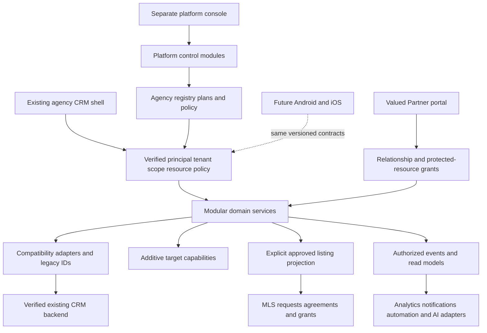

# Sellmore Master Architecture

**Version 1.0 — authoritative target architecture and planning baseline**  
**Date:** 30 September 2026  
**Scope:** All supplied requirements, sections 1–138, including final Phases 18–26.  
**Execution boundary:** Architecture and planning only. No phase, safeguard, code fix, migration, dependency upgrade, API rename, deletion or further screen redesign is executed by these documents.

This document supersedes the earlier draft blueprint as the authoritative target architecture. It preserves the earlier requirements and the [Phase-0 audit](REDBOX_CRM_MASTER_AUDIT.md) as evidence. Detailed supporting deliverables are the [Phase-0 stabilization package](SELLMORE_PHASE_0_STABILIZATION.md), [backend discovery checklist](SELLMORE_BACKEND_DISCOVERY_CHECKLIST.md), [module migration and navigation matrix](SELLMORE_MODULE_MIGRATION_MATRIX.md), and [target domain and ownership model](SELLMORE_DOMAIN_MODEL.md). The earlier [blueprint](SELLMORE_MASTER_BLUEPRINT.md) remains historical design context; this document controls final numbering, scope and decisions.

Sections 1–49 define the architecture, section 50 specifies every roadmap phase, and sections 51–54 identify risks, verification gates, resolved decisions and next actions. The linked matrices provide all 56 module dispositions, all 287 historic routes, every target navigation destination and 71 conceptual entities.

## 1 Executive Product Vision

Sellmore is a commercial multi-tenant real-estate operating system combining CRM, brokerage operations, property/project inventory, agent and Valued Partner networks, inter-agency MLS, deals, finance/commission, people/training, communication, attribution, automation, AI and management intelligence. REDBOX Estate is the first agency tenant. Agency-neutral code and configuration progressively replace business hardcoding without removing working REDBOX processes.

This is an evolution project. The initial commercial advantage is the existing operational depth: lead distribution, activities, Zong records, project holds/sales, documents, payment schedules/registers, HR and affiliate workflows. Preserve that value while establishing genuine server-enforced tenancy and consistent business identities. A modern-looking shell alone is not commercial SaaS readiness.

## 2 Evidence From Phase 0 Audit

The complete audit baseline covers 56 modules, 287 routes/222 routed components, 534 JavaScript files, 112 Redux action files and 569 recognized fetch/Axios call sites. It recorded 10 passing mocked dashboard/navigation tests and 1 lint error plus 6,733 warnings. Those counts describe the audited frontend, not backend acceptance or the number of server endpoints. Source classified as possibly unused remains protected from deletion pending static/runtime/owner review.

The actual CRM backend, database and deployment were unavailable. All current server facts remain **BACKEND VERIFICATION REQUIRED**. Every conceptual entity/data change in this document and its companions is **PROPOSED TARGET MODEL — NOT VERIFIED CURRENT SCHEMA**. Inferred entities are not verified tables, keys or constraints. The neighboring Next.js/Prisma/PostgreSQL website is separate and cannot establish the CRM engine or identity model.

Audit classifications KEEP, IMPROVE, REFACTOR, MERGE, REPLACE LATER and DEPRECATED / POSSIBLY UNUSED are retained in the migration matrix. “EXISTING WORKING” navigation status means client-wired or functioning static resource evidence; it does not certify remote correctness.

## 3 Architectural Principles

Preserve business behavior through domain adapters, compatibility layers, additive models, versioned contracts, feature flags, safe read comparisons and rehearsed backfills. Preserve legacy IDs/URLs, integration vocabulary, historical ledgers and issued documents. Maintain one authoritative writer per business operation; uncontrolled dual writes are not a migration strategy.

Prefer a **modular monolith**, or a similarly maintainable architecture integrated with the verified backend, initially. Logical modules do not mandate microservices. Communications, search, AI, notifications and automation can be extracted only when measured scaling or operational requirements justify the additional distributed-system burden. New APIs serve web and future Android/iOS/partner clients; React must not be the sole owner of business rules.

One maintained product supports agency differences through configuration: branding, entitlements, roles/scopes, pipelines/statuses, custom fields, approvals, commissions, assignment, widgets and document templates. No agency-specific source fork by default. Use original enterprise usability principles rather than competitor assets or copied proprietary layouts.

### Shared experience, table and form standards

Continue the modern Sellmore shell and progressively extract PageHeader, Sidebar, TopBar, Button, Icon, KpiCard, DataTable, FilterBar, StatusBadge, Avatar, LeadCard, ClientCard, PropertyCard, DealCard, Timeline, TaskPanel, QuickCreate, Drawer, Modal, ConfirmationDialog, FormField, PhoneField, CurrencyField, DatePicker, Pagination, EmptyState, LoadingState and ErrorState. Reuse the established icon approach; no competitor assets or global legacy-CSS replacement. Adopt components module by module with keyboard/focus, accessible labels, responsive behavior and print parity.

Shared tables use server pagination/sorting/filtering, saved views, column visibility, stable row IDs, authorized bulk selection/export, clear row actions and a mobile fallback. Distinguish loading, empty, failed and permission-denied states; maintain selection correctly across filtered pages. Destructive bulk actions require explicit confirmation identifying scope/count and recheck authorization at execution. Saved personal/team views carry filters, sort, columns, owner, scope and sharing rules; a saved filter never grants data access.

Forms need consistent labels, required indicators, inline validation/help, unsaved-change protection, submit loading and explicit success/failure behavior. Preserve user input on failed submissions and prevent duplicate writes using verified request contracts. Financial forms define currency, decimal precision and rounding with finance before formatting or calculation changes. Progressive disclosure keeps frequent agent actions simple while deeper finance/admin capabilities remain available to authorized users.

## 4 Current State Constraints

The CRM is a React 18/CRA JavaScript client with Redux/thunk/root persistence, direct fetch/Axios calls, mixed Bootstrap/jQuery/React UI and ECharts. Its new CrmLayout/sidebar is retained. Many business pages remain legacy, and some features are templates. Endpoint casing, envelopes, IDs, scope parameters and side effects vary; wrapping Redux alone misses direct component mutations.

Immediate gates are wrong-resource Deal Form/Vehicle Pass code, lead field round-trip gaps, server authorization, employee password-response handling, login/request failure states, and route/role/print regressions. Payment-plan identity/totals and reservation concurrency also need contract evidence before modernization. Do not combine broad dependency, performance, schema and visual rewrites in one release.

Current `company_id` may mean tenant, legal entity, branch, project company or reporting dimension. Determine meaning per domain; never simply rename it to `tenant_id` or assign every row to REDBOX by assumption. No physical storage/tenancy strategy is selected until actual engine, schema and operations are known.

## 5 Target Platform Architecture

Separate control-plane agency/plan/security administration from agency-private data and explicitly shared network projections. Shared domain invariants govern commands from any UI, integration or job. Reuse verified existing server capabilities before adding alternatives. The diagram is a target map, not an assertion that these services already exist.

## 6 Multi Tenant SaaS

Every Agency is a separate default-private boundary for users/employees, sales/client/contact/requirement data, owners/properties/listings/projects/inventory, activities/tasks/calls/files, deals/payments/commissions, HR/finance/campaigns/reports/configuration. Cross-agency visibility exists only through explicit MLS/co-broker grants or audited platform policy.

Bind tenant context to a verified principal and active membership/service grant. Validate every private reference/join/bulk operation; tenant selectors are not authorization. Apply the boundary to files, caches, jobs, search/AI, analytics, exports, notifications and restore operations. Tenant context and asynchronous processing require the same discipline as API authorization; [OWASP multi-tenant guidance](https://cheatsheetseries.owasp.org/cheatsheets/Multi_Tenant_Security_Cheat_Sheet.html) supports this security boundary.

Compare shared data with tenant-aware enforcement, isolated schemas/roles, and separate databases/credentials against verified engine capabilities, restore needs, scale and operating capacity. None eliminates application authorization. An unprotected reachable legacy endpoint cannot be secured by adding a proxy or sidebar alone. No second production agency until the backend actor matrix, storage/jobs/cache isolation and restore gate pass.

## 7 Platform Super Admin

There is one initial Platform Super Admin, distinct from Agency Admin. The platform console covers Overview, Agencies/Applications, Subscriptions/Plans/Features/Usage, Users, MLS, Integrations, Health, Audit/Security, Support, Announcements and Settings. It governs agency creation/approval/status, entitlements, global policies/integrations/taxonomies, quotas, billing configuration and network governance.

Do not automatically elevate current `/admin/dashboard` users to this role. Support access to tenant-private data requires explicit reason, minimum scope, time limit and real-actor audit. One admin's self-approval is not independent review; define owner notifications and secure offline recovery without silently provisioning another active super-admin account. Ordinary platform metrics use appropriate operational aggregates rather than unrestricted private client browsing.

## 8 Agency Architecture

Agency lifecycle supports CREATE, PENDING, ACTIVE, SUSPENDED and CANCELLED/CLOSED; approval/provisioning may be explicit PENDING substates. Provisioning is resumable/idempotent. Onboarding follows application/invitation, details, plan, required platform approval, workspace, branding, primary admin, organization, modules, permissions, sources, reviewed import and go-live acceptance.

An agency contains branches, departments, teams, designations, users/memberships, employee profiles and effective reporting relationships. Preserve M48/M49 equivalents. Suspension blocks ordinary access according to approved server policy, revokes/limits jobs and sharing as appropriate, preserves records/audit and allows controlled reactivation. Subscription state and agency lifecycle remain distinct.

Agency data belongs to the agency subject to terms/policy. Design authorized portability and exit with verified scope, bounded exports, private delivery, audit and retention/hold exceptions; never export another tenant or erase financial obligations on closure. Help Center, guided setup, tooltips, support tickets, status and release notes are future commercial capabilities, not current implementation tasks.

## 9 Identity Roles Permissions

User authentication, AgencyMembership, EmployeeProfile and Partner relationship are distinct concepts. A target login may support several explicit memberships, but current accounts are not merged automatically. Role titles are templates; effective decisions combine verified principal, active tenant/membership, entitlement, action permission, record scope, lifecycle and resource/field policy. Deny unless explicitly allowed.

Conceptual permissions use `resource.action.scope`; default-scope forms such as `lead.create` must have an explicit policy, not silently mean agency-wide. Existing numeric IDs remain until a versioned compatibility map is verified. Proposed examples and scope support:

| Resource/actions | Allowed conceptual scopes | Additional policy |
|---|---|---|
| `lead.view.own/team/department/branch/agency` | OWN, TEAM, DEPARTMENT, BRANCH, AGENCY | Current assignment/history and confidential fields |
| `lead.create`, `lead.assign`, `lead.transfer`, `lead.export` | Explicit authorized agency/team scope per action | Assignment eligibility, export and bulk checks separate |
| `client.view`, `client.edit` | OWN through AGENCY where configured | Contact disclosure and merge review separate from duplicate match |
| `property.submit`, `property.approve`, `listing.edit` | Agency organization scopes; approval role explicit | Mandate, current revision and independent approval |
| `deal.create`, `deal.approve` | Authorized agency scope | Parties, inventory, approval chain and version |
| `payment.create`, `payment.approve`, `payment.reverse` | Permitted finance scope | Separation of duties and immutable reversal evidence |
| `commission.view_own`, `commission.approve` | Own-recipient projection versus finance scope | Payment/dispute actions separate |
| `partner.attribution.resolve` | Explicit agency/project reviewer grant | Cannot be inherited from ordinary sales edit |
| `mls.publish`, `mls.request`, `mls.respond` | AGENCY publish; NETWORK projection/explicit participants | Entitlement, publication approval, expiry and grant |
| `document.download`, `document.print`, `document.export` | Subject/object policy | Classification and current authorization, not parent-page access |
| `agency.manage` | Own AGENCY | Cannot alter platform security or another agency |
| `platform.agency.approve`, `platform.support.access` | PLATFORM administrative policy | Support grant required for private tenant content |

Visibility scopes are **OWN, TEAM, DEPARTMENT, BRANCH, AGENCY, NETWORK, PLATFORM**. Not every resource supports all scopes. OWN may mean assigned record, creator or payee depending on resource; define it explicitly. Team/department/branch membership is server-derived and effective-dated. NETWORK sees approved projections/agreements, never all private records. PLATFORM is an administrative realm, not a universal data wildcard. Explicit denies and confidentiality rules still apply. The browser receives effective UX capabilities but the server re-evaluates every command.

Compatibility mapping records legacy feature/module/role/action IDs, semantic permission, allowed scopes, backend policy/evidence, version, owner and tests. Ambiguous mappings, including New Lead feature 100, remain unresolved rather than granting guessed privileges. Evaluate old/new decisions in non-mutating shadow mode where safe; inspect mismatches; pilot one module; retain old IDs/URLs. Revocation invalidates cached capabilities and active privileged operations.

## 10 Subscription Plans

Plans are Individual 1 user, Starter 5, Professional 10, Business 25 and Enterprise custom. Pricing is configurable and outside core code. Plan versions/agency subscriptions define feature, seat, storage, AI, automation, MLS, partner, finance, HR, advanced analytics, API, branding/custom-field and add-on entitlements. Entitlements never substitute for user permissions or rollout flags.

Define active-seat/invitation/service-account counting and atomically reserve quota for concurrent invitations/jobs/uploads. Changes have effective dates and audit; downgrades preserve records and follow approved over-limit/grace policy. Snapshot REDBOX's existing access before enforcement. Trial, billing cycle, invoice, platform payment, upgrade/downgrade, grace and suspension are optional future billing concepts, distinct from agency customer finance. No gateway/provider or price is selected or implemented here.

## 11 White Labeling

Version agency name/logo/colors/address/phone/email/website and receipt/invoice/document branding. Sellmore remains platform identity. Validate assets, accessible colors and template fields; do not execute tenant CSS/scripts. Gradually extract reusable hardcoding with REDBOX fallbacks rather than rename existing assets, URLs or project material.

Issued documents retain original branding/template snapshots and identifiers. Reprint is not permission to rewrite old legal/accounting artifacts. One shared product uses agency configuration; no fork per customer.

## 12 CRM Domain

The workflow spans inquiry, qualification, canonical client, multiple requirements, matching, follow-up/communication, meetings/viewings, offers/negotiation, deals, documentation, payments/commission and after-sales/referral/nurture. Preserve the current path while adding missing relationships. A sale can be WON while handover, collection or possession work remains open.

Client 360 composes profile/contact, inquiry/requirements, assignment, activities/calls/messages, follow-ups/tasks/meetings/viewings, shared properties, offers/deals/payments/docs, partner attribution/referrals/notes and timeline. Each panel and count has independent permissions; parent client access cannot disclose finance, HR, private documents or another agent's contacts. Targets distinguish activity, output and outcome, with metric/period/owner/value and clear transfer-credit rules.

## 13 Client Identity

Use one canonical client within the agency where technically possible, with many ContactPoints, inquiries and requirements. Preserve repeat inquiries/source history and support organizations, joint parties/shared phones. Do not create a global private cross-agency identity directory. Separate creator, current owner, assigned agent, team, agency, source and attribution owner.

Duplicate candidates are EXACT/PROBABLE/POSSIBLE matches with evidence; identifier equality is not conclusive person identity. Preserve raw/normalized values/country/provenance. Human-reviewed sensitive merges need a journal of before/after relations, reasons, actor and versions; reversal may require compensation if later changes exist. No automatic financial/property/client merge. Agent B may receive only “Possible existing client detected,” not Agent A's full details. Partial protected numbers are not canonical complete ContactPoints.

## 14 Leads

Preserve M03/M04/M06 manual/import assignment, distribution and transfer. AddLeadForm has a documented visible-field/state/payload/load matrix in the Phase-0 package; unknown server keys stay **BACKEND VERIFICATION REQUIRED**. Assignment supports manual and later round robin/team/project/location/source/skill/language/availability/workload/performance/campaign policies after eligibility and capacity checks.

Effective assignment history records actor/from/to/time/reason/method/team/project/source/policy; atomic expected-version commands prevent competing assignment winners. No historical overwrite. Intake preserves provider/external ID, campaign/ad/adset/UTM, timestamp/consent and batch/ingestion identity. Imports require preview/mapping/validation/normalization/dry-run, duplicate review, row errors, retry and audited safe rollback. Do not discard malformed rows or confuse idempotent retries with new inquiries.

Lead SLA separately records received, assigned, first attempted and first successful contact. WhatsApp open/call click is not contact success. Dormant logic is configurable by inquiry/requirement, qualifying activity and exemptions; M05 remains a template until real rules exist. Nurture/reassignment/retargeting/archive are authorized outcomes, not automatic person labels.

## 15 Requirements

Client has many requirements: Buy/Rent/Invest; type; locations/projects; budget/size ranges with currency/units; bedrooms/bathrooms; use; possession/timeframe/financing; notes/priority/status. Keep optional fields progressively disclosed and multiple preferences independent. Link relevant inquiries/activities/viewings/offers rather than overwrite a single client budget.

Finance Purchase Requisition M38 is procurement and remains separate. M12 `add-property` is incomplete preference-entry evidence, not an existing complete requirements or property model. Verify persistence before implementation.

## 16 Properties

Property represents a physical asset. Candidate identity uses location hierarchy and plot/unit where meaningful; apartments may use project/tower/floor/unit. Support assets without plot numbers, aliases/renumbering, raw address and provenance. Duplicate detection proposes candidates, never destructive canonicalization. Owner/property ownership can be many-to-many with dates, shares, evidence and verification status.

Location/type/size plus essential type-specific identity fields are the usual draft minimum. Further approval/publication requirements are contextual, not a 50-field mandatory initial form. Restricted owner name/phone/docs/minimum price/private notes require explicit field policy. Cross-agency property equivalence does not share owner/client data automatically.

## 17 Listings

Listing is an offer to sell/rent/market a Property, with mandate/source/broker, demand, negotiability, price history, validity and approval/status. Several listings on one property are valid. Preserve asking prices separately from actual transaction prices; market intelligence shows source, period, sample size and freshness and uses only permitted data.

Approval/marketing vocabulary includes DRAFT, SUBMITTED, UNDER_REVIEW, CHANGES_REQUESTED, APPROVED, REJECTED, ACTIVE, ON_HOLD, SOLD, RENTED, EXPIRED, ARCHIVED. Track approval and availability separately where necessary; changes to material approved terms create a reviewed revision. Secondary workflows include owner verification/viewing/offer/deal. Rentals/leases have rent, deposit/advance, duration, furnishing, maintenance, availability, landlord/tenant requirements/renewal, distinct from sale installments. Commercial type-specific fields remain configurable. Property management and construction/JV are future bounded domains, not initial implementation scope.

## 18 Projects Developers Inventory

Preserve M10/M11/M22 project/unit/filter/hold/sold behavior and IDs. Target Developer, Project, typed ProjectStructure and InventoryUnit support apartment tower/floor, plot sector/street and commercial shop/office structures without hardcoding a project. Profile includes location, documented approval/NOC claims where applicable, launch/completion estimate, description/amenities, pricing/plans, media/docs, policy, team/partner availability, training/FAQs/status. Recorded claims are not automatic verification.

**BACKEND VERIFICATION REQUIRED:** atomic hold/sale/unhold/cancel behavior, expected versions/locks, expiry and sold protection. A unit has one valid authoritative state; server time and transactionality determine reservations. Expiry cannot unlock sold stock. Record authorized transitions/history and handle conflicts/idempotency. The hardcoded frontend hold timer cannot serve as a lock. M47 operational stock stays distinct from property inventory.

## 19 Matching

Deterministically match Requirement to authorized available Listing/Inventory. Apply hard exclusions before ranking; return score, reasons, exclusions, availability/check time and rule version. Inputs include purpose/type/location/project/budget/size/rooms/use/possession/custom attributes, with explicit missing-data treatment. Recheck availability before consequential actions. AI may assist ranking but cannot admit ineligible or unauthorized results.

Saved searches/views carry filters/sort/columns/scope/owner/sharing/version. Sharing configuration never shares the owner's permissions. Personal/team examples include Hot Leads, DHA buyers, overdue follow-ups and pending approvals. Exact server predicates, bounded results and authorized export precede browser convenience.

## 20 Pipeline

Configurable versioned pipelines can start with NEW, ATTEMPTED, CONTACTED, QUALIFIED, INTERESTED, FOLLOW-UP, MEETING, PROPERTY SHARED, VIEWING, OFFER, NEGOTIATION, BOOKING, DEAL IN PROGRESS, WON, LOST, NURTURE. These are templates, not mandatory global constants.

Stable stage IDs, allowed transitions, required evidence and history preserve previous/new stage, actor/time/reason/duration. Reopening creates a new interval. Renaming/reconfiguring a pipeline does not rewrite historic outcomes. WON cannot bypass deal approval, inventory or financial invariants.

## 21 Activities My Day

Adapt M07/M08/M14 lead, work, reminder, task and Zong histories into events containing event/tenant IDs, actor, occurred/recorded times, type/source/source-event/correlation IDs, schema version, entity links and safe payload. Backfills retain original provenance and unknown precision/actors; corrections append instead of rewrite. Examples include lead assignment/transfer, calls, messages, follow-ups, meetings/viewings, offers, deals, payments, commission and document uploads.

My Day is an authorized actionable queue for due/overdue follow-ups, tasks, meetings/viewings, assignments/callbacks, approvals, expiring holds, responsive offers and permitted payment actions. Deduplicate source items and execute the authoritative command; do not locally erase work on failure. Keep standalone tasks, comments/checklists/history and optional client/lead/property/deal/project/campaign links.

## 22 Communication Zong

Preserve Zong's client-wired integration and Firebase notifications. WhatsApp is primarily deep links/manual evidence; Email/Chat are templates, not verified integrated systems. Provider-neutral Thread/Participant/Message/Channel/ProviderEvent/Delivery/Consent/Attachment concepts support phone, WhatsApp, email, SMS, internal chat and later channels.

Zong call records retain provider/call ID, agency, agent, client/lead, direction/start/end/duration, connected state/disposition, recording, notes/follow-up/project/deal. Idempotency scopes provider events to authorized tenant/provider account. Recordings require strict access/retention. Distinguish attempt/open, sent/delivered/read and connected/completed evidence.

Prefer free/native/open-source options where lawful/practical; retain click-to-chat. No unsupported automation/policy bypass or paid provider without Platform Super Admin approval. Verify current official policy/cost before future procurement; no provider is assumed universally free. In-app/push/email/SMS/WhatsApp notifications honor supported adapters, noncritical preferences and explicit mandatory policies without disclosing sensitive lock-screen content.

Consent and channel preferences distinguish calls, WhatsApp, email, SMS and marketing opt-out, recording source, timestamp, status and proof/reference. Check current provider/legal requirements before automated messaging; preferences are not a substitute for those rules. Provider delivery receipts retain their source/event ID and cannot be inferred from opening an app. Mandatory security/financial notifications require an explicit policy; user preferences apply to noncritical delivery. Preserve Firebase capability through an adapter rather than replace it merely for uniformity.

## 23 Valued Partners

An Agency is a SaaS tenant; a Valued Partner is an external collaborating broker/agent/agency/referrer. One party may hold both roles through separate explicit relationships without inherited access. M20–M23 affiliate onboarding/leads/activity/inventory/resources/training are preserved, along with IDs, available login history and URLs. Do not rename physical affiliate entities/endpoints before verified compatibility.

The dedicated migration and portal design is in the migration matrix. Portal destinations are Dashboard, Opportunities, Projects, Inventory, Submit Client, Protected Clients, Activities, Deals, Commission, Documents, Marketing Resources, Training, Profile, Support. Each accesses approved relationship-scoped projections. No retrospective claim or payout is invented from incomplete affiliate data.

## 24 Partner Client Protection

Default protection is 30 days, configurable by platform, agency, project, campaign/opportunity and agreement. Proposed precedence is specific agreement → campaign/opportunity → project → agency → platform default, requiring business approval. Snapshot server `created_at`, protection start/end, state, source/version and introduced/submitted time. Server acceptance is the proposed default start; backdating/amendment and calendar-versus-duration days require explicit policy. Expiry preserves history and previously earned obligations.

Partner may submit `030012345` for the example complete `03001234567`, displayed `030012345••`. Store raw partial value, country/format/expected length/provided count/completeness, partner/agency/project/requirement/timestamps separately from full ContactPoint. Never pad/invent missing digits or assume uniqueness. Compatible prefix/context creates POSSIBLE MATCH for authorized review, not identity confirmation, automatic merge or full-number disclosure to the partner.

PartnerAttributionClaim independently records claimant/agreement, protected reference, policy/window, match confidence/reasons, status, deal/commission/dispute/resolution and audit. Keep ACTIVE/EXPIRED/MATCH_PENDING/MATCH_CONFIRMED/REJECTED/DISPUTED/CONVERTED/COMMISSION_PENDING/COMMISSION_PAID vocabulary while separating overlapping match/protection/financial states. Ordinary salespeople cannot silently overwrite attribution. Conflict and late-conversion rules remain owner decisions; the domain model specifies the algorithm and precedence proposal.

## 25 Agent Network

Scale application, verification/documents, policy acceptance, onboarding, training/assessment/certification, activation, lead/inventory access, performance/deals/commission/promotion and suspension/exit. Reuse HR/affiliate/training/permission assets rather than recreate identity systems.

On exit, disable membership and revoke sessions, preserve identity/history/deals/assignment and compensation references, and reassign open work through approved policy. No deletion of staff referenced by transactions. Plan for thousands of users using pagination, bounded imports and scoped queries; measures rather than projected size justify infrastructure extraction.

## 26 Training

Extend M51 and M23 into versioned courses/modules/lessons, video/docs, quiz/assessment attempts, pass criteria, enrollment/completion, certificates/expiry and project-specific mandatory learning. Viewing static material does not establish certification.

Server checks certification alongside role/scope/entitlement for restricted work. Expiry/revocation affects access under policy but does not erase earned commission or historic deals. Preserve learner evidence; public verification exposes minimal approved certificate information.

## 27 MLS

Private by default. Explicit publication creates an approved versioned projection with listing/publishing agency, expiry, visibility, sanitized media and availability verification. Never auto-publish owner phone/CNIC, private notes/docs, internal commissions or private agents. Co-broker commercial terms are approved contract data, not the internal ledger.

Required flow: Agency A publishes → Agency B discovers with a potential buyer → submits protected buyer interest → duplicate/attribution review → accepted/rejected request → co-broker relationship/agreement and limited grants → authorized sharing → viewing/offer/negotiation → deal → commission-sharing policy → finance settlement verification → correlated entries/history in both agencies. Buyer/seller/publishing/co-broker roles, ownership, requests, agreements, deal links, disputes and audit are explicit.

Keep private ledgers separate. Reconcile two-sided settlement with idempotent events/evidence and compensating corrections; do not assume a distributed atomic transaction. Withdrawal/revocation invalidates future search/cache/grants, but already downloaded files cannot be recalled absolutely. Retain only agreement/retention-approved historical evidence. Architect now; full implementation waits for Phase 21 gates.

## 28 Viewings

First-class Viewing links client/requirement/property/listing/agent, date/time/location/attendees, status/outcome/feedback/next action. Support SCHEDULED, CONFIRMED, COMPLETED, CANCELLED, NO_SHOW and RESCHEDULED with predecessor/replacement references.

Verify conflicts, permissions and notification consent; protect owner/client contact/location details. Completed viewing is evidence of that activity, not automatic deal or contact conversion.

## 29 Offers Negotiation

Offer contains parties, property/listing, deal candidate, amount/currency/terms/expiry, submitter/time/state. Negotiation appends immutable revisions; never overwrite an earlier offer. DRAFT, SUBMITTED, COUNTERED, ACCEPTED, REJECTED, EXPIRED, WITHDRAWN have explicit authorized transitions.

Acceptance pins current revision and checks expiry/authority/availability/concurrency. Later changes create amendments with approval. Terms cannot become authoritative through a cosmetic status dropdown alone.

## 30 Deals

Canonical Deal links agency, client/buyer/seller parties, property/listing/project/unit, agents/manager/partner/external broker/developer, accepted offer, plan/docs/payment/expense/commission. Support primary/off-plan, secondary, rental/lease, commercial and extensible types; joint parties and multiple units require verified relationship decisions.

Preserve `inventorysold`/sale-form identifiers. Configurable manager/inventory/finance approval records actor/time/decision/comment/from/to state and subject version. Commit through authoritative inventory/finance contracts; after-sales work remains separately tracked after WON.

## 31 Documents

Preserve security files, customer/nominee/employee documents and all print routes. Metadata covers type/entity links/owner/uploader/time/classification/access/status/expiry/retention; immutable versions have binary reference and checksum where appropriate. Historical branding and issued identifiers remain intact.

**BACKEND VERIFICATION REQUIRED:** private storage/download/print policies. CNIC/NICOP/passport/contracts/financial/HR binaries must not be publicly accessible. Proposed upload quarantine, type/size validation/scanning, authorized version delivery and access audit are server responsibilities. Expiring download URLs only follow a successful access decision.

## 32 Payments

Preserve both legacy receipt families until finance verifies meaning; similar names are not proof of duplication. Customer-facing ledger supports booking/down payment/installments/receipts, adjustments/refunds/outstanding and allocations linked to deals/units. Holds/sold state remain authoritative inventory transitions, not inferred from browser totals.

Use verified stable customer IDs, decimal/currency/rounding contracts and idempotent posting/allocation. Do not collapse same-name customers, assume zero schedule placeholders are correct or incorrect without server review, or guess historical balances. Posted money changes use approved void/reversal/correction rather than destructive deletion.

## 33 Commission

Policy supports fixed/percentage/tier and project/developer/agency/HR/agent/manager/partner/deal terms. Recipients include agency, agent, team lead, manager, department head, Valued Partner, referral partner and external broker. Each calculation records base, policy/version, rate/fixed/tier, recipient, arithmetic, approval and payment state.

Example only: eligible agency commission PKR 1,000,000 × applicable 25% = PKR 250,000 partner entitlement. Neither 25% nor eligible basis is globally hardcoded. The domain model proposes specificity/effective-date precedence and blocks unresolved conflicts for finance review. Define deductions, rounding, collection/vesting, split caps, cancellation/clawback and late claim eligibility before calculation.

CALCULATED/PENDING/APPROVED/PAYABLE/PAID/DISPUTED/REVERSED are explicit history-bearing states; dispute can coexist with settlement history. Separate entitlement, accrual, payable and payment. No historic balances inferred from unfinished Deal Form fields.

## 34 Finance

Preserve chart of accounts, dimensions, GL mappings, manual/payment vouchers, deposits, cheque books/outward/PDCs, petty cash, receipts, bills, banks and existing registers. Finance-owner sign-off controls changes and golden fixture reconciliation.

Target proper double-entry journals/GL/trial balance/P&L/balance sheet/cash flow/receivables/payables/expenses/bank-cash/dimensions beneath a simple operational UI. Current posting internals remain unknown. Period close, reversal, currency and control accounts require verified contracts; no historical accounting rewrite. Platform subscription revenue is distinct from agency commission and property sale prices.

## 35 HR

Preserve M48–M56 employees/organization/reporting, attendance/shifts/holidays/leave, recruitment, training, warnings/policies/complaints/payroll/termination. Extend performance/targets/incentives/commission links and offboarding through approved privacy and compensation rules.

HR records have stricter field/object policies than sales profiles. Finance/HR approve payroll links without double-counting commissions. An agency sales administrator is not automatically entitled to health, salary, identity or complaint content. Employee edit password serialization is a Phase-0 verification gate.

## 36 Marketing

Preserve import/source/campaign/ad-spend functions and collateral. Extensible sources include manual, website, Meta/Facebook, Instagram, Google, TikTok, WhatsApp, phone, walk-in, referral, partner, agent, portal, campaign, CSV, API and MLS. Taxonomy does not imply working connectors. Preserve provider/external IDs, UTM, consent and ingestion provenance; retry-safe intake cannot reset qualification arbitrarily.

Referral attribution covers client/employee/agent/partner/external referrers and opportunity/deal/reward policy/status, separately from partner protection. Campaign credit and partner commission are different decisions. Website ADR W01 requires production/bridge confirmation and client/property/lead-status ownership plus repeat-inquiry policy; current mobile upsert cannot silently overwrite CRM state. No schema merge by assumption.

## 37 Approvals

Generic versioned requests/steps support inventory, deal, discount, expense, commission, document, onboarding and MLS publication approvals. The Approval Inbox shows only currently authorized work. Pin policy and subject revision; material changes invalidate/restart required steps. Record actor/time/decision/comment and status changes.

Rules are bounded configuration, not executable JavaScript. Enforce separation of duties, delegation/timeout and approved thresholds. Final approval calls domain policy/transaction checks; an old approved amount cannot authorize a new amount. Earlier phases need minimum safe approvals before generalized Phase 19 delivery.

## 38 Automation

Trigger + conditions + actions with versioning, dry run, idempotency, bounded retry/dead letters, kill switch, loop prevention, execution log, timezone/quiet hours and permissions. Meta/project assignment and 48h/72h/7-day inactivity are configurable examples, with eligible agents and current state/consent checked at execution.

Ordinary rules must not merge clients, post journals, delete financial records, override attribution or revoke security access. Only separately approved specialized workflows can cover such operations with explicit authority and tests. No queue/cron/rule engine is implemented in this planning task.

## 39 AI

Provider-independent capability gateway sits behind authorized domain services. Proposed summaries/scores/next action/matching/conversation/call summaries, drafts/coaching/duplicate suggestions/insights/search/document extraction/project knowledge require sources, minimum data and clear fact-versus-recommendation labels.

Prefer free/local/open models where appropriate after quality/license/operations-cost review, not at security's expense. Enforce tenant/user policy before retrieval; isolate providers, budgets/timeouts, artifact metadata, evaluations and human write approval. Treat documents/messages as untrusted prompt-injection content. No unrestricted SQL/tools or autonomous financial/attribution decisions. Core CRM works when AI is unavailable.

## 40 Analytics

Metric catalog records name, definition/formula/source/period/scope/currency/owner/refresh/version/freshness. Distinguish zero, missing, error and stale. Examples: lead/contact/viewing/deal conversion, revenue/collection/outstanding, productivity, response time, source ROI, inventory aging and partner conversion. Cohorts, denominators, attribution/rounding and source reconciliation require named owners.

Role composition retains platform, agency CEO/admin, department head, manager, agent, marketing, finance and HR views. Platform metrics concern agencies/usage/health/MLS/security/growth; billing revenue only when billing exists. Agency finance/sales/HR/partner panels respect independent permissions. No static/demo chart values in executive KPIs or unverified totals labeled conversion. Market intelligence distinguishes asks from transactions and publishes sample/source/period/freshness without private demand leakage.

## 41 Global Search

Server-authorized search covers Client, Mobile, Email, Lead, Property, Plot, Project, Owner, Agent and Deal with minimal redacted typed results, bounded pagination, safe highlighting and current policy. Do not download the customer database to the browser. Private, partner and MLS searches use distinct permitted projections; counts/snippets cannot reveal protected identities.

Start with measured indexed queries against the verified data source where suitable; add an engine only with evidence. Revocation/deletion updates read models; opening a result rechecks permission. CommandPalette/QuickCreate uses the same authorized commands, never bypasses approvals. Sidebar module search remains correctly labeled until record search exists.

## 42 Security

Commercial gates include verified authentication/session expiry/revocation, tenant/object policy, rate limits, password safety, private files, input/upload validation, secure transport, auth-appropriate CORS/CSRF, server-only secrets, dependency review, audit, backup/restore and security regression tests. No compliance claim without actual verification.

Actor matrix: anonymous, authorized/unauthorized same tenant, manager scope, different tenant, suspended user, revoked permission, explicit platform policy, and partner/co-broker grant. Test direct legacy endpoints and exports/files/jobs/caches, not only menus; [OWASP authorization regression guidance](https://cheatsheetseries.owasp.org/cheatsheets/Authorization_Regression_Testing_Cheat_Sheet.html) supports actor-resource-action test design.

Sensitive browser persistence is minimized only after contract review; logout/account switch cancels requests and prevents stale rehydration/in-flight data leakage. Data export uses current permissions, CSV formula protections, bounds/private delivery and sensitive-export audit. Retention periods require business/legal approval; no arbitrary deletion schedule.

## 43 Audit

Keep business timeline, restricted security/financial audit and operational logs separate. Append-oriented audit covers login/security, permission/agency changes, assignment, attribution, merge, inventory/deal status, money/commission, document access and postings. Record actual actor, time, correlation, subject/version and safe before/after/reason where justified.

“Immutable” requires access/integrity controls, not just a table label. Sensitive values may be redacted and subject to retention/holds. Historical activity is not rewritten to satisfy a new taxonomy. Suspensions/offboarding/archive preserve historical references and obligations.

Retention policies separately classify leads, finance records, CNIC/identity documents, recordings, HR, messages and audit. Record policy owner/version, trigger, permitted retention action and legal/business holds; actual periods require approval before enforcement. Prefer archive/lifecycle states for important entities, preserving referenced user/client/property/deal history. Financial VOID/REVERSAL/CANCELLATION follows finance contracts instead of destructive deletion. Retention jobs must verify scope, holds and audited outcome; a UI archive does not imply binary erasure.

## 44 Performance

The audit measured a roughly 3.91 MB raw main JS artifact and identified eager routing, repeated lookups, render-path handlers/subscriptions, broad Redux persistence and oversized components. It did not establish production latency, slow SQL or missing indexes. Establish page/API timing, payload/bundle/memory/query metrics before prioritizing.

Progressively split routes, cache stable reference data, cancel stale work, lifecycle-manage handlers and minimize sensitive persistence in isolated changes. Many agencies/thousands of users/millions of leads are a capacity direction, not a tested SLA. Modular boundaries and bounded queues/queries precede distributed infrastructure. Do not mix major optimization and domain/schema changes.

## 45 Mobile App Readiness

Keep the web shell; improve responsive leads, follow-ups/calls/tasks/properties/viewings with progressive disclosure, clear actions and low-bandwidth/keyboard/touch acceptance. Future Android/iOS clients use the same versioned domain APIs. No native app, store release or offline mutation is authorized now.

Evaluate PWA separately for session/cache privacy, uploads, push and actual offline needs. Existing Firebase/service workers do not establish safe PWA readiness. Do not cache private records/documents by default; account-switch and revocation semantics must be verified.

## 46 Pakistan Localization

PKR and Pakistan country/mobile/address/unit conventions are initial defaults, internationally extensible. Preserve raw input while normalizing complete `03...`, `+923...`, `00923...`, `923...` variants with country context. CNIC/NICOP is collected only where legitimately needed; partial partner phones follow the distinct algorithm.

Location hierarchy permits country/province-region/city/society/phase/sector-zone/block/street/plot-unit without requiring every level. Marla/Kanal/square yards/feet/acres retain original value/unit and approved jurisdiction-specific conversion; do not assume one universal conversion. Store business timezones and date-only semantics deliberately; languages/currencies/address/tax rules remain extensible and versioned.

Controlled agency custom fields cover lead/client/requirement/property/listing/project/unit/deal/partner: text, number, currency, date, boolean, dropdown/multiselect, URL/phone/email/reference, with type/entity/scope/order/validation/required/active/permissions. No arbitrary executable code. Stable option keys and historic values survive deactivation; inspect existing project extensibility first.

## 47 Data Migration Strategy

EXPAND → BACKFILL → VALIDATE → SWITCH READERS → SWITCH WRITERS → OBSERVE → OPTIONAL RETIRE. Obtain real schema and authoritative ownership first. Domain/legacy mapping preserves source-system/entity/ID and verified agency; quarantine ambiguity. Do not rename/drop columns first, force global phone uniqueness, auto-merge, guess balances or equate company with tenant.

Backfills are versioned/resumable with checkpoints, raw provenance and reconciliation. Compare only side-effect-free reads; impression endpoints cannot be shadow-called blindly. One authoritative writer per command, compatible routes/aliases and cohort flags reduce risk. Rollback accounts for new writes; finance uses authorized reversal/forward repair, never deleting entries to undo a UI rollout.

The module migration matrix contains each classification/treatment/dependency/phase/route/risk and all 287 paths. Removal requires static reachability, runtime consumers, owner confirmation and deep-link/print review. Unused/backup candidates are not deletion permissions.

### Proposed system-of-record register

These are target domain authorities, not verified current tables or services. Phase 0B must identify each deployed owner before any reader/writer switch. Imported/provider/website records retain source identity and pass through domain commands; they do not become competing masters.

| Business fact | Target authoritative boundary | Current evidence / unresolved gate |
|---|---|---|
| Client identity/contact | Agency Client service | Lead/customer representations require reconciliation; website ownership separately decided |
| Inquiry/lead qualification and assignment | Lead and assignment services | M03/M04/M06 contracts/history; repeat website inquiries must not reset status |
| Physical Property and ownership | Property service | M12 is incomplete; reconcile existing project units and owner evidence before addition |
| Marketing Listing/availability claim | Listing service | Distinct from physical identity; MLS is an approved publication, not a new private master |
| Project and structure | Project service | M10/M22 project references and custom structures require schema discovery |
| Inventory unit/reservation/sold state | Inventory service | M10/M11 holds/sales require authoritative transactional/expiry evidence |
| Deal and accepted commercial terms | Deal service | Legacy sale/inventorysold IDs retained through verified mappings |
| Payment/posting/allocation | Finance service under finance ownership | Preserve separate receipt/payment families until meaning and reconciliation are signed off |
| Employee employment record | HR service | M48/M49 profile/organization distinct from authentication subject and agency membership |

## 48 Testing

Grow unit/component tests into contract/integration/end-to-end/security coverage. Critical workflows include login/permissions/tenancy, lead create/edit/assign/import/deduplication/client conversion/requirements, inventory hold/sale, protected partner introduction/claim, viewing/offer/deal, payments/commission, private documents and reversals. Use synthetic two-agency fixtures with colliding legacy IDs and adversarial actor/scope changes.

Route existence is insufficient: preserve actionable role workflows, specialist dashboard defaults, affiliate/print exceptions and exact field round trips. New tests must assert side effects/resource identity, not just rendered buttons or response codes. No destructive production testing. Audit's 10 mocked tests are a starting point, not launch assurance.

## 49 Deployment Operations

Separate Development/Testing/Staging/Production; isolate credentials/data and prohibit experimentation against production. CI/CD gates build/tests, lint baseline plus touched code, security checks, migration validation and staged promotion. Establish supported Node/package manager/reproducible install before upgrades; CRA/TypeScript migration is deferred until domain/API/route stability.

Monitor structured safe logs, correlation IDs, errors/API latency/jobs/webhooks/queue depth/DB/storage/security. Never log passwords/tokens/full CNIC or unnecessary PII. Backup owner/frequency/retention, restored-data/document validation, tested restore, agreed RPO/RTO and rollback/repair are migration prerequisites. Tenancy-aware restore/export and suspension/job behavior must be tested.

Commercial readiness includes guided onboarding, help/support/status/release notes, entitlements, portable exit and owner-approved terms/retention/support access. Pricing, payment gateway, legal policy and service targets remain decisions, not guessed implementation facts.
## 50 Phased Roadmap

These are the final user-specified Sellmore phases: 0A, 0B and 1–26. They supersede the earlier audit numbering for future delivery. The numbering is not a security deferral: server identity/policy groundwork in Phase 3 is a prerequisite for any Phase 2 tenant pilot; earlier inventory/deal/finance phases require minimum safe approvals before the generalized Phase 19 engine. MLS stays private until Phase 21 gates; no phase is executed by this plan.

### Phase 0A Safety stabilization

| Required dimension | Plan |
|---|---|
| Objective | Contain integrity risks and restore reliable request/form behavior |
| Existing modules to preserve | M01/M04/M15/M42/M43/M48; existing shell and test suite; preserve all unrelated audited contracts |
| Existing modules to modify | M01/M04/M15/M42/M43/M48; existing shell and test suite within separately approved scope; exact source/route mapping in migration matrix |
| New modules required | No new business module; safety states and contract fixtures |
| Frontend impact | Small guards/failure states and field mapping after separate approval; retain the current UI structure |
| Backend impact | BACKEND VERIFICATION REQUIRED: Verify affected resource/password/session contracts before corrections |
| Proposed data-model impact | PROPOSED TARGET MODEL — NOT VERIFIED CURRENT SCHEMA: None assumed; repair only against verified contracts |
| Dependencies | Separate approval of Phase-0 work package; mocked fixtures and owner decisions |
| Security implications | Enforce current tenant, role/scope and resource/field policy on reads/writes/exports/jobs; keep sensitive values out of logs. |
| Migration considerations | No schema change initially; preserve routes, payloads, identities and print/portal behavior. Any optional data change requires its own verified contract. |
| Testing requirements | Wrong-resource negatives; login failures; field round trips; role/print parity; synthetic fixtures/staging only |
| Rollback strategy | Revert only an approved scoped code/doc patch if needed; never restore a known unsafe action as a rollback. No production data touched during characterization. |
| Complexity | Medium |
| Business-owner decisions required | Intended Deal Form/Vehicle Pass resources, supported lead fields and safe scope of containment |
| Acceptance criteria | Known dangerous actions isolated and supported fields/failures characterized |

### Phase 0B Backend and database discovery

| Required dimension | Plan |
|---|---|
| Objective | Establish actual server/schema and operational assurance |
| Existing modules to preserve | All 56 modules and API inventory; preserve all unrelated audited contracts |
| Existing modules to modify | None during discovery; inspect existing modules and record contracts without changing behavior |
| New modules required | Evidence register and contract/ownership matrix |
| Frontend impact | Read-only inspection and contract fixtures; no application behavior change for discovery |
| Backend impact | BACKEND VERIFICATION REQUIRED: Inspect runtime/routes/middleware/services/models/jobs/storage/deployment |
| Proposed data-model impact | PROPOSED TARGET MODEL — NOT VERIFIED CURRENT SCHEMA: Read-only DDL/keys/indexes/ownership profiling; no migrations |
| Dependencies | Backend owner/source, staging and restore access |
| Security implications | Enforce current tenant, role/scope and resource/field policy on reads/writes/exports/jobs; keep sensitive values out of logs. |
| Migration considerations | No schema change initially; preserve routes, payloads, identities and print/portal behavior. Any optional data change requires its own verified contract. |
| Testing requirements | Actor/resource/action negatives, serializer review, concurrency and restore evidence; synthetic fixtures/staging only |
| Rollback strategy | Revert only an approved scoped code/doc patch if needed; never restore a known unsafe action as a rollback. No production data touched during characterization. |
| Complexity | Medium |
| Business-owner decisions required | Backend/data/release owners, current company meaning and permitted staging evidence |
| Acceptance criteria | Discovery checklist signed off for intended implementation scope |

### Phase 1 Sellmore design system and navigation parity

| Required dimension | Plan |
|---|---|
| Objective | Reuse current shell and modernize one working module at a time |
| Existing modules to preserve | M02 plus CrmLayout/navigation; legacy print and affiliate exceptions; preserve all unrelated audited contracts |
| Existing modules to modify | M02 plus CrmLayout/navigation; legacy print and affiliate exceptions within separately approved scope; exact source/route mapping in migration matrix |
| New modules required | Shared page/table/form/state/icon primitives and role composition |
| Frontend impact | Compose shared page/table/form/state/icon primitives and role composition inside the existing shell/appropriate portal; preserve legacy entry points and error/permission states |
| Backend impact | BACKEND VERIFICATION REQUIRED: Preserve endpoints; verify capabilities rather than changing auth |
| Proposed data-model impact | PROPOSED TARGET MODEL — NOT VERIFIED CURRENT SCHEMA: None initially; preferences only if approved |
| Dependencies | 0A; canonical route/role expectations |
| Security implications | Enforce current tenant, role/scope and resource/field policy on reads/writes/exports/jobs; keep sensitive values out of logs. |
| Migration considerations | No schema change initially; preserve routes, payloads, identities and print/portal behavior. Any optional data change requires its own verified contract. |
| Testing requirements | 287-route accounting, actionable flow parity, keyboard/mobile/print fixtures; synthetic fixtures/staging only |
| Rollback strategy | Disable the cohort flag, restore compatible reader/writer routing and reconcile new records before reverting; retain audit and IDs. No deletion-based rollback. |
| Complexity | Medium |
| Business-owner decisions required | Role landing defaults, required shortcuts and print/accessibility acceptance |
| Acceptance criteria | One accepted vertical UI slice before broad rollout |

### Phase 2 Multi-tenant foundation and Agency model

| Required dimension | Plan |
|---|---|
| Objective | Establish REDBOX as first verified agency and secure future tenant provisioning |
| Existing modules to preserve | M49 company/organization; M01/M15 server policies; all scoped APIs; preserve all unrelated audited contracts |
| Existing modules to modify | M49 company/organization; M01/M15 server policies; all scoped APIs within separately approved scope; exact source/route mapping in migration matrix |
| New modules required | Agency registry, platform console foundation, plan/entitlement and branding configuration |
| Frontend impact | Agency context, provisioning/branding/entitlement UX after verified server policy; no cosmetic shell restart |
| Backend impact | BACKEND VERIFICATION REQUIRED: Trusted context, tenant-aware access/jobs/cache/files, lifecycle/provisioning; close legacy bypasses |
| Proposed data-model impact | PROPOSED TARGET MODEL — NOT VERIFIED CURRENT SCHEMA: Verified additive agency/membership/legacy mappings and chosen isolation controls |
| Dependencies | 0B; company semantics, backup/restore, isolated staging tenants |
| Security implications | Enforce current tenant, role/scope and resource/field policy on reads/writes/exports/jobs; keep sensitive values out of logs. |
| Migration considerations | Use verified additive mappings, provenance/backfill checkpoints and compatible old routes/IDs; compare safe reads before changing the sole authoritative writer. |
| Testing requirements | Full tenant matrix, colliding legacy IDs, provisioning retries, suspension and restore; synthetic fixtures/staging only |
| Rollback strategy | Stop further tenant onboarding and affected operations; retain isolation and restore last verified policy. Never fall back to an unrestricted legacy endpoint. |
| Complexity | Large |
| Business-owner decisions required | Physical isolation approach, agency status/support access, ownership mapping and tenant pilot criteria |
| Acceptance criteria | REDBOX reconciled; second-tenant production remains gated by isolation proof |

### Phase 3 Identity users roles and permissions

| Required dimension | Plan |
|---|---|
| Objective | Separate platform/agency/partner identity and establish role+scope policy |
| Existing modules to preserve | M01/M15/M20/M48/M49; preserve all unrelated audited contracts |
| Existing modules to modify | M01/M15/M20/M48/M49 within separately approved scope; exact source/route mapping in migration matrix |
| New modules required | Membership/capability administration and support-access audit |
| Frontend impact | Effective capability UX and explicit identity contexts; retain numeric-ID adapter until proven |
| Backend impact | BACKEND VERIFICATION REQUIRED: Session/revocation, per-action/object checks and verified credential contracts |
| Proposed data-model impact | PROPOSED TARGET MODEL — NOT VERIFIED CURRENT SCHEMA: Reuse existing identities; additive scoped memberships/history only where needed |
| Dependencies | 0B and Phase 2 design; auth foundation required before tenant pilot |
| Security implications | Enforce current tenant, role/scope and resource/field policy on reads/writes/exports/jobs; keep sensitive values out of logs. |
| Migration considerations | Use verified additive mappings, provenance/backfill checkpoints and compatible old routes/IDs; compare safe reads before changing the sole authoritative writer. |
| Testing requirements | Anonymous/revoked/suspended, cross-tenant/role, support access, partner isolation; synthetic fixtures/staging only |
| Rollback strategy | Stop further tenant onboarding and affected operations; retain isolation and restore last verified policy. Never fall back to an unrestricted legacy endpoint. |
| Complexity | Large |
| Business-owner decisions required | Action/scope matrix, platform versus agency roles, session/recovery and partner membership rules |
| Acceptance criteria | No title/plan/frontend flag grants unauthorized access |

### Phase 4 Lead management modernization

| Required dimension | Plan |
|---|---|
| Objective | Reliable intake imports assignments and transfers |
| Existing modules to preserve | M03/M04/M05/M06/M07; preserve all unrelated audited contracts |
| Existing modules to modify | M03/M04/M05/M06/M07 within separately approved scope; exact source/route mapping in migration matrix |
| New modules required | Field adapters, reviewable duplicates, assignment policy/history and import preview |
| Frontend impact | Compose field adapters, reviewable duplicates, assignment policy/history and import preview inside the existing shell/appropriate portal; preserve legacy entry points and error/permission states |
| Backend impact | BACKEND VERIFICATION REQUIRED: Validated round trip, idempotent intake/assignment and scoped bulk commands |
| Proposed data-model impact | PROPOSED TARGET MODEL — NOT VERIFIED CURRENT SCHEMA: Add proven source/normalization/assignment structures only if absent |
| Dependencies | 0A contracts and verified tenant/identity boundaries |
| Security implications | Enforce current tenant, role/scope and resource/field policy on reads/writes/exports/jobs; keep sensitive values out of logs. |
| Migration considerations | Use verified additive mappings, provenance/backfill checkpoints and compatible old routes/IDs; compare safe reads before changing the sole authoritative writer. |
| Testing requirements | All fields, source history, concurrent assign, import retries and partial failures; synthetic fixtures/staging only |
| Rollback strategy | Disable the cohort flag, restore compatible reader/writer routing and reconcile new records before reverting; retain audit and IDs. No deletion-based rollback. |
| Complexity | Large |
| Business-owner decisions required | Field contracts, assignment eligibility/tie-breaks, duplicate/import and source history rules |
| Acceptance criteria | Existing distribution retained with auditable effective ownership |

### Phase 5 Canonical Client and Requirements

| Required dimension | Plan |
|---|---|
| Objective | Represent one agency client with multiple inquiries and requirements |
| Existing modules to preserve | M03/M04/M07/M08/M12; preserve all unrelated audited contracts |
| Existing modules to modify | M03/M04/M07/M08/M12 within separately approved scope; exact source/route mapping in migration matrix |
| New modules required | Client 360 base, contact points, requirements and merge-review journal |
| Frontend impact | Compose client 360 base, contact points, requirements and merge-review journal inside the existing shell/appropriate portal; preserve legacy entry points and error/permission states |
| Backend impact | BACKEND VERIFICATION REQUIRED: Permission-aware identity linking/conversion and panel projections |
| Proposed data-model impact | PROPOSED TARGET MODEL — NOT VERIFIED CURRENT SCHEMA: Additive client/contact/requirement mappings after schema reconciliation |
| Dependencies | Phase 4 identity/source quality |
| Security implications | Enforce current tenant, role/scope and resource/field policy on reads/writes/exports/jobs; keep sensitive values out of logs. |
| Migration considerations | Use verified additive mappings, provenance/backfill checkpoints and compatible old routes/IDs; compare safe reads before changing the sole authoritative writer. |
| Testing requirements | Repeat inquiry, shared phone, joint parties, reversible review, scoped panels; synthetic fixtures/staging only |
| Rollback strategy | Disable the cohort flag, restore compatible reader/writer routing and reconcile new records before reverting; retain audit and IDs. No deletion-based rollback. |
| Complexity | Large |
| Business-owner decisions required | Client/inquiry/requirement boundaries, shared phone/joint parties and merge reviewers |
| Acceptance criteria | Original inquiry history retained; no finance/HR leakage in Client 360 |

### Phase 6 Property Listing Owner Project and Inventory

| Required dimension | Plan |
|---|---|
| Objective | Preserve primary stock and add accurate asset/listing relationships |
| Existing modules to preserve | M10/M11/M12/M22/M24; preserve all unrelated audited contracts |
| Existing modules to modify | M10/M11/M12/M22/M24 within separately approved scope; exact source/route mapping in migration matrix |
| New modules required | Property/listing/owner, geography, approval and project profiles |
| Frontend impact | Compose property/listing/owner, geography, approval and project profiles inside the existing shell/appropriate portal; preserve legacy entry points and error/permission states |
| Backend impact | BACKEND VERIFICATION REQUIRED: Atomic reservation/availability/approval, unit identity and extension contracts |
| Proposed data-model impact | PROPOSED TARGET MODEL — NOT VERIFIED CURRENT SCHEMA: Additive listing/mandate/owner/location/version structures where absent |
| Dependencies | Verified transactions and company/unit semantics; Phase 5 references |
| Security implications | Enforce current tenant, role/scope and resource/field policy on reads/writes/exports/jobs; keep sensitive values out of logs. |
| Migration considerations | Use verified additive mappings, provenance/backfill checkpoints and compatible old routes/IDs; compare safe reads before changing the sole authoritative writer. |
| Testing requirements | Concurrent hold/sale, expiry, size units, approval revisions, legacy deep links; synthetic fixtures/staging only |
| Rollback strategy | Disable the cohort flag, restore compatible reader/writer routing and reconcile new records before reverting; retain audit and IDs. No deletion-based rollback. |
| Complexity | Large |
| Business-owner decisions required | Unit/property identity, listing mandate, geography/units, approval and reservation policy |
| Acceptance criteria | Authoritative availability and property/listing separation accepted |

### Phase 7 Matching and Saved Searches

| Required dimension | Plan |
|---|---|
| Objective | Explain deterministic requirement-to-available-stock eligibility |
| Existing modules to preserve | M10 filters and Phase 5/6 records; preserve all unrelated audited contracts |
| Existing modules to modify | M10 filters and Phase 5/6 records within separately approved scope; exact source/route mapping in migration matrix |
| New modules required | Matching/shortlists/saved searches and reasons UI |
| Frontend impact | Compose matching/shortlists/saved searches and reasons ui inside the existing shell/appropriate portal; preserve legacy entry points and error/permission states |
| Backend impact | BACKEND VERIFICATION REQUIRED: Authorized criteria evaluation, ranking and availability recheck |
| Proposed data-model impact | PROPOSED TARGET MODEL — NOT VERIFIED CURRENT SCHEMA: Saved criteria/results/provenance; measured indexes only as needed |
| Dependencies | Phases 5–6 structured fields and availability |
| Security implications | Enforce current tenant, role/scope and resource/field policy on reads/writes/exports/jobs; keep sensitive values out of logs. |
| Migration considerations | Use verified additive mappings, provenance/backfill checkpoints and compatible old routes/IDs; compare safe reads before changing the sole authoritative writer. |
| Testing requirements | Hard exclusions, missing fields, score reasons, revocation, saved-view scope; synthetic fixtures/staging only |
| Rollback strategy | Disable the cohort flag, restore compatible reader/writer routing and reconcile new records before reverting; retain audit and IDs. No deletion-based rollback. |
| Complexity | Medium |
| Business-owner decisions required | Hard versus soft criteria, scoring weights, missing values and saved-search sharing |
| Acceptance criteria | Useful matching without AI and no bypass of hard eligibility |

### Phase 8 Pipeline My Day Activities and Timeline

| Required dimension | Plan |
|---|---|
| Objective | Create actionable daily work and trustworthy stage/event history |
| Existing modules to preserve | M03/M05/M07/M08/M14; preserve all unrelated audited contracts |
| Existing modules to modify | M03/M05/M07/M08/M14 within separately approved scope; exact source/route mapping in migration matrix |
| New modules required | Configurable pipeline, stage history, My Day, timeline adapters and SLA |
| Frontend impact | Compose configurable pipeline, stage history, my day, timeline adapters and sla inside the existing shell/appropriate portal; preserve legacy entry points and error/permission states |
| Backend impact | BACKEND VERIFICATION REQUIRED: Validated transitions, event publication, due work and cancellation |
| Proposed data-model impact | PROPOSED TARGET MODEL — NOT VERIFIED CURRENT SCHEMA: Versioned stages/events/entity links, with provenance backfills |
| Dependencies | Phases 4–6 stable identity; authoritative event rules |
| Security implications | Enforce current tenant, role/scope and resource/field policy on reads/writes/exports/jobs; keep sensitive values out of logs. |
| Migration considerations | Use verified additive mappings, provenance/backfill checkpoints and compatible old routes/IDs; compare safe reads before changing the sole authoritative writer. |
| Testing requirements | Stage changes/reopen, timestamps, due work, dedupe, replay, scope; synthetic fixtures/staging only |
| Rollback strategy | Disable the cohort flag, restore compatible reader/writer routing and reconcile new records before reverting; retain audit and IDs. No deletion-based rollback. |
| Complexity | Large |
| Business-owner decisions required | Stage/terminal semantics, due-work priority, SLA business hours and historical event treatment |
| Acceptance criteria | Real history preserved and daily actions reconciled to domain records |

### Phase 9 Calls and Communications

| Required dimension | Plan |
|---|---|
| Objective | Preserve Zong while adding honest provider-neutral channel capability |
| Existing modules to preserve | M07/M08/M16; Firebase; preserve all unrelated audited contracts |
| Existing modules to modify | M07/M08/M16; Firebase within separately approved scope; exact source/route mapping in migration matrix |
| New modules required | Call/thread/message/consent and delivery-state UI |
| Frontend impact | Compose call/thread/message/consent and delivery-state ui inside the existing shell/appropriate portal; preserve legacy entry points and error/permission states |
| Backend impact | BACKEND VERIFICATION REQUIRED: Provider verification, account mapping, ingestion idempotency and authorized sending |
| Proposed data-model impact | PROPOSED TARGET MODEL — NOT VERIFIED CURRENT SCHEMA: Call/provider IDs, thread/message/consent/attachment references where absent |
| Dependencies | Provider-policy review; paid provider needs Platform Super Admin approval |
| Security implications | Enforce current tenant, role/scope and resource/field policy on reads/writes/exports/jobs; keep sensitive values out of logs. |
| Migration considerations | Use verified additive mappings, provenance/backfill checkpoints and compatible old routes/IDs; compare safe reads before changing the sole authoritative writer. |
| Testing requirements | Webhook replay/order, opt-out, connected versus clicked, recording access; synthetic fixtures/staging only |
| Rollback strategy | Disable the cohort flag, restore compatible reader/writer routing and reconcile new records before reverting; retain audit and IDs. No deletion-based rollback. |
| Complexity | Large |
| Business-owner decisions required | Provider/cost approval, consent, recordings/retention and verified delivery definitions |
| Acceptance criteria | Working evidence-backed channels only; links/templates labeled accurately |

### Phase 10 Valued Partner Network

| Required dimension | Plan |
|---|---|
| Objective | Evolve affiliates into protected, auditable collaboration |
| Existing modules to preserve | M20–M23; M07/M11/M15 links; preserve all unrelated audited contracts |
| Existing modules to modify | M20–M23; M07/M11/M15 links within separately approved scope; exact source/route mapping in migration matrix |
| New modules required | Relationship/agreement, protected contact, claim/dispute portal |
| Frontend impact | Compose relationship/agreement, protected contact, claim/dispute portal inside the existing shell/appropriate portal; preserve legacy entry points and error/permission states |
| Backend impact | BACKEND VERIFICATION REQUIRED: Scoped partner grants, policy precedence, prefix match review and attribution locks |
| Proposed data-model impact | PROPOSED TARGET MODEL — NOT VERIFIED CURRENT SCHEMA: Additive claim/protection/policy versions and affiliate-ID mappings |
| Dependencies | Identity/tenancy; owner-approved protection/adjudication terms |
| Security implications | Partner relationship grants only; masked prefix matches never reveal full client identity or permit sales attribution overwrite. |
| Migration considerations | Use verified additive mappings, provenance/backfill checkpoints and compatible old routes/IDs; compare safe reads before changing the sole authoritative writer. |
| Testing requirements | Partial/full formats, overlaps, expiry, denial of full contact, salesperson overwrite; synthetic fixtures/staging only |
| Rollback strategy | Disable the cohort flag, restore compatible reader/writer routing and reconcile new records before reverting; retain audit and IDs. No deletion-based rollback. |
| Complexity | Large |
| Business-owner decisions required | Protection precedence/start/day rules, late conversion, overlaps/disputes and historic claims |
| Acceptance criteria | Independent attribution preserved; no guessed automatic identity merge |

### Phase 11 Agent Network and Training

| Required dimension | Plan |
|---|---|
| Objective | Scale onboarding and certified access using existing people assets |
| Existing modules to preserve | M15/M23/M48–M56; preserve all unrelated audited contracts |
| Existing modules to modify | M15/M23/M48–M56 within separately approved scope; exact source/route mapping in migration matrix |
| New modules required | Agent lifecycle, course/version/assessment/certificate |
| Frontend impact | Compose agent lifecycle, course/version/assessment/certificate inside the existing shell/appropriate portal; preserve legacy entry points and error/permission states |
| Backend impact | BACKEND VERIFICATION REQUIRED: Verification/policy acceptance and certification-aware project access |
| Proposed data-model impact | PROPOSED TARGET MODEL — NOT VERIFIED CURRENT SCHEMA: Additive enrollment/certificate and profile links; preserve HR IDs |
| Dependencies | Tenant/identity, onboarding owner and certification policy |
| Security implications | Enforce current tenant, role/scope and resource/field policy on reads/writes/exports/jobs; keep sensitive values out of logs. |
| Migration considerations | Use verified additive mappings, provenance/backfill checkpoints and compatible old routes/IDs; compare safe reads before changing the sole authoritative writer. |
| Testing requirements | Expiry/revocation, suspended agent, scoped training, retained deal/commission history; synthetic fixtures/staging only |
| Rollback strategy | Disable the cohort flag, restore compatible reader/writer routing and reconcile new records before reverting; retain audit and IDs. No deletion-based rollback. |
| Complexity | Large |
| Business-owner decisions required | Onboarding evidence, course pass/expiry and project certification restrictions |
| Acceptance criteria | Certification gates work without rewriting employee history |

### Phase 12 Viewings Offers and Negotiations

| Required dimension | Plan |
|---|---|
| Objective | Record appointments and immutable offered terms |
| Existing modules to preserve | M07 activities and Phase 5/6 references; preserve all unrelated audited contracts |
| Existing modules to modify | M07 activities and Phase 5/6 references within separately approved scope; exact source/route mapping in migration matrix |
| New modules required | Viewing calendar/outcomes, offer revisions and negotiation UI |
| Frontend impact | Compose viewing calendar/outcomes, offer revisions and negotiation ui inside the existing shell/appropriate portal; preserve legacy entry points and error/permission states |
| Backend impact | BACKEND VERIFICATION REQUIRED: Scheduling/permissions, revision acceptance and availability checks |
| Proposed data-model impact | PROPOSED TARGET MODEL — NOT VERIFIED CURRENT SCHEMA: Viewing/offer/revision links if absent |
| Dependencies | Requirements/listings and pipeline policy |
| Security implications | Enforce current tenant, role/scope and resource/field policy on reads/writes/exports/jobs; keep sensitive values out of logs. |
| Migration considerations | Use verified additive mappings, provenance/backfill checkpoints and compatible old routes/IDs; compare safe reads before changing the sole authoritative writer. |
| Testing requirements | Reschedule/no-show, expired/revised offers, concurrent acceptance and access; synthetic fixtures/staging only |
| Rollback strategy | Disable the cohort flag, restore compatible reader/writer routing and reconcile new records before reverting; retain audit and IDs. No deletion-based rollback. |
| Complexity | Large |
| Business-owner decisions required | Viewing status/outcomes, offer authority/expiry and negotiation acceptance rules |
| Acceptance criteria | Versioned negotiation and trustworthy viewing outcomes |

### Phase 13 Canonical Deal Engine and Documents

| Required dimension | Plan |
|---|---|
| Objective | Unify deal references through compatible sale mapping and approvals |
| Existing modules to preserve | M11/M13/M36/M41/M42/M45; preserve all unrelated audited contracts |
| Existing modules to modify | M11/M13/M36/M41/M42/M45 within separately approved scope; exact source/route mapping in migration matrix |
| New modules required | Deal parties/types, approval inbox and versioned document handling |
| Frontend impact | Compose deal parties/types, approval inbox and versioned document handling inside the existing shell/appropriate portal; preserve legacy entry points and error/permission states |
| Backend impact | BACKEND VERIFICATION REQUIRED: Authorized deal transitions, inventory commitment and private file delivery |
| Proposed data-model impact | PROPOSED TARGET MODEL — NOT VERIFIED CURRENT SCHEMA: Additive legacy deal links, approval/version/document metadata |
| Dependencies | Phases 6/12; owner-approved deal/approval vocabulary |
| Security implications | Enforce current tenant, role/scope and resource/field policy on reads/writes/exports/jobs; keep sensitive values out of logs. |
| Migration considerations | Use verified additive mappings, provenance/backfill checkpoints and compatible old routes/IDs; compare safe reads before changing the sole authoritative writer. |
| Testing requirements | Party/unit links, concurrent transitions, private download/print, old forms; synthetic fixtures/staging only |
| Rollback strategy | Disable the cohort flag, restore compatible reader/writer routing and reconcile new records before reverting; retain audit and IDs. No deletion-based rollback. |
| Complexity | Large |
| Business-owner decisions required | Deal parties/types, approval chain, cancellation and required document formats |
| Acceptance criteria | Existing sale IDs and document history preserved across deal types |

### Phase 14 Payments and Customer Ledger

| Required dimension | Plan |
|---|---|
| Objective | Expose reconciled obligations receipts allocations and refunds |
| Existing modules to preserve | M35/M37/M39/M40/M44/M46; preserve all unrelated audited contracts |
| Existing modules to modify | M35/M37/M39/M40/M44/M46 within separately approved scope; exact source/route mapping in migration matrix |
| New modules required | Ledger/receivable/allocation views over approved finance adapters |
| Frontend impact | Compose ledger/receivable/allocation views over approved finance adapters inside the existing shell/appropriate portal; preserve legacy entry points and error/permission states |
| Backend impact | BACKEND VERIFICATION REQUIRED: Idempotent receipt/allocation, authoritative decimals, approved adjustments |
| Proposed data-model impact | PROPOSED TARGET MODEL — NOT VERIFIED CURRENT SCHEMA: Only verified missing allocations/currency/reversal links |
| Dependencies | Finance contract/sign-off; Phase 13 deal identity |
| Security implications | Enforce current tenant, role/scope and resource/field policy on reads/writes/exports/jobs; keep sensitive values out of logs. |
| Migration considerations | Use verified additive mappings, provenance/backfill checkpoints and compatible old routes/IDs; compare safe reads before changing the sole authoritative writer. |
| Testing requirements | Golden fixtures, same-name clients, totals/rounding, duplicate/refund/reversal; synthetic fixtures/staging only |
| Rollback strategy | Stop new posting, preserve committed entries and use finance-approved reversal/forward repair. Reconcile ledgers before reverting compatible adapters; never delete historical balances. |
| Complexity | Large |
| Business-owner decisions required | Receipt-family meanings, allocation/refund/rounding and customer balance definitions |
| Acceptance criteria | Customer balances reconcile without conflating receipt families |

### Phase 15 Commission Engine

| Required dimension | Plan |
|---|---|
| Objective | Calculate and settle versioned multi-recipient entitlement |
| Existing modules to preserve | Incomplete M42 fields; preserved finance/HR/partner references; preserve all unrelated audited contracts |
| Existing modules to modify | Incomplete M42 fields; preserved finance/HR/partner references within separately approved scope; exact source/route mapping in migration matrix |
| New modules required | Policy calculator, entitlement/payable/settlement/dispute views |
| Frontend impact | Compose policy calculator, entitlement/payable/settlement/dispute views inside the existing shell/appropriate portal; preserve legacy entry points and error/permission states |
| Backend impact | BACKEND VERIFICATION REQUIRED: Approved basis/rule resolution, idempotent accrual and settlement/reversal |
| Proposed data-model impact | PROPOSED TARGET MODEL — NOT VERIFIED CURRENT SCHEMA: Additive policy/entitlement/entry/allocation records if absent |
| Dependencies | Phases 10/13/14; finance-approved rule precedence |
| Security implications | Enforce current tenant, role/scope and resource/field policy on reads/writes/exports/jobs; keep sensitive values out of logs. |
| Migration considerations | Use verified additive mappings, provenance/backfill checkpoints and compatible old routes/IDs; compare safe reads before changing the sole authoritative writer. |
| Testing requirements | Fixed/percent/tier, PKR example, split caps, partial payment, dispute/reversal; synthetic fixtures/staging only |
| Rollback strategy | Stop new posting, preserve committed entries and use finance-approved reversal/forward repair. Reconcile ledgers before reverting compatible adapters; never delete historical balances. |
| Complexity | Large |
| Business-owner decisions required | Eligible base, policy precedence, recipient splits, vesting/disputes and settlement |
| Acceptance criteria | Reproducible calculations; no historical balance inferred from UI |

### Phase 16 Finance reconciliation and accounting modernization

| Required dimension | Plan |
|---|---|
| Objective | Preserve registers while validating proper accounting underneath |
| Existing modules to preserve | M25–M47 including chart/dimension/mapping/voucher families; preserve all unrelated audited contracts |
| Existing modules to modify | M25–M47 including chart/dimension/mapping/voucher families within separately approved scope; exact source/route mapping in migration matrix |
| New modules required | Simplified operations plus reconciled journal/GL/trial-balance/reports |
| Frontend impact | Compose simplified operations plus reconciled journal/gl/trial-balance/reports inside the existing shell/appropriate portal; preserve legacy entry points and error/permission states |
| Backend impact | BACKEND VERIFICATION REQUIRED: Verified posting/period/approval/reversal contracts; one writer per posting |
| Proposed data-model impact | PROPOSED TARGET MODEL — NOT VERIFIED CURRENT SCHEMA: Additive verified journal structures or adapters, not historical rewrites |
| Dependencies | Finance sign-off, restore drill, Phases 14/15 compatibility |
| Security implications | Enforce current tenant, role/scope and resource/field policy on reads/writes/exports/jobs; keep sensitive values out of logs. |
| Migration considerations | Use verified additive mappings, provenance/backfill checkpoints and compatible old routes/IDs; compare safe reads before changing the sole authoritative writer. |
| Testing requirements | Balanced fixtures, period close, register reconciliation and print references; synthetic fixtures/staging only |
| Rollback strategy | Stop new posting, preserve committed entries and use finance-approved reversal/forward repair. Reconcile ledgers before reverting compatible adapters; never delete historical balances. |
| Complexity | Large |
| Business-owner decisions required | Posting/chart mappings, accounting periods, reconciliation and finance sign-off |
| Acceptance criteria | Finance accepts old/new totals and recoverable rollout |

### Phase 17 Marketing and Attribution

| Required dimension | Plan |
|---|---|
| Objective | Preserve sources and measure campaign outcomes with provenance |
| Existing modules to preserve | M06/M09/M19/M24; website separate; preserve all unrelated audited contracts |
| Existing modules to modify | M06/M09/M19/M24; website separate within separately approved scope; exact source/route mapping in migration matrix |
| New modules required | Campaign/source/touchpoint/connector and referral views |
| Frontend impact | Compose campaign/source/touchpoint/connector and referral views inside the existing shell/appropriate portal; preserve legacy entry points and error/permission states |
| Backend impact | BACKEND VERIFICATION REQUIRED: Idempotent source ingestion, consent and agreed attribution rules |
| Proposed data-model impact | PROPOSED TARGET MODEL — NOT VERIFIED CURRENT SCHEMA: Source/external-ID/spend/touchpoint metadata if absent |
| Dependencies | ADR W01 decisions for website, client/deal identity and consent |
| Security implications | Enforce current tenant, role/scope and resource/field policy on reads/writes/exports/jobs; keep sensitive values out of logs. |
| Migration considerations | Use verified additive mappings, provenance/backfill checkpoints and compatible old routes/IDs; compare safe reads before changing the sole authoritative writer. |
| Testing requirements | Repeat source event versus repeat inquiry, UTM, spend periods, agency boundaries; synthetic fixtures/staging only |
| Rollback strategy | Disable the cohort flag, restore compatible reader/writer routing and reconcile new records before reverting; retain audit and IDs. No deletion-based rollback. |
| Complexity | Medium |
| Business-owner decisions required | Source ownership, website repeat inquiries, cost/return attribution and referral reward conflicts |
| Acceptance criteria | Agreed source lineage and marketing attribution separate from partner claims |

### Phase 18 Analytics and Management Intelligence

| Required dimension | Plan |
|---|---|
| Objective | Make role-scoped metrics trustworthy and explainable |
| Existing modules to preserve | M02/M09 and finance/HR/partner reports; preserve all unrelated audited contracts |
| Existing modules to modify | M02/M09 and finance/HR/partner reports within separately approved scope; exact source/route mapping in migration matrix |
| New modules required | Metric catalog, reconciled dashboards and market intelligence |
| Frontend impact | Compose metric catalog, reconciled dashboards and market intelligence inside the existing shell/appropriate portal; preserve legacy entry points and error/permission states |
| Backend impact | BACKEND VERIFICATION REQUIRED: Authorized aggregates/read models, lineage and refresh contracts |
| Proposed data-model impact | PROPOSED TARGET MODEL — NOT VERIFIED CURRENT SCHEMA: Optional versioned read models/indexes only after measurement |
| Dependencies | Stable events, finance/source definitions and data owners |
| Security implications | Enforce current tenant, role/scope and resource/field policy on reads/writes/exports/jobs; keep sensitive values out of logs. |
| Migration considerations | Use verified additive mappings, provenance/backfill checkpoints and compatible old routes/IDs; compare safe reads before changing the sole authoritative writer. |
| Testing requirements | Source reconciliation, cohorts/currency, zero/missing/error, tenant/small-cohort privacy; synthetic fixtures/staging only |
| Rollback strategy | Disable the cohort flag, restore compatible reader/writer routing and reconcile new records before reverting; retain audit and IDs. No deletion-based rollback. |
| Complexity | Large |
| Business-owner decisions required | Metric owners/formulas/cohorts/currency/freshness and publishable market intelligence |
| Acceptance criteria | Every published KPI has an approved definition/source/scope/period/owner and freshness |

### Phase 19 Approval Engine

| Required dimension | Plan |
|---|---|
| Objective | Unify configurable review without bypassing domain invariants |
| Existing modules to preserve | Existing inventory/deal/finance/HR statuses and M15; preserve all unrelated audited contracts |
| Existing modules to modify | Existing inventory/deal/finance/HR statuses and M15 within separately approved scope; exact source/route mapping in migration matrix |
| New modules required | Approval definitions/steps, centralized inbox and delegated review |
| Frontend impact | Compose approval definitions/steps, centralized inbox and delegated review inside the existing shell/appropriate portal; preserve legacy entry points and error/permission states |
| Backend impact | BACKEND VERIFICATION REQUIRED: Version-pinned requests, authorized decisions and atomic domain transitions |
| Proposed data-model impact | PROPOSED TARGET MODEL — NOT VERIFIED CURRENT SCHEMA: Additive approval/history metadata if no equivalent exists |
| Dependencies | Verified domain transitions; earlier phases use minimum safe approval gates |
| Security implications | Enforce current tenant, role/scope and resource/field policy on reads/writes/exports/jobs; keep sensitive values out of logs. |
| Migration considerations | Use verified additive mappings, provenance/backfill checkpoints and compatible old routes/IDs; compare safe reads before changing the sole authoritative writer. |
| Testing requirements | Subject changes, stale decision, scope, delegation/timeout and separation of duties; synthetic fixtures/staging only |
| Rollback strategy | Disable the cohort flag, restore compatible reader/writer routing and reconcile new records before reverting; retain audit and IDs. No deletion-based rollback. |
| Complexity | Large |
| Business-owner decisions required | Approval thresholds, independent approvers, delegation and invalidation policy |
| Acceptance criteria | No approval of one revision authorizes a changed amount or resource |

### Phase 20 Automation Engine

| Required dimension | Plan |
|---|---|
| Objective | Provide controlled event-based assistance |
| Existing modules to preserve | M03/M06/M07/M14 and notification paths; preserve all unrelated audited contracts |
| Existing modules to modify | M03/M06/M07/M14 and notification paths within separately approved scope; exact source/route mapping in migration matrix |
| New modules required | Rules, dry run, execution log, retry/dead-letter and kill switch |
| Frontend impact | Compose rules, dry run, execution log, retry/dead-letter and kill switch inside the existing shell/appropriate portal; preserve legacy entry points and error/permission states |
| Backend impact | BACKEND VERIFICATION REQUIRED: Trusted tenant context, scheduler/outbox consumers and action policy checks |
| Proposed data-model impact | PROPOSED TARGET MODEL — NOT VERIFIED CURRENT SCHEMA: Versioned rules/execution/idempotency state if absent |
| Dependencies | Reliable events, consent, approvals and permission checks |
| Security implications | Enforce current tenant, role/scope and resource/field policy on reads/writes/exports/jobs; keep sensitive values out of logs. |
| Migration considerations | Use verified additive mappings, provenance/backfill checkpoints and compatible old routes/IDs; compare safe reads before changing the sole authoritative writer. |
| Testing requirements | Replay, loops, delayed state change, quiet hours, denied specialized actions; synthetic fixtures/staging only |
| Rollback strategy | Pause rules/workers, inspect execution log and compensate only through approved domain commands; do not replay non-idempotent actions blindly. |
| Complexity | Large |
| Business-owner decisions required | Allowed actions/escalations, exemptions, quiet hours and specialized workflow approvals |
| Acceptance criteria | Auditable bounded automation cannot merge/post/override/revoke by ordinary rule |

### Phase 21 Sellmore MLS and Inter-Agency Marketplace

| Required dimension | Plan |
|---|---|
| Objective | Enable explicit safe publication and protected co-brokerage |
| Existing modules to preserve | M10/M11/M20–M23 and deal/finance adapters; preserve all unrelated audited contracts |
| Existing modules to modify | M10/M11/M20–M23 and deal/finance adapters within separately approved scope; exact source/route mapping in migration matrix |
| New modules required | MLS publications, protected buyer interest, requests/agreements/grants and network deals |
| Frontend impact | Compose mls publications, protected buyer interest, requests/agreements/grants and network deals inside the existing shell/appropriate portal; preserve legacy entry points and error/permission states |
| Backend impact | BACKEND VERIFICATION REQUIRED: Publication filtering, attribution review, two-party authorization and settlement reconciliation |
| Proposed data-model impact | PROPOSED TARGET MODEL — NOT VERIFIED CURRENT SCHEMA: Additive shared projections and links; private records remain tenant-owned |
| Dependencies | Isolation proven; inventory, partner, deal and commission readiness |
| Security implications | Only allowlisted publication/grants cross agencies; no owner contact/private client/commission/doc leakage; revoke caches/downloads according to policy. |
| Migration considerations | Use verified additive mappings, provenance/backfill checkpoints and compatible old routes/IDs; compare safe reads before changing the sole authoritative writer. |
| Testing requirements | Owner/client disclosure negatives, expiry/availability, accept/reject, revoke, replay settlement; synthetic fixtures/staging only |
| Rollback strategy | Withdraw affected publications/revoke grants, stop new collaboration and reconcile in-flight agreements/settlements; preserve evidence and private ledgers. |
| Complexity | Large |
| Business-owner decisions required | MLS fields, co-broker agreement, attribution disputes and two-ledger settlement process |
| Acceptance criteria | Only approved information shared; both agencies retain reconciled history/ledgers |

### Phase 22 AI Capabilities

| Required dimension | Plan |
|---|---|
| Objective | Assist sales with grounded cost-aware provider-independent tools |
| Existing modules to preserve | Authorized CRM/activity/doc/search/metric interfaces; preserve all unrelated audited contracts |
| Existing modules to modify | Authorized CRM/activity/doc/search/metric interfaces within separately approved scope; exact source/route mapping in migration matrix |
| New modules required | Capability gateway, artifacts/review, evaluation and usage controls |
| Frontend impact | Compose capability gateway, artifacts/review, evaluation and usage controls inside the existing shell/appropriate portal; preserve legacy entry points and error/permission states |
| Backend impact | BACKEND VERIFICATION REQUIRED: Permission-first retrieval/tools, provider adapters, budgets/timeouts and human write approval |
| Proposed data-model impact | PROPOSED TARGET MODEL — NOT VERIFIED CURRENT SCHEMA: Optional versioned artifacts/interaction metadata; embeddings only if justified |
| Dependencies | Clean scoped data, metric catalog and non-AI fallback |
| Security implications | Authorize before retrieval/model/tool use; minimize PII, treat documents as untrusted, restrict tools and require human approval for writes. |
| Migration considerations | Use verified additive mappings, provenance/backfill checkpoints and compatible old routes/IDs; compare safe reads before changing the sole authoritative writer. |
| Testing requirements | Grounding, isolation, prompt injection, quality/cost, outage and write approval; synthetic fixtures/staging only |
| Rollback strategy | Disable AI capability/provider, cancel queued requests and use normal CRM; retain authorized audit/approved artifacts under retention policy. |
| Complexity | Large |
| Business-owner decisions required | Provider/local-model approval, data policy, quality thresholds, budget and write review |
| Acceptance criteria | Core CRM works without AI; outputs distinguish recommendations from evidence |

### Phase 23 HR Performance and Payroll modernization

| Required dimension | Plan |
|---|---|
| Objective | Extend preserved people workflows with governed targets/incentives |
| Existing modules to preserve | M48–M56, M15 and approved commission links; preserve all unrelated audited contracts |
| Existing modules to modify | M48–M56, M15 and approved commission links within separately approved scope; exact source/route mapping in migration matrix |
| New modules required | People/target/performance views and payroll reconciliation |
| Frontend impact | Compose people/target/performance views and payroll reconciliation inside the existing shell/appropriate portal; preserve legacy entry points and error/permission states |
| Backend impact | BACKEND VERIFICATION REQUIRED: HR field policies, payroll/commission contracts, offboarding and session revocation |
| Proposed data-model impact | PROPOSED TARGET MODEL — NOT VERIFIED CURRENT SCHEMA: Additive target/performance links; preserve historic payroll and staff IDs |
| Dependencies | HR/finance definitions, organization and identity policy |
| Security implications | Enforce current tenant, role/scope and resource/field policy on reads/writes/exports/jobs; keep sensitive values out of logs. |
| Migration considerations | Use verified additive mappings, provenance/backfill checkpoints and compatible old routes/IDs; compare safe reads before changing the sole authoritative writer. |
| Testing requirements | Salary/health access negatives, periods, commission double count, transfer/offboarding; synthetic fixtures/staging only |
| Rollback strategy | Stop new posting, preserve committed entries and use finance-approved reversal/forward repair. Reconcile ledgers before reverting compatible adapters; never delete historical balances. |
| Complexity | Large |
| Business-owner decisions required | HR privacy, target crediting, payroll/incentive rules and open-work handoff |
| Acceptance criteria | HR owner accepts privacy and finance accepts reconciled compensation |

### Phase 24 Mobile optimization and API readiness

| Required dimension | Plan |
|---|---|
| Objective | Support field work and future Android/iOS via common domain APIs |
| Existing modules to preserve | Current shell, sales/follow-up/call/task/property/viewing pages; preserve all unrelated audited contracts |
| Existing modules to modify | Current shell, sales/follow-up/call/task/property/viewing pages within separately approved scope; exact source/route mapping in migration matrix |
| New modules required | Responsive workflow patterns and reusable API contracts; no native app now |
| Frontend impact | Compose responsive workflow patterns and reusable api contracts; no native app now inside the existing shell/appropriate portal; preserve legacy entry points and error/permission states |
| Backend impact | BACKEND VERIFICATION REQUIRED: Versioned paginated APIs, upload/session/device contracts |
| Proposed data-model impact | PROPOSED TARGET MODEL — NOT VERIFIED CURRENT SCHEMA: None initially; no offline mutation model without separate approval |
| Dependencies | Stable domain APIs and real field-agent workflow tests |
| Security implications | Enforce current tenant, role/scope and resource/field policy on reads/writes/exports/jobs; keep sensitive values out of logs. |
| Migration considerations | No schema change initially; preserve routes, payloads, identities and print/portal behavior. Any optional data change requires its own verified contract. |
| Testing requirements | Devices, keyboard/touch, uploads, expired session, slow/stale responses; synthetic fixtures/staging only |
| Rollback strategy | Disable the cohort flag, restore compatible reader/writer routing and reconcile new records before reverting; retain audit and IDs. No deletion-based rollback. |
| Complexity | Medium |
| Business-owner decisions required | Priority devices/journeys, API needs and whether PWA/native/offline deserves a separate task |
| Acceptance criteria | Core field journeys work responsively; PWA/native remain separately gated |

### Phase 25 Performance Security Observability and Scale

| Required dimension | Plan |
|---|---|
| Objective | Harden measured bottlenecks and operational recovery |
| Existing modules to preserve | All 56 modules, request/persistence/listener boundaries and deployment; preserve all unrelated audited contracts |
| Existing modules to modify | All 56 modules, request/persistence/listener boundaries and deployment within separately approved scope; exact source/route mapping in migration matrix |
| New modules required | Monitoring/runbooks, capacity budgets and security regression gates |
| Frontend impact | Split routes/cache stable lookups/manage handlers/persistence only in measured isolated patches |
| Backend impact | BACKEND VERIFICATION REQUIRED: Evidence-led query/cache/queue tuning, tenant isolation and resource controls |
| Proposed data-model impact | PROPOSED TARGET MODEL — NOT VERIFIED CURRENT SCHEMA: Measured indexes/archive/read models only after query/retention review |
| Dependencies | Established measurements, source/restore ownership; critical fixes occur earlier |
| Security implications | Enforce current tenant, role/scope and resource/field policy on reads/writes/exports/jobs; keep sensitive values out of logs. |
| Migration considerations | Use verified additive mappings, provenance/backfill checkpoints and compatible old routes/IDs; compare safe reads before changing the sole authoritative writer. |
| Testing requirements | Load/soak, tenant cache/job tests, restore/RPO/RTO, security and dependency checks; synthetic fixtures/staging only |
| Rollback strategy | Disable the cohort flag, restore compatible reader/writer routing and reconcile new records before reverting; retain audit and IDs. No deletion-based rollback. |
| Complexity | Large |
| Business-owner decisions required | Scale/load targets, SLO/RPO/RTO, retention, support ownership and infrastructure budget |
| Acceptance criteria | Agreed measured targets and recoverable operations without claiming untested compliance |

### Phase 26 Commercial SaaS Launch Readiness

| Required dimension | Plan |
|---|---|
| Objective | Launch a supportable product after domain and isolation gates |
| Existing modules to preserve | Verified REDBOX workflows, compatible routes and all launched capabilities; preserve all unrelated audited contracts |
| Existing modules to modify | Verified REDBOX workflows, compatible routes and all launched capabilities within separately approved scope; exact source/route mapping in migration matrix |
| New modules required | Onboarding, help/support, status/release notes, portability and launch checklist |
| Frontend impact | Clear setup/help/support/plan-limit states; remove claims for unimplemented capabilities without deleting routes |
| Backend impact | BACKEND VERIFICATION REQUIRED: Production lifecycle, entitlement enforcement, support audit and optional billing readiness |
| Proposed data-model impact | PROPOSED TARGET MODEL — NOT VERIFIED CURRENT SCHEMA: Verified subscription/usage/config data; gateway/provider still separately approved |
| Dependencies | Phase 0A/0B blockers closed; all launched feature acceptance and commercial decisions |
| Security implications | Enforce current tenant, role/scope and resource/field policy on reads/writes/exports/jobs; keep sensitive values out of logs. |
| Migration considerations | Use verified additive mappings, provenance/backfill checkpoints and compatible old routes/IDs; compare safe reads before changing the sole authoritative writer. |
| Testing requirements | Second-tenant pilot, quotas/suspension/exit, restore, support access and no-private-data exports; synthetic fixtures/staging only |
| Rollback strategy | Pause new agency activation/charging/publication as appropriate, preserve existing tenant access under verified policy and execute the rehearsed incident/release rollback. |
| Complexity | Large |
| Business-owner decisions required | Plan prices/features, billing/trial/grace/suspension terms, support coverage and launch go/no-go |
| Acceptance criteria | Owner-signed launch decision; unresolved critical security/finance gaps block go-live |

## 51 Risks

### Top 10 immediate risks

| Priority | Risk | Evidence versus uncertainty | Required first response |
|---|---|---|---|
| 1 | Wrong-resource petty-cash mutation | Deal Form exposes copied Delete/edit actions; Vehicle Pass contains copied handler/read wiring but row actions are commented | Separately approved containment; no destructive live testing or guessed replacement endpoint |
| 2 | Unverified server authorization and tenant isolation | Caller IDs/navigation filters confirmed; actual server policy unknown | Backend principal/session/tenant/object matrix before multi-tenancy |
| 3 | Employee password response handling | Both edit forms read `.password`; actual returned content not retrieved | Inspect serializer/reset/update contract using synthetic evidence; never expose values |
| 4 | Lead field loss or edit overwrite | Optional fields omitted; most submitted fields not restored and may retain defaults | Field matrix, verified keys and staged round-trip tests |
| 5 | Failed/partial login and success-shaped errors | Missing catch/finally and partial session write order; inconsistent action error payloads | Narrow validated success/terminal-failure pilot before broad request refactor |
| 6 | Sensitive browser persistence and account switching | Whole Redux root persisted; session-specific data may remain | Inventory slices/storage, contract-led purge/cancellation and cross-account negatives |
| 7 | Financial identity and posting ambiguity | Name-keyed customer collapsing and zero total placeholders; receipt/posting semantics unknown | Stable ID/total contracts and finance-signed fixtures; preserve ledgers |
| 8 | Conflicting reservation/sale transitions | Holds/sold client wired; authoritative transactions/expiry unknown | Verify atomicity/idempotency/sold lock and simultaneous staging scenarios |
| 9 | Role/dashboard/action/print regression | New shell changes default landing and suppresses old navigation; numeric mappings scattered | Route/action/role matrix, specialist dashboard and print acceptance |
| 10 | Private document and future cross-party disclosure | Sensitive uploads exist; storage policy unknown; MLS/partial-match sharing adds risk | Private delivery verification and default-deny publication/claim projections before networking |

Performance, integration retry/idempotency, stale effects, provider cost/consent, weak coverage and unverified restore are additional launch risks. They do not justify a broad cleanup or premature service rewrite. One lint error and thousands of warnings need risk-based triage, not treating every warning as a functional defect.

### Specification and audit reconciliation

No resolved product decision must be discarded to fit the current client. Important distinctions are:

- The brief describes wrong-resource actions in both screens. Source confirms a live Deal Form control; Vehicle Pass's copied handler exists but its row buttons are currently commented. Treat dormant code and live reachability distinctly.
- “Canonical Client” must be agency-scoped to satisfy private tenancy; matching does not create a global customer directory or disclosure right.
- Existing company-aware requests do not establish true tenancy. REDBOX-first is the target business decision, not proof that all current company rows belong to one agency.
- M12 AddProperty is incomplete preference-entry UI, not a functioning general property/owner/listing module. M38 procurement is not a buyer requirement.
- Affiliate assets are client-wired starting points; protected claims, 30-day server policy, partial-contact review and a commission ledger are not established current capabilities.
- The new shell is retained, but it is not a route/security guard. Historical specialist landing behavior still needs acceptance.
- Proper accounting is the future target; frontend registers and incomplete commission fields cannot establish current double-entry semantics or balances.
- Zong is client-wired; WhatsApp links and Email/Chat templates are not delivered-message integrations. FCM `Token` is not proof of API authentication.
- The website's Prisma/PostgreSQL and AI endpoint remain separate. No verified CRM bridge or shared schema is inferred.
- Final Sellmore phase numbering replaces the audit roadmap for future planning. Identity/security/minimum approval dependencies must be completed before related tenant/domain rollout, even if full administration or generic approval UI comes later.

### Top 10 architectural conclusions

1. Evolve one agency-neutral product around the existing 56 modules; preserve 287 routes and legacy contracts.
2. Prefer a modular monolith with measured extraction points, not a rewrite or premature microservices.
3. Establish server-derived principal/tenant/action/object policy before commercial multi-tenancy.
4. Separate platform administration, agency memberships/HR identity and Valued Partner relationships.
5. Use agency-scoped canonical clients with multiple inquiries/requirements and human-reviewed identity changes.
6. Separate physical property, market listing, project/unit stock and explicit MLS publication.
7. Preserve affiliate IDs/history while introducing server-timed protection and independently auditable claims.
8. Keep money, commission and co-broker settlement versioned, reconciled and finance-approved.
9. Keep the current shell; improve role composition, forms/tables and truthful metrics through compatible slices.
10. Launch only after evidence gates; AI, mobile and network features build on verified domain contracts and remain optional to core operation.

## 52 Open Backend Questions

All items are **BACKEND VERIFICATION REQUIRED**: deployed CRM repository/framework/runtime; route/middleware/session implementation; models/controllers/services; actual engine/DDL/migrations/keys/indexes; company/tenant meaning; current server authorization; storage/private delivery; reservation transaction/expiry; financial posting and receipt-family distinctions; existing custom-field capability; website synchronization; provider/webhook/Zong/FCM server implementations; queues/jobs; deployment/staging; backups and demonstrated restore.

The [backend discovery work package](SELLMORE_BACKEND_DISCOVERY_CHECKLIST.md) names each requested artifact, why it matters, reviewer and acceptance. Obtain source/configuration structure and sanitized fixtures through secure access, not production passwords/secrets in documentation. No missing backend filename is invented.

Business choices still requiring definition include protection day/start/precedence/late-conversion and competing-claim disputes; commission basis/splits/vesting/reversal; plan feature/pricing/seat/grace policy; supported contact/referral consent/retention; MLS fields/agreements; certification rules; operational targets/support coverage. These refine resolved product requirements rather than reopen them.

## 53 Business Decisions Already Resolved

| Decision | Accepted product direction |
|---|---|
| Product and first customer | SELLMORE; REDBOX Estate first Agency/Tenant after verified legacy mapping |
| Platform | SaaS, one initial Platform Super Admin; separate platform and agency powers |
| Market | Pakistan first, nationwide and internationally extensible |
| Plans | Individual 1, Starter 5, Professional 10, Business 25, Enterprise custom; configurable pricing |
| Business types | Primary/off-plan, secondary, rental/leasing, commercial; property management and construction/JV future where relevant |
| Lead assignment | Manual and automatic, with preserved history |
| Property submission | User submissions and configurable approval |
| Property identity | Canonical Property with multiple Listings |
| Client identity | Canonical agency Client with multiple Requirements/Inquiries |
| Partner identity | Valued Partner distinct from SaaS Agency |
| Protection | Default 30 days, configurable by stated scopes, server enforced |
| Partial mobile | Allowed; Pakistani example first 9 of 11 digits, two masked; never canonical full identity |
| Partner commission | Policy-driven; 25% example, not global constant |
| Network | Phased Sellmore MLS/inter-agency marketplace |
| Finance and people | Proper accounting target alongside operational screens; full people lifecycle |
| AI | Productive, cost-aware, provider-independent, permission-aware and reviewed |
| Mobile | Future Android/iOS via reusable APIs; no native/offline/PWA implementation now |
| Delivery mode | Architecture and planning only; stop before implementation |

If actual implementation evidence creates a conflict, document the incompatibility and seek a scoped decision rather than quietly changing the business rule.

## 54 Immediate Next Actions

Review these five documents, assign backend/sales/inventory/finance/HR/release owners, and approve a bounded Phase-0A implementation separately. The exact recommended first sequence is:

1. Capture reproducible build/test/route baseline and isolate synthetic fixtures.
2. Contain live Deal Form wrong-resource mutations/shortcuts while preserving genuine Petty Cash.
3. Contain Vehicle Pass copied handler/read risk; do not reactivate its commented controls.
4. Obtain backend password-response and authentication/authorization evidence immediately; do not retrieve or print credentials.
5. Repair login/network terminal failure and validated-success behavior under the existing contract.
6. Finalize lead field mappings, then implement only verified create/load/edit round trips.
7. Verify the full route/action/permission and print/affiliate matrix.
8. Verify existing role dashboard/landing/metric behavior independently of route existence.
9. Inventory sensitive Redux/localStorage and approve a minimal persistence/session-clear policy before changing it.
10. Characterize the existing lint error and risk-sensitive warnings; run touched-code and final reproducibility/regression checks and obtain release acceptance.

Backend discovery Phase 0B runs as an evidence prerequisite alongside planning; broad tenancy/data/finance changes remain blocked until relevant gates pass. Financial identity/totals and reservations are separately scoped follow-on verification packages, not permission to expand a small frontend safeguard patch.

**Stop boundary:** The architecture/planning deliverables are complete for the supplied brief. No Phase 0 or later implementation begins automatically. Await explicit approval before changing application behavior, schema/data, APIs, dependencies, unused modules or screens.

## Requirements traceability

This crosswalk preserves the supplied sections 1–138 as one specification; the architecture headings above use the separately requested 54-section structure. Phase sequencing and rule precedence identified as proposals do not change resolved product decisions.

| Supplied sections | Coverage in this master and companions |
|---|---|
| 1–3 | Vision/preservation/constraints §§1–4; Phase-0A eight-dimension cards and field matrix |
| 4–6 | Platform/tenancy/organization §§5–9; domain ownership matrix and backend gate |
| 7–9 | Dashboard composition §40 and Phase-0A A08; plans/branding §§10–11 |
| 10–11 | Agency Client identity and duplicate review §§12–13; domain invariants |
| 12–16 | Partners/protection/partial contact/claims §§23–24; commission §33; domain algorithms |
| 17–18 | Agent network/training §§25–26 |
| 19–24 | Property/listing/entry/geography/project/approval/reservation §§16–18, 37, 46 |
| 25 | Full MLS/co-broker flow §27 and domain/network model |
| 26–29 | Preserved assignment, configurable stages, requirements, deterministic matching §§14–15, 19–20 |
| 30–32 | Client 360 §12; preserved timeline and actionable My Day §21 |
| 33–36 | Provider-neutral communications/Zong/zero-cost policy §22; source intake §§14, 36 |
| 37 | Website ADR W01 §36; separate backend ownership gate |
| 38–41 | Viewings/offers/versioning/deals/approvals §§28–30, 37 |
| 42–45 | Documents/payment families/accounting/commission §§31–34 |
| 46–48 | Preserved HR/tasks and approval framework §§21, 35, 37 |
| 49–52 | Automation, AI strategy/safety and authorized search §§38–39, 41 |
| 53–55 | Shared design system/table/form standards §3; no global CSS replacement |
| 56–57 | Responsive web/API readiness and separately gated PWA §45 |
| 58–60 | Audit §43, notifications §22 and metric catalog §40 |
| 61–63 | Performance §44, persistence/security §42 and Phase-0A storage inventory |
| 64–67 | Localization/custom fields §46; one product/configuration §3; platform/agency separation §§7–8 |
| 68–69 | Platform console/onboarding §§7–8; complete navigation matrix |
| 70–74 | Imports §14, exports §42, saved views §19, commands §41, approval inbox §37 |
| 75 | Market intelligence §§17, 40; source/period/sample/freshness and ask versus transaction |
| 76–81 | Project/secondary/rental/commercial/future management §§16–18; after-sales §12 |
| 82–85 | Referral §36, targets §12/35/40, SLA and dormancy §14 |
| 86–90 | Consent §22; retention/archive/history §43; distinct record ownership §13 and entity matrix |
| 91–95 | Compatible API architecture §5; discovery checklist; migration/tenant mapping/system of record §47 |
| 96–100 | Test/security matrices §§42, 48; observability/backup/deployment §49 |
| 101–105 | Risk-based debt/performance/dependency gates §§4, 44, 49; route/module preservation §47 and full matrix |
| 106 | All 102 proposed agency destinations and separate platform/partner navigation in migration matrix |
| 107 | Full roadmap §50: 0A, 0B and 1–26, each with all 15 dimensions |
| 108 | Phase-0A A01–A10, exact sequence, files/evidence/risks/changes/backend/tests/acceptance/rollback |
| 109 | Backend checklist §10: all 18 developer artifacts, purpose and acceptance |
| 110–111 | Domain companion: 71 conceptual entities and matching ownership rows |
| 112–113 | Permission notation/scopes, server enforcement and numeric-ID compatibility §9 |
| 114–116 | Complete navigation, all 56 module dispositions/287 routes and dedicated affiliate migration/portal |
| 117–122 | Partial algorithm, server protection, commission precedence, property identity and owner/client privacy in domain companion; §§13, 16, 24, 33 |
| 123–124 | Configurable plan entitlements and optional separate platform billing §10 |
| 125–128 | Help/portability/agency suspension §8; user offboarding §25 and HR §35 |
| 129–133 | Modular scale/API-first §3/5/44; original progressive experience §3/45 |
| 134–135 | Five required documents; this master's 54 major sections |
| 136–137 | Resolved decisions §53; explicit backend unknowns §52 and discovery gate |
| 138 | Documentation-only stop boundary §54; final report and separate implementation approval |

## Document verification record

Static checks confirmed 54 numbered architecture sections, 28 roadmap entries with 15 dimensions each, 71 entity rows with matching ownership rows, 56 module classifications matching the audit, and 287 exact route patterns matching `src/App.js`. The navigation map contains all 102 proposed agency destinations plus separate partner/platform maps. All ten Phase-0A cards include the eight required dimensions. The storage inventory covers all 112 registered root slices and literal browser-storage keys.

Local Markdown links/anchors and existing source-file references resolve; table column counts and fenced diagrams pass structural checks. These are static Markdown checks, not rendered visual QA. SHA-256 comparison against the start-of-turn preservation snapshot confirms all 1,851 existing source/public/package/lock/original-audit files remain unchanged. Earlier user changes were preserved.

Only Sellmore planning documents were created/updated. No application tests or production build were rerun for prose; the audit's ten passing tests and lint/build figures remain historical evidence. No live API, database, upload, message, security probe, credential reset, dependency upgrade or safeguard implementation occurred. Proposed test paths are plans, not files created. The earlier master blueprint is marked superseded and retained for provenance. Implementation awaits explicit approval.
