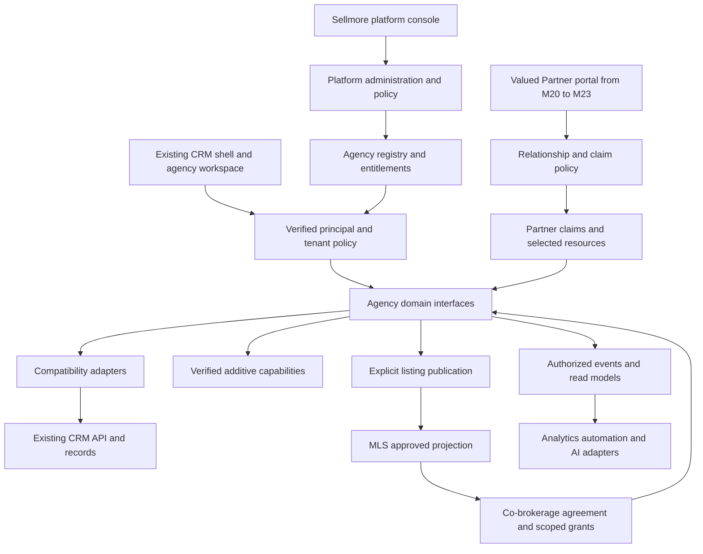
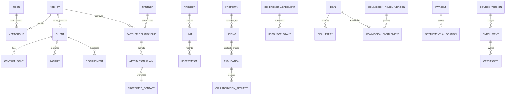

# SELLMORE MASTER PRODUCT ARCHITECTURE, SAAS TRANSFORMATION & MODERNIZATION BLUEPRINT

**Historical working draft — superseded by [the authoritative master architecture](SELLMORE_MASTER_ARCHITECTURE.md).** Earlier analysis is retained for provenance; use the five final deliverables for approval and execution scope.  
**Date:** 30 September 2026  
**Evidence baseline:** [REDBOX CRM master audit](REDBOX_CRM_MASTER_AUDIT.md), read in full, including its 56 modules, 287 routes, API inventory and appendices.  
**Companion:** [Phase 0 stabilization work package](SELLMORE_PHASE_0_STABILIZATION.md).

Sellmore will evolve the existing CRM into an agency-neutral real-estate operating system. REDBOX Estate becomes its first agency tenant. The safest path preserves working sales, inventory, finance, HR, affiliate and document workflows, establishes verified server authorization, then adds tenant administration and new domains behind compatible contracts. The current dashboard shell remains the foundation.

The supplied brief and its continuations are treated as one specification. Business requirements are distinguished from proposed implementation choices. All supplied sections 1–138 have now been reconciled in the authoritative master and its four companion documents. The earlier roadmap below is historical, not the final delivery schedule.

## Reading guide

- Platform, tenancy, plans and role dashboards: sections 2–9.
- Clients, partners, commission, agents, property and MLS: sections 10–17.
- Compatibility, workstreams, acceptance and decisions: sections 18–21.
- Detailed sales, communication, UI, AI and governance contracts: sections 22–35.
- Complete target navigation and numbered delivery roadmap: sections 36–37.
- Every existing module and route preservation obligation: Appendix A.
- Numbered requirement traceability: Appendix B.
- Immediate implementation backlog: [Phase 0 stabilization package](SELLMORE_PHASE_0_STABILIZATION.md).
- Mandatory server/schema evidence gate: [backend discovery checklist](SELLMORE_BACKEND_DISCOVERY_CHECKLIST.md).

## 1 Evidence and decision boundaries

| Label | Meaning in this blueprint |
|---|---|
| Verified frontend baseline | Evidence recorded in the audit; client wiring does not prove successful server behavior. |
| Business requirement | A product decision explicitly supplied in the Sellmore brief. |
| PROPOSED TARGET MODEL — NOT VERIFIED CURRENT SCHEMA | Every new entity, relationship, policy field, event and service boundary described here. Names are conceptual, not SQL or migration instructions. |
| BACKEND VERIFICATION REQUIRED | Current API authentication, database engine/schema, authorization, transactionality, queues, storage, integrations and deployment remain unknown. |
| Proposal requiring owner decision | Recommended precedence, lifecycle or operational policy beyond the supplied requirements. |

The neighboring Next.js/Prisma/PostgreSQL website remains a separate system. No assumption of shared identities, tables, authentication or synchronization is permitted. Existing `company_id` values are not yet verified tenant IDs. A company may be a legal entity, branch-related business structure or other reference; map it only after source and business review.

The audit baseline contains 534 JavaScript files, 112 Redux action files and 569 recognized API call sites. Its tests passed 10 dashboard/navigation tests with mocked requests/charts; lint reported 1 error and 6,733 warnings. These are baseline results, not a fresh SaaS acceptance test. Its 20 potentially unused files are review candidates, not a removal list.

A targeted source re-read adds precision to T01: Deal Form renders its copied petty-cash row actions; Vehicle Pass defines the copied delete handler but its row actions and pagination are commented out. Both still dispatch petty-cash reads. This does not reduce the need to contain wrong-resource code, but distinguishes a reachable destructive control from dormant code. The original audit remains unchanged as the dated evidence baseline.

## 2 Product boundaries and architectural decisions

Sellmore encompasses CRM, brokerage operations, property/project inventory, distributed agents, Valued Partners, inter-agency MLS, deals, finance/commissions, HR, LMS, marketing attribution, communication, automation, AI assistance and business intelligence. These are coordinated domains, not a requirement to ship every feature together.

| Decision | Proposed architecture and consequence |
|---|---|
| Evolution | Keep legacy pages, IDs, routes, integrations and printed documents. Introduce adapters before replacing implementations. |
| Tenant | An Agency is a SaaS customer and privacy boundary. REDBOX is the first tenant, not a privileged hardcoded branch of core logic. |
| Platform administration | A separate control plane with initially one Platform Super Admin. Agency Admin privileges cannot grant platform privileges. |
| Client identity | One canonical client within an agency where feasible, with many contact points, inquiries and requirements. No platform-wide private client directory. |
| Partner | An external collaborator connected through an Agency Partner Relationship; not automatically an agency tenant or employee. |
| Property | Physical asset identity is distinct from a listing offering it for sale/rent. Private cross-agency property equivalence does not imply shared ownership/contact data. |
| MLS | Explicit publication of a limited listing projection and controlled collaboration grants. Never a query over all tenants' private records. |
| Finance | Preserve current accounting contracts. Commission rules and postings are versioned, reviewed and reversible through correcting entries. |
| Frontend | Keep CrmLayout, navigation registry and working routes; incrementally compose role dashboards and reusable page primitives. |
| Backend topology | Prefer clear domain boundaries within the existing backend where practical. Service boundaries are logical; no microservice fleet, new framework or database is selected without server evidence. |
| Rollout | One authoritative writer per operation; adapters, additive mappings, feature flags and reconciled read comparisons. No uncontrolled dual writes. |

### Proposed system map

**BACKEND VERIFICATION REQUIRED:** this is a target map. The current server may already provide parts of these boundaries; reuse them after verification. A new browser shell or API proxy alone cannot secure reachable legacy endpoints.

## 3 Phase 0 release blockers and delivery gates

No second agency should be onboarded to shared production data until the tenant isolation gate passes. Broad feature development follows a bounded stabilization package; cosmetic work must not mask unresolved integrity issues.

| Gate | Audit basis | Concrete deliverable | Exit evidence |
|---|---|---|---|
| P0 A Resource integrity | T01, M42/M43 | Disable copied destructive actions and misleading mutation shortcuts until intended resource contracts are verified; retain genuine M37 petty-cash workflows | Fixture tests prove affected screens cannot issue petty-cash mutations; enabling tests later assert verified method, resource and IDs |
| P0 B Lead round trip | T02, M04 | Complete field-contract matrix; obtain server mappings; then separately repair supported load/save paths | Create/edit fixture for every supported field; unknown keys remain blocked from implementation |
| P0 C Authorization | S01/S06, M01/M15 | Principal/session, tenant and action/object policy inventory across all endpoint families | Anonymous, wrong-role, wrong-tenant, export, file and direct legacy endpoint negatives pass in authorized staging |
| P0 D Password serialization | S02, M48 | Backend-owner review of employee serializer and change/reset contract | No password or hash in employee reads, logs, fixtures or editable returned data |
| P0 E Failure behavior | T06, M01 and action inventory | Request outcome specification, login recovery pilot, incremental adapters | Rejected fetch, timeout, invalid JSON, HTTP error, business error and expired session terminate loading without false success |
| P0 F Compatibility | T07/T08, all modules | Route/action/role matrix, print samples and rollback runbook | Existing 287 routes remain accounted for; authorized workflows and specialist finance/HR views retain access |

The [stabilization package](SELLMORE_PHASE_0_STABILIZATION.md) includes current field names, test cases and owners to assign. No guessed endpoint or guessed schema may clear a gate. Technical containment can proceed without inventing the intended replacement business workflow.

## 4 Platform administration and agency lifecycle

**PROPOSED TARGET MODEL — NOT VERIFIED CURRENT SCHEMA.** Separate PlatformPrincipal/PlatformRole from AgencyMembership/AgencyRole. A person who eventually holds both uses an explicit context switch; no implicit inheritance joins their powers.

Initially one active Platform Super Admin controls agency creation/approval/activation/suspension, plan catalogs, entitlements, usage/storage limits, platform security/settings, global integrations, MLS governance, approved shared taxonomies, health, audit access, billing configuration and announcements. The current `/admin/dashboard` is a legacy M02 route, not proof that a SaaS control plane exists. Do not convert its existing role IDs into platform authority automatically.

Required agency lifecycle: CREATE → PENDING → ACTIVE, with SUSPENDED and CANCELLED/CLOSED paths. Review, approval and provisioning are proposed substates of PENDING; active agencies may move to SUSPENDED, then approved reactivation or CLOSED. Record status reason, actor, effective time and version. Provisioning should be idempotent and resumable; failure must not leave a publicly accessible half-created tenant. Approval and subscription status are independent.

Suspension blocks normal access and new automated business actions at server boundaries. Define separately whether authorized account recovery, settlement and scoped data export remain available. It must not delete clients, reverse deals or cancel financial obligations. Offboarding revokes sessions, API credentials and sharing grants, stops jobs, and follows an approved retention/export process.

Platform administration does not mean unrestricted daily access to all customer content. Default dashboards use operational aggregates; exceptional tenant support access requires a reason, limited scope and duration, visible audit and explicit policy. Record the real platform actor as well as any assisted user. With one administrator, self-approval is not independent review: use owner notifications and tamper-resistant records, and define an offline recovery procedure without silently creating another active super-admin account.

## 5 Tenant isolation and authorization

### Required decision path

Proposed authorization decision:

`verified principal + active agency membership/service grant + permitted agency state + effective entitlement + action permission + record scope + resource policy + lifecycle constraints`

All conditions must hold. A plan entitlement does not grant user permission; a feature flag does not grant either. Titles such as Manager or CEO are role templates, not code-level bypasses. Evaluate read, list, create, update, delete, assign, approve, share, export, print and download separately.

The target role hierarchy is Platform Super Admin; within an agency, Agency Admin → Group/Department Head → Manager → User/Agent. Reporting hierarchy influences scope only through approved policy. Membership and reporting changes are effective-dated; detect cycles and recompute scope when staff transfer or leave. A manager's access to sales does not imply access to employee health, payroll or complaint records.

Tenant selectors in URLs, headers, `agentId`, `company_id`, team/role IDs and localStorage are untrusted inputs. The server validates identity and membership and binds a request context. Record resolution must include that context before returning data or accepting a mutation. Shared or support operations use explicit grant types rather than a generic “all tenants” flag. Tenant-scoped context, data access and asynchronous processing are established security boundaries in [OWASP multi-tenant guidance](https://cheatsheetseries.owasp.org/cheatsheets/Multi_Tenant_Security_Cheat_Sheet.html).

### Isolation coverage

| Surface | Sellmore target invariant | Required negative case |
|---|---|---|
| API and database access | Repository/service methods require verified tenant context, including joins and bulk operations | Guess another agency's record ID or mix foreign IDs into a bulk request |
| Unique references and relationships | Business uniqueness and references are scoped appropriately; tenant ownership must agree across related private records | Link Agency A payment to Agency B deal |
| Sessions and browser state | Tenant switch clears incompatible caches/views and cancels in-flight work; stale responses cannot populate the new tenant | Switch tenant during a slow response; reopen persisted state |
| Caches and analytics | Key includes tenant, relevant permission/scope version and query definition | Same query/ID in two agencies never reuses private results |
| Files and prints | Tenant-owned metadata and authorized download/print; guessed URLs do not authorize access | Open another tenant's CNIC, attachment, receipt or export |
| Jobs and events | Trusted producer binds tenant; consumer validates context, active grant and idempotency | Forge/replay a job with a different tenant; process after suspension |
| Search and AI | Authorized retrieval before ranking or model use; tenant-scoped indexes and invalidation | Similar names/phone prefixes cannot reveal foreign records or result counts |
| Webhooks and integrations | Verified provider account maps to an authorized tenant integration; secrets remain server-side | Valid event for another account cannot be relabeled by request parameters |
| MLS and partners | Only approved publication/grant projections; private records never become public by association | Revoked participant cannot fetch a cached full record |
| Operations and restore | Backups, logs and restore jobs retain tenant boundaries; access is audited | Restore/export one tenant without disclosing another |

### Physical isolation remains a backend decision

**BACKEND VERIFICATION REQUIRED.** Compare shared tables with strict tenant-aware access and database enforcement where supported, separate schemas with isolated roles, or separate databases with isolated credentials/backups. Shared tables simplify operations but make omitted tenant predicates dangerous; separate schemas/databases increase migration and operational cost and still require correct authorization. Do not assume row-level security exists or select a database to obtain it.

Decision inputs: existing engine/ORM, current company relationships, tenant counts, data volume, restore/export needs, operational capacity, enterprise isolation contracts and measured load. Preserve REDBOX's existing deployment until its ownership mapping and safe migration approach are verified. Even if dedicated databases become necessary, share compatible code and contracts rather than forking the product per agency.

### Authorization acceptance

Use an actor × resource × action matrix for tests and include direct legacy endpoints, lists, exports and files; menu tests alone do not establish authorization. This follows the testing approach described in [OWASP authorization regression guidance](https://cheatsheetseries.owasp.org/cheatsheets/Authorization_Regression_Testing_Cheat_Sheet.html). Sellmore fixtures must include two agencies with colliding legacy numeric IDs, two branches, managers/agents, a suspended member, a partner and a platform actor.

## 6 Organization and identity

**PROPOSED TARGET MODEL — NOT VERIFIED CURRENT SCHEMA.** Agency owns branches, departments, teams, designations and organization configuration. Preserve M48/M49 reporting/employee identifiers through adapters. A User represents authentication; an AgencyMembership represents access; an Employee/AgentProfile represents business and HR details. A person may be a contractor or partner without becoming an employee.

A target identity system may allow one login to hold multiple explicit agency memberships. That is a future capability decision, not permission to combine current accounts. Agency-private client/contact identities remain separate even if a login is global. Map legacy IDs with `(source system, source entity, legacy ID, verified agency)` and a stable target reference; preserve original IDs in URLs and documents.

Roles define actions, scope defines own/team/department/branch/agency coverage, and record policies add assignment, confidentiality, certification, partnership or approval constraints. Default scope is narrow and explicit. Changes to permissions, employment, certifications and agency status invalidate cached capability decisions and outstanding privileged actions.

## 7 Subscription plans and entitlements

The supplied initial plans are:

| Plan | User limit | Pricing |
|---|---:|---|
| Individual | 1 | Configurable; no price supplied |
| Starter | Up to 5 | Configurable |
| Professional | Up to 10 | Configurable |
| Business | Up to 25 | Configurable |
| Enterprise | Custom | Configurable agreement |

**PROPOSED TARGET MODEL — NOT VERIFIED CURRENT SCHEMA.** PlanVersion defines configurable user, storage, AI and automation limits; module/feature entitlements; integrations/reports; branding; API access; custom fields; MLS and partner-network access; and add-ons. AgencySubscription pins an effective version and approved overrides. EntitlementGrant records source, scope, dates, reason and limits. Usage records have an event identity, period, unit and adjustment history.

Separate commercial entitlement from rollout flags. Examples of proposed keys include `sales.leads`, `partner.claims`, `network.mls.publish`, `lms.certification` and `ai.summaries`. These are new conceptual capability names; they are not substitutions for current numeric permission IDs until a verified mapping exists.

Proposed enforcement: atomically reserve capacity for pending seat invitations and large uploads/jobs; commit actual usage or release the reservation. Count rules for invitations, service accounts, partners and inactive users need owner approval. Test simultaneous invitations at the 5-user boundary. AI usage must record the configured billable unit rather than assume tokens equal cost. No pricing calculator, billing provider or tax logic is implemented by this architecture.

Downgrades do not delete staff, files or history. Show required remediation and apply the agreed policy to new consumption; preserve authorized access to retained records. Suspension, payment delinquency and plan limits are separate states. REDBOX's current access is captured as an explicit migration entitlement baseline before commercial enforcement, so first-tenant adoption does not accidentally remove working modules.

## 8 Agency branding and route compatibility

Agency branding includes name, logo, colors, address, phone, email, website and receipt/invoice/document presentation. Sellmore remains the technology identity. Use a versioned BrandingProfile with validated assets, accessible color constraints and REDBOX fallback values during its rollout. Do not inject tenant-supplied CSS/scripts or remote asset URLs without validation.

Extract reusable platform labels gradually from `CrmLayout`, common headings and new primitives. Do not rename existing files, domains, REDBOX assets, marketing URLs or printed references simply to display Sellmore. Old issued documents retain their original branding snapshot and identifiers; new branding must not retroactively rewrite legal/accounting artifacts. A reprint uses the historical version unless explicitly designated a revised document.

All 287 legacy routes remain registered as compatibility contracts. Appendix A maps their complete module groups into Sellmore domains. Preserve query parameters, parameter meanings, view/edit modes, return navigation and standalone print/affiliate layouts. New canonical routes, if later approved, resolve old IDs through verified adapters; they never treat an old numeric ID as a global tenant-independent identity.

## 9 Dashboard composition and information architecture

Keep the current shell and its SVG icons, module search, active links and main content workspace. Extend a dashboard registry describing widget ID, definition version, source adapter, allowed roles/actions, entitlement, scope, period, freshness, drilldown and loading/error behavior. No widget may query a broader scope because the user is on a management dashboard.

| Audience | Required composition | Existing foundation and readiness |
|---|---|---|
| Platform Super Admin | Agencies, active users, subscription usage, health, MLS activity, security alerts, growth; revenue only when billing exists | New control-plane metrics; `/admin/dashboard` is not proof of these sources |
| Agency Admin or CEO | Revenue, pipeline, deals, collections, receivables, conversion, inventory, team, attribution, commission, forecast, alerts | M02/M09/M10 and finance reports; definitions and missing capabilities gated |
| Department Head | Department KPIs, teams, tasks, targets, pipeline, exceptions | M02/M09/M14 with verified department scope |
| Manager | Team leads, follow-ups, calls, meetings, viewings, deals, targets, conversion | M03/M07/M08/M09; viewings/targets need contracts |
| Agent | My Day, leads, tasks, follow-ups, calls, meetings, viewings, pipeline, deals, commission, targets | Compose existing lists, reminders and tasks first |
| Marketing | Campaigns, sources, CPL, quality, conversion, source/project performance | M06/M09/M24; spend/source attribution remains partial |
| Finance | Collections, receivables, payables, expenses, commissions, cash/bank, revenue, P&L indicators | Preserve M02 and finance families; unverified ledger-derived values unavailable |
| HR | Employees, attendance, leave, recruitment, training, performance | M48–M56 and HR overview; protect sensitive subfields |

Every metric must expose definition, scope, period, freshness and source, with distinct zero/missing/error/stale states. Proposed examples: collections is confirmed receipt allocations in the period less approved reversals, subject to finance sign-off; lead conversion is a defined inquiry cohort reaching an agreed stage, not total clients divided by assigned leads; active users means a documented activity window. Property sale price is not agency revenue, and agency revenue is not Sellmore subscription revenue. Forecasting must be labeled estimated and omitted until its data and method are accepted.

The agency navigation retains the audit's Home, Sales, Properties, Communication, Marketing, Business, People, Finance, Analytics, Admin and AI groups. Add **Network** for explicit MLS/co-brokerage, **Valued Partners** for relationships/claims, and **Learning** for training/certification as capabilities become available. Platform console and partner portal use separate permitted navigation. Module search stays distinct from eventual authorized record search. Planned entries must not masquerade as functioning pages.

## 10 Canonical clients and requirements

**PROPOSED TARGET MODEL — NOT VERIFIED CURRENT SCHEMA.** Within an agency, Client owns ContactPoints and has many Lead/Inquiries and Requirements. A requirement describes intent, location/type/size/budget/timing preferences, readiness and status; it may link multiple inquiries over time. An inquiry retains original source, campaign, raw input, received time and assignment history even after linkage to a known client.

Ahmed Khan can have DHA Phase 8 buying, DHA City investing and Clifton renting requirements without three person records. Requirement-specific budgets and follow-ups must not overwrite each other. Activities link to the relevant client, inquiry and/or requirement; offers, viewings, deals, documents and referrals preserve their own relationships. Support organizations, joint purchasers, shared contact points and multiple authorized contacts rather than forcing every record into one person's mobile number.

Do not globally deduplicate clients across independent agencies. A controlled co-brokerage grant can share an approved representation for a selected opportunity without transferring or merging private identities. A partial partner contact may remain an unlinked ProtectedContact until an authorized identity review succeeds.

### Proposed duplicate engine

Return EXACT MATCH, PROBABLE MATCH or POSSIBLE MATCH candidate evidence, never an automatic merge instruction. Exact refers to compared identifiers, not guaranteed person identity. Preserve raw and normalized values, country context, source and provenance. Strong signals may include normalized full mobile/WhatsApp or legitimately collected identity number; email, name, project, requirement, time and source are secondary. Shared phones, recycled numbers and different identity-document types must be represented.

Candidate generation and review are tenant-scoped and permission-filtered. Partial prefixes generate only possible attribution matches. Name similarity cannot collapse payment-plan choices; M44's `clientName`-keyed UI is a stabilization issue. Retain `getduplicateleads` behind a verified adapter before introducing a new matching engine.

A proposed MergeJournal records reviewer, reason, candidate evidence, before/after relationship mapping, aliases, affected versions and conflict checks. Sensitive client/property/financial merges require human approval. Reversal restores links only when safe; later activity may require reviewed compensating changes instead of blindly replaying an old snapshot. Never move monetary balances or property ownership by similarity score.

## 11 Valued Partners and protected attribution

### Agency and partner are separate concepts

M20 onboarding, M21 affiliate leads/activity, M22 selected inventory and M23 documents/training form the starting point for the Valued Partner portal. Keep their historic URLs, OTP/API vocabulary and affiliate IDs behind an adapter. A Partner may be a broker, agent, agency or referrer collaborating on selected projects, listings, clients/opportunities and deals. An AgencyPartnerRelationship contains approval, permitted resources, agreement, status and visibility policy.

A company may independently be both a SaaS agency and another agency's Valued Partner. Link the two identities explicitly if authorized; tenancy grants no partnership rights and partnership grants no tenant-wide CRM access. The same external partner working with multiple agencies has separate claims, terms and private histories for each relationship.

### Protection policy

Business requirement: default protection is **30 days**, configurable by platform, agency, project, campaign/opportunity and partner agreement. Proposed precedence, requiring owner approval: specific signed agreement override → campaign/opportunity override → project override → agency override → platform default. Validate conflicting scopes rather than selecting arbitrarily; record which version won. Platform governance may constrain allowed ranges but must not silently rewrite signed terms.

At claim acceptance, snapshot introduced time, submission time, protection start/end, applicable timezone, effective policy/version, agency, partner relationship, project, requirement, attribution state, commission policy and dispute state. Proposed default start is server acceptance; any backdated introduction requires authorized evidence and review. Define days as an explicit duration or calendar-day convention before implementation. Use a start-inclusive/end-exclusive interval and trusted server time for comparisons. Policy edits affect future claims unless an authorized recorded amendment changes an existing claim.

Expiry ends the configured protection window; it does not erase the introduction, settled entitlement or dispute evidence. Whether a deal accepted within protection but closed later remains eligible is an agreement rule still requiring an owner decision.

### Protected partial contact

The supplied example `030012345` is nine digits of an expected eleven-digit Pakistani local mobile and displays as `030012345••`. This is **PARTIAL**, never a unique client key or a dialable number. The example is illustrative input, not a customer record.

Proposed ProtectedContact stores raw submitted value, normalized known digits, country/format context, expected full length, provided digit count, completeness, masking metadata, partner relationship, agency, project/requirement and timestamps/protection metadata. Do not fabricate the missing digits, an E.164 full number or a globally unique constraint. Account for domestic trunk-prefix versus international country-code representations using an agreed normalization contract. Reject contradictory lengths; set a reasonable minimum prefix policy through owner review to reduce unusably broad claims.

The server compares a later full contact only within authorized agency/project/requirement and time-policy scope. A compatible prefix creates a **POSSIBLE PARTNER ATTRIBUTION MATCH** for review. The partner receives only its permitted claim state/masked representation, never the full number, other claimants' details or a search oracle revealing client existence. Apply rate limits and generic submission responses; masking in the browser alone is insufficient. Partial contacts cannot trigger phone/WhatsApp sends.

### Partner Attribution Claim

**PROPOSED TARGET MODEL — NOT VERIFIED CURRENT SCHEMA.** Claim includes claim ID, agency, partner relationship, protected contact reference, optional reviewed client link, project/requirement, submitted/introduced times, protection window/policy version, match confidence/reasons, attribution status, commission policy snapshot, deal links, dispute/resolution and append-only audit references.

Preserve supplied display statuses ACTIVE, EXPIRED, MATCH_PENDING, MATCH_CONFIRMED, REJECTED, DISPUTED, CONVERTED, COMMISSION_PENDING and COMMISSION_PAID. Proposed internal model separates protection state, match/adjudication state, conversion state, commission state and dispute state because a paid claim can still be disputed, and expiry can coexist with an earlier eligible conversion. Derive the display label without discarding those dimensions.

| Trigger | Authorized decision and invariant |
|---|---|
| Introduction submitted | Validate relationship and policy; record claim independently of any canonical client link |
| Possible full-contact match | Queue evidence for an authorized reviewer; no auto-merge, payout or disclosure |
| Match confirmed/rejected | Record decision reason, evidence and reviewer; retain competing claims |
| Multiple overlapping claims | Open dispute review; earliest submission alone is not automatically the winner |
| Protection expires | Preserve history; evaluate later eligibility against snapshotted terms |
| Deal linked | Verify parties/project/requirement and attribution; snapshot the applicable agreement |
| Commission approval/payment | Finance policy and separation of duties apply; sales cannot mark an obligation paid |
| Dispute or reversal | Freeze contested settlement as policy requires; append resolution/adjustment, never silently overwrite attribution |

Ordinary salespeople can view permitted attribution and submit evidence; they cannot change claimant, protection dates or adjudicated ownership. Partners can review their own claims and appeal through scoped workflows. Assign an authorized agency reviewer and an escalation policy before launch.

## 12 Commission and finance architecture

**PROPOSED TARGET MODEL — NOT VERIFIED CURRENT SCHEMA.** CommissionPolicyVersion may vary by agency, project, developer, partner, deal, campaign or agreement. Record applicable precedence and freeze the selected rule/version at the agreed business event. The brief's example is `PKR 1,000,000 eligible agency commission × 25% = PKR 250,000 partner entitlement`. Neither 25% nor 30 days is a global code constant.

Eligible agency commission is not property price. Agreements must define gross/net basis, taxes/withholding, approved deductions, rebates, collection dependence, vesting, cancellation/clawback, rounding, currency, split order and caps. These are business/accounting decisions, not legal or tax advice. No current tax rate is assumed.

Separate proposed concepts: policy calculation → entitlement → approved accrual/payable → settlement allocation → payment/reversal. Store basis inputs and version so later policy edits do not recalculate historical obligations. Use decimal or explicit fixed-precision money with currency on the server after engine verification; browser totals are previews. Split totals and adjustments must reconcile to the eligible pool, and duplicate requests must not post twice.

Reuse M29–M35 account/dimension/mapping/voucher contracts and M37/M39/M40/M44/M46 cash, bank, receipt and schedule records. Commission-specific ledger structures are additive only where absent. M42's unfinished commission fields are not a verified existing ledger. Keep payroll commissions and external partner payables separately attributable; one must not silently satisfy the other. Preserve printed references and reconcile old/new reads before any writer switch.

## 13 Agent network and learning

Preserve M48/M49 employee/organization administration, M55 recruitment/termination, M51 training, M23 affiliate training resources and M15 permissions. Extend them through explicit profile/membership links rather than recategorizing every affiliate as an employee.

Required lifecycle: APPLICATION → IDENTITY VERIFICATION → DOCUMENT COLLECTION → POLICY ACCEPTANCE → ONBOARDING → TRAINING → ASSESSMENT → CERTIFICATION → ACTIVATION → LEAD/INVENTORY ACCESS → PERFORMANCE → DEALS/COMMISSION → PROMOTION, with SUSPENSION and EXIT transitions. These states represent business process; accepted policy versions, verification outcomes and assessments need their own audit records.

**PROPOSED TARGET MODEL — NOT VERIFIED CURRENT SCHEMA.** CourseVersion contains modules/lessons, video/document references, quizzes, assessment attempts, pass criteria and certification requirements. Enrollment and completion link an agency membership to the applicable course version; Certificate records issuer, issue/expiry dates, course/project scope, status and revocation. Public verification returns only approved certificate details.

A lead/project access rule may require active certification in addition to role/scope/entitlement. Evaluate it at the server when assigning/accessing restricted work and when a certificate expires or is revoked. Expiry must not erase existing deal records or earned commissions; define supervised handoff/remediation. Existing training screens do not prove an LMS assessment or certification engine exists.

For hundreds/thousands of agents, use paginated directories, queued document processing, bounded imports, searchable team scopes and event-based progress summaries. Do not load the entire network into every browser or grant network-wide client search. Load and concurrency targets require an agreed pilot workload before choosing infrastructure.

## 14 Properties listings geography and project inventory

### Property and listing identities

**PROPOSED TARGET MODEL — NOT VERIFIED CURRENT SCHEMA.** Property represents a physical asset; Listing represents a dated offer to sell, rent, lease or market it, with asking terms, originator, mandate, visibility, approval and status history. Multiple listings may refer to one physical property and preserve differing prices/broker provenance. Private agency property records remain isolated; a reviewed shared property reference may later aid MLS deduplication without revealing private relationships.

Store ownership/mandate provenance and validity separately from listing claims. An owner can own many properties, and co-ownership is supported through explicit relationships. Listing claims about title or authority are not automatically verified ownership. Maintain offer and price history rather than replacing yesterday's price silently.

### Fast entry and extensible geography

The usual minimum is Location, Property Type and Size, plus only the identifying fields required by that property type. Use progressive disclosure for pricing, rooms, amenities, ownership, media and documents. Submission/publication may require further policy fields without forcing a 50-field initial draft. Keep arbitrary extension data out of critical price, ownership and availability invariants.

The Pakistan-first hierarchy supports Country → Province/Region → City → Society/Community → Phase → Sector/Zone → Block → Street/Road → Plot/Unit. Not every path contains every level. Proposed LocationNode has stable identity, parent, level/type, jurisdiction, aliases and optional geometry; parent/type rules can vary internationally. Preserve raw addresses and legacy codes. Geographic containment is distinct from project structure.

Store size value, unit and unit-definition context. Do not assume one marla/kanal conversion across every market; version approved conversions and preserve original units. Geocoding is a separately authorized integration, not a reason to overwrite verified plot identifiers.

### Projects and developers

Reuse M10 `project`, `projectinventory`, block/plot filters and M11 sale links. Map actual structures before creating custom-field infrastructure. Target concepts are Developer, Project, ProjectPhase, Tower/Block/Sector, Unit, InventoryPosition, PaymentPlan, CommissionPolicy, Media, Document, Amenity and versioned CustomFieldDefinition where truly needed.

Apartment: Project → Tower → Floor → Apartment. Plot: Project → Sector → Street → Plot. Commercial: Project → Tower → Floor → Shop/Office. A physical unit can be linked to its property identity; inventory describes marketable stock/status under a verified mandate, not another disconnected physical asset. Existing financial stock registers M47 remain operational stock, not property units.

### Approval and availability

Preserve DRAFT, SUBMITTED, UNDER_REVIEW, CHANGES_REQUESTED, APPROVED, REJECTED, ACTIVE, ON_HOLD, SOLD, RENTED, EXPIRED and ARCHIVED as required vocabulary. Proposed implementation separates approval state from marketing/availability state with a derived display status; approval alone does not make a unit available or authorize MLS sharing.

Submitter edits after approval create a reviewable revision for material changes. Record actor, timestamp, reason and previous state on each transition. Agency policy can allow immediate activation for permitted inventory or require an independent reviewer. SOLD/RENTED is linked to an authorized deal/tenancy transition; archiving does not delete history. Define cancellation/reopening semantics with inventory and finance owners.

### Reservation concurrency gate

**BACKEND VERIFICATION REQUIRED:** inspect M10/M22 hold/unhold/cancel and M11 sold behavior, database constraints and transaction boundaries before modernizing them. Proposed command includes resource identity, expected version and idempotency key; server derives actor/tenant and validates lifecycle. Atomically verify availability and commit the reservation or return a conflict. Expiry is server-authoritative, and late expiry jobs cannot unlock sold units.

Concurrent hold/sale/unhold commands must have a single valid winner; reject stale versions and return current authorized state. Record starts/expiry, actor, customer/requirement, reason and history. Authorized unhold/cancel is distinct from expiry, and a confirmed sold lock requires an approved cancellation/reversal workflow. The hardcoded UI timer cannot be the authority. A lease/rental availability model may need periods rather than one permanent sold flag; do not force that semantics into current project stock prematurely.

## 15 Sellmore Network and MLS

### Publication boundary

**Business requirement:** private by default; sharing requires an explicit “Share with Sellmore Network” decision. **PROPOSED TARGET MODEL — NOT VERIFIED CURRENT SCHEMA:** PublicationVersion is an allowlisted projection of an approved listing, owned by the publishing agency, with audience, validity, sharing policy/version and revocation state.

Allow only approved property characteristics, permitted approximate/exact location, asking terms, availability/freshness, approved sanitized media and brokerage contact method. Exclude owner phone, CNIC, private notes, internal commissions, private documents and private agent details. A separately agreed co-brokerage offer can expose approved commercial terms; it must never copy the internal commission ledger. Inspect media for embedded personal data, overlays and metadata before publication.

Edits to private listings do not silently broaden published fields. Material changes produce a new reviewed publication version. Withdrawal invalidates search/cache access and future downloads. Existing authorized counterparties retain only agreement-required historical evidence under explicit policy; previously downloaded data cannot be magically recalled. Do not promise absolute revocation of offline copies.

### Required co brokerage flow

The supplied continuation establishes this flow; contract/grant details are proposed implementation choices:

1. Agency A, as listing owner/publishing and seller-side agency, approves a listing and explicitly publishes its limited projection.
2. Agency B discovers it and submits protected buyer interest for a selected client/opportunity as buyer-side/co-broker agency. The request contains only authorized protected contact/requirement data.
3. Duplicate and attribution checks run within the permitted scope. Ambiguous/overlapping claims go to authorized review; no automatic merge or full-contact disclosure occurs.
4. Agency A accepts or rejects the request. Accepted collaboration pins a versioned agreement, commission-sharing rules, listing/opportunity references and limited resource grants.
5. Authorized information is shared and viewing, negotiation and offer progress. Revalidate availability and listing expiry; publication does not reserve stock.
6. A deal closes through approved domain transitions; agreed commission-sharing terms determine auditable entitlements.
7. Finance verifies settlement evidence. Both agencies' authorized ledgers/history receive correlated, idempotent entries or verified adapter updates, with reconciliation and correcting entries for failure/reversal. No assumption of a distributed atomic transaction between independent ledgers.
8. Retain deal linkage, buyer/seller/co-broker roles, request decisions, protection, agreement, dispute and audit history. Expiry/suspension/revocation closes future access without silently deleting settlement obligations.

Proposed network objects: ListingPublication, CollaborationRequest, CoBrokerAgreementVersion, SharedOpportunityReference, ResourceGrant, NetworkEvent and DisputeCase. Each shared record explicitly lists participants and allowed operations. A nullable tenant ID must never mean “public.” Listing ownership, publishing agency, buyer-side agency, seller-side agency and co-broker participation are explicit roles; listing expiry and availability verification are mandatory. Platform moderators see the approved MLS surface by default; private evidence access is separately scoped and audited.

## 16 Communication marketing search automation and AI

Preserve M07 activities/reminders, M08 Zong/history, M06 imports/source fields, M14 tasks and M19 content requests. The chat/email templates in M16 and static M17/M18 dashboards must not be advertised as working integrated capabilities.

| Capability | Incremental target and acceptance boundary |
|---|---|
| Communication | Adapt Zong and existing activity evidence first; add provider-neutral channel interfaces later. Distinguish click/attempt from sent/delivered/read/completed. Tenant/provider account mapping, consent, opt-out and replay-safe webhooks precede sending. |
| Marketing | Preserve campaign/source/ad-spend fields and inquiry provenance. Normalize source/touchpoint identities and approved attribution windows; separate source marketing credit from partner entitlement. Website feed requires a verified bridge and replay policy. |
| Global search | Server-authorized, typed minimal results across permitted clients/leads/properties/plots/projects/agents/deals; separate private, partner and MLS indexes/projections. Revocation invalidates results; partial contacts cannot reveal full identities. |
| Timeline | Adapt existing lead, call, reminder and task histories into entity-linked events with real actor/time/source. Backfills retain timestamp uncertainty; restricted security/HR audit detail stays outside ordinary sales timelines. |
| Automation | Versioned trigger/condition/action rules, tenant-bound workers, dry run, idempotency, budgets, retry/dead-letter handling and kill switch. Recheck membership, certification, protection and consent when delayed actions run. |
| AI | Provider-neutral capability gateway for grounded summaries, drafts, matching and insights. Tenant-authorized retrieval before provider calls; provenance, budgets, evaluation and human review. No unapproved messages, client merges, claim adjudication or finance postings. |
| Analytics | Versioned metric definitions and reconciled read models; tenant/scope-aware aggregates and freshness. Static graphs never populate executive KPIs. Platform analytics do not expose agency customer details. |

**BACKEND VERIFICATION REQUIRED:** none of the proposed workers, event stores, shared indexes or AI interfaces is confirmed in the legacy CRM. Begin with a modular implementation and measured needs; do not make separate queues/search/vector infrastructure prerequisites for simple working lists.

## 17 Target logical model and ownership register

**PROPOSED TARGET MODEL — NOT VERIFIED CURRENT SCHEMA.** All entities below are conceptual additions or reconciled equivalents, not claimed existing tables.

The diagram intentionally omits many links for readability. Tenant ownership applies to every private entity even when not drawn. Shared agreement participants and grants are explicit exceptions, not removal of tenant boundaries.

| Ownership | Target records | Invariants |
|---|---|---|
| Platform | Agency registry/status, PlatformPrincipal, PlanVersion, subscription configuration, global taxonomy versions, platform announcements and audit | No implicit agency client access; one initial Platform Super Admin |
| Agency private | Membership, employee/agent profile, branches/departments/teams, clients/contact points/inquiries/requirements, owners/properties/listings/projects/units, tasks/activities/calls, documents, deals, finance/HR, campaigns/configuration | Verified tenant context and object scope; stable legacy mapping |
| Agency with restricted partner projection | AgencyPartnerRelationship, ProtectedContact, AttributionClaim, PartnerAgreement, permitted training and selected inventory | Partner sees only its authorized relationships/claims; private full contacts remain hidden |
| Explicit network collaboration | PublicationVersion, CollaborationRequest, CoBrokerAgreement, ResourceGrant, shared opportunity references, dispute evidence | Named participants, permitted fields/actions, validity and revocation |
| Versioned financial contracts | CommissionPolicyVersion, Entitlement, Accrual, SettlementAllocation, reversal/adjustment references | Monetary reconciliation, business approvals and no destructive historical rewrite |
| Infrastructure metadata | ContractVersion, LegacyIdMap, Event/Outbox, MergeJournal, backfill checkpoints, capability/usage decisions | Tenant-aware, minimum sensitive data, reproducible replay and audit |

## 18 Compatibility APIs and safe data evolution

Audit Appendix C covers 112 action files, but mutations also occur directly in components. An adapter program must cover both; wrapping Redux alone leaves destructive calls and tenant leaks untouched. The inventory includes action-shaped endpoints, mixed casing, query concatenation, resource lookups without explicit tenant parameters, and different response envelopes.

| Existing family | Sellmore adapter responsibility | Contract risk |
|---|---|---|
| `login`, `listrolepermission`, `employee`, affiliate/OTP | Verified identity/session/capability projection without replacing current auth on assumption | Push `Token` is not an API bearer token; employee `.password` must be checked |
| `listassignleads`, `assignleadadd`, distribution/transfer/import | Inquiry/client mapping, source preservation, field matrix and assignment history | Missing field round trips; mixed employee/company/team parameter names |
| `myleadactivity`, reminders, lead/call histories, Zong | Preserve original IDs/events and provider provenance; distinguish intent from delivery | Timelines fragmented; calling impression appears in a read-shaped action |
| `project`, `projectinventory`, hold/unhold/cancel, `inventorysold` | Preserve unit/sale IDs and enforce verified transition/concurrency contract | Frontend timer and query IDs cannot establish atomicity |
| Receipt, plan, voucher, cash/bank, account/dimension/mapping | Normalize presentation while keeping finance-approved writers and references | `paymentreciept` and `payreciepts` are not presumed synonymous |
| `affiliateprogram`, `optverification`, `affiliateleads`, `affiliateactivity` | Partner relationship/claim adapters with independent attribution | Existing affiliate identity cannot be promoted to tenant membership automatically |
| HR, training, tasks, document/print families | Retain employee/status/history and explicit confidentiality/access rules | Cross-cutting data isolation includes binary files and exports |

For each adapter, document observed endpoint/method, request keys, envelope, ID namespace, principal/tenant policy, error behavior, side effects, pagination and version. “GET/default or options variable” in the scanner is unresolved evidence, not an authoritative HTTP method. Do not send shadow reads to operations that increment impressions or otherwise mutate state.

Proposed sequence per domain: discover schema/contracts → characterize old behavior with fixtures → add verified mapping/optional structures → rehearse resumable backfill → reconcile counts/links and financial totals → compare safe reads → switch a pilot cohort's reads → switch its single writer → observe → expand. Keep old routes and record IDs resolvable throughout. Every batch has source checkpoint, mapping/version, validation result and rollback/repair plan.

No destructive migrations, blanket assignment of all legacy company rows to REDBOX, automatic identity merges or blind financial backfills. Quarantine ambiguous tenant ownership rather than guessing. A flag rollback must account for newly written data; UI rollback alone does not undo a posted receipt or new claim. Financial correction uses approved reversal/adjustment rules, not row deletion.

## 19 Delivery sequence and acceptance gates

The audit's phases 0–15 remain the legacy modernization reference. The workstreams below add SaaS and network dependencies; they do not discard the audit roadmap or renumber its historical findings. Complexity is relative scope, not a schedule or cost promise.

| Workstream | Audit phase alignment and existing modules | Deliverable and backend/data boundary | Exit gate and complexity |
|---|---|---|---|
| S0 Stabilization | Phase 0; M01/M04/M15/M42/M43/M48 | Resource containment, field matrix, failure behavior, backend evidence and regression fixtures | P0 A–F; Small containment, Medium broader stabilization |
| S1 Verified tenancy and platform foundation | Before second tenant; M01/M15/M48/M49 | Principal/membership policy, legacy agency mapping, separate platform registry, provisioning/status and isolation strategy | Two-agency negatives across APIs/files/jobs/cache; restore drill; Large |
| S2 Plans branding and role composition | Phase 1; M02 shell, M24/M41 branding | Versioned entitlements/usage, REDBOX baseline, safe branding, role widgets | No access regression, seat-limit concurrency, historic print parity; Medium to Large |
| S3 Client identity and reliable sales | Phases 2–3 and 6; M03–M09/M12/M14 | Lead adapters, many requirements, dedupe review, timeline and My Day | Full supported round trip, source/assignment history, merge-review recovery; Large |
| S4 Property and project integrity | Phases 4–5; M10/M11/M12/M22 | Property/listing distinction, flexible geography, approval revisions, atomic reservations and matching | Concurrent hold/sale tests, stable IDs, approved location/unit mappings; Large |
| S5 Partner portal and attribution | Phases 3/6/8/9 extensions; M20–M23 | Relationship scopes, configurable protection, partial contacts, claim/dispute review | No full-contact leakage, overlap/expiry tests and approved agreements; Large |
| S6 Deals and financial reconciliation | Phases 8–9; M11/M13/M25–M47 | Canonical deal links, documents, verified commission policy and settlement adapters | Finance-signed fixtures, ledger reconciliation, duplicate/reversal tests; Large |
| S7 Agents and LMS | People extension; M15/M23/M48–M56 | Onboarding, course versions, assessment/certification and access gates | Certification expiry/revocation tests and HR privacy; Large |
| S8 MLS and co brokerage pilot | After S1/S4/S5 plus deal agreement readiness | Approved publication, requests/agreements/grants, disputes, isolated private records | Two-agency share/revoke/suspension/media disclosure tests; Large |
| S9 Communication and attribution | Phases 7/10; M06–M09/M16/M19/M24 | Authorized provider adapters, source events, consent and attribution definitions | Replay/opt-out/delivery evidence and scoped provider credentials; Large |
| S10 Analytics automation and AI | Phases 11–13; M02/M07–M09/M14 | Metric contracts, reliable events, rule dry runs, bounded AI pilot | Reconciliation, loop/replay tests, grounding/isolation/evaluation; Large |
| S11 Scale and field readiness | Phases 14–15, ongoing security | Measured optimization, monitoring, mobile/responsive workflow and recovery | Load/restore/accessibility/device acceptance; Medium to Large |

Security and monetary correctness are gates throughout, not tasks deferred until S11. S5 can pilot manual attribution before S6 settlement, but must not advertise calculated payouts as paid commissions. S8 cannot open inter-agency access before S1 isolation and grant tests. Billing revenue widgets remain unavailable until billing events exist.

### Release method

Begin with REDBOX and a small internal cohort. Obtain workflow sign-off from sales, inventory, finance, HR and partner-operation owners for their domains. Capture route/action/deep-link/print fixtures, enable a capability per cohort, monitor errors and reconciliation, and expand only after its exit gate. A second test agency precedes any second production tenant. An external MLS pilot requires two deliberately approved participants and no automatic sharing of historical listings.

Maintain separate flags for UI rollout, read adapter, authoritative writer and external publication. Fail closed on access/policy uncertainty; do not fail open to an old unrestricted endpoint. Keep a verified support path and operational rollback instruction for each release.

## 20 Quality performance and operational readiness

The baseline warnings are not all defects. Prioritize T01/T02/T03/T06 and S01/S02; repair `actionConfig` in the unused VirginData candidate before reuse, not through a mass lint rewrite. Characterize loose equality where it affects permissions, money or status. Preserve package/lockfiles and libraries until a separate tested dependency policy is agreed.

Performance work follows measurements: the baseline eagerly imports 287 routes and has a roughly 3.91 MB raw main bundle; AddLeadForm repeats cascading lookups; full Redux persistence and repeated subscriptions/handlers are known review targets. Start with request cancellation/deduplication, scoped persistence and route splitting behind regression checks. No slow SQL or missing database indexes are asserted without backend measurements.

Proposed operations readiness includes per-tenant request/error/latency metrics, queue lag, failed integrations, reservation conflicts, reconciliation discrepancies, usage-limit outcomes and audited administrative access. Do not log raw passwords, CNIC, full partial-match candidates or unnecessary contact data. Define availability, latency, recovery time and recovery point targets with the owner before selecting infrastructure or promising an SLA.

| Acceptance area | Essential scenarios |
|---|---|
| Compatibility | All 287 routes covered by module policy; old IDs/query meanings, specialist landing, print and partner exceptions preserved |
| Identity and isolation | Anonymous, wrong agency/branch/team/role, changed membership, stale session and direct legacy endpoint access |
| Plans | Simultaneous seat reservations, downgrade over limit, expired add-on, agency suspension, usage retries |
| Lead and clients | Every matrix field, repeated inquiry, shared full phone, partial contact, missing edit values, failure without data loss |
| Partner attribution | Competing claims, policy precedence, backdating denial, expiry boundary, disputed conversion, sales overwrite denial |
| Inventory and MLS | Two simultaneous holds/sales, stale version, expiry after sold, unpublished data, grant revocation, media PII, offline-copy limits |
| Money | Example policy arithmetic, decimal rounding, split cap, duplicate accrual/payment, cancellation/reversal, old/new receipt separation |
| LMS and agents | Certification pass/fail/expiry/revocation, suspended agent, scoped project access, retained deal history |
| Communication automation AI | Verified tenant source, duplicate/out-of-order events, opt-out, retries/loops, injection, unauthorized retrieval and provider outage |
| Operations | Tenant switch race, cache isolation, queued job after suspension, tenant-scoped export/restore, narrow-screen/keyboard/print parity |

## 21 Decisions required and immediate next work

The supplied business decisions resolve the product name, first tenant, separation of Agency and Valued Partner, client-with-many-requirements model, private-by-default policy, one initial Platform Super Admin, plan user limits, configurable 30-day protection, partial contact handling, property/listing distinction and Pakistan-first geography. Do not ask the owner to decide these again.

Still required:

1. Review the completed authoritative master architecture and four companion documents; all continuations, including co-brokerage and phases 18–26, are incorporated there.
2. Identify the actual CRM backend/schema owner, read-only source, staging environment, API auth contract and restore process through appropriate secure channels.
3. Confirm what current company IDs represent and how REDBOX legal entities/branches map into one agency tenant.
4. Confirm the intended Deal Form and Vehicle Pass resources, approved employee password-update contract, and missing lead field mappings.
5. Approve partner protection precedence, start/day convention, late-conversion eligibility, competing-claim adjudication and dispute escalation.
6. Define eligible commission basis, overrides, collection/vesting/reversal rules, finance approvers and split reconciliation.
7. Define seat counting, downgrade/grace/suspension policy, enterprise isolation needs and plan feature allocations; no pricing was supplied.
8. Approve MLS publishable fields, mandate verification, co-broker agreement, contact exchange and evidence-retention rules.
9. Define certification gates, restricted projects and treatment of existing agents when requirements change.
10. Confirm provider agreements/consent rules, data retention/export obligations, pilot scale, operational owners and service targets.

Immediate work is the bounded Phase 0 package, followed by verified tenancy and one compatible REDBOX pilot. A broader SaaS rollout cannot be declared ready from this frontend repository alone. Every unknown current server/schema capability remains **BACKEND VERIFICATION REQUIRED**.

## 22 Assignment pipelines requirements and matching

**PROPOSED TARGET MODEL — NOT VERIFIED CURRENT SCHEMA.** Preserve M03/M06 manual assignment, import distribution and transfers before introducing automatic strategies. AssignmentPolicyVersion can select manual, round robin, team, project, location, source, skill, language, availability, workload, performance or campaign rules. Eligible agents must first satisfy membership, tenant/scope, certification, capacity and active status. Ranking cannot override eligibility.

An AssignmentHistory entry records assigned by/to/at, reason, method, previous/new owner, team, project, source, effective start/end, policy version and correlation/idempotency identity. Append transfers rather than overwrite historical ownership. Use expected record version and atomic ownership transition; two distribution workers cannot both win. Define tie-breaking, capacity reservation, unavailable-agent handling and fallback to a review queue. Performance-based routing needs an approved fairness/measurement policy, not a feedback loop that permanently starves new agents. Manual overrides require a reason and authority.

Configurable PipelineVersion and StageDefinition retain stable IDs, allowed transitions, required evidence and terminal/nurture semantics. Supplied conceptual defaults are NEW, ATTEMPTED, CONTACTED, QUALIFIED, INTERESTED, FOLLOW-UP, MEETING, PROPERTY SHARED, VIEWING, OFFER, NEGOTIATION, BOOKING, DEAL IN PROGRESS, WON, LOST and NURTURE. They are templates, not hardcoded global stages. Version changes cannot relabel historic events; record previous/new stage, actor, time, reason and duration based on actual intervals. Reopened stages create new intervals. A salesperson dragging a card to WON must not bypass deal approval, inventory commitment or financial rules.

Requirement supports purpose Buy/Rent/Invest; property type; multiple locations/projects; budget and size minima/maxima with units/currency; bedrooms/bathrooms; commercial/residential use; possession preference; timeframe; financing preference; notes; priority and status. Optional fields stay optional until a specific workflow requires them. M38 internal procurement remains separate from client property requirements.

Deterministic matching evaluates Requirement against authorized available Listing/Inventory. Apply hard exclusions first: permitted transaction purpose, incompatible type/use, explicit budget/size constraints, access and authoritative availability. Rank eligible results by configured location/project, rooms, possession and approved attributes; distinguish absent information from a failed requirement. Return match score, reasons, hard exclusions, availability status and checked time, algorithm version and permission-safe source reference. Explain weights and whether a soft budget tolerance applies. Recheck availability before sharing, viewing, offer or reservation. AI can reorder eligible candidates with explanations, never reintroduce excluded/unauthorized stock.

## 23 Client 360 My Day viewings and offers

Client 360 is a permission-aware composition over existing and additive interfaces, not a universal unfiltered client payload. It contains profile/contact points, inquiry history, requirements, assigned agents, activities/calls/messages, follow-ups/tasks, meetings/viewings, shared properties, offers/negotiations, deals/payments/documents, partner attribution, referrals, notes and timeline. Each panel enforces its own action/object policy; denied finance/HR/private-document data is not fetched and hidden afterwards. Count badges must also respect authorization. Stable links preserve the legacy record context.

My Day presents actionable due follow-ups, overdue items, tasks, meetings/viewings, new assignments, callbacks, pending approvals, expiring holds, offers awaiting response and payments requiring authorized action. Each item has source record, due time/timezone, urgency, permitted action, owner and freshness. Deduplicate the same work item arriving through reminder and task adapters. Completing a card invokes its authoritative domain command and reconciles the result; it does not locally erase a report row. Role/scope controls both visibility and action. Existing M14 tasks can remain standalone or optionally link client, lead, property, deal, project and campaign.

**PROPOSED TARGET MODEL — NOT VERIFIED CURRENT SCHEMA:** Viewing links client, requirement, property/listing, agent, date/time, location, attendees, status, outcome, feedback and next action. Support SCHEDULED, CONFIRMED, COMPLETED, CANCELLED, NO_SHOW and RESCHEDULED; retain original appointment and replacement link on reschedule. Conflict detection, attendee consent and authorized location/contact disclosure precede notification. Completion does not automatically infer an offer or a connected phone call.

Offer links client/parties, property/listing, deal candidate, amount/currency, terms, expiry, submitted actor/time and status. Each negotiation creates an immutable revision with predecessor and provenance. States are DRAFT, SUBMITTED, COUNTERED, ACCEPTED, REJECTED, EXPIRED and WITHDRAWN. Acceptance checks current revision, expiry, authority and availability; concurrent acceptance of incompatible offers is resolved by authoritative domain transactions. Accepted terms and approval evidence feed a deal; revising later creates an amendment rather than overwriting the agreed offer.

## 24 Deal approvals documents and customer accounting

**PROPOSED TARGET MODEL — NOT VERIFIED CURRENT SCHEMA:** canonical Deal supports primary sale, secondary sale, rental, lease, commercial and future transaction types. It links agency; client/buyer/seller parties; property/listing/project/unit; agents/manager; partner/external broker/developer; offer revision; plan; documents; payments; expenses and commission. Explicit party/link entities support joint purchasers and multi-agent participation. The number of properties/units per deal is an owner/schema decision, not a forced one-to-one assumption. Preserve `inventorysold` and sale-form IDs using compatibility mappings.

ApprovalDefinitionVersion contains agency, applicable domain/type, steps, eligible approvers, thresholds, conditions, delegation/expiry policy and separation-of-duties rules. ApprovalRequest pins the subject revision and definition version. StepDecision records actor/time/decision/comment and previous/new status. Examples include manager → inventory → finance deal review and approvals for inventory, discount, expense, commission, document, agent onboarding and MLS publication. Use allowlisted conditions/actions, never unrestricted agency-supplied executable code.

A material subject change invalidates or restarts affected approvals under a documented rule; an old approved amount must not authorize a new amount. Final approval calls the same authorized domain transition used elsewhere, with a concurrency/version check. Approving a deal does not automatically prove funds arrived; approving a commission does not settle it. Distinct stages may use different approvers and confidential projections.

Document model includes type, entity links, owner, uploader/time, classification, access policy, versions, hash/checksum where appropriate, status, expiry and retention rule. Preserve existing security files, customer/nominee documents and print routes. New versions do not replace historical bytes silently. Sensitive CNIC/NICOP/passport/employee identities/contracts/financial records require private binary storage and authorized delivery. **BACKEND VERIFICATION REQUIRED:** current storage and access controls. Proposed uploads use a restricted pending/quarantine state, validated type/size and scanning before approved access; download/print/export are separately audited. Expiring URLs are not substitutes for checking access before issuing them.

Customer ledger composition preserves booking/down-payment/installments, receipts, adjustments/refunds, outstanding and payment allocations. Holds/sold state link to inventory transactions but are not determined solely by frontend payment totals. Allocation is explicit and idempotent; reversals link to originals and cannot be counted twice. Receipts, agency earnings and held customer funds are distinct concepts.

The long-term accounting target is double-entry journals beneath a simpler operational UI: chart of accounts, GL, trial balance, P&L, balance sheet, cash flow, receivables/payables, expenses, bank/cash and dimensions/cost centers. **BACKEND VERIFICATION REQUIRED:** current accounting internals are unknown; this target is not a claim that current vouchers already post balanced journals. Finance signs off mappings, monetary precision, period close, reversals and migration reconciliations. Never rewrite historical accounting to fit new UI names.

Commission rules support fixed, percentage, tiered, project/developer/agency/HR/agent/manager/partner/deal policies and recipients Agency, Agent, Team Lead, Manager, Department Head, Valued Partner, Referral Partner and External Broker. Retain CALCULATED, PENDING, APPROVED, PAYABLE, PAID, DISPUTED and REVERSED as required lifecycle vocabulary. Dispute state may coexist with payment history, so retain orthogonal financial/dispute records. Tier boundary, rule precedence, multiple recipients and prior payments must be reproducible from saved inputs/version, not a mutable current policy.

HR retains employees, organization/reporting, attendance/shifts/holidays/leave, recruitment, training, warnings, policies/complaints, payroll, performance, targets/incentives, commission links, termination and offboarding. Targets and incentives add to M48–M56 after policy review. An incentive/commission may link payroll without giving ordinary sales users access to salary or employee files. Offboarding removes new access and assignments while retaining auditable deals and payable obligations.

## 25 Events communication sources and notifications

**PROPOSED TARGET MODEL — NOT VERIFIED CURRENT SCHEMA.** Universal event envelope contains `event_id`, `tenant_id`, actor, `occurred_at`, `recorded_at`, `event_type`, source, `source_event_id`, `correlation_id`, `schema_version`, entity links and safe payload. Actor can be a verified user/service or explicitly unknown legacy actor. Preserve original precision and provenance when adapting LeadHistory, TotalLeadWorkHistory, activities, reminder/task logs and Zong history. Do not rewrite old events to look newly generated.

Supported event vocabulary includes LeadCreated, LeadAssigned, LeadTransferred, CallAttempted, CallConnected, CallCompleted, WhatsAppOpened, MessageSent, FollowUpCreated, FollowUpCompleted, MeetingScheduled, ViewingScheduled, ViewingCompleted, PropertyShared, OfferCreated, OfferRevised, DealCreated, DealWon, PaymentReceived, CommissionAccrued, CommissionPaid and DocumentUploaded. Each requires evidence from its authoritative domain; a deep link cannot emit confirmed delivery. Corrections append compensating events with references.

Use transactionally consistent event publication when supported by the verified backend, with idempotent consumers and bounded retries. Keep three distinct channels: business timeline for permitted operational users; security audit for sensitive access/configuration events; system logs for troubleshooting with minimized PII. Audit login/security, permission changes, assignment, attribution, merge, inventory/deal state, payment/commission, document access, posting and agency configuration. Append-oriented history needs restrictive write/access controls, retention and monitored integrity; “immutable” is not a claim made solely by naming a table.

CommunicationThread, Participant, Message, Channel, ProviderEvent, DeliveryStatus, Consent and Attachment are provider-neutral concepts for phone, WhatsApp, email, SMS, internal chat and later channels. Preserve Zong and present current WhatsApp links/manual evidence honestly; M16 email/chat are templates. Correlate provider events with agency/provider account/external event ID to prevent repeated ingestion. A thread's participants do not bypass tenant or protected-contact policy.

Zong VPBX target call fields: provider/call ID, agency, agent, client/lead, direction, start/end/duration, connected status, disposition, recording reference, notes, follow-up, project and optional deal. Retain original event identity and distinguish provider corrections from duplicate deliveries. Recordings/transcripts require separate access, retention and consent policy; no public recording links in general timelines.

Business cost policy: prefer free/native/open-source options where lawful and practical. Keep click-to-chat while official API integration is deferred. No unsupported WhatsApp/Meta automation, session scraping or policy bypass; no paid provider without Platform Super Admin approval. Future provider selection requires a current official policy/cost review at the time of procurement; no claim is made that official messaging is universally free. Provider adapters keep messaging costs and transport out of core deal/lead logic.

Source taxonomy supports Manual, Website, Meta/Facebook, Instagram, Google, TikTok, WhatsApp, Phone, Walk-in, Referral, Valued Partner, Agent, Property Portal, Campaign, CSV Import, API and Sellmore MLS. These are extensible classifications, not claims that all connectors exist. Ingestion captures provider, external source ID, campaign/ad/adset where available, timestamp, raw source reference, UTM, consent and ingestion ID. Scope idempotency by tenant/provider account/event; retries must not create extra inquiries. A new inquiry from the same known person is not automatically a duplicate event.

Notification abstraction supports in-app, push/FCM and email/SMS/WhatsApp where authorized providers exist. Preserve Firebase; govern subscriptions/tokens per authenticated device and tenant context. Noncritical preferences apply by category/channel; mandatory security/finance notices follow explicit policy. Deduplicate event notifications, recheck recipients after reassignment and keep lock-screen payloads free of private client/HR/finance details. Delivery failure must not roll back a correctly committed business transaction; expose failed delivery for permitted retry.

## 26 Website integration decision record

**ADR W01 — status: BACKEND VERIFICATION REQUIRED and owner decision pending.** The adjacent website has a separate Next.js/Prisma/PostgreSQL schema. It is not the CRM backend and is not to be merged by assumption.

| Decision | Required answer before integration |
|---|---|
| Deployment | Is this website production, and who owns its deployment/data? |
| Purpose | Should it supply leads/listings to Sellmore or remain separate? |
| Client ownership | Does Sellmore own the canonical agency client while website IDs remain source aliases? Proposed, not accepted yet. |
| Property ownership | Which system owns property/listing identity and publishing authority? |
| Lead status ownership | Which system owns qualification/stage and assignment? Website ingestion must not reset CRM state implicitly. |
| Repeat inquiry behavior | Record a new inquiry, link an existing client after review, or another explicit policy; distinguish retry from renewed interest. |

Observed website mobile upsert resets some submitted fields/status. Before connecting it, test repeat submissions, shared phones, retries and existing qualified CRM leads. Proposed bridge is an authenticated, tenant-bound ingestion adapter with source/external ID, signed or otherwise verified transport, idempotency, mapping and reconciliation. Keep source records/provenance and dead-letter failures; no direct cross-schema writes or shared database assumptions. Existing website behavior is not changed by this plan.

## 27 User interface standards client storage and mobile readiness

Extend the existing shell module-by-module with PageHeader, Sidebar, TopBar, Button/Icon, KpiCard, DataTable/FilterBar, StatusBadge/Avatar, Lead/Client/Property/Deal cards, Timeline, TaskPanel, QuickCreate, Drawer, Modal/ConfirmationDialog, FormField/PhoneField/CurrencyField/DatePicker, Pagination and Empty/Loading/Error states. Audit section 14 identifies their starting equivalents. Do not globally replace legacy CSS or all forms/tables in one release.

Shared table contract: server pagination and stable sorting/filtering, saved views/column preferences, stable domain row IDs, clear scoped actions, permission-checked CSV export, mobile fallback and distinct loading/empty/error/denied states. Define whether bulk selection means visible page, explicit IDs or all filtered records. The server rechecks scope and current versions at execution; confirmation names action and affected count. CSV export requires its own permission and safe cell handling, not merely a visible Export button.

Shared forms provide labels, required indicators, contextual help, inline validation, unsaved-change protection, terminal submission states and accurate success/error feedback. Preserve values after recoverable errors. Financial fields use agreed currency/decimal/rounding contracts and authoritative calculations. Async reference changes cancel stale loads and do not silently overwrite unrelated edit fields.

Minimal browser persistence is a target policy, not a change to `store.js` now. Inventory every persisted slice; prefer scoped non-sensitive display preferences. Authentication storage/expiry must follow the verified backend contract. Do not persist raw customer lists, HR responses, claim evidence, recordings, credentials or documents just to make pages reload faster. Logout/account switch cancels in-flight requests, purges scoped state and prevents old responses from repopulating it; define cross-tab behavior and permission refresh. Browser state is never the authorization boundary.

Future Android/iPhone apps should reuse the same domain commands, pagination, policy/error contracts and public capability semantics. Native app/store delivery is deferred. Prioritize responsive field-agent leads, calls, follow-ups, tasks, properties and viewings, with keyboard/touch/accessibility and low-bandwidth tests. No offline mutation is assumed or approved.

PWA is a later decision record considering session security, upload behavior, push, actual offline needs and cache privacy. Existing Firebase/service-worker files do not prove safe PWA readiness. Avoid caching private API/document responses by default; evaluate account-switch purge and stale-data behavior before any offline feature.

## 28 Automation AI and metric specifications

Automation uses versioned trigger + conditions + actions with dry run, idempotency, bounded retry, dead-letter handling, kill switch, loop prevention, execution log, timezone, quiet hours and current permissions. The supplied Meta/DHA City routing example can assign an eligible team, create a follow-up and notify; 48-hour/72-hour/7-day inactivity rules require configurable definitions and exemptions. Delayed work rechecks the latest record state and consent.

Ordinary automation must not merge clients, post journals, delete financial records, override partner attribution or revoke security access. Any exceptional specialized workflow needs explicit approval, defined authority and independent acceptance tests; creating a configurable rule does not supply that approval. Template conditions/actions are bounded data, never arbitrary executable code.

AI capability gateway supports lead summaries/scores, next action, matching assistance, conversation/call summaries, follow-up/email drafts, sales coaching, duplicate suggestions, management insights, natural-language search, document extraction and project knowledge assistance. Start with a bounded read-only/draft pilot after retrieval and metrics are trustworthy. Prefer free/local/open models where appropriate, but evaluate hardware/operations/license/quality costs; local is not automatically free or private.

Requests pass tenant scope, user permissions, minimum data, redaction, audit, provider isolation, budget and timeout controls. Untrusted messages/documents can contain prompt injection; model output cannot grant itself permissions or execute unrestricted SQL. Use typed authorized tools and schema-validated output. Human approval is required for writes and sending. A recommendation is labeled separately from verified source facts, with source references and uncertainty; provider outage leaves ordinary CRM operations usable. Evaluation covers leakage, attribution mistakes, grounding, hallucinations, quality, latency and cost before provider changes.

Global search covers authorized Client/Mobile/Email/Lead/Property/Plot/Project/Owner/Agent/Deal records. The browser receives minimal redacted result pages rather than the customer database. Recheck permissions at drilldown; searches, snippets, counts and embeddings obey the same tenant/partner protections. Use actual database indexes initially if appropriate after backend review; a separate search engine requires measured justification.

Proposed MetricDefinition stores Name, Definition, Formula, Source, Period, Scope, Currency, Owner and Refresh policy, plus definition version, freshness/error state and lineage. The following are draft definitions requiring named business owners and real source reconciliation, not current implemented KPIs:

| Metric | Proposed formula and key decision | Owner/source requirement |
|---|---|---|
| Lead conversion | Qualified or won inquiries divided by eligible received inquiry cohort; explicitly choose outcome and maturation window | Sales; inquiry/stage history |
| Contact rate | Inquiries with evidence of contact divided by attempted eligible inquiries | Sales/telephony; define connected versus attempted |
| Viewing conversion | Completed viewings progressing to agreed offer/deal outcome divided by completed viewing cohort | Sales; viewing/deal links |
| Deal conversion | Won deals divided by closed won+lost deals in a defined cohort | Sales; configured terminal-stage semantics |
| Revenue | Finance-approved recognized agency income, net of approved reversals | Finance; verified journals; not property sale price |
| Collection | Confirmed receipt allocations in period minus relevant reversals | Finance; distinct receipt-family reconciliation |
| Outstanding | Agreed obligations less valid allocations/credits as of date | Finance; define due versus total unpaid |
| Agent productivity | Explicit vector of verified activities, outcomes and target attainment; no unexplained blended score | Sales/HR; scope and attribution history |
| Lead response time | First qualifying action time minus assignment/receipt time; specify start, business hours and percentile | Sales operations; event timestamps |
| Source ROI | Attributed agreed return minus attributed cost, divided by attributed cost; undefined when cost is zero/missing | Marketing and finance; approved attribution window/currency |
| Inventory aging | As-of time minus agreed first activation date, with explicit pause/relist treatment | Inventory; listing/status history |
| Partner conversion | Eligible converted claims divided by accepted claim cohort | Partner operations; adjudicated claims and deal links |

All metrics include period/scope/source/freshness and zero/missing/error distinctions. Refresh cadence and reconciliation tolerance are approved per metric. Shared dashboards do not fabricate values while new domains or source contracts are unavailable.

## 29 Pakistan localization and controlled customization

Initial defaults reflect Pakistan: PKR; Pakistan mobile formats; CNIC/NICOP only where legitimately required; provinces/regions/cities/housing societies; DHA/Bahria and other society structures; residential/commercial categories; Marla, Kanal, Square Yards, Square Feet and Acres. These are configurable defaults, not constraints that prevent additional countries, currencies, languages, address structures, units, timezones or tax-rule versions.

Phone handling preserves the original submitted value separately from normalized full contact identity. The supplied full-number patterns `03XXXXXXXXX`, `+923XXXXXXXXX`, `00923XXXXXXXXX` and `923XXXXXXXXX` can normalize to a common country-aware representation after complete-number validation. Format alone does not prove ownership or consent. Partial partner inputs retain their own country/length/completeness metadata and must not be padded into a full number. Test full variants, spaces/separators, incorrect lengths, shared numbers and prefixes under the separate protected-contact rules.

Use explicit currency on amounts, approved unit conversions with preserved raw units, UTC instants plus business timezone, and localized display. Date-only values such as business dates are not automatically midnight timestamps. Support English initially if that matches existing workflows and allow future language/RTL requirements without embedding display labels as API identities. Tax rules are effective-dated, owner-approved configuration; no Pakistani tax rate or legal compliance claim is asserted in this blueprint.

**PROPOSED TARGET MODEL — NOT VERIFIED CURRENT SCHEMA:** CustomFieldDefinition supports agency, entity type, stable key, display label/order, type, required/optional by workflow, validation, active/inactive, sensitivity/permissions and schema version. Applicable entities are Lead, Client, Requirement, Property, Listing, Project, InventoryUnit, Deal and Partner. Types: Text, Number, Currency, Date, Boolean, Dropdown, Multi-select, URL, Phone, Email and authorized Reference.

Use typed validation, limits and allowlisted rules rather than executable JavaScript. References must resolve within permitted tenant/resource boundaries. Option IDs remain stable when labels change; deactivation preserves historic values. Currency and phone custom fields retain the same precision/normalization protections as core fields. Index only fields with measured query needs. Required-field changes need a backfill/display policy before blocking edits to old records. Inspect existing M10 project/inventory structures before creating a competing extension model.

One product serves all agencies through versioned branding, modules, permissions, pipelines/statuses, custom fields, approvals, commission/assignment policies, widgets, document templates and entitlements. Agency-specific code forks are not the customization mechanism.

| Scope | Controlled settings | Boundary |
|---|---|---|
| Platform | Plans, global feature catalog, system/security policies, platform integrations, MLS governance, agency lifecycle, shared taxonomies | Agency administrators cannot edit or override platform security |
| Agency | Branding, organization/users/roles, pipelines/sources/projects, custom fields, assignment/commission/approval rules, agency integrations, dashboard preferences | Must remain within platform guardrails, entitlements and current agency scope |
| Personal or team | Saved views, permitted preferences, noncritical notification choices | Cannot broaden server access or change another user's private configuration |

## 30 Platform console and agency onboarding

The separate Platform Super Admin console includes Overview, Agencies, Agency Applications, Subscriptions, Plans, Features, Usage, Users, MLS, Integrations, System Health, Audit, Security, Support, Announcements and Platform Settings. User administration in that console concerns platform/membership operations; it does not create blanket access to private HR or client content.

Use the required agency lifecycle vocabulary CREATE, PENDING, ACTIVE, SUSPENDED and CANCELLED/CLOSED. Proposed internal review/approval/provisioning substates may refine PENDING, but do not turn approval into automatic activation before provisioning/security checks finish. Preserve status history and block normal operations on suspension at server boundaries. A failed provisioning retry must not duplicate agencies, admins or seat grants.

Guided onboarding follows application/invitation → agency details → plan selection → platform approval where required → workspace creation → branding → primary Agency Admin → organization setup → modules → permissions → lead sources → import → go live. Store a resumable checklist with actor/time/evidence per step. Verify the primary administrator invitation before granting access; a public application form cannot choose privileged roles. Use dry-run imports and an explicit activation gate. REDBOX follows a migration variant of this flow after company semantics are reconciled, rather than importing its own records as a duplicate agency.

## 31 Import export saved views and action discovery

Preserve M06 CSV workflows. Proposed ImportBatch stores entity type, agency, uploader, source file reference, mapping/version, validation results, normalization policy, row identity, status and audit. Preview → column mapping → validation/normalization → duplicate candidates → dry run → approved import → row-level outcomes. Supported future types include leads, clients, properties, inventory, employees and partners. Never silently discard malformed rows or auto-merge financial/customer records.

Retry failed rows idempotently using batch/row provenance; distinguish a retried event from a legitimate new inquiry. Report accepted/rejected/skipped-with-reason counts that reconcile to input. Undo is allowed only where technically safe and no dependent business work makes deletion unsafe; otherwise use a reviewed compensating operation. Protect imported formulas/files and sensitive error reports under the same authorization as source records.

Exports support current view, filtered results, authorized selected rows and reports. Re-evaluate permissions and scope when queued exports execute and when files download. Bound row count/runtime/file size, chunk large approved jobs and expire temporary downloads under policy. Apply CSV formula-injection controls without changing authoritative data. Audit sensitive bulk exports; default views and client-side selections do not grant export permission.

SavedView contains filters, sort, columns, requested scope, owner, sharing rules and schema version. Personal/team examples include My Hot Leads, DHA Phase 8 Buyers, Overdue Follow-ups, Properties Under 100M, Partner Leads and Pending Deal Approval. A shared view shares query configuration, not access to its owner's records; intersect it with the reader's current policy. Invalidated filters/columns are explained after schema changes.

CommandPalette/QuickCreate discovers permitted New Lead, Client, Requirement, Property, Task, Follow-up, Schedule Viewing, Create Offer and Create Deal actions. Invoke the same validated domain commands as full pages. A centralized Approval Inbox aggregates authorized inventory/deal/discount/expense/commission, partner/agent onboarding and MLS publication requests. Recheck current subject version, approver scope and separation of duties when deciding; a notification link cannot bypass approval policy.

## 32 Project secondary rental and future property operations

Project profiles eventually contain developer, location, approval/NOC information where applicable with evidence/status, launch/completion estimates, description, amenities, inventory structure, pricing/plans, documents/media, commission policy, sales team, partner availability, training, FAQs and status. A recorded approval claim is not legal verification; authorized evidence and freshness must be visible. Preserve M10 unit structures, project-specific material routes and operational history; configure extension fields rather than hardcode a single developer's template.

Secondary market workflow links owner → property → listing → asking demand/negotiability → availability → broker/source/mandate → owner verification/documents → viewing → offer → deal. Agent-created listings can require approval. Multiple broker offers on the same property remain distinct listings with price/provenance history.

Rental/lease terms are separate from sale installments: rent, security deposit, advance, lease duration, furnishing, availability date, maintenance, tenant requirements, landlord, agreement and renewal. A refundable deposit is not automatically revenue. Define occupancy/date-range conflicts and renewals through a rental-specific contract instead of populating a sale-only schedule. Commercial categories include office, shop, showroom, warehouse, building, land, industrial and configurable others, with relevant field groups rather than extra mandatory fields on every residential form.

Optional future Property Management covers managed properties, landlords/tenants, leases, rent collection, maintenance/service requests and renewals. It is outside initial modernization and requires separate approval. It may reuse property/party/document identities but does not follow automatically from implementing rentals.

A WON deal can still require handover, document completion, collections, possession, customer service, referral request, repeat investment or renewal. Create an after-sales case/checklist linked to the deal with independent completion and ownership; never reopen or rewrite the sale merely to track a task.

## 33 Referrals targets response time and lifecycle

**PROPOSED TARGET MODEL — NOT VERIFIED CURRENT SCHEMA:** Referral records referrer type/reference (client, employee, agent, partner or external party), referred person/reference, date/source, opportunity/deal links, reward/commission policy/version and status. Referral attribution is separate from partner protection. If both apply, explicit policy links and conflict review prevent duplicate or contradictory rewards; a free-text “Referred by” field is not a verified claim.

TargetDefinition links agency/department/team/manager/agent, period, metric-definition version, owner and value. Candidate metrics include calls, talk time, follow-ups, meetings, viewings, leads contacted/qualified, deals, revenue, collections and conversion. Activity (attempts/time), output (completed meetings/viewings) and outcome (won deals/collections) stay distinct. Transfers and hierarchy changes need explicit crediting rules; historic targets cannot move silently with a current team filter.

Lead SLA captures received, assigned, first attempted contact and first successful contact separately. Assignment Delay = assigned minus received; response-time definition must specify whether its start is receipt or assignment and its end attempted or successful contact. Business-hours/timezone/exemption policies are versioned. Opening WhatsApp or clicking a phone link supplies attempt/open evidence only, never successful contact.

M05 Dormant Leads remains a template until a real rule exists. Proposed dormancy evaluates a configured lack of qualifying activity for X days at inquiry/requirement scope, with exclusions for closed, opted-out or otherwise ineligible records. Do not label the whole client dormant merely because one requirement stalled. Nurture, reassignment review, retargeting or archiving are separately authorized outcomes; a scheduler rechecks current state before acting.

## 34 Consent retention record ownership and market intelligence

Consent/Preference records channel (call, WhatsApp, email, SMS), purpose, source, timestamp, status, proof/reference and actor. Marketing opt-out is distinct from transactional contact policy. Before automated messaging, review current applicable provider/legal requirements; this architecture does not assert a legal basis. Re-evaluate consent when sending, not only when a campaign is created. Protected partial contacts cannot be contacted as if complete.

RetentionPolicyVersion distinguishes leads, finance, identity documents, recordings, HR, messages and audit; include classification, jurisdiction/agency, retention trigger, approved action and holds. Legal/business approval determines actual periods. No arbitrary deletion schedule is specified. Apply policies to blobs, indexes, caches, backups and derived AI artifacts with documented limitations; legal holds and accounting obligations must be reconciled before erasure.

Prefer lifecycle/archive state for important clients, properties, deals, payments, commissions, agencies and users. Financial VOID/REVERSAL/CANCELLATION follows approved finance rules rather than destructive row deletion. Archiving does not conceal a payable obligation or bypass audit. Eventual purge remains separately governed by retention and dependency checks.

Separate record creator, current owner, assigned agent, team, agency, source and attribution owner. Each has a distinct purpose, provenance and policy. Field-level history where justified records before/after, actor, timestamp and required reason for lead stage, contact, price/listing state, deal terms, commission and permission changes. Redact sensitive before/after values for ordinary viewers; retention rules still apply to audit copies.

Property/listing separation enables market intelligence from permitted asking-price histories and legitimately recorded transactions. Report current/historical asks, inventory aging, demand by location/requirements, price trends, listing velocity and supply with source, period, sample size and freshness. Never label an asking price a transaction price or infer that withdrawn stock sold. Cross-agency analysis uses explicitly approved publication/aggregate data; suppress small sensitive cohorts and avoid leaking private buyer demand or owner information.

## 35 Authoritative records migration and operational gates

**BACKEND VERIFICATION REQUIRED:** the current system of record for each entity must be discovered. The following table assigns target responsibility, not a new competing database master:

| Entity | Target authority | Existing evidence and compatibility boundary |
|---|---|---|
| Client | Agency client identity domain | `listmyleads`/customer references; preserve legacy IDs and review merges |
| Lead/inquiry | Sales intake domain | `assignleadadd`, imports, source/assignment history; website contributes source events only under ADR W01 |
| Property | Property identity domain | General entry incomplete; reconcile project/unit identity before adding records |
| Listing | Listing/mandate domain | Proposed domain; owns asking terms and publication approval, not physical ownership proof |
| Project | Project administration | M10 `project`; developer/location relationships require verification |
| Inventory | Inventory service | M10/M22 units/holds; sole authority for availability transitions |
| Deal | Deal domain via sale-ID adapter | M11/M13/M36 and incomplete M42; approved state transition with inventory/finance dependencies |
| Payment | Finance posting/allocation domain | M35/M37/M39/M40/M44/M46; receipt families stay separate until reconciled |
| Employee | HR business profile, linked to identity membership | M48/M49/M55; credentials belong to verified identity handling, not editable employee payloads |

The mandatory [backend discovery checklist](SELLMORE_BACKEND_DISCOVERY_CHECKLIST.md) covers repository/framework/runtime, routes/middleware/models, database/DDL/migrations/indexes, storage, jobs/queues, backup/restore and deployment. No significant schema or tenancy implementation proceeds without relevant evidence. Tenant migration explicitly determines company semantics before REDBOX mapping; do not rename `company_id` to `tenant_id`.

Environments should be Development, Testing, Staging and Production with isolated configuration/data. Future CI/CD runs build, tests, baseline-plus-touched-code lint, security checks, migration validation and release gates. Establish supported Node/package manager and reproducible dependency versions before upgrades. CRA/JavaScript migration or TypeScript adoption is a separate later decision after stable contracts, tests and route parity.

Structured logs/error monitoring expose API latency, job/webhook failures, queue depth, database health, storage failures and security events with correlation IDs and minimized PII. Backup assurance requires owner, frequency, retention, restore procedure, tested restore, agreed RPO/RTO and rollback/forward-repair policy. A backup file alone is insufficient assurance. Test tenant-scoped restoration and document/ledger consistency before major migration.

Testing grows from unit and component tests to contract, integration, end-to-end and security suites. Critical cases include login/permissions/tenant isolation, lead creation/edit/assignment/import/deduplication/conversion, requirements, inventory/hold/sale, protected partner introduction/attribution, viewing/offer/deal, payment/commission/document access and finance reversal. Use the full actor matrix in the discovery checklist and no destructive production testing.

## 36 Complete target navigation

This is a capability map, not an instruction to create empty pages. Existing routes remain aliases to working modules until verified replacements exist; entitlements and user/resource permissions determine visibility and execution.

| Workspace group | Target entries |
|---|---|
| HOME | Dashboard; My Day |
| SALES | Leads; Pipeline; Clients; Requirements; Follow-ups; Activities; Meetings; Viewings; Offers; Deals |
| PROPERTIES | Properties; Listings; Inventory; Owners; Projects; Developers; Matching; Saved Searches; Locations |
| PARTNERS | Valued Partners; Protected Clients; Partner Deals; Partner Commissions; Partner Resources; Partner Training |
| SELLMORE NETWORK | MLS; Shared Properties; Co-Broker Requests; Network Deals |
| COMMUNICATION | Calls; Inbox; WhatsApp; Email; SMS; Communication History |
| MARKETING | Campaigns; Lead Sources; Meta Leads; Website Leads; Referral Leads; Marketing Analytics; Collateral |
| BUSINESS | Tasks; Calendar; Approvals; Documents; Forms; Reports; Procurement |
| PEOPLE / HR | Employees; Teams; Attendance; Leave; Recruitment; Training; Performance; Payroll; Policies; Complaints |
| FINANCE | Customer Ledger; Receipts; Payment Plans; Receivables; Payables; Commissions; Expenses; Bank/Cash; Vouchers; Chart of Accounts; Dimensions; Financial Reports |
| ANALYTICS | Executive; Sales; Leads; Agents; Calls; Inventory; Deals; Marketing; Finance; Partners |
| ADMIN | Agency; Users; Roles; Permissions; Branches; Departments; Teams; Pipelines; Statuses; Custom Fields; Lead Sources; Integrations; Automation; Audit; Settings |
| AI | Assistant; Lead Intelligence; Matching; Insights |

The Platform Super Admin console is separate. A partner portal sees only relationship-scoped resources and claims; it does not inherit the agency navigation. The existing shell remains; module-by-module content improvements follow the shared standards and no cosmetic restart is required.

## 37 Sellmore development roadmap

The user-specified Sellmore numbering below supersedes audit phase numbers for future delivery. Section 19 remains a dependency/workstream crosswalk to the older audit. Phases 0B, 2 and 3 have overlapping discovery/design work: secure identity and policy must be established before any second-tenant pilot, even when the broader identity UI is delivered later. No phase implements unknown backend/schema assumptions.

### Phase 0A Safety stabilization

| Dimension | Plan |
|---|---|
| Objective | Contain integrity risks and restore reliable request/form behavior |
| Existing components | M01/M04/M15/M42/M43/M48; existing shell and test suite; exact paths in audit Appendix A and Phase-0 package |
| New capabilities | No new business module; safety states and contract fixtures |
| Backend changes | BACKEND VERIFICATION REQUIRED: Verify affected resource/password/session contracts before corrections |
| Database changes | PROPOSED TARGET MODEL — NOT VERIFIED CURRENT SCHEMA: None assumed; repair only against verified contracts |
| Risk | High if wrong-resource or credential semantics are changed blindly |
| Dependencies | Separate approval of Phase-0 work package; mocked fixtures and owner decisions |
| Testing | Wrong-resource negatives; login failures; field round trips; role/print parity |
| Complexity | Small containment; Medium full package |
| Acceptance gate | Known dangerous actions isolated and supported fields/failures characterized |

### Phase 0B Backend and database discovery

| Dimension | Plan |
|---|---|
| Objective | Establish actual server/schema and operational assurance |
| Existing components | All 56 modules and API inventory; exact paths in audit Appendix A and Phase-0 package |
| New capabilities | Evidence register and contract/ownership matrix |
| Backend changes | BACKEND VERIFICATION REQUIRED: Inspect runtime/routes/middleware/services/models/jobs/storage/deployment |
| Database changes | PROPOSED TARGET MODEL — NOT VERIFIED CURRENT SCHEMA: Read-only DDL/keys/indexes/ownership profiling; no migrations |
| Risk | High consequence of guessing tenancy or money |
| Dependencies | Backend owner/source, staging and restore access |
| Testing | Actor/resource/action negatives, serializer review, concurrency and restore evidence |
| Complexity | Medium; depends on availability |
| Acceptance gate | Discovery checklist signed off for intended implementation scope |

### Phase 1 Sellmore design system and navigation parity

| Dimension | Plan |
|---|---|
| Objective | Reuse current shell and modernize one working module at a time |
| Existing components | M02 plus CrmLayout/navigation; legacy print and affiliate exceptions; exact paths in audit Appendix A and Phase-0 package |
| New capabilities | Shared page/table/form/state/icon primitives and role composition |
| Backend changes | BACKEND VERIFICATION REQUIRED: Preserve endpoints; verify capabilities rather than changing auth |
| Database changes | PROPOSED TARGET MODEL — NOT VERIFIED CURRENT SCHEMA: None initially; preferences only if approved |
| Risk | Medium CSS/shortcut/print regression |
| Dependencies | 0A; canonical route/role expectations |
| Testing | 287-route accounting, actionable flow parity, keyboard/mobile/print fixtures |
| Complexity | Medium |
| Acceptance gate | One accepted vertical UI slice before broad rollout |

### Phase 2 Multi-tenant foundation and Agency model

| Dimension | Plan |
|---|---|
| Objective | Establish REDBOX as first verified agency and secure future tenant provisioning |
| Existing components | M49 company/organization; M01/M15 server policies; all scoped APIs; exact paths in audit Appendix A and Phase-0 package |
| New capabilities | Agency registry, platform console foundation, plan/entitlement and branding configuration |
| Backend changes | BACKEND VERIFICATION REQUIRED: Trusted context, tenant-aware access/jobs/cache/files, lifecycle/provisioning; close legacy bypasses |
| Database changes | PROPOSED TARGET MODEL — NOT VERIFIED CURRENT SCHEMA: Verified additive agency/membership/legacy mappings and chosen isolation controls |
| Risk | Very high cross-tenant disclosure and ownership errors |
| Dependencies | 0B; company semantics, backup/restore, isolated staging tenants |
| Testing | Full tenant matrix, colliding legacy IDs, provisioning retries, suspension and restore |
| Complexity | Large |
| Acceptance gate | REDBOX reconciled; second-tenant production remains gated by isolation proof |

### Phase 3 Identity users roles and permissions

| Dimension | Plan |
|---|---|
| Objective | Separate platform/agency/partner identity and establish role+scope policy |
| Existing components | M01/M15/M20/M48/M49; exact paths in audit Appendix A and Phase-0 package |
| New capabilities | Membership/capability administration and support-access audit |
| Backend changes | BACKEND VERIFICATION REQUIRED: Session/revocation, per-action/object checks and verified credential contracts |
| Database changes | PROPOSED TARGET MODEL — NOT VERIFIED CURRENT SCHEMA: Reuse existing identities; additive scoped memberships/history only where needed |
| Risk | Very high privilege escalation or access loss |
| Dependencies | 0B and Phase 2 design; auth foundation required before tenant pilot |
| Testing | Anonymous/revoked/suspended, cross-tenant/role, support access, partner isolation |
| Complexity | Large |
| Acceptance gate | No title/plan/frontend flag grants unauthorized access |

### Phase 4 Lead management modernization

| Dimension | Plan |
|---|---|
| Objective | Reliable intake imports assignments and transfers |
| Existing components | M03/M04/M05/M06/M07; exact paths in audit Appendix A and Phase-0 package |
| New capabilities | Field adapters, reviewable duplicates, assignment policy/history and import preview |
| Backend changes | BACKEND VERIFICATION REQUIRED: Validated round trip, idempotent intake/assignment and scoped bulk commands |
| Database changes | PROPOSED TARGET MODEL — NOT VERIFIED CURRENT SCHEMA: Add proven source/normalization/assignment structures only if absent |
| Risk | High lost fields, ownership or duplicate ingestion |
| Dependencies | 0A contracts and verified tenant/identity boundaries |
| Testing | All fields, source history, concurrent assign, import retries and partial failures |
| Complexity | Large |
| Acceptance gate | Existing distribution retained with auditable effective ownership |

### Phase 5 Canonical Client and Requirements

| Dimension | Plan |
|---|---|
| Objective | Represent one agency client with multiple inquiries and requirements |
| Existing components | M03/M04/M07/M08/M12; exact paths in audit Appendix A and Phase-0 package |
| New capabilities | Client 360 base, contact points, requirements and merge-review journal |
| Backend changes | BACKEND VERIFICATION REQUIRED: Permission-aware identity linking/conversion and panel projections |
| Database changes | PROPOSED TARGET MODEL — NOT VERIFIED CURRENT SCHEMA: Additive client/contact/requirement mappings after schema reconciliation |
| Risk | High accidental person merge or PII exposure |
| Dependencies | Phase 4 identity/source quality |
| Testing | Repeat inquiry, shared phone, joint parties, reversible review, scoped panels |
| Complexity | Large |
| Acceptance gate | Original inquiry history retained; no finance/HR leakage in Client 360 |

### Phase 6 Property Listing Owner Project and Inventory

| Dimension | Plan |
|---|---|
| Objective | Preserve primary stock and add accurate asset/listing relationships |
| Existing components | M10/M11/M12/M22/M24; exact paths in audit Appendix A and Phase-0 package |
| New capabilities | Property/listing/owner, geography, approval and project profiles |
| Backend changes | BACKEND VERIFICATION REQUIRED: Atomic reservation/availability/approval, unit identity and extension contracts |
| Database changes | PROPOSED TARGET MODEL — NOT VERIFIED CURRENT SCHEMA: Additive listing/mandate/owner/location/version structures where absent |
| Risk | High double booking and broken unit/document links |
| Dependencies | Verified transactions and company/unit semantics; Phase 5 references |
| Testing | Concurrent hold/sale, expiry, size units, approval revisions, legacy deep links |
| Complexity | Large |
| Acceptance gate | Authoritative availability and property/listing separation accepted |

### Phase 7 Matching and Saved Searches

| Dimension | Plan |
|---|---|
| Objective | Explain deterministic requirement-to-available-stock eligibility |
| Existing components | M10 filters and Phase 5/6 records; exact paths in audit Appendix A and Phase-0 package |
| New capabilities | Matching/shortlists/saved searches and reasons UI |
| Backend changes | BACKEND VERIFICATION REQUIRED: Authorized criteria evaluation, ranking and availability recheck |
| Database changes | PROPOSED TARGET MODEL — NOT VERIFIED CURRENT SCHEMA: Saved criteria/results/provenance; measured indexes only as needed |
| Risk | Medium stale results or unauthorized disclosure |
| Dependencies | Phases 5–6 structured fields and availability |
| Testing | Hard exclusions, missing fields, score reasons, revocation, saved-view scope |
| Complexity | Medium |
| Acceptance gate | Useful matching without AI and no bypass of hard eligibility |

### Phase 8 Pipeline My Day Activities and Timeline

| Dimension | Plan |
|---|---|
| Objective | Create actionable daily work and trustworthy stage/event history |
| Existing components | M03/M05/M07/M08/M14; exact paths in audit Appendix A and Phase-0 package |
| New capabilities | Configurable pipeline, stage history, My Day, timeline adapters and SLA |
| Backend changes | BACKEND VERIFICATION REQUIRED: Validated transitions, event publication, due work and cancellation |
| Database changes | PROPOSED TARGET MODEL — NOT VERIFIED CURRENT SCHEMA: Versioned stages/events/entity links, with provenance backfills |
| Risk | High lost history or duplicated actions |
| Dependencies | Phases 4–6 stable identity; authoritative event rules |
| Testing | Stage changes/reopen, timestamps, due work, dedupe, replay, scope |
| Complexity | Large |
| Acceptance gate | Real history preserved and daily actions reconciled to domain records |

### Phase 9 Calls and Communications

| Dimension | Plan |
|---|---|
| Objective | Preserve Zong while adding honest provider-neutral channel capability |
| Existing components | M07/M08/M16; Firebase; exact paths in audit Appendix A and Phase-0 package |
| New capabilities | Call/thread/message/consent and delivery-state UI |
| Backend changes | BACKEND VERIFICATION REQUIRED: Provider verification, account mapping, ingestion idempotency and authorized sending |
| Database changes | PROPOSED TARGET MODEL — NOT VERIFIED CURRENT SCHEMA: Call/provider IDs, thread/message/consent/attachment references where absent |
| Risk | High PII/recording leaks or unintended sends |
| Dependencies | Provider-policy review; paid provider needs Platform Super Admin approval |
| Testing | Webhook replay/order, opt-out, connected versus clicked, recording access |
| Complexity | Large |
| Acceptance gate | Working evidence-backed channels only; links/templates labeled accurately |

### Phase 10 Valued Partner Network

| Dimension | Plan |
|---|---|
| Objective | Evolve affiliates into protected, auditable collaboration |
| Existing components | M20–M23; M07/M11/M15 links; exact paths in audit Appendix A and Phase-0 package |
| New capabilities | Relationship/agreement, protected contact, claim/dispute portal |
| Backend changes | BACKEND VERIFICATION REQUIRED: Scoped partner grants, policy precedence, prefix match review and attribution locks |
| Database changes | PROPOSED TARGET MODEL — NOT VERIFIED CURRENT SCHEMA: Additive claim/protection/policy versions and affiliate-ID mappings |
| Risk | High contact disclosure, conflicting claims or lost credit |
| Dependencies | Identity/tenancy; owner-approved protection/adjudication terms |
| Testing | Partial/full formats, overlaps, expiry, denial of full contact, salesperson overwrite |
| Complexity | Large |
| Acceptance gate | Independent attribution preserved; no guessed automatic identity merge |

### Phase 11 Agent Network and Training

| Dimension | Plan |
|---|---|
| Objective | Scale onboarding and certified access using existing people assets |
| Existing components | M15/M23/M48–M56; exact paths in audit Appendix A and Phase-0 package |
| New capabilities | Agent lifecycle, course/version/assessment/certificate |
| Backend changes | BACKEND VERIFICATION REQUIRED: Verification/policy acceptance and certification-aware project access |
| Database changes | PROPOSED TARGET MODEL — NOT VERIFIED CURRENT SCHEMA: Additive enrollment/certificate and profile links; preserve HR IDs |
| Risk | High inappropriate access or HR disclosure |
| Dependencies | Tenant/identity, onboarding owner and certification policy |
| Testing | Expiry/revocation, suspended agent, scoped training, retained deal/commission history |
| Complexity | Large |
| Acceptance gate | Certification gates work without rewriting employee history |

### Phase 12 Viewings Offers and Negotiations

| Dimension | Plan |
|---|---|
| Objective | Record appointments and immutable offered terms |
| Existing components | M07 activities and Phase 5/6 references; exact paths in audit Appendix A and Phase-0 package |
| New capabilities | Viewing calendar/outcomes, offer revisions and negotiation UI |
| Backend changes | BACKEND VERIFICATION REQUIRED: Scheduling/permissions, revision acceptance and availability checks |
| Database changes | PROPOSED TARGET MODEL — NOT VERIFIED CURRENT SCHEMA: Viewing/offer/revision links if absent |
| Risk | High invalid acceptance or overwritten agreement |
| Dependencies | Requirements/listings and pipeline policy |
| Testing | Reschedule/no-show, expired/revised offers, concurrent acceptance and access |
| Complexity | Large |
| Acceptance gate | Versioned negotiation and trustworthy viewing outcomes |

### Phase 13 Canonical Deal Engine and Documents

| Dimension | Plan |
|---|---|
| Objective | Unify deal references through compatible sale mapping and approvals |
| Existing components | M11/M13/M36/M41/M42/M45; exact paths in audit Appendix A and Phase-0 package |
| New capabilities | Deal parties/types, approval inbox and versioned document handling |
| Backend changes | BACKEND VERIFICATION REQUIRED: Authorized deal transitions, inventory commitment and private file delivery |
| Database changes | PROPOSED TARGET MODEL — NOT VERIFIED CURRENT SCHEMA: Additive legacy deal links, approval/version/document metadata |
| Risk | Very high transaction/document integrity |
| Dependencies | Phases 6/12; owner-approved deal/approval vocabulary |
| Testing | Party/unit links, concurrent transitions, private download/print, old forms |
| Complexity | Large |
| Acceptance gate | Existing sale IDs and document history preserved across deal types |

### Phase 14 Payments and Customer Ledger

| Dimension | Plan |
|---|---|
| Objective | Expose reconciled obligations receipts allocations and refunds |
| Existing components | M35/M37/M39/M40/M44/M46; exact paths in audit Appendix A and Phase-0 package |
| New capabilities | Ledger/receivable/allocation views over approved finance adapters |
| Backend changes | BACKEND VERIFICATION REQUIRED: Idempotent receipt/allocation, authoritative decimals, approved adjustments |
| Database changes | PROPOSED TARGET MODEL — NOT VERIFIED CURRENT SCHEMA: Only verified missing allocations/currency/reversal links |
| Risk | Very high financial corruption |
| Dependencies | Finance contract/sign-off; Phase 13 deal identity |
| Testing | Golden fixtures, same-name clients, totals/rounding, duplicate/refund/reversal |
| Complexity | Large |
| Acceptance gate | Customer balances reconcile without conflating receipt families |

### Phase 15 Commission Engine

| Dimension | Plan |
|---|---|
| Objective | Calculate and settle versioned multi-recipient entitlement |
| Existing components | Incomplete M42 fields; preserved finance/HR/partner references; exact paths in audit Appendix A and Phase-0 package |
| New capabilities | Policy calculator, entitlement/payable/settlement/dispute views |
| Backend changes | BACKEND VERIFICATION REQUIRED: Approved basis/rule resolution, idempotent accrual and settlement/reversal |
| Database changes | PROPOSED TARGET MODEL — NOT VERIFIED CURRENT SCHEMA: Additive policy/entitlement/entry/allocation records if absent |
| Risk | Very high mispayment and attribution dispute |
| Dependencies | Phases 10/13/14; finance-approved rule precedence |
| Testing | Fixed/percent/tier, PKR example, split caps, partial payment, dispute/reversal |
| Complexity | Large |
| Acceptance gate | Reproducible calculations; no historical balance inferred from UI |

### Phase 16 Finance reconciliation and accounting modernization

| Dimension | Plan |
|---|---|
| Objective | Preserve registers while validating proper accounting underneath |
| Existing components | M25–M47 including chart/dimension/mapping/voucher families; exact paths in audit Appendix A and Phase-0 package |
| New capabilities | Simplified operations plus reconciled journal/GL/trial-balance/reports |
| Backend changes | BACKEND VERIFICATION REQUIRED: Verified posting/period/approval/reversal contracts; one writer per posting |
| Database changes | PROPOSED TARGET MODEL — NOT VERIFIED CURRENT SCHEMA: Additive verified journal structures or adapters, not historical rewrites |
| Risk | Very high ledger/control failure |
| Dependencies | Finance sign-off, restore drill, Phases 14/15 compatibility |
| Testing | Balanced fixtures, period close, register reconciliation and print references |
| Complexity | Large |
| Acceptance gate | Finance accepts old/new totals and recoverable rollout |

### Phase 17 Marketing and Attribution

| Dimension | Plan |
|---|---|
| Objective | Preserve sources and measure campaign outcomes with provenance |
| Existing components | M06/M09/M19/M24; website separate; exact paths in audit Appendix A and Phase-0 package |
| New capabilities | Campaign/source/touchpoint/connector and referral views |
| Backend changes | BACKEND VERIFICATION REQUIRED: Idempotent source ingestion, consent and agreed attribution rules |
| Database changes | PROPOSED TARGET MODEL — NOT VERIFIED CURRENT SCHEMA: Source/external-ID/spend/touchpoint metadata if absent |
| Risk | High misleading ROI or duplicate/reset inquiries |
| Dependencies | ADR W01 decisions for website, client/deal identity and consent |
| Testing | Repeat source event versus repeat inquiry, UTM, spend periods, agency boundaries |
| Complexity | Medium to Large |
| Acceptance gate | Agreed source lineage and marketing attribution separate from partner claims |

## Appendix A Complete legacy module disposition

All 56 modules and their 287 routes remain in scope. Each row links to the full audited components/APIs and exact route patterns. The route count is a preservation obligation, not a menu-item count. All paths inherit the compatibility policy in sections 8 and 18; none is removed, renamed or enabled for another agency merely by this mapping.

| Module and audited evidence | Routes | Audit classification retained | Sellmore domain and migration treatment |
|---|---:|---|---|
| [M01 Employee authentication and profile](REDBOX_CRM_MASTER_AUDIT.md#module-m01) | [5](REDBOX_CRM_MASTER_AUDIT.md#routes-m01) | REFACTOR | Identity and agency access |
| [M02 Home and management dashboards](REDBOX_CRM_MASTER_AUDIT.md#module-m02) | [4](REDBOX_CRM_MASTER_AUDIT.md#routes-m02) | IMPROVE | Role dashboards and platform boundary |
| [M03 Assigned leads and working lead lists](REDBOX_CRM_MASTER_AUDIT.md#module-m03) | [7](REDBOX_CRM_MASTER_AUDIT.md#routes-m03) | REFACTOR | Sales assignment and lead workspace |
| [M04 Lead create and edit](REDBOX_CRM_MASTER_AUDIT.md#module-m04) | [2](REDBOX_CRM_MASTER_AUDIT.md#routes-m04) | IMPROVE | Lead intake and client adapter |
| [M05 Dormant lead queue](REDBOX_CRM_MASTER_AUDIT.md#module-m05) | [1](REDBOX_CRM_MASTER_AUDIT.md#routes-m05) | REPLACE LATER | Nurture lifecycle after defined rules |
| [M06 Lead import, distribution and source intake](REDBOX_CRM_MASTER_AUDIT.md#module-m06) | [6](REDBOX_CRM_MASTER_AUDIT.md#routes-m06) | MERGE | Source intake and import framework |
| [M07 Activities, follow-ups and reminders](REDBOX_CRM_MASTER_AUDIT.md#module-m07) | [6](REDBOX_CRM_MASTER_AUDIT.md#routes-m07) | IMPROVE | Activities follow-ups and timeline |
| [M08 Lead and call history](REDBOX_CRM_MASTER_AUDIT.md#module-m08) | [4](REDBOX_CRM_MASTER_AUDIT.md#routes-m08) | IMPROVE | Zong and historical event adapters |
| [M09 Sales analytics and reporting](REDBOX_CRM_MASTER_AUDIT.md#module-m09) | [9](REDBOX_CRM_MASTER_AUDIT.md#routes-m09) | REFACTOR | Metric catalog and analytics |
| [M10 Projects, inventory and reservations](REDBOX_CRM_MASTER_AUDIT.md#module-m10) | [6](REDBOX_CRM_MASTER_AUDIT.md#routes-m10) | IMPROVE | Project/unit inventory and reservations |
| [M11 Inventory sales and customer documentation](REDBOX_CRM_MASTER_AUDIT.md#module-m11) | [2](REDBOX_CRM_MASTER_AUDIT.md#routes-m11) | IMPROVE | Canonical deal compatibility |
| [M12 Property requirement entry](REDBOX_CRM_MASTER_AUDIT.md#module-m12) | [1](REDBOX_CRM_MASTER_AUDIT.md#routes-m12) | REPLACE LATER | Client requirements and future property entry |
| [M13 Deal views and file requests](REDBOX_CRM_MASTER_AUDIT.md#module-m13) | [4](REDBOX_CRM_MASTER_AUDIT.md#routes-m13) | REFACTOR | Deal workflow and after-sales |
| [M14 Task management](REDBOX_CRM_MASTER_AUDIT.md#module-m14) | [3](REDBOX_CRM_MASTER_AUDIT.md#routes-m14) | KEEP | Tasks with optional domain links |
| [M15 Roles, modules and permissions](REDBOX_CRM_MASTER_AUDIT.md#module-m15) | [7](REDBOX_CRM_MASTER_AUDIT.md#routes-m15) | REFACTOR | Tenant role/scope policy adapters |
| [M16 Email and chat](REDBOX_CRM_MASTER_AUDIT.md#module-m16) | [2](REDBOX_CRM_MASTER_AUDIT.md#routes-m16) | REPLACE LATER | Provider-backed communication after contracts |
| [M17 Operations dashboard](REDBOX_CRM_MASTER_AUDIT.md#module-m17) | [1](REDBOX_CRM_MASTER_AUDIT.md#routes-m17) | REPLACE LATER | Operational analytics after real sources |
| [M18 Content production dashboards](REDBOX_CRM_MASTER_AUDIT.md#module-m18) | [4](REDBOX_CRM_MASTER_AUDIT.md#routes-m18) | REPLACE LATER | Content operations after real sources |
| [M19 Video requests](REDBOX_CRM_MASTER_AUDIT.md#module-m19) | [3](REDBOX_CRM_MASTER_AUDIT.md#routes-m19) | KEEP | Marketing production requests |
| [M20 Affiliate identity and onboarding](REDBOX_CRM_MASTER_AUDIT.md#module-m20) | [3](REDBOX_CRM_MASTER_AUDIT.md#routes-m20) | IMPROVE | Valued Partner identity and onboarding |
| [M21 Affiliate sales and activity](REDBOX_CRM_MASTER_AUDIT.md#module-m21) | [4](REDBOX_CRM_MASTER_AUDIT.md#routes-m21) | IMPROVE | Partner introduction and attribution claims |
| [M22 Affiliate inventory](REDBOX_CRM_MASTER_AUDIT.md#module-m22) | [3](REDBOX_CRM_MASTER_AUDIT.md#routes-m22) | IMPROVE | Partner-selected inventory access |
| [M23 Affiliate documents and training](REDBOX_CRM_MASTER_AUDIT.md#module-m23) | [18](REDBOX_CRM_MASTER_AUDIT.md#routes-m23) | REFACTOR | Partner resources and learning |
| [M24 Marketing collateral and pricing](REDBOX_CRM_MASTER_AUDIT.md#module-m24) | [9](REDBOX_CRM_MASTER_AUDIT.md#routes-m24) | REFACTOR | Agency collateral and pricing |
| [M25 Fixed assets and gate passes](REDBOX_CRM_MASTER_AUDIT.md#module-m25) | [5](REDBOX_CRM_MASTER_AUDIT.md#routes-m25) | KEEP | Business assets and gate passes |
| [M26 Cheque books](REDBOX_CRM_MASTER_AUDIT.md#module-m26) | [3](REDBOX_CRM_MASTER_AUDIT.md#routes-m26) | KEEP | Finance cheque-book register |
| [M27 Utility bills](REDBOX_CRM_MASTER_AUDIT.md#module-m27) | [4](REDBOX_CRM_MASTER_AUDIT.md#routes-m27) | KEEP | Finance bills and payables |
| [M28 Outward cheques](REDBOX_CRM_MASTER_AUDIT.md#module-m28) | [5](REDBOX_CRM_MASTER_AUDIT.md#routes-m28) | KEEP | Finance outward-cheque register |
| [M29 Chart of accounts](REDBOX_CRM_MASTER_AUDIT.md#module-m29) | [9](REDBOX_CRM_MASTER_AUDIT.md#routes-m29) | KEEP | Accounting chart hierarchy |
| [M30 Financial dimensions](REDBOX_CRM_MASTER_AUDIT.md#module-m30) | [9](REDBOX_CRM_MASTER_AUDIT.md#routes-m30) | KEEP | Accounting dimensions |
| [M31 Voucher types](REDBOX_CRM_MASTER_AUDIT.md#module-m31) | [3](REDBOX_CRM_MASTER_AUDIT.md#routes-m31) | KEEP | Accounting voucher types |
| [M32 Manual vouchers](REDBOX_CRM_MASTER_AUDIT.md#module-m32) | [3](REDBOX_CRM_MASTER_AUDIT.md#routes-m32) | KEEP | Accounting manual vouchers |
| [M33 General-ledger mappings](REDBOX_CRM_MASTER_AUDIT.md#module-m33) | [3](REDBOX_CRM_MASTER_AUDIT.md#routes-m33) | KEEP | Accounting posting mappings |
| [M34 Postdated cheques](REDBOX_CRM_MASTER_AUDIT.md#module-m34) | [4](REDBOX_CRM_MASTER_AUDIT.md#routes-m34) | KEEP | Finance PDC register |
| [M35 Payment vouchers](REDBOX_CRM_MASTER_AUDIT.md#module-m35) | [4](REDBOX_CRM_MASTER_AUDIT.md#routes-m35) | KEEP | Finance payment vouchers |
| [M36 Sales forms](REDBOX_CRM_MASTER_AUDIT.md#module-m36) | [4](REDBOX_CRM_MASTER_AUDIT.md#routes-m36) | KEEP | Canonical deal documents with sale IDs |
| [M37 Petty cash](REDBOX_CRM_MASTER_AUDIT.md#module-m37) | [5](REDBOX_CRM_MASTER_AUDIT.md#routes-m37) | KEEP | Finance petty cash preserved |
| [M38 Purchase requisitions](REDBOX_CRM_MASTER_AUDIT.md#module-m38) | [4](REDBOX_CRM_MASTER_AUDIT.md#routes-m38) | KEEP | Business procurement, not client requirements |
| [M39 Bank deposits](REDBOX_CRM_MASTER_AUDIT.md#module-m39) | [4](REDBOX_CRM_MASTER_AUDIT.md#routes-m39) | KEEP | Finance deposit and reconciliation |
| [M40 Payment receipts: plural API family](REDBOX_CRM_MASTER_AUDIT.md#module-m40) | [5](REDBOX_CRM_MASTER_AUDIT.md#routes-m40) | KEEP | Finance plural receipt contract preserved |
| [M41 Sale and payment document printing](REDBOX_CRM_MASTER_AUDIT.md#module-m41) | [9](REDBOX_CRM_MASTER_AUDIT.md#routes-m41) | KEEP | Historical branded print compatibility |
| [M42 Finance deal forms](REDBOX_CRM_MASTER_AUDIT.md#module-m42) | [3](REDBOX_CRM_MASTER_AUDIT.md#routes-m42) | REFACTOR | Contain copied actions then verified deal workflow |
| [M43 Vehicle passes](REDBOX_CRM_MASTER_AUDIT.md#module-m43) | [2](REDBOX_CRM_MASTER_AUDIT.md#routes-m43) | REFACTOR | Contain copied code then verified vehicle operations |
| [M44 Payment plans, legacy receipts and statements](REDBOX_CRM_MASTER_AUDIT.md#module-m44) | [10](REDBOX_CRM_MASTER_AUDIT.md#routes-m44) | REFACTOR | Customer ledger/payment-plan compatibility |
| [M45 Security files and document register](REDBOX_CRM_MASTER_AUDIT.md#module-m45) | [7](REDBOX_CRM_MASTER_AUDIT.md#routes-m45) | IMPROVE | Private document and security-file register |
| [M46 Bank accounts](REDBOX_CRM_MASTER_AUDIT.md#module-m46) | [3](REDBOX_CRM_MASTER_AUDIT.md#routes-m46) | KEEP | Agency banking reference data |
| [M47 Stock registers and asset reporting](REDBOX_CRM_MASTER_AUDIT.md#module-m47) | [7](REDBOX_CRM_MASTER_AUDIT.md#routes-m47) | KEEP | Operational stock, distinct from property units |
| [M48 Employee records and reporting lines](REDBOX_CRM_MASTER_AUDIT.md#module-m48) | [8](REDBOX_CRM_MASTER_AUDIT.md#routes-m48) | REFACTOR | Private HR profiles and reporting |
| [M49 Organization setup](REDBOX_CRM_MASTER_AUDIT.md#module-m49) | [13](REDBOX_CRM_MASTER_AUDIT.md#routes-m49) | KEEP | Agency organization after company reconciliation |
| [M50 Leave administration](REDBOX_CRM_MASTER_AUDIT.md#module-m50) | [5](REDBOX_CRM_MASTER_AUDIT.md#routes-m50) | KEEP | Private HR leave administration |
| [M51 Training](REDBOX_CRM_MASTER_AUDIT.md#module-m51) | [5](REDBOX_CRM_MASTER_AUDIT.md#routes-m51) | KEEP | Training adapter to versioned LMS |
| [M52 Notices and employee warnings](REDBOX_CRM_MASTER_AUDIT.md#module-m52) | [6](REDBOX_CRM_MASTER_AUDIT.md#routes-m52) | KEEP | HR notices and restricted warnings |
| [M53 Attendance, shifts and holidays](REDBOX_CRM_MASTER_AUDIT.md#module-m53) | [8](REDBOX_CRM_MASTER_AUDIT.md#routes-m53) | KEEP | HR attendance shift/holiday contracts |
| [M54 Payroll](REDBOX_CRM_MASTER_AUDIT.md#module-m54) | [1](REDBOX_CRM_MASTER_AUDIT.md#routes-m54) | IMPROVE | Private payroll with approved commission links |
| [M55 Recruitment and termination](REDBOX_CRM_MASTER_AUDIT.md#module-m55) | [6](REDBOX_CRM_MASTER_AUDIT.md#routes-m55) | KEEP | Agent/employee recruitment and offboarding |
| [M56 Circular policies and complaints](REDBOX_CRM_MASTER_AUDIT.md#module-m56) | [6](REDBOX_CRM_MASTER_AUDIT.md#routes-m56) | KEEP | Restricted HR policies and complaints |

Every action-file/API pattern in audit Appendix C remains part of contract discovery, including the nine call sites outside routed dependency trees. The 20 Appendix D unreferenced candidates retain **DEPRECATED / POSSIBLY UNUSED** status. Removal requires static reachability, runtime/consumer evidence, route/deep-link review and business-owner approval. No filename containing Backup or Test is an automatic deletion instruction.

## Appendix B Requirements coverage

This crosswalk maps the supplied numbered requirements to implementation proposals and evidence gates. It does not convert proposed backend models into verified existing schema.

| Brief sections | Requirement | Blueprint coverage |
|---|---|---|
| 1–2 | Product vision and preservation | 2, 18; Appendix A |
| 3 | Five release blockers | 3; Phase 0 work package |
| 4–6 | Platform, tenancy, organization | 4–6, 30; backend checklist |
| 7–9 | Role dashboards, plans, branding | 7–9 |
| 10–11 | Client identity and duplicate engine | 10 |
| 12–16 | Valued Partners, protection, partial contacts, claims, commission | 11–12 |
| 17–18 | Agents and LMS | 13 |
| 19–24 | Property/listing, fast entry, geography/projects, approvals, reservations | 14 |
| 25 | MLS and required co-brokerage flow | 15 |
| 26–29 | Assignment, pipelines, requirements, deterministic matching | 22 |
| 30–32 | Client 360, timeline, My Day | 23, 25 |
| 33–36 | Communication, Zong, zero-cost policy, sources | 25 |
| 37 | Website decision record | 26 |
| 38–41 | Viewings, offers, deals and approvals | 23–24 |
| 42–45 | Documents, payments, accounting and commission | 12, 24 |
| 46–48 | HR, tasks and generic approval framework | 13, 23–24 |
| 49–52 | Automation, AI strategy/safety and global search | 28 |
| 53–57 | Design system, tables/forms, mobile and PWA | 27 |
| 58–59 | Audit and notifications | 25 |
| 60 | Metric catalog | 9, 28 |
| 61–63 | Performance, persistence and security baseline | 5, 20, 27, 35; backend checklist |
| 64–67 | Localization, custom fields, configuration without forks and scope | 29 |
| 68–69 | Platform console and agency onboarding | 30 |
| 70–74 | Imports, exports, saved views, commands and approval inbox | 31 |
| 75 | Market intelligence | 34 |
| 76–81 | Project/secondary/rental/commercial, future management and after-sales | 32 |
| 82–85 | Referrals, targets, response SLA and dormant lifecycle | 33 |
| 86–90 | Consent, retention, archive, ownership and change history | 34 |
| 91–95 | API, discovery, migrations, tenancy and authoritative records | 18, 35; backend checklist |
| 96–100 | Tests, tenant matrix, observability, disaster recovery and deployment | 20, 35; backend checklist |
| 101–105 | Debt, dependency/frontend policy, routes and legacy classifications | 18, 20, 35; Appendix A |
| 106 | Full navigation | 36 |
| 107 in full | Final roadmap 0A, 0B and 1–26 | [Authoritative section 50](SELLMORE_MASTER_ARCHITECTURE.md#50-phased-roadmap) supersedes historical section 37 |
| 108–138 | Work packages, detailed models/matrices, resolved decisions and stop boundary | Authoritative master and four companion documents |

## Document verification record

At the earlier three-document draft checkpoint, only planning documents had been added. SHA-256 comparisons confirm all 1,851 baseline source, public asset, package/lock and original audit files remained unchanged. Local document/source links and audit module/route anchors resolve; the module disposition covers all 56 modules and 287 routes. Credential-like literal comparison found no source key/credential values reproduced in the planning documents.

No application tests, production build, live API/security tests, uploads, sends, deletions, migrations or safeguards were executed for this documentation-only turn. The 10 passing tests and lint counts cited above remain the prior audit baseline. No rendered-document preview was available; Markdown structure, tables, links and code-fence balance were checked statically.

The final continuation is received. Refer to the authoritative master’s verification record for final deliverable checks and its complete 0A/0B/1–26 roadmap. This draft is retained without authorizing any implementation.
