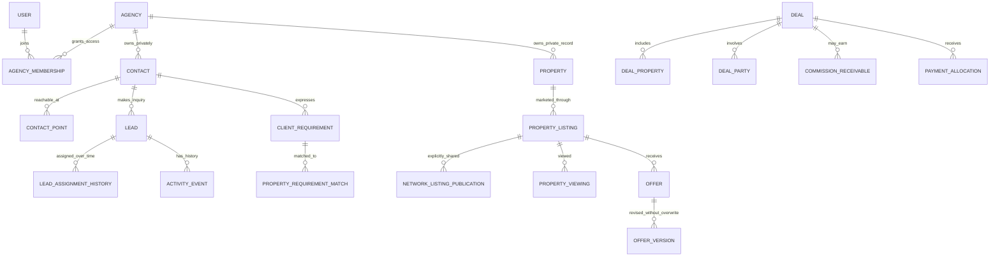

# Sellmore Target Database Architecture

**Status:** Conceptual target architecture only. All structures below are proposals, not verified current tables or migration DDL. No SQL was generated or executed.  
**Evidence:** [Legacy database audit](SELLMORE_LEGACY_DATABASE_AUDIT.md), [master architecture](../SELLMORE_MASTER_ARCHITECTURE.md), [domain model](../SELLMORE_DOMAIN_MODEL.md), and [module migration matrix](../SELLMORE_MODULE_MIGRATION_MATRIX.md).  
**Design rule:** Evolve the existing MariaDB-backed CRM through adapters and additive structures after backend verification. Do not constrain Sellmore to the legacy schema, and do not assume the separate website PostgreSQL schema is the CRM system of record.

## Design Principles

1. **Agency-private by default.** Every private record has a verified agency/tenant owner. A `company_id` value is not automatically a tenant ID.
2. **Preserve identity and history.** Keep legacy IDs, routes, issued documents, and finance history accessible through mappings. Do not collapse a lead, person, listing, project unit, sale form, or payment just because labels look similar.
3. **Separate identity from workflow.** Person/contact, inquiry/lead, assignment, requirement, property, listing, activity, task, offer, deal, payment, and commission are separate concepts with explicit links.
4. **One authoritative writer per operation.** Domain adapters provide compatibility; avoid uncontrolled dual writes.
5. **Additive and reversible.** Expand, backfill, validate, switch reads, switch one writer, observe, and only then consider retirement.
6. **No blind constraints.** Existing ID columns often have no FKs. Profile actual data and application behavior before adding any DB constraint or uniqueness rule.
7. **Modular monolith first.** Domain boundaries do not require immediate microservices, separate databases, search engines, or event brokers.

## Target Relationship Overview

This is a conceptual map. Every join that crosses agencies requires an explicit publication, grant, agreement, or reviewed process. A null agency ID must never mean public.

## A. SaaS Tenancy and Organization

**Target structures:**

- `agencies` / `tenants`: stable Sellmore tenant ID, lifecycle, primary contact, verified legacy mapping, status reason, created/closed timestamps.
- `agency_settings`: versioned locale, timezone, data policies and approved configuration.
- `agency_branding_versions`: validated logo/colors/contact and template references; issued documents pin a historical branding version.
- `branches`, `departments`, `teams`: agency-scoped organization records with stable IDs and effective dates.
- `users`: authentication subject, independent of employment record and agency membership.
- `agency_memberships`: user-to-agency relationship, status, effective dates, invitation/activation/revocation actor.
- `employee_profiles`: HR/employment data linked to membership only where the person is an employee.
- `team_memberships`, `reporting_relationships`: effective-dated membership/reporting hierarchy; prevent cycles, preserve history.
- `roles`, `permissions`, `role_permissions`, `membership_role_grants`: semantic resource/action/scope policy. Keep current numeric feature IDs in a compatibility map during transition.
- `plans`, `plan_versions`, `features`, `plan_entitlements`, `agency_subscriptions`, `entitlement_overrides`, `usage_events`, `usage_periods`, `subscription_events`: versioned plans, limits, feature access and auditable usage. AI/media credits and seat/storage/marketplace quotas are entitlement dimensions, not hardcoded UI switches.

**Isolation:** agency ownership and authorization must apply to reads, joins, writes, files, caches, exports, search, notifications and background jobs. Compare shared-table, separate-schema and separate-database deployment options only after confirming actual production engine, tenant count, operations and restore requirements. Platform administration is a separate realm; support access is explicit, scoped, time-limited and audited.

## B. Canonical Contact, Client and Lead

**Contact model:**

- `contacts`: agency-scoped person or organization identity, display name and lifecycle; does not encode every sales status.
- `contact_points`: phone/email/channel address, raw value, normalized value, country/context, verification and primary flag. Do not assume every phone is unique or belongs to one person.
- `contact_roles`: Buyer, Seller, Investor, Tenant, Landlord, Broker, Developer Representative, Referral Partner, etc., with effective dates.
- `contact_addresses`, `contact_preferences`, `contact_tags`, `contact_consents`, `contact_sources`: normalized supporting facts and provenance.
- `contact_duplicate_candidates`, `contact_merge_reviews`, `contact_merge_history`: evidence, reviewer, before/after legacy links and reversible/compensating actions. Candidates never auto-merge clients or financial records.

Canonical identity is initially agency-scoped. A global cross-agency private contact directory is not proposed. Network collaboration exposes only an allowlisted, authorized projection.

**Lead workflow:**

- `leads`: inquiry identity, agency, contact link (nullable until reviewed), intake source, received time, requested purpose, current pipeline stage, temperature and data-quality state.
- `lead_sources`, `campaigns`, `campaign_touches`, `lead_intake_events`: controlled source taxonomy, campaign/ad/UTM/provider identity and import provenance.
- `lead_assignments`: current assignment projection; `lead_assignment_history`: immutable from/to, team, actor, method, reason, policy, effective start/end and correlation/idempotency key.
- `lead_status_history`: previous/new stage, actor/time/reason and interval; status is not a temperature or data-quality flag.
- `lead_temperatures`: HOT/WARM/COLD and optional policy/version/confidence; retain historical changes separately.
- `lead_quality_reviews` or derived quality state: COMPLETE, INCOMPLETE, POSSIBLE_DUPLICATE, INVALID, MANUALLY_FLAGGED, reason and reviewer. Avoid turning a derived label into destructive filtering.
- `lead_lost_reasons`, `lead_tags`, `lead_notes`, `lead_external_refs`: only where verified workflow needs justify them.

The current `customer_leads_tbls`, `leadsimportdatabase`, `import_lead_data`, Facebook tables, and assignment records remain compatibility sources until each API and identity mapping is proven.

## C. Client Requirements

A client can hold many independent requirements. Proposed structures:

- `client_requirements`: owner contact, agency, BUY/SELL/RENT/INVEST purpose, urgency, status, visibility, expiry and source inquiry links.
- `requirement_locations`, `requirement_property_types`, `requirement_sizes`, `requirement_budgets`, `requirement_features`: one-to-many criteria, normalized units/currency and ranges rather than concatenated strings.
- `requirement_assignments`, `requirement_status_history`, `requirement_visibility_grants`: ownership and state history; INTERNAL_ONLY by default, with explicit NETWORK publication.

Keep procurement `purchaseReqForm` separate. Sharing a requirement publishes a minimal protected projection; it must not expose buyer identity, contact information, internal notes or unrelated lead history.

## D. Physical Property and Property Listing

**Physical property:**

- `properties`: canonical physical asset, type, stable agency identity, source/verification state and lifecycle.
- `property_addresses`, `property_locations`, `property_attributes`, `property_features`, `property_media`, `property_documents`, `property_ownership_refs`, `property_verifications`, `property_map_geometry`, `property_history`.
- Geography and unit-size definitions are versioned; preserve raw legacy location/plot/unit text and aliases. A property may lack a plot number, and apartment/building identity may require project/tower/floor/unit.
- Ownership is modeled as effective-dated many-to-many refs with evidence and restricted visibility; a claimed owner is not automatically verified.

**Listing is separate:**

- `property_listings`: property, publishing agency, broker/agent, mandate, transaction type, demand, availability, verification, listing/expiry dates and visibility.
- `listing_agents`, `listing_agencies`, `listing_prices`, `listing_price_history`, `listing_status_history`, `listing_visibility`, `listing_verification`, optional listing-specific media.
- Multiple brokers can list the same physical property. Preserve each listing, price history, mandate and attribution; never deduplicate legitimate listings into one row.
- Network publication is explicit: `network_listing_publications` stores allowlisted/versioned data, expiry, source listing revision, audience and withdrawal state. Owner/client identity and internal price limits remain private by default.

Legacy `projects`, `project_inventories`, `inventory_main_update2`, `inventories`, `inventory_hold`, `inventory_cancelled`, and `inventory_sold` are migration sources, not interchangeable target entities.

## E. Duplicate Property Intelligence and Matching

- `property_identity_keys`: normalized candidate identity by geography/project/structure/unit plus source and confidence; aliases/renumbering remain.
- `property_duplicate_candidates`, `property_listing_clusters`, `property_merge_reviews`, `property_merge_history`: candidate evidence and human review. Similarity never deletes a listing or moves ownership/payment records.
- `property_requirement_matches`: requirement, listing/property, deterministic version, score, EXACT/STRONG/POSSIBLE class, reasons, exclusions, availability checked time, state and user feedback.
- Apply hard authorization, purpose and availability exclusions before rank. Revalidate inventory availability before consequential actions. AI may later rank eligible results but never broaden access or replace deterministic exclusions.

## F. Visits, Offers and Deals

- `property_viewings`, `viewing_attendees`, `viewing_feedback`, `viewing_followups`, `viewing_status_history`: contact/requirement/property/listing/agent/time/status/outcome and reschedule lineage.
- `offers`, `offer_participants`, `offer_terms`, `offer_versions`, `offer_status_history`, `offer_documents`: append-only revisions, counter terms, currency, expiry and authority. Never overwrite negotiated terms.
- `deals`: canonical transaction, agency, type/status, accepted offer reference, close date/price and optional confidential-party mode.
- `deal_properties`, `deal_parties`, `deal_brokers`, `deal_agencies`, `deal_stages`, `deal_stage_history`, `deal_documents`, `deal_closing`: support multi-property, joint parties and inter-agency roles without requiring buyer/seller identity for every minimal record.
- `deal_payment_refs` and `deal_commission_refs` link to accounting structures rather than copying balances into a deal row.

Current `SalesFormdata` and `inventory_sold` stay distinct until finance/inventory owners reconcile meanings and issue an identity mapping.

## G. Commissions and Finance

- `commission_rules` / `commission_rule_versions`: effective-dated base, scope, recipient, rate/tier, policy source, caps and approval.
- `deal_commissions`, `commission_splits`, `broker_commissions`, `agent_commissions`, `referral_commissions`: calculated entitlement and recipient shares.
- `commission_receivables`, `commission_payments`, `commission_adjustments`: payable/paid/disputed/reversed history and finance reconciliation.
- Use explicit currency and fixed decimal precision. Separate gross basis, split, receivable and settlement. No historical balance/commission backfill from UI-only fields.
- Keep legacy chart-of-account/voucher/bank/cheque/receipt/cash tables authoritative until finance identifies and reconciles their roles. Do not normalize receipt families by name.

## H. Broker and Agency Network

- `broker_profiles`, `agency_profiles`, `broker_specializations`, `broker_service_areas`, `broker_verifications`, `broker_reviews`, `broker_trust_metrics`, `broker_trust_score_history`, `broker_connections`, `broker_reports`, `broker_blocks`.
- Verification state distinguishes Unverified, Verified Broker, Verified Agency, Trusted Partner. Trust combines verified evidence, successful collaborations and permitted review signals; public reviews alone are not the trust authority.
- `network_listing_publications`, `network_requirement_publications`, `saved_marketplace_items`, `marketplace_contact_requests`, `marketplace_interactions`: B2B publication/protected contact requests with explicit owner agency, audience, status, expiry and audit.
- `conversations`, `conversation_participants`, `messages`, `message_attachments`, `message_reads`, optional reactions; link to property/requirement/offer/deal through typed references.
- `broker_rooms`, `room_members`, `room_messages`, `room_moderators`, `room_pins`, `room_reports`, `room_mutes`, `room_notification_settings`: category/location, visibility, moderation and membership history. Rooms do not grant access to referenced private records.
- `agency_partner_relationships`, `affiliate_programs`, `affiliate_agencies`, `affiliate_brokers`, `affiliate_invitations`, `affiliate_approvals`, `affiliate_leads`, `affiliate_visits`, `affiliate_bookings`, `affiliate_sales`, `affiliate_commission_refs`: preserve legacy affiliate IDs and isolate claims/records by relationship.

## I. Builder / Developer Platform

- `developers`, `developer_projects`, `project_phases`, `project_towers`, `project_blocks`, `project_floors`, `project_units`, `unit_inventory`.
- `price_lists`, `price_list_versions`, `payment_plans`, `payment_plan_versions`, `developer_commission_plans`, `project_promotions`.
- Explicitly link project unit to physical property where appropriate; a builder unit/inventory state is not a broker listing or generic property ownership record.
- Preserve legacy project IDs and JSON inventory payloads through adapters; only normalize when row profiling and application use are known.

## J. Maps and Newspaper Notices

**Interactive maps:** `map_sources`, `map_versions`, `map_societies`, `map_phases`, `map_sectors`, `map_streets`, `map_plots`, `plot_geometry`, `map_calibration`, `property_map_links`. Version map sources/calibration and record coordinate reference system, provenance, accuracy and review. Exact Society -> Phase -> Street -> Plot search/highlight requires a verified hierarchy and spatial data; no inferred geometry from free text.

**Notices:** `notice_sources`, `property_notices`, `notice_documents`, `notice_extractions`, `notice_properties`, `notice_verifications`, `notice_duplicate_candidates`. Support manual entry and uploaded source first; AI extraction is a later proposal with human verification and provenance.

## K. Documents, Communication and Events

- `documents`, `document_versions`, `document_links`, `document_classifications`, `document_permissions`, `document_verifications`, `document_expiry`: versioned private objects linked to contact/property/listing/requirement/deal/project/broker/agency/notice. Storage IDs and authorized delivery remain backend responsibilities.
- `communications`, `communication_participants`, `communication_channels`, `call_events`, `call_recordings`, `message_events`, `provider_references`: normalize Zong and future providers without deleting source history. Store provider event IDs/idempotency and distinguish attempt from sent/delivered/read/completed.
- `audit_events` / append-only entity history: actor, agency, action, entity type/ID, event time, source, request/correlation reference, and minimized/redacted before/after data where appropriate. Separate restricted security audit from user-visible activity timeline.

## L. Academy, AI and Marketing Studio

- Academy: `knowledge_categories`, `knowledge_items`, `knowledge_versions`, `knowledge_files`, `courses`, `lessons`, `quizzes`, `assessments`, `certifications`, `user_progress`, project/agency audience scopes.
- AI: `ai_conversations`, `ai_messages`, `ai_requests`, `ai_actions`, `ai_action_confirmations`, `ai_results`, `ai_audit_events`, `ai_usage`, `ai_credits`, `ai_generated_assets`, `ai_match_explanations`. Store references, decision metadata, permissions and minimal necessary content; do not retain sensitive prompts by default. Support text and voice as channel/input metadata.
- Marketing Studio: `brand_kits`, `marketing_templates`, `marketing_generation_jobs`, `generated_marketing_assets`, `generated_captions`, `marketing_usage`. Record agency/property/agent, template/version, brand/language/format and job provenance/credits.

## M. Subscription, Usage and Audit

Plan packages (Basic/Free, Business, Business+, Business Pro) are versioned catalog configuration, not branch statements throughout code. Structures include `plans`, `plan_versions`, `features`, `entitlements`, `subscriptions`, `subscription_events`, `usage_events`, `credit_ledger`, and `quota_reservations`. Enforce seats, storage, AI/media credits, marketplace limits and feature access server-side with atomic reservations and auditable adjustments.

Security/audit should also cover login/session history, data export, permission changes, sensitive-field access, entity changes, support access, publication/grant withdrawal and migration jobs. Protect audit integrity and minimize sensitive values.

## Privacy and Indexing Requirements

- Agency-private by default. Separate tenant-owned source records from network publication projections and collaboration grants.
- Enforce authorization before search/match/AI retrieval, not after results are assembled. Permission-filter counts and snippets too.
- Sensitive identity, contact, HR, finance and document fields need field/object policy; public or partner view is an explicit projection.
- Preserve legacy IDs through a mapping namespace `(source_system, source_table, legacy_id, verified_agency)`; do not impose global uniqueness on phone or IDs.
- Candidate future index families, subject to query-plan evidence: `(agency_id, normalized_phone)`; lead agency/status/assignment-date; assignment agency/agent/date; listing agency/visibility/status/location/type/price; map location hierarchy/plot key and spatial index if supported; requirement agency/status/purpose/location; conversation agency/participant/created date; audit agency/entity/time. Validate write cost, cardinality, collation and engine capability before adoption.
- Search indexing and cache keys include tenant and effective permission scope. Revoke/update invalidates caches and read models.

These concepts extend the current system; they do not authorize DDL or a database-engine decision. See the migration plan for sequencing and release gates.

## Current Support vs Sellmore Requirements

The classifications below refer to the supplied DDL, not runtime API behavior. “Supported” means a recognizable current structure exists; it does not certify completeness, integrity, security, or a working UI integration.

| Sellmore capability | Current database classification | Evidence / gap |
|---|---|---|
| Agency/tenant isolation | PARTIALLY SUPPORTED | company/branches/departments exist, but no verified tenant membership, tenant lifecycle, ownership policy, subscriptions, entitlements, quotas or network isolation. |
| Users, roles, permissions | PARTIALLY SUPPORTED | employees/users, several role and permission families exist; identity realms and effective server scopes are not reconciled. |
| Teams and reporting | LEGACY STRUCTURE CAN BE ADAPTED | empteam and empTeam duplicate; teamObj is opaque text; reportto and employee ReportTo are separate. |
| Contacts/clients | MAJOR DOMAIN REFACTOR EVENTUALLY REQUIRED | lead/customer payloads embed contact details; no canonical contact point/role/consent/address model or verified person identity. |
| Leads/intake | PARTIALLY SUPPORTED | customer_leads_tbls, import and Facebook tables represent multiple lead-like sources; common identity/status/source/quality rules are not established. |
| Assignment and history | PARTIALLY SUPPORTED | leadsassigndatabase and transfer table contain assignment-shaped data; no verified append-only, effective-dated assignment history contract. |
| Temperature/data quality/status | NEW TABLE/ENTITY REQUIRED | legacy LeadStatus mixes hot, My Lead, Not Interested; no separate temperature or quality model/history. |
| Activities/reminders/tasks | PARTIALLY SUPPORTED | customer_activities, assign_reminders and task families exist; relationship types, chronology, scope and history integrity need adapters. |
| Calling/communication | PARTIALLY SUPPORTED | Zong and callingimpression evidence exists; normalized channels, threads, provider events, delivery, consent and recordings policy do not. |
| Multiple client requirements | NEW TABLE/ENTITY REQUIRED | budgets/preferences embedded in lead-like records; no multi-requirement-per-client model, visibility, expiry, assignments or history. |
| Projects/builders | LEGACY STRUCTURE CAN BE ADAPTED | projects and project tables exist; builder organization, typed hierarchy, versioned price lists/payment plans/promotions remain incomplete. |
| Physical property | NEW TABLE/ENTITY REQUIRED | inventory rows are project/unit stock and do not establish canonical physical-property identity or ownership. |
| Multiple broker listings per property | NEW TABLE/ENTITY REQUIRED | no listing/mandate/price-history/visibility model. |
| Duplicate property intelligence | NEW TABLE/ENTITY REQUIRED | no identity-key, candidate, cluster or review history. |
| Requirement matching | NEW TABLE/ENTITY REQUIRED | no persisted candidate score/reason/version/feedback. |
| Viewings/site visits | PARTIALLY SUPPORTED | activity meeting fields exist, but no property-specific viewing lifecycle and attendee/feedback history. |
| Offers/negotiations | NEW TABLE/ENTITY REQUIRED | no offer revisions, counter terms, expiry or state history. |
| Canonical deals | PARTIALLY SUPPORTED | SalesFormdata/inventory_sold hold transaction-like data; no canonical multi-party deal/stage/history model. |
| Commission entitlements/splits | PARTIALLY SUPPORTED | sale co-agent and payment details exist; no verified rule/version, split, receivable, paid/dispute ledger. |
| Broker/agency network and directory | PARTIALLY SUPPORTED | affiliate records are a starting point; profiles, verification, trust history, connections and grants are missing. |
| B2B marketplace | NEW TABLE/ENTITY REQUIRED | no explicit publication projections, requirement publications, saved items or contact requests. |
| Broker chat/rooms | NEW TABLE/ENTITY REQUIRED | no conversations, messages, participants or moderation structures in this CRM DDL. |
| Affiliate/channel partners | PARTIALLY SUPPORTED | affiliate registration/leads/activities exist; agency relationship, protection claims, approvals, visits and commission links need extension. |
| Maps/plot geometry | PARTIALLY SUPPORTED | country/city/location/project text exists; no versioned map, street/plot geometry, calibration or property link. |
| Newspaper notices | NEW TABLE/ENTITY REQUIRED | no notice source/document/extraction/verification model. |
| Document management | PARTIALLY SUPPORTED | document lookup, security file and release log exist; no general version/link/classification/permission/expiry model. |
| Finance/accounting | PARTIALLY SUPPORTED | chart, vouchers, cash/bank/receipt/plan families are broad; proper ledger relationships, precision and receipt semantics require finance/backend evidence. |
| HR | PARTIALLY SUPPORTED | employee, attendance, leave, payroll, training and lifecycle structures exist; privacy, date typing, membership and certification gates remain. |
| Academy/certification | PARTIALLY SUPPORTED | training assignments/types exist; courses, lessons, assessment attempts, versioning, certificates and access policy are absent. |
| AI/Copilot/voice | NEW TABLE/ENTITY REQUIRED | no CRM AI request/action/audit/usage/credit model. The adjacent website's AI route is separate evidence. |
| Marketing Studio | NEW TABLE/ENTITY REQUIRED | lead campaign/spend and pricing/content tables are partial; no generated asset/template/brand/job/usage lineage. |
| Subscriptions and quotas | NEW TABLE/ENTITY REQUIRED | no plans, subscription lifecycle, entitlement snapshots, usage or credit ledger. |
| Audit/security history | PARTIALLY SUPPORTED | table_activities_log, task history and timestamps exist; no comprehensive tenant/action/entity audit, export/sensitive-access history or immutability proof. |

## Proposed Structure Types

These are logical table-shape recommendations. A family may map to a verified existing equivalent after backend discovery; it is not a DDL commitment.

| Domain | Structure type and proposed structures |
|---|---|
| SaaS/tenancy | NEW TABLE: agencies, agency_settings, branding_versions, plans/plan_versions, features, entitlements, subscriptions, subscription_events, usage_events, credit_ledger. EXTEND: verified branch/department/team/company records only where ownership and usage are proven. JOIN: agency_memberships, team_memberships, membership_role_grants. HISTORY: membership/status/entitlement changes. |
| Contacts | NEW TABLE: contacts, contact_points, contact_addresses, contact_preferences, contact_consents. JOIN: contact_roles, contact_tags, contact_sources. HISTORY/AUDIT: contact_duplicate_candidates, contact_merge_reviews, contact_merge_history. |
| Leads | NEW TABLE or ADAPTER TARGET: leads, lead_sources, campaigns, campaign_touches, lead_intake_events, lead_quality_reviews. JOIN: lead_contacts, lead_tags, lead_external_refs. HISTORY: lead_assignments, lead_status_history, lead_temperature_history, lead_lost_reasons. EXTEND/LOOKUP: versioned semantic maps for existing lead/source/status values. |
| Activities/work | EXTEND/ADAPTER: current activities/reminders/tasks. NEW JOIN: activity_entity_links, task_entity_links. HISTORY: activity_events, reminder_state_history, task assignment/status histories where existing equivalents do not satisfy audit needs. |
| Requirements | NEW TABLE: client_requirements, requirement_locations, requirement_property_types, requirement_sizes, requirement_budgets, requirement_features, requirement_assignments, requirement_visibility_grants. HISTORY: requirement_status_history. LOOKUP: purpose, urgency, status and unit catalogs with stable codes. |
| Property/listing | NEW TABLE: properties, property_addresses, property_attributes, property_features, property_media, property_documents, property_verifications, property_ownership_refs; property_listings, listing_prices, listing_verifications. JOIN: property locations/owners, listing_agents, listing_agencies. HISTORY: property_history, listing_price_history, listing_status_history, listing_visibility history. EXTEND/ADAPTER: legacy project inventory IDs. |
| Duplicate/matching | NEW TABLE: property_identity_keys, property_duplicate_candidates, property_listing_clusters, property_merge_reviews, property_requirement_matches. HISTORY: merge/match decisions and feedback. LOOKUP/VERSION: deterministic match rules and score version. |
| Visits/offers/deals | NEW TABLE: property_viewings, viewing_attendees, viewing_feedback, offers, offer_terms, deals, deal_stages. JOIN: viewing follow-ups, offer participants, deal_properties, deal_parties, deal_brokers, deal_agencies. HISTORY: viewing/offer/deal stage histories and immutable offer_versions. |
| Commission/finance | EXTEND/ADAPTER: verified current ledger/register families. NEW TABLE: commission_rules/versions, deal_commissions, commission_receivables, commission_payments, commission_adjustments, payment_allocations only where no canonical equivalent exists. JOIN: commission_splits and recipient links. HISTORY/AUDIT: policy snapshots, approvals, settlement/reversal events. |
| Broker/network | EXTEND: affiliate compatibility identity. NEW TABLE: broker_profiles, agency_profiles, broker_verifications, broker_trust_metrics/history, broker_connections, broker_reports, network_listing_publications, network_requirement_publications, marketplace_contact_requests/interactions. JOIN: agency_partner_relationships, publication grants, saved marketplace items. HISTORY: approvals, disputes, publication/revocation. |
| Chat/rooms | NEW TABLE: conversations, messages, broker_rooms, room_messages. JOIN: conversation_participants, room_members/moderators, typed property/requirement/offer/deal references. HISTORY: message reads, moderation reports, mutes/pins/settings as justified by product usage. |
| Builder/maps/notices | EXTEND/ADAPTER: projects and existing units. NEW TABLE: developers, project phases/towers/blocks/floors/units, price list versions, map sources/versions/plots/geometry/calibration, property notices/sources/documents/extractions/verifications. JOIN: property_map_links, notice_properties, affiliate bookings/sales. HISTORY: project price/inventory/approval and notice extraction/review. |
| Documents/communication | EXTEND/ADAPTER: security_files, releasefilelog, Zong data. NEW TABLE: document_versions, document_links, classifications, permissions, provider references, communication channels/events/participants. HISTORY/AUDIT: access/download/print, provider delivery and retention events. |
| Academy/AI/marketing | EXTEND/ADAPTER: trainings and existing collateral. NEW TABLE: knowledge versions/files, courses/lessons/quizzes/assessments/certifications/progress; AI conversations/messages/actions/confirmations/results/usage/credits/audit; brand kits/templates/generation jobs/assets/usage. JOIN: audience, agency, property and user access links. HISTORY: course/certificate, AI-action confirmation and asset versions. |
| Security/audit | NEW AUDIT TABLE: audit_events, login/session events, data_export_events, permission_changes, sensitive_field_access, migration_job_events. JOIN: event entity references. Append-only/history controls must be designed in the verified backend; a table name alone does not make records immutable. |

For every proposed structure, retain source provenance, agency scope, stable ID strategy, actor/time fields and explicit access policy as appropriate. Avoid duplicating sensitive contact/financial data into search, AI or network projections.
